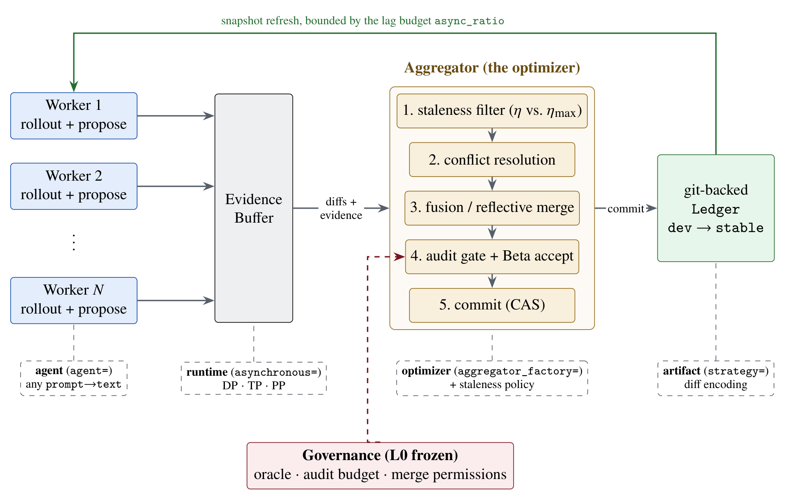
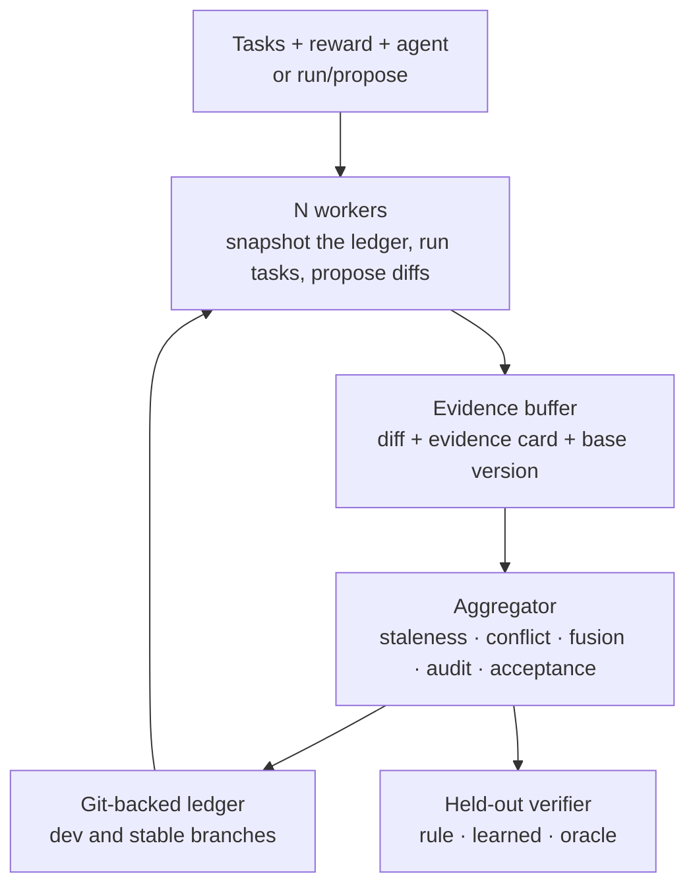

# AgentDescent, explained simply

**One-page summary:** [`agentdescent-onepages.svg`](agentdescent-onepages.svg).

*As of 28 November 2026. Sources: the repository at `main@a52a2470`, version 0.11.0, its README, architecture, concepts, evolution, MCP, plugin, algorithm and results documentation. AgentDescent is built by another team in the company. This note is context, not our roadmap.*

## The short version

- **AgentDescent is a framework for improving the things around an agent** — prompts, skills, skill libraries, agent directories, agent code and host plugins — from examples.
- It does **not train model weights**. It runs tasks, scores the results, asks workers to propose edits, merges the edits that survive a held-out test, and keeps the result in a git-backed ledger.
- The core bet is **throughput**: instead of one improvement per serial loop, N workers propose in parallel and one aggregator merges their diffs.
- You can use it from **Python** (`evolve()`), the **CLI**, an **MCP server**, or inside **Claude Code, Codex, OpenCode, DeepSeek Harness or Grok Bot**.
- It is a **research reference implementation, not a production system**. Version 0.11.0 was released on 20 November 2026; the repository is active daily. It is MIT-licensed, with one Apache-2.0 algorithm port.
- It ships **23 algorithm ports** (8 benchmark-faithful, 15 mechanism microports) and a **zero-key offline demo** that runs in about ten seconds.

## What it looks like



*One round: several workers try a change, one aggregator merges them, and a test on unseen tasks decides what is kept.*

## What it is

The project’s one-line description is “gradient descent, but the parameters are agents.” That is an analogy, not literal training.

In normal model training, a gradient tells you how to change the weights. Here, a worker runs some tasks against an artifact, sees what failed, and proposes a **diff** — a change to a prompt, a skill file, a directory or some agent code. The diff comes with an **evidence card**: what was run, what the reward was, and why the change should help.

N workers do this in parallel. One **aggregator** decides what to keep: it discards stale diffs, resolves contradictory ones, fuses complementary ones, optionally sends the candidate to an audit, and commits only if the held-out reward improves with enough statistical confidence. The artifact lives in a **git-backed ledger**, so every accepted change has a version, a parent and a history.

The important consequence: **diffs do not add**. You cannot average two prompt changes. The optimizer is a discrete process of conflict resolution, fusion, acceptance and commit — not a vector sum.

## The three-function contract

The smallest useful run needs three things from you:

1. **A way to run a task.** Call your existing agent, or a model, with the current artifact.
2. **A way to score the output.** A reward function returning a number between 0 and 1.
3. **A way to propose on failure.** Look at a failed rollout and say what should change.

In Python it looks like this:

```python
from agentdescent import Task, evolve

tasks = [Task(id=f"t{i}", prompt=f"item {i}") for i in range(12)]

def reward(task, output):
    return 1.0 if "2026" in output else 0.0

def run(rendered, task):
    return "answer" + (" 2026" if "year" in rendered else "")

def propose(rendered, task, output, reward):
    return "always state the year"

result = evolve(tasks, reward, run=run, propose=propose,
                rounds=6, n_workers=3, max_concurrency=3)
```

`result.rendered` is the evolved artifact, `result.final_reward` is the held-out score, and `result.error` says whether the run ended cleanly. `evolve()` also accepts an `agent=` object, a `Strategy`, a `Policies` bundle, budgets and an async runtime.

The contract is deliberately small. The framework is not a new agent loop; it is a loop around your agent that improves the artifact it runs with.

## The loop



The steps in plain words:

1. **Workers take a snapshot.** Each worker reads the current artifact and runs a task or a small batch. It never writes the shared ledger directly.
2. **A worker proposes a diff.** The diff is tied to the base version it was computed against. The evidence card records the score, the task and the failure.
3. **The aggregator filters staleness.** If the head moved while the worker was running, the diff may be accepted, rebased onto the current head and re-checked, or discarded. The shipped policies are **Full** (accept anything), **Guarded** (rebase within a tolerance) and **Reflective** (always rebase and re-verify).
4. **It resolves conflicts and fuses.** Two workers may edit the same key in different ways; one may be dropped, or a model may merge them. Complementary edits can be fused.
5. **An audit can veto.** Before acceptance, a candidate can be sent to an oracle with a budget. The governance layer marks the change by blast radius: L0 is frozen, L1 is fast-moving, L2 is broader. The audit is a gate, not a spot-check.
6. **Acceptance is statistical.** The candidate is kept only if the held-out reward is likely to have improved. The default is a Beta posterior test. A candidate that merely looks better on the tasks the workers already saw does not commit.
7. **Commit.** The accepted artifact is written to the ledger with a compare-and-swap, and the change is broadcast to the workers. The `dev` branch moves quickly; `stable` is confirmed over clean rounds.

The **held-out split** is the main defence against overfitting. You give the framework tasks; it keeps some back for the gate. The worker proposes against the training side; the gate decides on the unseen side.

## What can evolve

The artifact is not the model. It is whatever the `Strategy` says it is:

| Artifact | What changes |
|---|---|
| **Text prompt** | A system prompt or instruction block, often a single slot. |
| **Skill directory** | A folder with `SKILL.md` and supporting files. |
| **Skill library** | A multi-file library of related skills. |
| **Agent directory** | An agent workspace: instructions, configuration, tools and assets. |
| **Agent code** | Program code that implements an agent, gated by tests. |
| **Host plugin** | A plugin or integration for a host such as Claude Code or DeepSeek Harness. |

The shipped strategies include `SingleSlot`, `AppendRules`, `KeyedRules` and `FileTree`. The key space is what the aggregator merges over; a single-slot prompt has no room for parallel merging, which is why the CLI warns that extra workers buy best-of-N selection rather than a merge.

## The product surfaces

**Python.** `pip install agentdescent`, define `tasks`, `reward`, `run` and `propose`, and call `evolve()`. The package is small in dependencies — `numpy` is the only runtime dependency — and the test suite is offline and deterministic.

**CLI — Path A.** The default loop is:

```text
demo → doctor → init/plan → evolve/start → status → show → apply
```

- `agentdescent demo` runs a complete evolution offline, with no API key. It builds a skill whose rules name the wrong CSV column, runs twelve cases against a local program, and ends with held-out reward `0.000 → 1.000`; the learned rule is `rules.md -> 'COLUMN: amount'`.
- `doctor` reports which agent CLIs and provider keys the machine has.
- `plan` validates a spec and estimates cost; `plan --probe` sends one minimal call per model so a dead key or endpoint is refused before the run is created.
- `evolve` runs the loop with optional `--max-calls` and `--max-usd` caps.
- `status`, `show`, `apply` inspect and write the result. **`apply` is destructive**; it backs up first, and nothing is written back before you ask.

**MCP — Path A.** The MCP server exposes the same loop to a host agent: `demo`, `doctor`, `list_algorithms`, `describe_algorithm`, `algorithm_spec`, `plan`, `start`, `status`, `show`, `apply`, `cancel`, `resume`, `diagnose`. The default MCP discovery set is deliberately small; advanced tools are opt-in with `agentdescent mcp --advanced`.

**Host plugins.** `agentdescent install dsh|claude-code|codex|opencode|grok-bot` writes a shared skill and the host’s MCP configuration. `doctor` reports whether an install is current, stale or partial; `uninstall` removes only what the installer wrote. Grok Bot has no one-click local plugin API, so its scaffold is a skill plus a documented HTTP MCP route.

## Safety and governance

The project takes self-modification seriously, within the limits of a research framework:

- **A held-out gate** decides what is kept; the training reward alone is not enough.
- **An audit gate** can veto a candidate before acceptance; it is not a post-commit spot-check.
- **L0/L1/L2 governance** separates frozen, fast-moving and broader changes by blast radius.
- **Budgets** cap calls, dollars, seconds and rollouts; a budget stop ends the run cleanly instead of overshooting.
- **Operation identity and receipts** make retries safe: the same ID and input return the original result; different input is refused.
- **Apply backs up first**, and credentials come from environment variables at call time, never from code or a spec.
- **The tests are offline and deterministic**; real-model checks are opt-in and reported as not run when skipped.

Two limits are worth stating plainly:

- **A wrong reward is optimized correctly.** If the score does not measure what you want, the framework will improve the score, not the product.
- **It is a research reference implementation.** The README says the novelty is a narrow engineering synthesis and the throughput premise is a testable hypothesis, not community consensus. It is not a production system.

## Algorithms and evidence

The repository ships **23 algorithm ports**. Eight are benchmark-faithful: ACE, GEPA, EvoSkill, SkillOpt, ADAS, DGM, OpenEvolve and ERA. Fifteen are mechanism microports or analogues, including PromptBreeder, AFlow, Self-Refine, Reflexion, SICA, Gödel Agent, Voyager, SkillWeaver, Absolute Zero, R-Zero, Agent0, gskill, TextGrad, Dynamic Cheatsheet and Genesis.

The measured results are on the project’s own datasets, with `deepseek-v4-flash`:

- 40 HotpotQA items, 12 held out: held-out exact match **0.167 → 0.583** in four rounds (338 calls, ~25 minutes).
- A two-step word-problem agent scored in integer cents: **0.250 → 1.000** in one round when the reflector can see the expected answer in `meta`; the learned rule generalised rather than memorised.
- Thread parallelism with 8 threads on real API calls: **5.8×**; a whole `evolve()` run: **1.8×** on 8 workers; barrier-free dispatch: **2.65×**.
- Gate concurrency 1 → 8: **3.6 s → 1.2 s**.

These are project-reported results, not an independent audit. The results page also records the runs where there was nothing left to learn, and the cases where a difficulty knob calibrated on one model did not transfer to another.

## What is product, and what is advanced

The package has more modules than the default product path uses. The project’s own map is:

- **Path A — evolve one artifact.** The `evolve()` / `async_evolve()` loop, strategies, policies, verifier, ledger and run store. This is what the CLI and MCP `plan/evolve/status/show/apply` use.
- **Path B — governed release.** Trust evidence, promotion, signed release records, admission.
- **Path C — continuous platform.** Durable loop, five-layer platform, multi-cycle campaigns.
- **Advanced layers.** Capability growth, tenancy, operations, meta-learning and governed harness.

These are control, evidence and memory layers around the same engine, not 23 different optimizers. The default path is much smaller than the repository suggests.

## Status and limits

- **Version:** 0.11.0, released 20 November 2026; `main` at 28 November.
- **Licence:** MIT, with the RRSI port under Apache-2.0.
- **Python:** 3.9+ for the library and CLI; 3.10+ for the MCP extra.
- **Dependencies:** `numpy` for the prediction-powered estimator; the rest is standard library.
- **Maturity:** research reference, not production; active daily; a single maintainer and an agent-heavy PR process.
- **Not included:** a hosted service, a general workflow platform, a training system for model weights, or a guarantee that a reward/verifier is correct.
- **Operational limits:** real runs cost model calls; `apply` changes files; host installs write configuration; self-modification needs governance, not just a good prompt.

## How it relates to OpenDirector and our products

| Product | Relationship |
|---|---|
| **OpenDirector** | Same public repository owner (ThinkFlowLab), adjacent layer. OpenDirector is a video creation app; AgentDescent is a tool for improving the prompts, skills and agent artifacts behind such an app. In principle it could evolve OpenDirector’s built-in skills or host plugin from examples, but there is no shipped integration in either repository. |
| **openJiuwen / JiuwenSwarm** | AgentDescent is runtime-agnostic: it can wrap a JiuwenSwarm agent in `run`/`propose` and evolve the prompt, skill or directory around it. There is no JiuwenSwarm host plugin today, and it is not built on JiuwenSwarm. |
| **DigitalMate** | A consumer assistant app; AgentDescent is not an app. It could be used offline to improve DigitalMate’s skills or prompts, but that would be a separate integration. |
| **PPMA** | A memory-first manager; AgentDescent could evolve its decision prompts or skill artifacts, but the two do not share a runtime today. |
| **Orbit** | A desktop agent workspace; AgentDescent could improve the prompts and skills used inside it, but it is not part of Orbit’s runtime. |

The closest description is: **AgentDescent is a capability foundry for agents.** It sits below the app layer and above the model: it improves the artifacts an agent uses, then returns them to the host.

## Why it matters to us

- **It is a concrete implementation of self-improvement with an evaluation gate.** The interesting part is not “agents edit prompts”; it is the merge, staleness, acceptance and audit machinery around that idea.
- **It treats evaluation as the bottleneck.** Held-out gates, audit vetoes, budgets and evidence cards are the product, not extras.
- **It is host-portable.** The same engine is exposed to Claude Code, Codex, OpenCode, DeepSeek Harness and Grok Bot, and to any Python caller.
- **It is a useful test case for JiuwenSwarm.** If we want JiuwenSwarm skills to improve from examples, the questions AgentDescent forces are the right ones: what is the artifact, what is the reward, what is held out, what is allowed to change, and what is the evidence?
- **It is early.** The throughput hypothesis is not settled, the 23 ports are research code, and the project says it is not production. Treat it as a reference design, not a dependency to adopt without a pilot.

## Open questions

- **Does merge-of-N beat best-of-N at equal budget?** The project has a baseline module for this, but the evidence is early and project-reported. Independent replication would matter.
- **How good is the verifier?** The whole loop inherits the reward’s blind spots. A weak or gameable scorer will produce a confident, wrong artifact.
- **Will hosts adopt it as a plugin, or will it stay a CLI/research tool?** The host integrations are thoughtful but configuration-heavy.
- **Does the 23-port fidelity survive?** The project distinguishes benchmark-faithful ports from mechanism microports; that honesty is useful, but it also means most ports are not the full published method.
- **Will it connect to JiuwenSwarm or OpenDirector?** Both would be natural pilot hosts, but neither is wired today.
- **What is the production path?** v0.11 is pre-1.0; release, tenancy, governed harness and platform layers exist but are advanced, not the default.

## Sources

- README: <https://github.com/ThinkFlowLab/agentdescent>
- Architecture: `docs/architecture.md`
- Concepts: `docs/concepts.md`
- `evolve()`: `docs/evolution.md`
- MCP / CLI Path A: `docs/mcp-path-a.md`
- Host plugins: `docs/plugins.md`
- Algorithms: `docs/algorithms.md`
- Self-evolution ports: `docs/self-evolution-examples.md`
- Results: `docs/results.md`
- Main path vs advanced modules: `docs/main-path.md`
- Package metadata: `pyproject.toml`, `agentdescent/__init__.py`
