# Belle, explained simply

**One-page summary:** [`belle-onepages.svg`](belle-onepages.svg).

*As of 28 November 2026. Sources: the repository at `main@6499441`, version 1.0.0, its README, configuration, scopes, Second Brain, skills, feature-matrix and JiuwenSwarm integration documentation. Belle is built by another team in the company. This note is context, not our roadmap.*

## The short version

- **Belle is an AI coworker for team chat.** It sits inside Slack, Mattermost, Matrix or Discord, answers from team knowledge, welcomes new members, digests shared reading, and stays quiet when it has nothing useful to add.
- It is **one Belle for the team**, not one assistant per person. In a shared room it answers once.
- It sits between the chat platform and **one agent harness**. The harness runs the turn; Belle decides when to speak, what the channel and the person may use, and whether the reply needs approval.
- It has a **Second Brain**: it reads documents and links shared in selected channels, summarizes them, and recalls them when a question needs them.
- It is **version 1.0.0**, Apache-2.0, Python 3.11+. The primary harness is **JiuwenSwarm**; OpenCode v2, Docker Agent and ACP are experimental.
- It is a concrete **app on top of JiuwenSwarm**, not a new agent platform.

## What it looks like



*The core argument, drawn by the Belle team: one shared assistant instead of five competing ones. The drawing is animated when opened in a browser.*



*Audience and approval rules in practice: a wider audience needs a person's yes, and a named approver can be required.*

## What it is

Belle is a participant in a team’s chat, not a separate chat app. People talk in a channel; Belle reads along, decides whether it can help, and either answers once or says nothing. The same team can have many people and many rooms without many competing assistants.

The product is built around four ideas:

| Idea | What it means |
|---|---|
| **One Belle for the team** | Five people should not mean five agents. A shared assistant answers once instead of flooding the room. |
| **Quiet until it can help** | In an ambient channel, Belle reads the conversation and speaks only when it has something useful to add. Silence is a decision. |
| **It knows who is in the room** | Rules per channel and per person say what Belle may do. Before posting to a wider audience than the one the content came from, it asks a person. |
| **It works on a schedule and in the background** | It posts scheduled digests, starts long work, answers other questions meanwhile, and posts the result when it finishes. |

It is not a model and not an agent harness. It uses one harness for the turn and separate **task models** for decisions and document chores.

## How a turn works

```text
chat message
    → Belle: admit? which scope? speak or stay silent?
    → harness: run one turn with the chat model and tools
    → Belle: post, ask, approve, or stay silent
```

Belle:

1. Reads the message and the conversation context.
2. Applies the **scope** rules for that channel, person and chat type.
3. Decides whether to answer at all.
4. Starts a turn on the configured harness, with the allowed skills, tools and model.
5. Posts the reply, asks a question, waits for an approval, or stays silent.
6. For a long task, posts progress and returns the result later.

The harness is the program that runs the agent loop. Belle is the layer that decides *whether*, *where* and *under what rules*.

## Ambient mode

In a shared channel, Belle can be set to read every message and decide whether to speak. That is the “ambient” mode. It is not always-on chatter; the default error is silence.

The project tested this on 100 conversations: half should get a reply, half should stay silent, split into easy and hard cases. The reported result is **89% accuracy**, with **8 false negatives against 3 false positives** — when in doubt, Belle stays silent. That is the right bias for a team channel, but it also means it will miss some useful moments.

## Audience and approval rules

The most important safety idea is the **audience rule**. Each scope says what Belle may read, what it may post, and who may approve an action.

- A rule can be per channel, per chat type, per person or per role.
- Before Belle posts to a conversation that has more readers than the one the content came from, it asks a person.
- A rule can make an action wait for one named person’s approval. In the example, only David can approve an Ops action; Bob’s click is refused and the request waits for David.
- On Slack, `enforce_audience: false` turns the wider-audience check off. That is a deliberate choice, not the default.
- **Second Brain recall is different:** it has no audience check. A document recalled from a private channel can enter a turn in a wider channel. The docs say this plainly, and it is the main privacy caveat.

## The Second Brain

The Second Brain is Belle’s memory of the documents and links people share.

- It ingests from selected channels: public channels, named channels, or every channel Belle receives.
- It reads PDFs, Word documents, spreadsheets, JSON, HTML and plain text. It fetches public links, but refuses private or local addresses and links with credentials.
- It stores the original file, the extracted text, a Markdown summary and a search index. A document is identified by the SHA-256 of its bytes, so it is not ingested twice.
- At the start of a turn, Belle searches the summaries and adds the best matches to the turn. The model also has `brain_search`, `brain_read` and `brain_list` tools.
- The corpus is plain text on disk. An end-to-end encrypted room is ingested only when its ID is explicitly selected; `public` and `*` do not select it.

The project tested it on two benchmarks:

| Benchmark | Result |
|---|---|
| I,-knowledge (customer-service tasks) | Second Brain **56.7%** vs All Tools **54.6%** |
| EnterpriseRAG-Bench, 500 Confluence documents | Second Brain **57/64 correct**, **90.0% completeness**, **85.2 combined**, **97.6% doc recall**; baseline RAG 57/64, 74.3%, 71.8%, 91.9%; gold documents 57/64, 87.9%, 87.1% |

These are project-reported results from `muse-spark-1.3`; they are not an independent audit. The interesting part is that Second Brain matches the baseline’s correct answers with more complete answers, close to the gold-document ceiling.

## Skills and scopes

Belle’s behaviour is shaped by **skills** and **scopes**.

- A skill is a packaged instruction set, such as `messaging-context`, `group-chat-participation`, `session-work`, `welcome-onboarding`, `reading-digest`, `chat-digest` or `slack-daily-update`.
- A scope is a rule for a channel, chat type, person or role. It chooses the delivery mode, the skills the turn may use, the tools it may call, and who may approve.
- Narrower rules beat broader ones; at equal specificity the later rule wins. Tool restrictions combine to the strictest level.
- A scope can require a skill, make a skill unavailable, or restrict the tools to `allow`, `ask` or `deny`.

The result is a team assistant that behaves differently in a public channel, a private channel, a direct message and an incident room, without a separate bot for each.

## Platforms and harnesses

| Platform | Status |
|---|---|
| **Slack** | Primary; tiered app manifests, Socket Mode, App Home, lists, canvases, charts. |
| **Mattermost** | Experimental. |
| **Matrix** | Experimental; supports end-to-end encrypted rooms, with the limits that implies. |
| **Discord** | Experimental. |

| Harness | Status |
|---|---|
| **JiuwenSwarm** | Primary; the matching `belle/20261013` branches. |
| **OpenCode v2** | Experimental. |
| **Docker Agent** | Experimental. |
| **ACP** | Experimental; any agent that speaks the Agent Client Protocol. |

The feature matrix is honest about the gaps. On JiuwenSwarm, for example, scheduled jobs deliver to Slack only, detached sessions and `/belle bg` are not available, and Mattermost Second Brain only recalls, it does not ingest. On JiuwenSwarm, a scope that sets `permissions.tools` refuses every Slack and Mattermost tool call, because the DeepAgent scheduler task does not carry the conversation context Belle needs. These are integration limits, not marketing copy.

## The JiuwenSwarm connection

This is the part most relevant to us: **Belle is built to plug into JiuwenSwarm**.

- It installs as application extensions: the agent plugin, a Slack connector that replaces JiuwenSwarm’s built-in one, and a Second Brain adapter. Mattermost and Matrix are optional extensions.
- It uses JiuwenSwarm’s Gateway and AgentServer, its rails, skills and tools, and its model configuration.
- It uses the matching `belle/20261013` branches of JiuwenSwarm and agent-core.
- It reads Belle’s YAML config at `~/.config/belle-agent/config.yaml`, or `BELLE_AGENT_CONFIG_FILE`.
- It can also run with its own launcher and other harnesses, but JiuwenSwarm is the primary path.

That makes Belle a concrete example of an app on top of our platform: the platform runs the agent; Belle decides when to speak, which skills and tools apply, and what can be said to whom.

## Status and limits

- **Version 1.0.0**, Apache-2.0, Python 3.11+.
- **Active**: `main` was at 26 November 2026 when this note was written.
- **Primary path:** Slack + JiuwenSwarm. Most other platform/harness combinations are marked experimental.
- **Second Brain privacy:** the corpus is plain text; encrypted rooms need explicit selection; recall has no audience check. This is the biggest caveat.
- **JiuwenSwarm tool permissions:** a scope with `permissions.tools` refuses Slack and Mattermost tool calls on JiuwenSwarm; the docs tell operators to remove the setting for those turns.
- **Ambient mode** is good but not perfect: 89% on the project’s 100-conversation test, with more misses than false alarms.
- **Not a general chat platform.** It lives inside one; it does not replace Slack or Mattermost.
- **Not a general agent platform.** It uses one harness at a time; it does not try to be JiuwenSwarm, OpenCode or Docker Agent.

## How it relates to our products

| Product | Relationship |
|---|---|
| **openJiuwen / JiuwenSwarm** | **Direct integration.** Belle plugs into JiuwenSwarm’s Gateway and AgentServer as application extensions, replaces the built-in Slack connector, and uses its rails, skills, tools and models. It is one of the clearest examples of an app built on the platform. |
| **DigitalMate** | Both are agent assistants for people, but the surfaces differ: DigitalMate is a HarmonyOS phone app with a cloud server and a feed; Belle is a participant in team chat, shared by a whole team. DigitalMate runs on WorkSwarm; Belle primarily on JiuwenSwarm. |
| **FlyBot** | Both are team-facing AI products. FlyBot is a self-hosted workspace with its own UI and a DS-Bot per account; Belle is a bot inside existing chat platforms with one harness behind it. FlyBot owns the room; Belle joins the room. |
| **PPMA** | Both have memory. Belle’s Second Brain is a shared document corpus for a team; PPMA is a personal, memory-first manager across apps. Different scope, different privacy model. |
| **Orbit** | No direct relation. Orbit is a desktop workspace where a team and its AI agents work in shared rooms; Belle is a chat participant. |
| **OpenDirector** | Same public repository owner (ThinkFlowLab), different layer. OpenDirector is a local video app; Belle is a team-chat agent. |
| **AgentDescent** | Same owner. AgentDescent improves prompts/skills from examples; Belle’s skills are exactly the kind of artifact it could evolve offline. No wired integration. |
| **Nullius** | Same owner. Nullius evaluates agents; Belle is an agent product. Belle is not in Nullius’s catalogue; its Second Brain and ambient-mode tests are its own evaluations. |

The closest description: **Belle is the team-chat front end for an agent harness.** It is not another harness; it is the policy, memory and delivery layer around one.

## Why it matters

- **It solves a real team problem:** five personal assistants make a room noisier, not smarter. One shared assistant that knows when to stay silent is a different product.
- **The audience and approval rules are the interesting safety design.** They treat “who can see this?” as a first-class question, not a post-hoc filter.
- **Second Brain is a practical team-memory product.** It ingests the documents people already share, not a separate knowledge base someone has to maintain.
- **It is a direct JiuwenSwarm integration.** The extension model, rails, skills and tools are all exercised by a real product.
- **It is honest about the gaps.** The feature matrix and the “experimental” labels make the limits visible; that is useful for anyone planning a deployment.

## Open questions

- **Will the JiuwenSwarm path stay primary?** Belle is harness-agnostic in design, but JiuwenSwarm is the only non-experimental harness.
- **Can Second Brain recall respect the audience rule?** Today it does not; that is the largest privacy gap.
- **Can the tool-permission caveat be fixed?** On JiuwenSwarm, scoped tool permissions currently refuse Slack and Mattermost tool calls; the fix depends on carrying the conversation into the scheduler task.
- **How good is ambient mode in a real team?** The 89% test is a good start; real channels are noisier.
- **Will it connect to AgentDescent or Nullius?** The skills are a natural target for offline evolution, and the Second Brain/ambient tests are natural evaluation targets, but neither is wired.

## Sources

- README: <https://github.com/ThinkFlowLab/belle>
- JiuwenSwarm integration: `docs/integrations/jiuwenswarm.md`
- Second Brain: `docs/second-brain.md`
- Scopes: `docs/scopes.md`
- Skills: `docs/skills.md`
- Feature matrix: `docs/feature-matrix.md`
- Configuration: `docs/config.md`
- Package metadata: `pyproject.toml`
