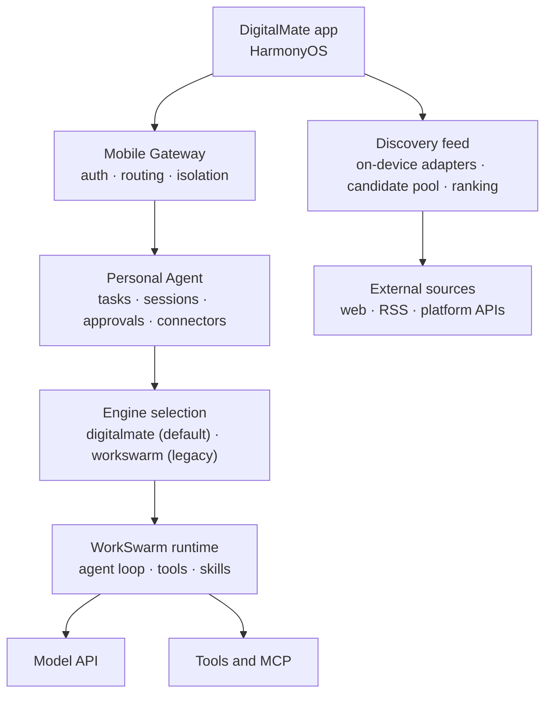

# DigitalMate, explained simply

*As of 15 November 2026. Sources: the repository at `main@62278b8f`, its documentation, and the
local `orbit` checkout. This replaces the 29 October note, which was written from the public board
and had the architecture wrong in several places — see
[What the October note got wrong](#what-the-october-note-got-wrong).*

*DigitalMate is built by another team in the company. This note is context, not our roadmap.*

## The short version

- **DigitalMate** is an AI assistant for HarmonyOS. You start a task in one sentence, attach
  files if you need to, and the assistant runs it in the cloud and returns a result you can
  read, edit and follow up. A discovery feed sits beside it.
- It is **two halves in one repository**: the HarmonyOS client (`digitalmate/`) and the
  **Personal Agent** server (`harness/personal-agent/`, `server/`). It is not only a phone app.
- The client's default backend is `cloudBackend: "digitalmate"`. The older `workswarm`
  conversation path is still selectable.
- The Personal Agent owns tasks, sessions, approvals, connectors and memory, and **delegates
  execution to WorkSwarm** (JiuwenSwarm) over a WebSocket gateway.
- The server is **mid-migration to v3.1**: Agent Service, Router, Session Store, Model Gateway
  and Plugin Gateway are being assembled behind the current Bridge entry point.
- The engine's name has changed twice: `luna` → `orbit` → `digitalmate`. **Orbit is a separate
  product**, and it was DigitalMate's engine from 20 to 30 October. The current server replaced
  it on 30 October and runs the agent on WorkSwarm; the old name is still used in the message
  format and in the workspace migration.

## The picture

The app talks to a gateway, the gateway to the Personal Agent, and the agent to an execution
runtime. The discovery feed is a separate on-device path.

## What the app does

- **Home — cloud tasks.** Submit a task, attach files, choose skills, follow progress, answer
  approvals, and return to the same conversation later. History and results are still there when
  you return.
- **Skill centre.** Browse, install, enable, disable and uninstall skills. What is available
  is whatever the connected service returns.
- **Custom MCP.** Remote HTTP, SSE and cloud-launched stdio services can be selected for a
  conversation. stdio programs run in the cloud.
- **Discovery.** One feed over many sources, with a local candidate inventory, duplicate
  removal and ranking, adjusted by what you read and by topic statements such as "show me more
  about robotics".
- **On-device aggregation.** Local tools merge results from several providers for email,
  travel and media search. The repository also keeps A2UI components and older contracts.

Two limits are stated in the repository and worth repeating: the historical Leader/Data/UI/Action
multi-agent runtime files are **absent** from this checkout, and configuring an on-device
data source does not register it as a cloud tool. Treat those two paths as separate.

## How a request flows

1. After login the client opens `room.home` and restores the conversation from the snapshot.
2. A message may carry attachments; files are uploaded first and passed as source IDs.
3. The client sends `room.message`, or `task.create` when it carries attachments or device
   context. Both use a submission ID.
4. The Personal Agent validates and records the task, then delegates to WorkSwarm, which calls
   the model and tools.
5. An accepted submission is **not** a completed run. A lost response is reconciled against
   the submission ID and a refreshed snapshot before retrying.
6. Results stream back as `digitalmate.task.text` and other events; after a disconnect the
   client reconciles against server state.

## The server

The v3.1 target splits responsibilities that the Bridge entry point currently holds together.
The migration is in progress, and the documentation is explicit that a design, a merge and a
deployment are three different facts.

| Component | Responsibility |
|---|---|
| **Server Runtime** | Startup profiles, component assembly, readiness, shutdown |
| **Mobile Gateway** | Auth scope, message normalisation, client events, connection and push buffers |
| **Router** | Choose New/Continue and ModelCall/AgentCall, then ask the owner to persist the binding |
| **Agent Service** | Runs, scoped capabilities, interactions, revocation, checkpoints, cancel, final commit |
| **Session Manager / Store** | Admission, capacity, claim, recovery; the single writer for session, run and receipt state |
| **Registry / Profile** | Exact implementation versions and per-session bindings |
| **Harness** | Agent loop, skills, rails, sub-execution and working state over a scoped HostAPI |
| **Model Gateway** | One model dispatch, provider protocols, stream and usage observation |
| **Plugin Gateway** | Tools, hooks and completion protocols for bound providers |

A submission is `M`, a product session is `S`, and one execution is `R`. A second ordinary
message can start a new run inside the same session; an explicit follow-up binds to the
existing run.

## Engines and names

The engine has been renamed twice — `luna` → Orbit → DigitalMate — and the middle name belongs to
a different product.

- **luna** was the first release name. Orbit's own client still copies `luna.*` browser keys to
  `orbit.*`, and DigitalMate's migration still adopts `luna/` workspaces.
- **Orbit** is a separate product built by another team: a desktop workspace that puts Claude Code,
  Codex and other agents in one room, with a cloud engine behind it. DigitalMate used it as its
  engine from 20 October, and the 10.23 build ran on it. The phone spoke `orbit.request` over
  `/orbit/ws`, and Orbit proposed screens that the phone drew.
- **DigitalMate** is the current engine: the in-repo server imported on 30 October (`server_engine`).
  It replaced Orbit, keeps tasks, sessions, approvals, connected accounts and memory, and delegates
  execution to **WorkSwarm** (the PyPI name of JiuwenSwarm) rather than running an agent SDK
  in-process. The commit that did it is titled "run DigitalMate on WorkSwarm", and it renamed the
  client's `Orbit*` files to `DigitalMate*`.
- **The old names stay compatible.** `/orbit/ws`, `orbit.request`, the saved `cloudBackend: "orbit"`
  value and the `orbit/` workspace directory are all still accepted. `engine_rename.py` adopts
  `orbit/` and `luna/` directories, renames their SQLite tables and records, and moves them to
  `digitalmate/`, so existing users keep their history.
- **The pinned WorkSwarm build** and its own `agent-core` commit are recorded in
  `harness/personal-agent/README.md`; the production image is `digitalmate:v0.1.10`.
- **The older `workswarm` backend** remains in the client for compatibility and rollback. It is the
  direct WorkSwarm chat path that existed before Orbit, which is why the client has two backend
  settings rather than one.

## Connections

Connections are their own subsystem, with one place responsible for each fact: authorisation,
connection state, credentials and task permission are kept separately.

| Path | What it is |
|---|---|
| **Feishu** | Native account connection and group reading (merged 13 November) |
| **Gmail / Outlook** | Composio-hosted authorisation with read-only access and limits (merged 14 November) |
| **Mail pipeline** | A proposed shared pipeline (Signal) that takes mail in, processes it, and produces a result plus an outbox |
| **MCP** | Per-conversation remote tools, plus custom cloud-launched services |
| **IMAP** | QQ Mail in the on-device path |
| **RSS and HTTP** | Discovery sources and public feeds |

The connection foundation and the mail pipeline are **candidates under review**, not deployed
production boundaries. The repository keeps their source under `temp/` until the owning path is
ready.

## Project Hive (proposal)

The newest design is a bot called **Beebou** and a worker called **Bee**, both running as
sibling Harness implementations under the same protocol:

- **Beebou** answers quickly from the current context and decides whether a request needs a
  worker.
- **Bee** is a WorkSwarm instance with its own scope, identity and generation, which can be
  archived and later reactivated with a new generation.
- The old Router → Sessions production routing is meant to retire, leaving Agent Service to
  own admission, the Session Manager, the Store and exact bindings.
- Three input actions are proposed for a busy run: steer the current task, queue, or stop and
  send.

As of 14 November the Hive documents are **review proposals** (`#1228`, `#1316`); interfaces are
not accepted and the scenarios have not been run.

## What the October note got wrong

| October note said | The repository says |
|---|---|
| "DigitalMate is a HarmonyOS phone app." | It is a client **and** a server (`harness/personal-agent/`, `server/`) in one repository. |
| "Its cloud engine today is Orbit." | Orbit was DigitalMate's engine from 20 to 30 October. It is a **separate product**, not a rename: the current engine is DigitalMate's own server, which replaced Orbit on 30 October and delegates execution to **WorkSwarm**. |
| "The code is private; the GitHub repo returns 404." | Still true. We now have a local checkout, and the origin still returns 404 without access. |
| The A2UI surface is the product's main screen. | A2UI components remain, but the historical multi-agent runtime files are absent; the default conversation is cloud-backed. |
| The board snapshot was the best source. | The code, `docs/`, and the migration status are now the authoritative sources. |
| No mention of skills, discovery, MCP, connectors or the server migration. | All four are major parts of the product. |

The board's roadmap items are still useful history, but several are superseded: topic routing
was removed from the client and revived on 9 November (#942), and the "Orbit as a plugin" idea
has been overtaken by the Hive design.

## How we know

- **Architecture:** `docs/architecture/server-system-overview-v3.1.md` and
  `docs/migration_status.md`.
- **Client behaviour:** `docs/implementations/client/harmonyos-client-task-flow-v1.md`.
- **Execution and deployment:** `harness/personal-agent/README.md`.
- **Name history:** `harness/personal-agent/services/agent_bridge/src/server_engine/engine_rename.py`.
- **The engine swap:** commit `9f419939` ("feat: run DigitalMate on WorkSwarm"), which renames the
  client's `Orbit*` files to `DigitalMate*`; `CloudBackendConfig.ets`, which maps a saved `orbit`
  value to `digitalmate`; and the `orbit` commits of 20 October that first selected Orbit
  (`72356e36`, `55f286c6`, `b01627fd`).
- **Connections:** `docs/architecture/server-connection-foundation-v1.md`.
- **Hive:** `docs/implementations/contracts/beebou-bee-harness-design.md` and
  `beebou-hive-kickoff-plan.md`.
- **Product copy:** `README.md`.

The [Orbit note](../orbit/overview.md) now covers the current public product: a desktop workspace
where a team and its AI agents work in shared rooms. For the internal cloud engine DigitalMate used
for ten days, and the swap, see [`whats-new-2026-10.md`](whats-new/whats-new-2026-10.md).

## Open questions

- When v3.1 cuts over: the tracker (`#737`, `#963`) owns the forecast, and the docs say a
  merge is not a deployment.
- Whether Hive replaces the Router this month or next; it is still a proposal.
- Real cost and latency per user. The board's TTFT complaints are not addressed by any merged
  performance work I could find.
- How much of the on-device aggregation path is reachable from the default UI, versus retained
  code.
