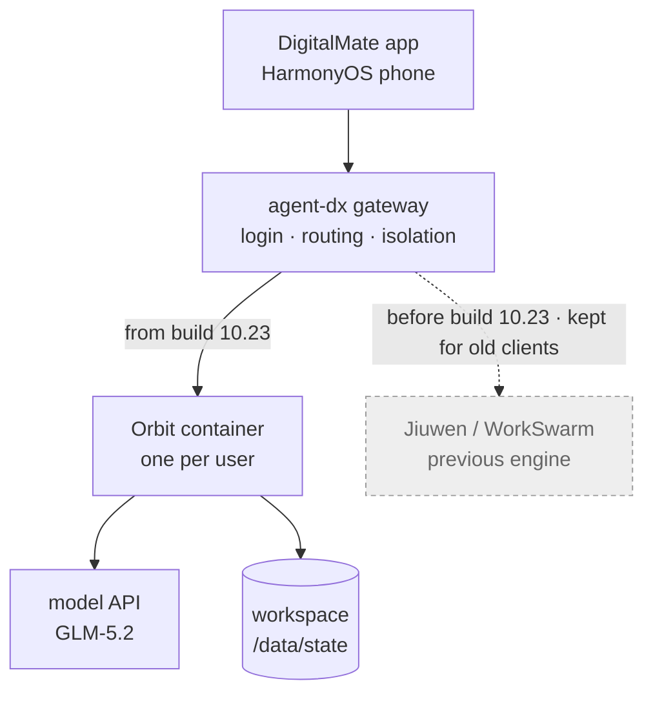
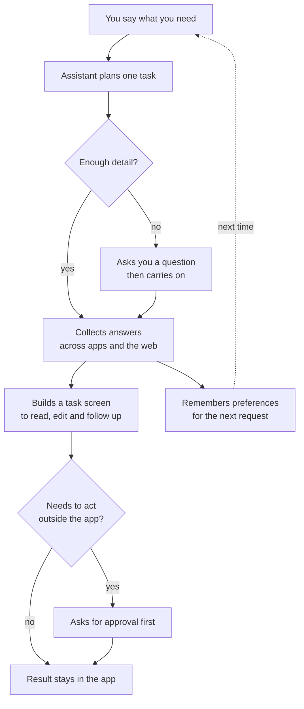

# DigitalMate, explained simply

*As of 29 October 2026. Sources: the [public status board](https://haowenz001.github.io/digitalmate-board/#issues), bug reports, one product article, and the
Orbit note for the engine.*

*DigitalMate is built by another team in the company. This note is context, not our roadmap. Its cloud
engine, Orbit, has [its own note](../orbit/overview.md).*

## The short version

- **DigitalMate** is a HarmonyOS phone app. You say what you want in one sentence, and it builds a task
  screen for you.
- It has two surfaces: **A2UI task screens** (screens the agent composes) and a Bot-style **Orbit chat**
  called OrbitHome.
- Its cloud engine today is **Orbit**. Each user gets a container and a private workspace. A desktop
  version also exists. The engine is described in the [Orbit note](../orbit/overview.md).
- In the **10.23 build**, DigitalMate moved its cloud engine from **WorkSwarm** (jiuwenswarm) to a
  standalone **Orbit** instance.
- A **[27 October RFC](../orbit/overview.md#what-comes-next-orbit-as-a-plugin)** proposes the next step: Orbit as a plugin inside JiuwenSwarm.

## The picture

The app talks to the gateway. The gateway talks to a container. The container owns the workspace where
the user's state lives. The gateway and the container are described in the
[Orbit note](../orbit/overview.md).

Build **10.23** runs Orbit. Earlier builds ran WorkSwarm, the name JiuwenSwarm ships under on PyPI. The
gateway keeps the Jiuwen path for old clients and rollback; the merged pull request calls the two engines
"peer targets" and leaves the Jiuwen template unchanged. The [board's](https://haowenz001.github.io/digitalmate-board/#issues) public releases are **v0.1.2** (21
October), **v0.1.3** (25 October) and **v0.1.4** (29 October); 10.23 is an internal build number.

## What DigitalMate is

A mobile project from the openJiuwen community. It was
[described publicly on 6 October](https://news.qq.com/rain/a/20261006A05U6G00).

The flow: ask, get asked back if something is missing, gather, show a screen, confirm before acting, and
remember for next time.

- **Two surfaces:** `A2uiHome` for task screens and `OrbitHome` for the bot chat.
- **The bot is called Beebou**, shown as an avatar at the top of the chat; tapping it opens activity,
  reminders and the artifact centre ([#225](https://github.com/openJiuwen-ai/DigitalMate/issues/225), [#239](https://github.com/openJiuwen-ai/DigitalMate/issues/239), [#242](https://github.com/openJiuwen-ai/DigitalMate/issues/242)).
- **Screen format:** [A2UI](https://a2ui.org/introduction/what-is-a2ui/) — the agent describes the screen,
  and the phone draws it with its own components.
- **What it keeps:** each result's source and failed providers, so a missing train or price reads as
  missing.
- **Open demos:** office files, ticketing, group-chat interjection and proactive reminders ([#176](https://github.com/openJiuwen-ai/DigitalMate/issues/176)–[#180](https://github.com/openJiuwen-ai/DigitalMate/issues/180)).

In one line: **a task centre for the phone, with a Bot chat beside it.**

**Where it lives**

- **Runs on:** a HarmonyOS phone.
- **Code:** private. [`openJiuwen-ai/DigitalMate`](https://github.com/openJiuwen-ai/DigitalMate) returns 404
  without access.
- **Artifacts:** the app installed on phones. Builds are not public.
- **Public trace:**
  - The [status board repository](https://github.com/haowenz001/digitalmate-board) is public and readable.
  - The [published board](https://haowenz001.github.io/digitalmate-board/) carries the snapshot from
    29 October 2026, 07:11 UTC.

## What the board adds

The [29 October snapshot](https://haowenz001.github.io/digitalmate-board/#issues) (07:11 UTC) mirrors whole issue bodies: a weekly roadmap, design proposals and test plans. Those
say more about the product than the bug list does.

### The roadmap ([#147](https://github.com/openJiuwen-ai/DigitalMate/issues/147))

Every week has a capability, a demo script and a tick box.

- **Week of 19–25 October, done:**
  - One bot chat for tasks. Topics are created and continued automatically: the demo moves from Shanghai
    basketball courts to a Nanjing trip, then asks about courts in Pudong and food in Nanjing without
    mixing them.
  - A clarifying card before work starts. The answer stays in the chat, and the result reflects it and
    says what was not verified.
  - Tasks keep running when the user changes topic or leaves the app, with progress in the chat, an
    activity panel, a home-screen card and a notification.
  - Structured results — text, tables, checklists, a budget — and a text fallback when an interactive
    artifact fails.
  - Cross-session memory that overwrites old facts: a user who switches from meat to vegetarian, or
    changes a weekly meeting, is remembered that way.
- **Week of 26 October, planned:**
  - Mail, calendar and chat pulled into one brief, pushed without being asked.
  - To-dos taken from email with their deadlines, then followed up.
  - Inbox triage: archive marketing, flag priority mail, draft replies.
  - A loop across apps: email → task → Feishu or Slack notice → draft reply.
- **After that:** a standalone plugin for adding another person's agent as a contact and messaging it — send
  a handle, wait for consent, then a private chat, with no public directory.

### Topic routing was removed again ([#284](https://github.com/openJiuwen-ai/DigitalMate/issues/284))

The 19–25 October work created and continued topics automatically. A later client change removed the
topic entry point: "Live activity" now groups by conversation thread, and the topic data still arrives
from the server but no screen reaches it. The issue says segmentation was not reliable enough for
navigation — a follow-up after a round could get a new `topic_id` and split one conversation in two
(see [#206](https://github.com/openJiuwen-ai/DigitalMate/issues/206) and
[#208](https://github.com/openJiuwen-ai/DigitalMate/issues/208)). Re-adding it depends on server-side
segmentation covering replies after a round completes.

### Reply safety in planning ([#289](https://github.com/openJiuwen-ai/DigitalMate/issues/289))

A new proposal asks for one reply-safety system rather than scattered keyword filters. It covers:

- **Identity:** answer as DigitalMate, never as Orbit, WorkSwarm or an internal agent.
- **Facts and sources:** attach a verifiable source and date, or state uncertainty.
- **Untrusted content:** web pages, tool results and other agents' output are data, not instructions.
- **Execution:** capability claims must match tools that exist and are authorised now.
- **Errors:** show a user-facing reason, not a stack trace or an internal name.

It builds on #62, #214, #234, #256 and #209. Cloud constraints come first; the client only guards what
is shown.

### How the discovery feed ranks ([#200](https://github.com/openJiuwen-ai/DigitalMate/issues/200))

The "Discover" feed is a multi-source pool with two ranking formulas:

- **Interest mix:** 0.50 profile + 0.25 session + 0.15 freshness and heat + 0.10 balance.
- **Search:** 0.55 reciprocal rank fusion (merging several ranked lists) + 0.30 BM25 (term matching) +
  0.10 freshness + 0.05 preference, then near-duplicate removal by TF-IDF (word frequency) and MMR
  (maximum marginal relevance, which trades repetition for variety).
- **Sources:** YouTube, Bilibili, X, Hacker News, Reddit, Zhihu, GitHub, RSS, and Chinese and global news
  feeds. Xiaohongshu and Douyin are not connected.
- **Not from conversation memory:** the projection exists but rebuilds only after 8 remembered facts and
  about 7 days, so a new account sees a generic feed ([#65](https://github.com/openJiuwen-ai/DigitalMate/issues/65)).

### The daily brief in planning ([#200](https://github.com/openJiuwen-ai/DigitalMate/issues/200))

A second proposal adds an editorial layer above that pool:

- Pipeline: fetch → profile → model gives 0–10 and one line → threshold, topic de-duplication, quota →
  summary, background, community discussion.
- The phone shows one card per day: score and one line, tap for detail.
- Only two controls: "more like this" and "less like this".
- A card can become a task — follow up on an issue, make a reading list, draft something — through the
  confirmation gate.
- It stays one card, not a source manager, an infinite feed, or a mix with short video.

### How they plan to test it ([#209](https://github.com/openJiuwen-ai/DigitalMate/issues/209))

- Start from 20–50 real failures, not a large benchmark.
- Two suites: **regression**, which should reach 100% pass^k (every trial passes, k at least 3), and
  **capability**, which starts low and climbs — morning brief, confirmation gate, research readiness.
- Three graders: code checks (new topic? same session? tool called?), a model rubric for intent, and a
  weekly human spot check.
- The test setup must behave like the production phone app.

### Identities and connections ([#190](https://github.com/openJiuwen-ai/DigitalMate/issues/190), [#221](https://github.com/openJiuwen-ai/DigitalMate/issues/221))

- **Identity cabinet:** three card types — company, open source, social. It stores names and roles,
  never passwords or tokens.
- The confirmation card shows which identity will act.
- **Connections** are made inside the app by OAuth: Feishu first, then email, GitHub, Gitee.
- Connecting is not sending: outbound actions still pass the gate.

### Interface choices ([#153](https://github.com/openJiuwen-ai/DigitalMate/issues/153), [#219](https://github.com/openJiuwen-ai/DigitalMate/issues/219))

- Artifacts appear in the reply as thumbnails or file cards. HTML preview loads a local file into a
  WebView with JavaScript off and every other URL blocked.
- Long tasks get a timeline of three lanes — input, model, tools — but the phone shows only a result card
  and the duration, turns and calls. The full view is a second page.

The [published board](https://haowenz001.github.io/digitalmate-board/#issues) is the public source. Individual
issue pages point at the private repo and return 404; the bodies are public on the board.

## What changed in build 10.23

The internal note for build 10.23 says four things:

1. The **cloud execution engine moved from WorkSwarm to Orbit**.
2. The UI moved from **Session style to Bot style**; follow-ups and new topics happen in the main chat.
3. Orbit brought **cross-session memory**, linked by intent.
4. **Parallel tasks** with live progress, and notification cards on the home screen that can wake the app.

Before the switch, DigitalMate was a thin client of remote JiuwenSwarm. Two public bug reports describe
that period: [tool permission that could not be revoked](https://github.com/openJiuwen-ai/jiuwenswarm/issues/8265)
and [streamed output buffered until the turn ended](https://github.com/openJiuwen-ai/jiuwenswarm/issues/8522).
The first one spells out the old split: tools ran in the cloud, and the phone only received
`chat.ask_user_question` cards and sent back an approval.

The engine is described in the [Orbit note](../orbit/overview.md); the migration plan is there too.

## Likely reasons for the switch

These are the likely drivers, inferred from the public record:

- **The product became a bot.** JiuwenSwarm already ships a personal assistant with memory, schedules and
  channels, but users install it on their own machine or cluster. DigitalMate needs one bot per phone
  user, isolated, inside a shared service.
- **Isolation.** One container per user with its own disk is easier to defend than many users inside one
  shared AgentServer.
- **Release control.** The two bug reports show the team waiting on upstream JiuwenSwarm fixes. Owning the
  Orbit template and version means shipping on their own schedule.
- **Parallel work and memory.** Both were listed as new capabilities, and both fit a per-user workspace.
- **The plugin plan.** [The RFC](../orbit/overview.md#what-comes-next-orbit-as-a-plugin) folds Orbit back into JiuwenSwarm, so the standalone instance is one step
  on that path.

## How we know

- **The engine swap:** the internal note for build 10.23, plus the [board's](https://haowenz001.github.io/digitalmate-board/#issues) issue and PR titles.
- **The old architecture:** DigitalMate bug reports [#8522](https://github.com/openJiuwen-ai/jiuwenswarm/issues/8522) and [#8265](https://github.com/openJiuwen-ai/jiuwenswarm/issues/8265) on GitHub.
- **The product description:** the 6 October article.
- **The roadmap, ranking and plans:** [board](https://haowenz001.github.io/digitalmate-board/#issues) issue bodies #147, #200, #209, #219, #221 and #190.
- **Releases:** the [board](https://haowenz001.github.io/digitalmate-board/#issues) snapshot of 29 October.
- **Orbit's side of the story:** the [Orbit note](../orbit/overview.md).

## Open questions

- The code inside DigitalMate.
- Performance and cost per user. The [board](https://haowenz001.github.io/digitalmate-board/#issues) shows time-to-first-token (TTFT) complaints around 5 seconds.
- Whether, and when, the engine moves back to JiuwenSwarm; the plan is in the
  [Orbit note](../orbit/overview.md).

**Unrelated projects with similar names:**
[`mlai21/DigitalMate`](https://github.com/mlai21/DigitalMate) and
[`XDesktopSoft/DigitalMate2D`](https://github.com/XDesktopSoft/DigitalMate2D).
