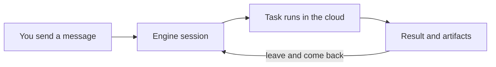
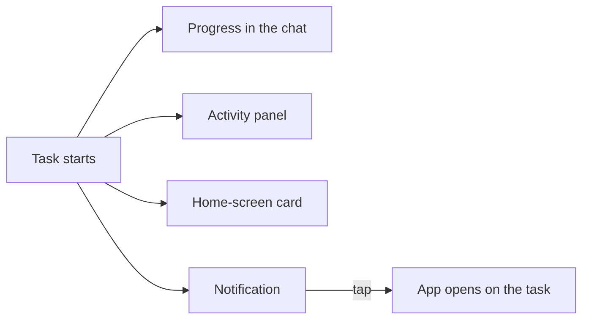
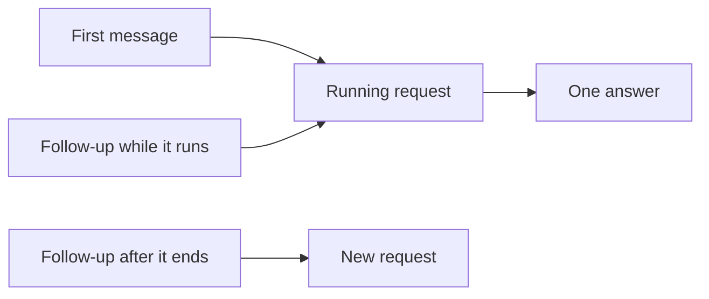
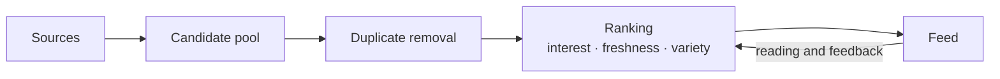

# What's New in DigitalMate — October 2026

October is the month this repository appeared. It was seeded on 8 October and, by the end of
the month, the app had become a bot with its own engine, tasks that keep running when you leave
the app, and a first server. About 375 commits landed.

*Last updated: 2026-11-14.*

**Coverage** — read from `main`:

| Repository | Commit | Merged | What it is |
|---|---|---|---|
| `DigitalMate` | `9eea155a` | 2026-10-31 22:46 +08:00 | merge of #435 (`fix-task-clear-force-type`) |
| first commit | `4c256328` | 2026-10-08 | initial import of the project |

Everything here is tagged:

- **[NEW]** — a capability that did not exist before.
- **[UPGRADE]** — an existing capability re-worked until it feels new.

---

# The big things

## 1. The app gets an engine and remembers the conversation — [NEW]

The project was imported on 8 October. From there the app moved onto its own engine: the
conversation gained attachments and file preview, account and room recovery, reconnect
handling, device permissions, task controls, artifact versions and a startup connection path.
By the end of the month the engine could carry a conversation across a cold start, not just a
single turn.

The name it shipped under is the one that still appears in code and PR titles: `orbit`. It was
later renamed to `digitalmate`; the workspace migration in `engine_rename.py` keeps old data.

## 2. Tasks keep running outside the app — [NEW]

Progress used to live only inside the conversation. On 30 October (#304) a task got an
activity panel, a home-screen card and a notification, so leaving the app or changing topic no
longer hid what was still running. The notification card can wake the app.

This is the first time the product treated a task as something that exists outside the screen
that started it.

## 3. Quick follow-ups join the request already running — [NEW]

On 31 October (#390) messages sent close together stopped creating a second task. They merge
into the turn already in flight, which makes follow-up corrections feel like one conversation
instead of a queue of separate requests.

## 4. A server appears behind the app — [NEW]

On 30 October (#323) `server_engine` entered the repository. It brought the Bridge and an
engine service that the Personal Agent still runs today, plus a WorkSwarm adapter and the
start of a proper streaming boundary. The same week, internal runtime text was kept out of the
chat, so the user saw the answer rather than the machinery.

This import is the seed of the v3.1 migration that dominates November.

## 5. A discovery feed joins the app — [NEW]

A second surface appeared: one feed over many sources. The client holds a candidate inventory,
removes duplicates, ranks results, and changes what appears next based on reading and on topic
statements. The feed has its own empty state and its own source caveats, such as a Bilibili
webview cookie.

## 6. Tests that run on a real phone — [NEW]

The month ended with an end-to-end harness that runs on a simulator and on a device, plus
Orbit telemetry, failure attribution and CI gates. This is what made the later nightly runs and
the profiling dashboard possible.

---

# The rest, by theme

## Chat and content

- **Clarification in the stream [UPGRADE]**: a clarifying card arrives inside the reply and the
  answer resumes the same task.
- **Multi-question resume [UPGRADE]**: several questions can be answered before the task
  continues.
- **Markdown and code [UPGRADE]**: code-block overflow, LaTeX rendering and autolinked source
  URLs were fixed.
- **Artifacts [UPGRADE]**: file preview, artifact versions and delete from the artifact centre.
- **Drafts and stop [UPGRADE]**: the composer keeps a draft, and stopping gives feedback before
  the first token.
- **Task clear [NEW]**: a task can be cleared from the client, including the force path.

## Discovery

- **Entry and empty state [UPGRADE]**: the discovery entry no longer flashes empty.
- **Sources [UPGRADE]**: Bilibili webview cookies and source URLs were repaired.

## Server and runtime

- **WorkSwarm streaming [UPGRADE]**: streamed output reaches the client instead of buffering
  until the turn ends.
- **Internal text stays internal [UPGRADE]**: runtime and routing text is filtered out of the
  chat.
- **Account and room recovery [NEW]**: reconnect, startup and account switching recover the
  conversation instead of dropping it.

## Topics

- **Topics and threads [NEW]**: #280 laid out automatic topics, and parallel topics followed in
  the engine. The client entry point was removed, then revived on 9 November (#942) alongside
  queued busy turns. Segmentation (#311) remains the constraint.

## Platform and delivery

- **E2E nightly [NEW]**: simulator and real-device runs, with per-case profiling.
- **Failure attribution [NEW]**: a failing nightly case reports where it failed.
- **CI gates [NEW]**: unit tests and code checks run on Linux cloud runners, behind a switch.
- **Release gate [UPGRADE]**: the test entries used by the release gate were fixed.

---

# See also

- [November 2026](whats-new-2026-11.md)
