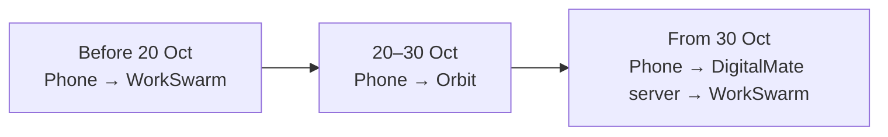
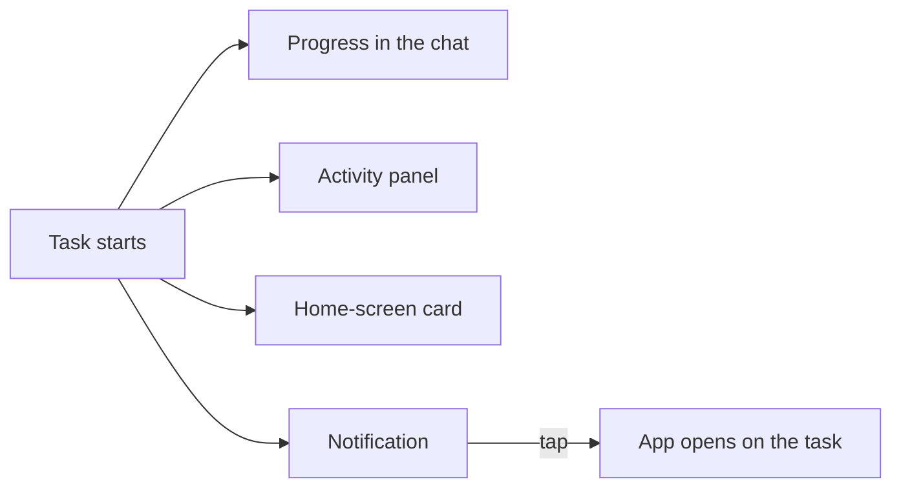
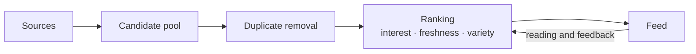

# What's New in DigitalMate — October 2026

October is the month this repository appeared, and the month DigitalMate changed engines twice. It
started on WorkSwarm, the company's agent platform. On 20 October it gained a second engine, Orbit —
a separate product from another team — and the 10.23 build (the app version released that week) ran
on it. Ten days later, on 30 October, DigitalMate replaced Orbit with its own server, which runs the
agent on WorkSwarm again. The rest of the month — tasks that keep running after you leave the app,
merged follow-ups, a discovery feed, a test suite that runs on a real phone — happened alongside
that change. About 375 commits landed.

*Last updated: 2026-11-15.*

## What DigitalMate is

DigitalMate is an AI assistant for HarmonyOS phones. You type a task, attach files and pick skills; a
cloud server runs the task and streams the answer back. A second tab is a personalised feed of
videos, articles and posts. The repository holds both the phone app and the server.

## What runs underneath

Three layers, from top to bottom:

1. **The phone app** — what the user sees and touches.
2. **The engine** — the server that owns tasks, sessions, approvals, connected accounts and memory.
   This is the layer that changed twice in October.
3. **The agent platform** — the software that actually runs the agent: the loop, the tools, the model
   calls. The company's platform is called **WorkSwarm** (also published as **JiuwenSwarm**). **Orbit**
   was the engine of a different product, built by another team.

At the start of October the phone talked to WorkSwarm directly. By the end it talked to DigitalMate's
own server, which talks to WorkSwarm.

**Coverage** — read from `main`; this is the first edition.

| Repository | Commit | Merged | What it is |
|---|---|---|---|
| `DigitalMate` | `9eea155a` | 2026-10-31 22:46 +08:00 | merge of #435 (`fix-task-clear-force-type`) |
| first commit | `4c256328` | 2026-10-08 | initial import of the project |
| `Orbit` (local checkout) | no git history | — | the separate engine DigitalMate used for ten days |

Not read this edition: `agent-dx`, the layer that runs one private container per user.

Everything here is tagged:

- **[NEW]** — a capability that did not exist before.
- **[UPGRADE]** — an existing capability re-worked until it feels new.
- **[REMOVED]** — something that was in the product and is now gone.

---

# The big things

## 1. Orbit becomes a second engine — [NEW]

On 20 October the app could use either of two engines. Four commits that day did the work: "integrate
Orbit conversation through cloud-adapter", "select Orbit or JiuwenSwarm as the main chat backend",
"connect Orbit backend to built-in Orbit Agent through Home", and "share chat UI across WorkSwarm and
Orbit backends".

Orbit is a separate product built by another team: a desktop workspace where people put Claude Code,
Codex and other agents in the same room, with a cloud engine behind it. On the phone it had no screen
of its own — it proposed screens and DigitalMate drew them. The 10.23 build made Orbit the engine, so
the phone sent its tasks in Orbit's message format to Orbit's address (`/orbit/ws`).

## 2. DigitalMate replaces Orbit with its own server — [NEW]

On 30 October the repository gained its own server: `server_engine`, with a single entry point, the
service that runs the product side, and a connector to WorkSwarm (#323). The same commit renamed the
client's Orbit files to DigitalMate and mapped the saved `orbit` setting to the new server. Its title
is the point: "run DigitalMate on WorkSwarm".

The new server keeps tasks, sessions, approvals, connected accounts and memory, and hands the actual
agent work to WorkSwarm. That is the arrangement that still exists today. Orbit was not renamed into
this server; it was replaced by it.

The old names stay on purpose. The `/orbit/ws` address, the `orbit.request` message name and the
saved `orbit` value still work, and `engine_rename.py` moves old Orbit workspaces (and older `luna`
ones) into the new `digitalmate/` layout, so nobody loses their history. That is why the repository
is full of the word "orbit" even though Orbit is gone.

## 3. Your chat is still there when you come back — [NEW]

Close the app, restart the phone, lose the network or switch accounts, then open the app again: the
same chat is reloaded from the server, with its messages, attachments and the task's progress.
Before this, the open chat could come back empty, and a running task could show no progress.

Attachments now show a preview before sending, and the app reconnects to the server on its own when
the network returns. By the end of the month this worked for the whole chat, not just for a single
reply.

## 4. Tasks keep running after you leave the app — [NEW]

Progress used to be visible only while you were in the chat. On 30 October (#304) a task got an
activity panel, a home-screen card and a notification, so leaving the app or changing topic no longer
hid what was still running. Tapping the notification opens the task. Before this, leaving the chat
hid the task; now it stays visible.

## 5. Sending a follow-up mid-task no longer starts a second task — [NEW]

On 31 October (#390) messages sent close together stopped creating a second task. They merge into
the turn already in flight, which makes a correction feel like part of the same conversation instead
of a queue of separate requests.

## 6. A new feed tab gathers videos, articles and posts — [NEW]

A second surface appeared: one feed over many sources. The phone holds a pool of candidate items,
removes duplicates, ranks them, and changes what appears next based on what you read and on topics
you state, such as "show me more about robotics". The feed has its own empty state and its own source
caveats, such as a Bilibili webview cookie.

## 7. Tests that run on a real phone — [NEW]

The month ended with an end-to-end test suite that runs on a simulator and on a device. When a case
fails, the report says which step failed; automatic checks run on every change. This is what made
the later nightly runs and the profiling dashboard possible.

---

# The rest, by theme

## Chat and content

- **A question inside the reply [UPGRADE]**: the assistant can ask a clarifying question in the same
  reply, and your answer continues the same task.
- **Several questions at once [UPGRADE]**: you can answer more than one question before the task
  continues.
- **Code and links [UPGRADE]**: long code blocks stay inside the bubble, maths renders, and bare
  source links are clickable.
- **File versions and delete [UPGRADE]**: files preview, keep their versions, and can be deleted
  from the file list.
- **Drafts and Stop [UPGRADE]**: the input box keeps what you typed, and Stop shows a message before
  the first token arrives.
- **Clearing a task [NEW]**: a task can be cleared from the phone, including one that will not
  progress.

## Discovery

- **Start screen [UPGRADE]**: the feed no longer flashes empty when it opens.
- **Sources [UPGRADE]**: Bilibili webview cookies and source URLs were repaired.

## Server and runtime

- **Text arrives while it is written [UPGRADE]**: the phone shows text as the model produces it,
  instead of waiting for the turn to end.
- **No internal text in the chat [UPGRADE]**: messages meant for the system are filtered out, so the
  chat shows the answer, not the machinery.
- **Account and chat restore [NEW]**: when the connection drops, the app restarts or the account
  changes, the app reloads the same chat instead of showing an empty screen.

## Topics

- **Automatic topics [NEW]**: #280 set out how a long conversation is split into topics on
  27 October, and the engine later ran topics side by side. The phone's entry point was removed
  again in the same month — see [What didn't ship](#what-didnt-ship).
- **Where a topic ends [UPGRADE]**: #311 is still the open question of where one topic ends and the
  next begins.

## Platform and delivery

- **Nightly tests on a phone [NEW]**: simulator and real-device runs, with per-case timing.
- **Failures say where they broke [NEW]**: a failing nightly case reports the step that failed.
- **Automatic checks on every change [NEW]**: unit tests and code checks run on Linux cloud runners,
  behind a switch.
- **Release checks [UPGRADE]**: the test entries used by the release gate were fixed.

---

# What didn't ship

- **The topic entry point** was designed (#280), built into the engine, and then removed from the
  phone in October. It returns on 9 November (#942), which is in the November edition.
- **Direct WorkSwarm chat** stopped being the default when Orbit arrived, and remains only as the
  legacy option kept for compatibility and rollback.

---

# See also

- [November 2026](whats-new-2026-11.md)
- [DigitalMate, explained simply](../overview.md)
