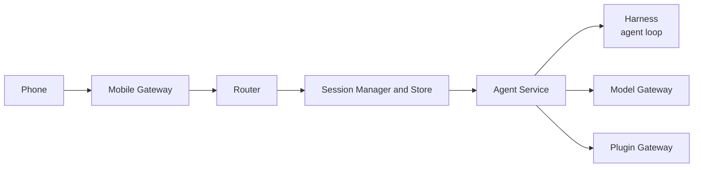
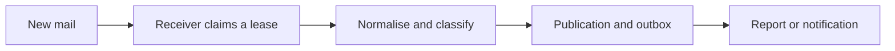
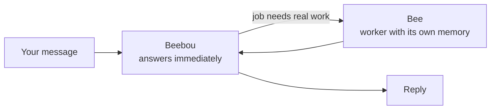

# What's New in DigitalMate — November 2026

November is the reconstruction month. The server that replaced Orbit on 30 October is two weeks old
and is being split into named parts. Connections became their own subsystem, mail got a background
pipeline design, and the Hive bot design moved from review into code: Hive2 and Hive3 merged, and the
old Router package was deleted. About 2,500 commits landed in sixteen days.

*Last updated: 2026-11-16.*

## What DigitalMate is

DigitalMate is an AI assistant for HarmonyOS phones. You type a task, attach files and pick skills; a
cloud server runs the task and streams the answer back. A second tab is a personalised feed of
videos, articles and posts. The repository holds both the phone app and the server.

## What runs underneath

As of 16 November, the phone talks to **DigitalMate's own server** (written in Python). That server
owns tasks, sessions, approvals, connected accounts and memory, and hands the actual agent work to
**WorkSwarm** (also published as JiuwenSwarm), the company's agent platform, which runs the loop, the
tools and the model calls. One execution of a task is called a **run**.

Two older paths still work and are kept for compatibility:

- **Orbit**, the separate engine DigitalMate replaced on 30 October. Its address (`/orbit/ws`) and
  message format are still accepted, and saved settings that say `orbit` still work.
- **The direct WorkSwarm chat**, still selectable in the app as the legacy option.

The server is in the middle of a planned split (called **v3.1**). Today the bridge still assembles
the parts in one process; the target is a set of named parts. On 16 November the old Router package
was deleted as part of Hive3, and Home routing moved into the Hive path. The repository says it
plainly: a design, a merge and a deployment are three different facts, and the split is not a
deployment yet.

**Coverage** — read from `main`:

| Repository | Commit | Merged | What it is |
|---|---|---|---|
| `DigitalMate` | `2b9b721d7` | 2026-11-16 17:08 +08:00 | merge of #1603 (`hive3-bee-session-target`) |
| `WorkSwarm` (vendored) | pinned build | — | the agent platform the server calls |
| `Orbit` (local checkout) | no git history | — | the engine that was replaced on 30 October |

The first version of this edition stopped at `62278b8f` (14 November); this update adds the 1,093
commits merged after it. The previous edition stopped at `9eea155a` (31 October). Not read this
edition: `agent-dx`, the layer that runs one private container per user.

Everything here is tagged:

- **[NEW]** — a capability that did not exist before.
- **[UPGRADE]** — an existing capability re-worked until it feels new.
- **[PROPOSAL]** — designed and reviewed, not accepted or deployed.

---

# The big things

## 1. The two-week-old server is split into named parts — [UPGRADE]

The server still assembles the parts in one process through the bridge, and the split is not a
deployment yet. In November the target architecture was written down; in the second half the old
Router package was deleted as part of Hive3 (G6, #1313):

- **Mobile Gateway** — checks who is calling, normalises the message, and keeps the phone's
  connection and push queue.
- **Router** — decides whether this is a new conversation or a continuation, and whether to answer
  with a model call or by running the agent. The old package is gone; the Hive path makes the
  decision today.
- **Agent Service** — owns each run: what it may do, when to ask the user, when to cancel, and when
  it is truly finished.
- **Session Manager and Store** — decide whether a new run can start, and are the single writer
  for message, session and run state.
- **Model Gateway** and **Plugin Gateway** — take model calls and tool calls out of the bridge.

By 16 November Hive2 (`#1421`) and Hive3 (`#1605`) were merged, `server/router` was deleted, and the
Home entry runs through the Hive path. The production template still enables none of Hive's optional
features; a merge is not a deployment.

## 2. Connect an account once: Feishu, Gmail and Outlook — [NEW]

On 13 November the **connection foundation** (`#1176`) was merged. It is a shared subsystem with one
place responsible for each fact — authorisation, connection state, stored credentials and task
permission. It is **merged but still under review**: ownership is not accepted and it is not
deployed.

Then the first providers arrived:

- **Feishu** (`#1142`) — native account connection, group reading and summaries.
- **Gmail and Outlook** (`#1192`) — authorisation hosted by Composio (a third-party service that
  runs the app logins), with read-only access and limits.

The rule that makes this more than plumbing: connecting an account is not permission to act.
Outbound actions still pass their own confirmation, and provider tokens stay with the provider.

## 3. Mail will be processed in the background — [NEW] [PROPOSAL]

A shared pipeline (called **Signal**) was drafted to take mail in, process it, and produce a result
plus an outbox (the queue of messages waiting to be sent), with a separate mail layer for
normalisation, rules and payloads. A small Outlook worker and the Gmail connector exercise it. The
design uses leases — a receiver claims an item so no one else takes it — and completion receipts, so
a crashed worker does not silently drop a message.

The implementation sits in a temporary folder (`temp/mail-signal-pipeline/`) while it is reviewed. It
is a candidate, not a production boundary, and the docs say so repeatedly.

## 4. A faster bot: Beebou answers at once, Bee runs the long tasks — [NEW] [PROPOSAL]

On 13–14 November the next bot design, called **Hive**, arrived in review. Today one assistant
handles every message. While it runs a long task, a new message waits, and even "what are you doing?"
has to wait behind the task.

The proposal splits the job between two bots:

- **Beebou** is the bot you always talk to. It reads your message, the last part of the conversation
  and a small live view of running tasks, then answers at once in the same language you wrote in, and
  says what it is doing about the request. It can also check simple things, such as the weather, with
  tools that only read. It does not run long tool chains or work in a separate workspace.
- **Bee** is a separate worker bot. Beebou hands it the jobs that need real work: a longer tool chain,
  a separate workspace, waiting for something, or work that continues over time. Bee is a WorkSwarm
  instance with its own identity and memory. When it is idle it can be archived; when it is needed
  again it comes back as a new generation (a fresh copy) with the same profile and saved information,
  and the archived version stays as history.
- While a task is running, your next message can do one of three things: steer the current task, wait
  in a queue, or stop the task and send.
- Beebou keeps its own memory of the conversation. Bee keeps its own working memory, and only
  approved pieces are published to shared memory.
- If every place for a Bee is taken, an idle Bee is archived to free one; if none can be freed, you
  are told that the system is busy.

**How many Bees.** The design does not fix a number. It reuses the existing session capacity as the
number of Bee places — the default is 10 — and leaves the final cap, the scope of the pool (per user
or per tenant) and fairness between users to the owning teams and each deployment.

Why it matters: the first answer arrives sooner, "what is happening?" can be answered while a long
task runs, and long work gets its own worker instead of blocking the conversation.

As of 16 November the design is still marked a **review proposal** (`#1228`, `#1316`), but the code
has merged in phases: Hive2 (`#1421`) on 15 November and Hive3 (`#1605`) on 16 November, including
Bee session targets (`#1603`), attachments (`#1677`), input-copy erasure (`#1686`), orphan recovery
(`#1681`) and busy routing (`#1680`). The production template enables no Hive option by default;
turning on results, turns or Bees is a separate deployment step. The design is in
`docs/implementations/contracts/beebou-bee-harness-design.md`; the capacity rule is in
`beebou-failure-handling.md` and `beebou-config/README.md`; the kickoff plan is
`beebou-hive-kickoff-plan.md`.

## 5. A production template and a faster first message — [UPGRADE]

A production deployment template was added to the repository on 12 November (`01d9c74f`), with the
image pinned at `digitalmate:v0.1.10`. It is a template, not a deployment: the platform still has to
assign a version and switch traffic to it.

The server now documents the settings it writes at startup: which features it turns off, which it
leaves to the workspace, and which settings must be saved so a restart cannot read an old value.

Part of that is the **prewarm pool**: one assistant session is prepared in the background so the
first message does not wait for a full start-up. It is a default in DigitalMate and can be turned
off per deployment.

## 6. Images, captions and report cards in the chat — [UPGRADE]

- **Diagrams and media appear as they arrive** (`#1340`, `#1373`).
- **Attachment captions** (`#1272`) — an attachment can have a line of text under it that explains it.
- **Report cards** (`#1269`) — a structured result has its own card instead of a wall of text.
- **Home image preview** (`#1049`) — images can be opened from the conversation.

## 7. Fewer stuck chats and better error messages — [UPGRADE]

Most of the reliability work is invisible when it succeeds: recovering a session's capacity
(`#1185`), disconnecting an idle connection (`#1097`), a model timeout (`#1181`), a proper error when
a user hits their quota (`#1386`), a session slot that expires after an hour idle (`#1237`), and
history archive and reset work (`#1112`, `#1160`, `#1170`).

---

# The second half of November

The first version of this edition stopped on 14 November. Between 14 and 16 November, 1,093 commits
and 31 pull-request merges landed. Hive2 and Hive3 are the big ones (above); these are the rest:

- **Bee session targets [UPGRADE]**: `hive.message.send` can name a target session, and the Host
  routes it for Beebou. This is the server half of the client work in #1243.
- **Bee attachments [UPGRADE]**: attachments addressed to a Bee go to the Bee's turn and workspace;
  input copies are erased when the attachment is erased and after the task ends (#1677, #1686).
- **Orphan recovery [UPGRADE]**: a Bee run left `RUNNING` by a restart is recovered instead of
  staying stuck (#1681, #1655).
- **Busy routing [UPGRADE]**: queue, preempt and steer controls are routed before the busy gateway,
  so a message sent during a running task lands in the right path (#1680).
- **Memory provider [NEW]**: the Hive memory provider merged, with load budgets and Global Memory
  lookup (#1416).
- **Calendar fixes [UPGRADE]**: phone edit and delete, privacy and weather fixes after the November
  revert (#1460, #1556, #1342).
- **Connections and mail [UPGRADE]**: unfinished connections are hidden, and the Signal v1 report
  goals merged (#1483, #1454).
- **Language [UPGRADE]**: task language and process-bubble language fixes (#1470, #1467).
- **Release [NEW]**: v0.1.12 was tagged on 14 November (`709f4d39d`). Hive3 landed after it, so the
  tag does not contain Hive3.
- **CI [UPGRADE]**: Hive scenarios enrolled, per-suite capture, and non-blocking artifact upload
  (#1448, #1636, #1656).

---

# The rest, by theme

## Server and migration

- **New-conversation routing [NEW]**: the default Home path decides whether to continue a
  conversation by reading the session table (`dm_sessions`), and the Hive routing step records the
  choice it made.
- **One entry point for model calls [NEW]**: embedding, judging and summarisation go through the
  public JSON entry point (`post_json`).
- **One writer for session state [NEW]**: the default path for starting a new run goes through the
  Store's own operation, while the new path stays separate from the old database.
- **The old bridge reports what it sees [UPGRADE]**: a watcher produces records without claiming the
  new path is live.
- **Cancelled runs end cleanly [UPGRADE]**: when a run is cancelled, its final state is cleared
  safely so it cannot be mistaken for a finished run.

## Connections and mail

- **Stored credentials [NEW]**: a runtime client keeps connection and tool-service secrets, with the
  configuration service optional.
- **Turning background mail on and off [NEW]**: `set_subscription_intent` records which authorisation
  and which version the request was made with, and applies only if both still match, so
  re-authorising cancels an old enable.
- **Who may start a connection [PROPOSAL]**: records the missing launch proof and the minimum host
  permission.
- **Mail results become report goals [PROPOSAL]**: a producer that turns mail results into report
  goals.

## Client

- **Topics return [UPGRADE]**: the topic entry came back on 9 November (`#942`), together with
  queued busy turns — a message sent while a turn is running now waits its turn instead of racing
  it.
- **Typing and moving around [UPGRADE]**: long-text scrolling, back behaviour and the status-bar size
  were fixed.
- **How messages look [UPGRADE]**: the model's markup (DSML) and full-width text render correctly,
  and partial replies and quoted text still display correctly after the history migration.
- **Attachments [UPGRADE]**: upload validation now rejects the wrong attachment type explicitly.

## Reliability

- **Reopening a session [UPGRADE]**: reopening a session waits for the archive to finish instead of
  racing it.
- **Restart [UPGRADE]**: after a restart, the phone reloads the chat from the last saved snapshot
  instead of starting blank.
- **Old results are not shown [UPGRADE]**: list queries reject stale results rather than showing
  them.

## Docs and CI

- **Docs restructured [NEW]**: the documentation tree was reorganised around contributor rules,
  component boundaries, user goals and evidence of what was tested.
- **Old document folders removed [UPGRADE]**: the old `docs/adr`, `docs/specs` and `docs/plans`
  folders were removed after the new reader was adopted.
- **A design review before merge [NEW]**: a feature issue needs a design draft and a review before
  merge.
- **Architecture slides [NEW]**: a v3.1 migration deck was added to `docs/assets`.
- **Automatic checks [UPGRADE]**: checks for features still mid-migration, security checks and
  nightly device runs were adjusted as the server moved.

---

# What didn't ship

- **Hive is not switched on.** The production template (`hive-deploy.prod.toml`) declares only the
  per-user principal binding and enables no Hive option. Results, turns and Bees are separate
  deployment flags; the packaged defaults are off.
- **The mail pipeline** is still a candidate, not a production boundary.
- **v0.1.12 predates Hive3.** The tag was cut on 14 November; Hive3 merged on 16 November.
- **The migration status page is stale.** It still describes the old Router path and has not been
  updated since 11 November.

---

# See also

- [October 2026](whats-new-2026-10.md)
- [DigitalMate, explained simply](../overview.md)
