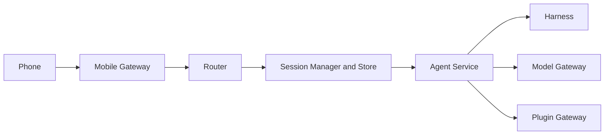
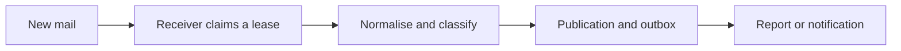
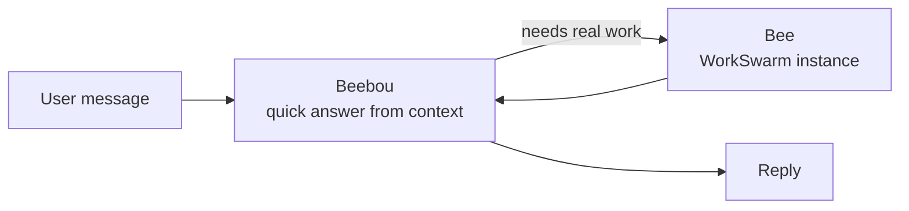

# What's New in DigitalMate — November 2026

November is the migration month. The server grew a real architecture, connections became a
subsystem with its own foundation, mail turned into a pipeline, and a new bot design — Beebou
and Bee — arrived as a proposal. About 1,396 commits landed in two weeks.

*Last updated: 2026-11-14.*

**Coverage** — read from `main`:

| Repository | Commit | Merged | What it is |
|---|---|---|---|
| `DigitalMate` | `62278b8f` | 2026-11-14 17:34 +08:00 | merge of #1411 (`issue-936-investigation`) |

The previous edition stopped at `9eea155a` (31 October).

Everything here is tagged:

- **[NEW]** — a capability that did not exist before.
- **[UPGRADE]** — an existing capability re-worked until it feels new.
- **[PROPOSAL]** — designed and reviewed, not accepted or deployed.

---

# The big things

## 1. The server is being rebuilt behind the scenes — [NEW]

The server used to do routing, sessions, models and tools in one process. In November the
target architecture was written down and work packages were opened to split the job:

- **Agent Service** owns runs, scoped capabilities, interactions, revocation, checkpoints and
  the final commit.
- **Session Manager and Store** own admission, capacity, claim, recovery and the single write
  path for `M`/`S`/`R` state.
- **Router** chooses New/Continue and ModelCall/AgentCall, then asks the owner to persist the
  binding.
- **Model Gateway** and **Plugin Gateway** take model dispatch and tool/hook protocols out of
  the Bridge.

Two pieces landed as working paths rather than diagrams: **hosted sessions and context**
(`#1021`, `#1087`) and a **legacy bridge observation gateway** (`#1159`). The migration status
page is explicit that a design, a merge and a deployment are three different facts; the default
entry point is still the Bridge/EngineService assembly.

## 2. Connect an account once: Feishu, Gmail and Outlook — [NEW]

On 13 November the **connection foundation** (`#1176`) landed: one place for credential storage,
authorisation orchestration, backend registration, capability declarations and a minimal
background subscription intent. It keeps four facts apart — authorisation, connection state,
credentials and task permission — and gives each an owner.

Then the first providers arrived:

- **Feishu** (`#1142`) — native account connection, group reading and summaries.
- **Gmail and Outlook** (`#1192`) — Composio-hosted authorisation with a bounded read path.

The rule that makes this more than plumbing: connecting an account is not permission to act.
Outbound actions still pass their own confirmation, and provider tokens stay with the provider.

## 3. Mail will be processed in the background — [NEW] [PROPOSAL]

A shared **Signal pipeline** was drafted for durable mail input, publication and outbox, with a
separate mail domain for normalisation, rules and payloads. A small Outlook worker and the Gmail
adapter exercise it. The design uses leases and completion receipts so a crashed consumer does
not silently drop a message.

The implementation sits under `temp/mail-signal-pipeline/` under the transition rules. It is a
candidate, not a production boundary, and the docs say so repeatedly.

## 4. A faster bot: Beebou answers, Bee does the work — [NEW] [PROPOSAL]

On 13–14 November the next bot design arrived in review:

- **Beebou** answers quickly from the current context and decides whether the request needs a
  worker.
- **Bee** is a WorkSwarm instance with its own scope, identity and generation. It can be
  archived and reactivated with a new generation rather than destroyed.
- Both run as sibling Harness implementations under one protocol, registered by exact version.
- The old Router → Sessions production routing is meant to retire, leaving Agent Service to own
  admission and bindings.
- A busy run gets three input actions: steer the current task, queue the message, or stop and
  send.

As of 14 November this is a **review proposal** (`#1228`, `#1316`), and its scenarios have not
been run.

## 5. A production deployment and a faster first message — [UPGRADE]

The production ADX template was added on 12 November, with the image pinned at
`digitalmate:v0.1.10`, and startup work landed in two batches (`#1068`, `#1351`). The Personal
Agent now documents the policy it writes at startup — what it disables, what it leaves to the
workspace, and the environment switches that must be persisted so a restart cannot re-read an
old value.

Part of that is the **prewarm pool**: one single-agent session is prepared in the background so
the first message does not pay full initialisation cost. It is a default in DigitalMate and can
be turned off per deployment.

## 6. Images, captions and report cards in the chat — [UPGRADE]

- **SVG and media streaming** (`#1340`, `#1373`) — diagrams and media render as they arrive.
- **Attachment captions** (`#1272`) — an attachment carries the text that explains it.
- **Report cards** (`#1269`) — a structured result has its own card instead of a wall of text.
- **Home image preview** (`#1049`) — images can be opened from the conversation.
- **Calendar** — a calendar path landed (`#983`) and was reverted (`#1082`); it is not shipped.

## 7. Fewer stuck sessions and cleaner timeouts — [UPGRADE]

A migration month produces failure-path work, and most of it is invisible when it succeeds:
session capacity recovery (`#1185`), idle WebSocket disconnect (`#1097`), model timeout
(`#1181`), a proper quota error code (`#1386`), a one-hour idle slot (`#1237`), and history
archive/reset lifecycle work (`#1112`, `#1160`, `#1170`).

---

# The rest, by theme

## Server and migration

- **Router source baseline [NEW]**: the managed Home path selects continuity through `dm_sessions`,
  and the root Router publishes typed selection values.
- **Model Gateway baseline [NEW]**: configured embedding, judging and summarisation use the public
  `post_json` compatibility entry.
- **Session Store baseline [NEW]**: managed legacy admission uses the Store-owned aggregate
  operation, with canonical admission kept distinct from the legacy database path.
- **Legacy bridge observation [UPGRADE]**: an observation gateway produces receipts without
  claiming the target path is live.
- **Terminal withdrawal [UPGRADE]**: terminal state is withdrawn safely when a run is cancelled.

## Connections and mail

- **Credential storage [NEW]**: a runtime client keeps connection and MCP secrets, with the
  configuration centre optional.
- **Subscription intent [NEW]**: `set_subscription_intent` uses authorisation generation and intent
  version for CAS, so re-authorising invalidates an old enable.
- **Owner admission [PROPOSAL]**: an admission proposal records the missing launch proof and the
  minimum host permission.
- **Report goals [PROPOSAL]**: a Signal v1 report-goal producer for the mail pipeline.

## Client

- **Composer and navigation [UPGRADE]**: long-text scrolling, back behaviour and status-bar
  sizing were repaired.
- **Message rendering [UPGRADE]**: DSML and full-width handling, partial replies and quoted text
  after history migration.
- **Attachments [UPGRADE]**: upload validation now rejects the wrong attachment type explicitly.

## Reliability

- **Resume and archive [UPGRADE]**: resuming a session defers archive instead of racing it.
- **Cold projection [UPGRADE]**: a cold start rebuilds the client projection from the committed
  snapshot.
- **Stale results [UPGRADE]**: list queries reject stale results rather than showing them.

## Docs and CI

- **Protocols, architecture and scenarios [NEW]**: the documentation tree was restructured around
  contributor rules, component boundaries, user goals and verification evidence.
- **Legacy paths retired [UPGRADE]**: the old `docs/adr`, `docs/specs` and `docs/plans` mirrors were
  removed after the fixed-path reader was adopted.
- **Feature design review [NEW]**: a Feature Issue needs a design draft and review before merge.
- **Architecture slides [NEW]**: a v3.1 migration deck was added to `docs/assets`.
- **CI [UPGRADE]**: transition-feature scanning, trust checks and nightly device runs were
  adjusted as the server moved.

---

# See also

- [October 2026](whats-new-2026-10.md)
