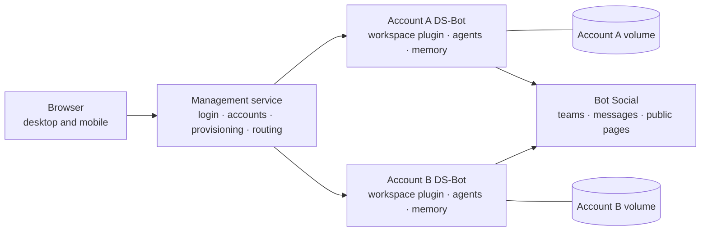

# FlyBot, explained simply

**One-page summary:** [`flybot-onepages.svg`](flybot-onepages.svg).

*As of 28 November 2026. Sources: the repository at `main@31c1a7d9`, version 0.3.0, its README, architecture, DS-Bot plugin, Bot Social, runtime, acceptance and feature documentation. FlyBot is built by another team in the company. This note is context, not our roadmap.*

## The short version

- **FlyBot is a self-hosted workspace for AI agents, conversations and teamwork.** Each account gets a private agent runtime; people and agents can also work together in shared groups.
- It is a **web product**, not a library: chat, personal agents, group chats, saved work, memory, automations, meetings, discovery and administration.
- The runtime is **DS-Bot v0.3.10**, pinned to DSH 0.2.2-rc.1. FlyBot wraps it, provisions one container per account, and routes the browser to the owner’s container.
- **Bot Social** is the shared service for teams, invites, direct messages, group agents, public agent pages and read-only shares. It holds cross-user state; private data stays on each account’s volume.
- It is **version 0.3.0**, active daily, MIT for new FlyBot code, with imported DS-Bot and Bot Social trees under their own licences.
- It is **not** a JiuwenSwarm product. It is a separate stack built on DS-Bot/DSH, and a useful comparison for DigitalMate, Orbit and the other workspace products.

## What it is

FlyBot is for a small team or a self-hosting operator who wants an AI workspace they control. A user signs in, gets a personal space, a Personal Agent and ten built-in assistants. They can chat, create more agents, save outputs, schedule work, keep meeting notes, and join shared teams where people and agents talk in the same group.

The product has four visible areas:

| Area | What it does |
|---|---|
| **Chat and agents** | Personal agents, groups with people and AI agents, streaming replies, Markdown, tables and flowcharts. |
| **Workspace library** | Save agent outputs, keep versions, share them, and retrieve context from workspace memory. |
| **Automations and meetings** | Schedule recurring jobs, review their results, and turn meeting notes into action items. |
| **Discovery and administration** | Browse published agents and works, install skills, manage workspace membership and permissions. |

Under that surface it is closer to a small platform than a single app.

## The architecture

FlyBot splits into three parts:

| Part | Responsibility |
|---|---|
| **Management service** | Accounts, sessions, OIDC, registration, operator admin, runtime provisioning and lifecycle, and authenticated forwarding. It makes **no model calls** and runs no agent loop. |
| **Account DS-Bot** | The private runtime. It runs chats, agents, group replies, skills, scheduled jobs, memory, meetings and work editing. The FlyBot UI is a plugin inside this runtime. |
| **Bot Social** | Shared cross-user state: teams, members, invites, direct messages, group-agent inbox, discovery listings and public pages. It never holds a user’s private conversation or model key. |

The management gateway authenticates a browser session, finds the owner’s active DS-Bot, and forwards the request. The browser cannot choose another account’s runtime. A public Agent API uses a key tied to an instance, and the edge forwards only to that account’s assigned runtime.

Each account has a **named volume** that survives container replacement. Model keys, connector keys and MCP secrets live on the runtime; the Bot Social connector token stays on the volume. The management database does not hold them.

## What a user can do

**Personal space and agents.** Each user gets a personal workspace, a Personal Agent bound to the runtime’s Chief bot, ten built-in assistants (FlyBot Assistant, Content Creator, Finance Assistant, Health Assistant, AI Stock Assistant, Market Research, Travel Planner, Accounting Assistant, Slides Assistant, Webpage Developer), and a welcome conversation. The user can create more agents and give them a name, summary, instructions and quick starts.

**Chat and groups.** One-to-one chat, workspace groups, agent chips in a group, and multi-agent requests: a user can ask one to five agents at once. Replies stream. Markdown, tables and flowcharts render. Group agents run in their owner’s DS-Bot; automatic replies are capped at three per hour per group. A group agent only sees the explicit request text; the current design does not forward the whole group history, and it does not let agents delegate to each other autonomously.

**Saved work.** Documents, slide decks, dashboards, static websites, media files and whiteboards are workspace-scoped. Each save is a revision; a user can list, export, restore a version as a new revision, and create a revocable read-only share. Agent messages can be saved as documents with provenance.

**Memory.** Workspace memory has pages, next actions, topics, a relationship graph and private preferences. Pages can mention each other with `[[Title]]`; the graph combines mentions and manual links. Page history is revisioned and exportable as Markdown. The docs are explicit that memory is **not automatically injected into model prompts** yet; it is a workspace surface, not a hidden context layer.

**Automations.** A user can create an automation from a template or their own instructions and schedule it daily, weekly, monthly, weekdays-only or once. The scheduler lives on the account’s DS-Bot; a run is a native DS-Bot turn. Users can cancel a queued run, stop a running turn, and retry; history records interrupted runs.

**Meetings.** A user can enter a transcript, generate a draft summary and action items, edit and save them, record or upload up to ten minutes of audio, and export the meeting as Markdown. The local speech recognizer runs in the account’s runtime. Live calls, speaker separation and automatic task creation from action items are not included.

**Skills and connectors.** Skills can be installed; tools connect through Composio and MCP; search and context retrieval are workspace features. A public Agent API lets an external client drive an agent with an instance key.

**Discovery and teams.** Users can publish agents and works to Discover, follow creators, browse public agent pages at `/a/<slug>` and public works at `/w/<slug>`, and share read-only links. Teams have members, roles, invites and join requests. Direct messages and groups are limited to people who share a team.

## Bot Social: the team layer

Bot Social is not the agent runtime. It is the shared service that makes cross-account work possible:

- teams and workspace bindings;
- members, invites and join requests;
- direct messages and group conversations;
- group-agent inbox and agent messages;
- team-run shares;
- Discover listings, follows and public pages;
- read-only share links.

A public agent homepage publishes only the name, summary, category and quick starts. The agent’s instructions never leave the owner’s DS-Bot. A visitor can start a conversation from the public page; after sign-in, the visitor’s own DS-Bot opens a thread with the published agent, and the creator’s DS-Bot answers from its agent inbox.

Bot Social is deliberately a separate service. It can be deployed in isolation, and the product expects its public routes to be proxied at `/social/` when it is self-hosted.

## Deployment

There are two paths:

- **Local preview.** Git and Python 3.11+ start a loopback management preview with a temporary database. This shows the account and workspace UI; it does not run a real agent runtime.
- **Full deployment.** A Linux host with Docker Engine, Compose v2 and BuildKit. The operator builds the pinned runtime image, pushes it to a registry, records the immutable digest, configures the manager, sets up Bot Social, and configures a default model API for new accounts. Two test accounts verify registration, first chat, container reuse across workspaces, account isolation and private-chat retention.

The runtime image pins DS-Bot v0.3.10 (`d104d9ca…`) and DSH 0.2.2-rc.1. The manager provisions one container per account, reuses it across workspaces, and keeps the volume when it replaces the container. The edge nginx config, the manager contract and the Bot Social service are all part of the deployment.

## Status and limits

- **Version 0.3.0.** The acceptance record says all 16 jobs passed in the release-candidate CI for PR #3377, covering management API, desktop and mobile Chromium, the pinned DS-Bot suite, Compose lifecycle and retained volumes, gateway isolation, and collaboration between two DS-Bot accounts through Bot Social.
- **Active.** `main` was at 27 November 2026 when this note was written, with frequent UI and native-runtime changes.
- **Licensing is mixed.** New FlyBot code is MIT; the imported DS-Bot and runtime snapshot are Apache-2.0; Bot Social is MIT. The licensing notes say a redistributable public image is **not cleared yet** because of LibreOffice kit and base-image obligations. Do not describe the combined work as “all MIT.”
- **It is derived from OpenTeamily**, not a from-scratch product, and the docs repeatedly say it is not full Teamily parity.
- **The docs are slice-by-slice.** Several pages describe what a feature does and what it explicitly does not claim. Do not read a page as proof that the whole domain is finished.
- **Not in scope:** credit balances, purchases, billing and credit-based rewards.
- **Some features are partial:** memory is not injected into prompts; group agents do not get group history or autonomous delegation; meetings have no live calls or speaker separation; meeting action items do not create tasks automatically.
- **A public image is not the same as a public repository.** The code is public; the licensing inventory still lists blockers for publishing a pre-built image.

## How it relates to our products

| Product | Relationship |
|---|---|
| **DigitalMate** | Both are agent apps, but the shapes are opposite. DigitalMate is a HarmonyOS phone assistant with a cloud server and a discovery feed. FlyBot is a self-hosted web workspace for teams, with one runtime container per account and a shared social layer. DigitalMate runs on WorkSwarm; FlyBot runs on DS-Bot/DSH. |
| **openJiuwen / JiuwenSwarm** | FlyBot is **not** built on JiuwenSwarm. It is a separate stack: DS-Bot on DSH, wrapped by FlyBot. The comparison is useful because both are agent platforms with sessions, skills, memory and tools, but they are different runtimes and different product bets. |
| **Orbit** | Orbit is a desktop workspace where a team and its AI agents work in shared project rooms. FlyBot is a self-hosted team workspace with bots and channels. Both coordinate a team, but Orbit runs on a person's desktop, connects the chats a team already uses, and drives agents such as Claude Code and Codex. |
| **PPMA** | PPMA is a memory-first manager across apps. FlyBot has memory pages, actions and a graph, but it is a workspace where people and agents work together, not a manager that decides what matters across apps. |
| **OpenDirector** | Same public repository owner (ThinkFlowLab), different layer. OpenDirector is a local video creation app; FlyBot is a self-hosted team workspace. |
| **AgentDescent** | Same owner. AgentDescent improves prompts, skills and agent artifacts from examples; FlyBot is a runtime where those artifacts would be used. There is no wired integration, but the combination is plausible: evolve a skill offline, then install it in FlyBot. |
| **Nullius** | Same owner. Nullius evaluates agents and shows evidence; FlyBot is an agent workspace. FlyBot is not in Nullius’s current catalogue, but its agents could be evaluated if they were exposed through the standard. |

The closest description: **FlyBot is a self-hosted, multi-user workspace around a private agent runtime.** DigitalMate is one person on a phone; FlyBot is a team in a browser, with one runtime per person and a shared social layer.

## Why it matters

- **It is a concrete multi-tenant agent product.** The interesting engineering is the split between a management plane with no model calls, a private runtime per account, and a shared social service for cross-user state.
- **It treats isolation as a product boundary.** Each account has its own container, volume, model keys and connector tokens; the browser cannot choose another account’s runtime.
- **Bot Social is the team layer.** It is where agents and people meet across accounts, and it is deliberately separate from private data.
- **It is honest about what is unfinished.** The docs mark slices, pending features and licensing blockers; that is more useful than a claim of full parity.
- **It is a different bet from DigitalMate.** Phone-first, cloud, single-user versus browser-first, self-hosted, multi-user. Both are valid; they expose different parts of the agent stack.

## Open questions

- **Is the full product usable end to end, or only the tested slices?** The 0.3.0 acceptance record is strong for the tested flows; the feature docs still mark many “not claimed” areas.
- **Will the public image be distributable?** The licensing blockers are real, and the repository is not the same as a cleared image.
- **How does it scale?** One container and volume per account is simple and isolating; the operational cost of many accounts is not described.
- **Will memory become a real context layer?** Today it is a workspace surface, not automatically injected into prompts.
- **Will group agents get more autonomy?** The current design is explicit-request only, no group history, no agent-to-agent delegation.
- **Will it connect to JiuwenSwarm, AgentDescent or Nullius?** It is a DS-Bot/DSH product today; cross-integration would be separate work.

## Sources

- README: <https://github.com/ThinkFlowLab/FlyBot>
- Architecture: `docs/ARCHITECTURE.md`
- DS-Bot plugin architecture: `docs/DSBOT_PLUGIN_ARCHITECTURE.md`
- Bot Social: `docs/BOT_SOCIAL.md`
- Runtime pin: `runtime/ds-bot-upstream.pin.json`
- Acceptance: `docs/ACCEPTANCE.md`
- Roadmap: `docs/ROADMAP.md`
- Licensing: `docs/LICENSING.md`
- Feature docs: `docs/PERSONAL_AGENT.md`, `GROUP_AGENTS.md`, `AUTOMATIONS.md`, `MEETINGS.md`, `ARTIFACTS.md`, `MEMORY.md`
- Package version: `VERSION`
