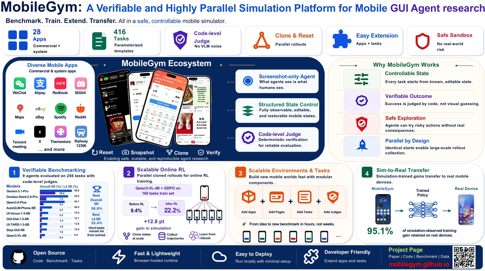

# MobileGym, explained simply

**One-page summary:** [`mobilegym-onepages.svg`](mobilegym-onepages.svg).

*As of 28 November 2026. Sources: the repository `Purewhiter/mobilegym` at `main@5fbd3f3`, version 0.1.0, its README, AGENTS, changelog and platform documentation. MobileGym is another team's research project. This note is context, not our roadmap.*

## The short version

- **MobileGym is a simulated mobile phone that runs in a browser**, built for testing and training AI agents that use mobile apps by looking at the screen and tapping.
- It is not a phone emulator. It is a **programmable world**: the entire phone state is a JSON snapshot, so a test can reset it, clone it, inject data, and compare the result exactly.
- It ships **28 simulated apps** and **416 task templates**, with **deterministic judges** that read the phone state instead of asking a model to grade the result.
- It runs **256 parallel instances on one server**, at about **400 MB RAM and 50 MB disk per instance**, and a full 256-task evaluation takes about **6 minutes**.
- It has been used for **online RL**: a GRPO run on Qwen3-VL-4B gained **+42.8 points in simulation** and kept **95.1%** of that gain on a real phone (**+40.7 points**).
- It is a **research benchmark and training environment**, not a product app. Code is Apache-2.0; the companion dataset is CC BY-NC 4.0.

## What it looks like



*The project's own summary of the simulator: its apps, its tasks, its judges, its results and the sim-to-real test.*

## What it is

MobileGym is a browser-hosted, Android-like mobile environment. An agent sees screenshots, chooses from 16 actions (tap, type, swipe, back, home, wait, drag, complete, and so on), and tries to finish a task. The environment is made of simulated versions of everyday apps: WeChat, RedNote, X, Reddit, Alipay, eBay, Bilibili, Spotify, WeChat Reading, 12306, Maps, Tencent Meeting, plus system apps such as Contacts, SMS, Notes, Calendar, Files, Gallery, Settings and a browser.

The apps are **independently implemented research surrogates**. They are not connected to the real services, accounts or money. The project’s disclaimer is explicit about that.

The point is not pixel-perfect imitation. The point is a **verifiable world**: the environment knows its own state, so a judge can say exactly whether the task succeeded, whether the agent took a wrong turn, and whether it caused an unexpected side effect.

## The three problems it solves

The README frames the problem as three walls that real-device and emulator testing hit:

| Wall | What goes wrong on a real phone | What MobileGym does |
|---|---|---|
| **Unreadable state** | The accessibility tree shows the UI, but not balances, orders or chat history. Verification falls back on a model judge, which misjudges about 10.2% of the time. | The whole environment is a structured JSON snapshot. Judges read the state directly. |
| **Unwritable state** | App data sits in encrypted databases and server backends. You cannot reset it, clone it or run group RL on it. | Reset, inject, snapshot and clone the state into hundreds of parallel instances. |
| **Irreversible side effects** | A transfer moves real money; deactivation is permanent. | Everything is sandboxed. Roll back, replay, run a million episodes. |

That combination is the product: one environment for **trustworthy evaluation** and **scalable online RL**.

## How it is built

MobileGym is a three-layer stack:

```text
Benchmark layer (Python + Playwright)
  task templates · deterministic judges · reward shaping · parallel rollouts
        ↓  __SIM__ / __OS__ / __SIM_INPUT__
Apps layer (apps/<Name>, system/<Name>)
  manifest · navigation finite-state machine · layered state
        ↓  IntentResolver · BackDispatcher · AppLifecycle
OS layer (os/)
  SystemShell · TaskManager · status/quick/notification shade · services
```

- **OS layer.** A simulated Android system: task and activity stack, back handling, intents, app lifecycle, status bar, keyboard, notifications, clipboard, time and location services. Apps must use the simulated services instead of real browser APIs.
- **Apps layer.** Each app has a manifest, a declarative navigation file, a finite-state machine of screens and actions, and its own state. A new app drops in through the manifest; the OS discovers it automatically.
- **Benchmark layer.** Python and Playwright drive the environment, bind task parameters, run the agent, judge the result and record the run.

The key design choice is that **state is the interface**. The agent gets screenshots; the judge gets the full state. That is why the judge can be deterministic and why the same state can be cloned across many parallel runs.

## Apps and tasks

- **28 simulated apps**, including WeChat, RedNote, X, Reddit, Alipay, eBay, Bilibili, Spotify, WeChat Reading, 12306, Maps and Tencent Meeting.
- **416 parameterized task templates**. A template binds parameters and injects data into the initial state, so the same task can be run with different contacts, messages, balances or dates.
- **256 test tasks** on the public benchmark split.
- **16-action abstraction**: tap, type, swipe, back, home, wait, drag, complete and the rest.
- **AnswerSheet**: a structured form for free-text answers, with declared field types, so an agent cannot game the metric with chain-of-thought text.
- **Deterministic judges**: every task ships a programmatic check. The judge reads the state, not a model’s opinion.
- **Full-environment comparison**: the judge can catch side effects a screenshot-only pipeline cannot see, such as a followed user or a sent message that was not part of the task.

## Parallelism and cost

The environment is deliberately small:

- about **400 MB RAM** and **50 MB disk** per instance;
- **256 parallel instances** on one server, using less than 10% CPU;
- a full 256-task evaluation in about **6 minutes**;
- cold start in about **3 seconds** per instance.

For heavy runs, the repository ships an nginx gateway with HTTP/2 and eight workers. A single `npm run preview` tops out around eight parallel rollouts; the gateway is what makes the larger numbers possible.

## Evaluation and RL results

The public leaderboard on 256 test tasks reports:

| Model | Overall success rate |
|---|---|
| Gemini 3.1 Pro | **58.8%** |
| Doubao-Seed-2.0-Pro | 52.0% |
| Qwen3.6-Plus | 45.7% |
| AutoGLM-Phone-9B | 20.0% |
| UI-Venus-1.5-8B | 15.4% |
| Qwen3-VL-4B | 9.4% |
| **Qwen3-VL-4B + GRPO** | **22.2%** |

The sim-to-real result is the more interesting one. On a 59-task signal-bucket subset, **10 GRPO steps on one node** lifted Qwen3-VL-4B by **+42.8 points in simulation** and **+40.7 points on a real Redmi Note 12 Turbo** — a **95.1% retention** of the simulation gain. The training recipe used Qwen3-VL-4B, GRPO, learning rate 1e-6, group size 8, batch 12, KL 0.01, DAPO-style asymmetric clipping, a dense progress-shaped reward, and three RTX Pro 6000 GPUs with 96 parallel browser instances.

These are project-reported results, not an independent audit. The sim-to-real result is one subset and one device; it is evidence of behavioural fidelity, not a guarantee for every app or every phone.

## Supported agents

MobileGym is model-agnostic. It ships adapters for:

- `autoglm` — Open-AutoGLM style;
- `uitars` — UI-TARS;
- `venus` — UI-Venus;
- `gui_owl` — GUI-Owl;
- `gelab` — Gelab-Zero;
- `generic` / `generic_v2` — a unified JSON schema, including a `<think>` + `<answer>` form for trained checkpoints;
- `mai_ui` — MAI-UI style;
- `human` — manual control for debugging.

A new adapter is a small piece of code, not a new harness.

## Status and limits

- **Version 0.1.0**, released on 26 June 2026. The paper was accepted to EMNLP 2026; the preprint is arXiv 2605.26114.
- **Code:** Apache-2.0. **Data:** CC BY-NC 4.0, so the companion dataset is not for commercial use without checking the licence.
- **Requirements:** Node 22+, Python 3.11+, Playwright Chromium. The companion dataset is about 1.9 GB.
- **Activity:** the last commit on `main` at the time of this note is 9 October 2026; this is a published research artifact, not a daily product.
- **Not a real phone.** It is an Android-like simulation. HarmonyOS, iOS and real vendor services are not the target; behavioural fidelity is.
- **Judges are deterministic for the core tasks**, but the repo also includes VLM evaluation tooling for other uses. The deterministic state-diff judge is the differentiator.
- **The leaderboard is a public research table**, not an audited vendor benchmark. Rows are added by pull request with run commands and logs.
- **The apps are research surrogates.** They are not affiliated with the real publishers and never touch real services or funds.

## How it relates to our products

| Product | Relationship |
|---|---|
| **DigitalMate** | The closest domain match: both are about mobile agents. DigitalMate is a HarmonyOS phone assistant; MobileGym is an Android-like simulated phone for GUI-agent research. MobileGym could evaluate a mobile agent’s screen-and-tap behaviour, but it is not built for HarmonyOS or for DigitalMate’s task model. |
| **openJiuwen / JiuwenSwarm** | No direct integration. MobileGym is a benchmark environment; JiuwenSwarm is an agent runtime. A JiuwenSwarm GUI agent could be adapted to MobileGym, but no adapter ships today. |
| **Nullius** | Complementary evaluation layers. Nullius runs benchmarks and shows evidence; MobileGym supplies a mobile simulation with deterministic state judges. MobileGym is not in Nullius’s catalogue today. |
| **AgentDescent** | Different kind of improvement. AgentDescent evolves prompts and skills from examples; MobileGym trains a GUI agent with online RL. A MobileGym reward could in principle feed an agent-improvement loop, but there is no wired integration. |
| **OpenDirector / FlyBot / Belle** | No direct relation. Those are apps and workspaces; MobileGym is a research simulator. |
| **PPMA / Orbit** | No direct relation. |

The closest description: **MobileGym is a test track for mobile GUI agents**, not an agent product. It is where you find out whether an agent can use a phone, and whether the training transfers to a real one.

## Why it matters

- **It makes state the judge.** That is the clean answer to “did the agent actually do the task?” — no model grading a screenshot, no string matching.
- **It makes parallel RL practical.** Cloning a JSON state into hundreds of instances is much cheaper than cloning phones.
- **It separates side effects from success.** A task can be “done” while the agent also followed someone or sent an extra message; MobileGym sees that.
- **It has sim-to-real evidence.** The 95.1% retention number is the strongest part of the pitch, with the caveat that it is one subset and one device.
- **It is honest about being a benchmark.** It does not pretend to be a production phone or a real app.

## Open questions

- **Does the sim-to-real transfer hold beyond the signal-bucket subset and the Redmi device?** That is the key replication question.
- **How faithful is an Android-like simulation for HarmonyOS or iOS agents?** The OS layer is Android-shaped; other platforms would need their own mapping.
- **How much of real app complexity do 416 templates cover?** The templates are parameterized, but real apps have more edge cases.
- **Will the benchmark stay maintained?** The last commit is September 2026; the paper is published, but a benchmark needs upkeep.
- **Can it connect to Nullius or AgentDescent?** The pieces fit in principle — a deterministic environment, a reward, an evaluation viewer — but no integration exists.
- **What is the commercial path?** Code is Apache-2.0, but the dataset is non-commercial; that limits some uses.

## Sources

- Repository (main): <https://github.com/Purewhiter/mobilegym/tree/main>
- Project site: <https://mobilegym.dev>
- Paper: <https://arxiv.org/abs/2605.26114>
- Platform contract: `docs/platform/app/module-contract.md`
- State model: `docs/platform/state/model.md`
- Task authoring: `bench_env/docs/task/TASK_AUTHORING_GUIDE.md`
- Changelog and versioning: `CHANGELOG.md`, `docs/VERSIONING.md`
- Package metadata: `package.json`
