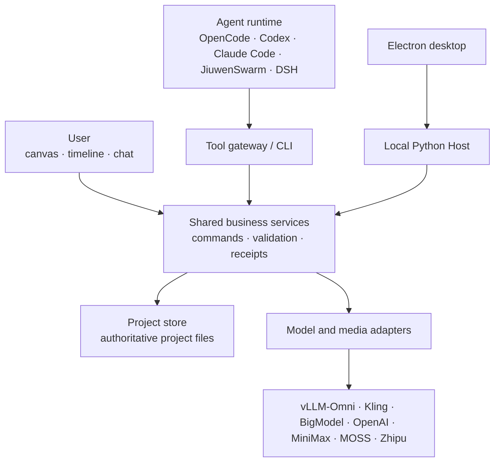

# OpenDirector, explained simply

**One-page summary:** [`opendirector-onepages.svg`](opendirector-onepages.svg).

*As of 27 November 2026. Sources: the repository at `main@368eb3d3`, version 0.1.6, its README, architecture docs, user guide, CLI guide and release notes. OpenDirector is built by another team in the company. This note is context, not our roadmap.*

## The short version

- **OpenDirector is a local AI video creation workspace.** You talk to an assistant, generate images, video and audio, arrange the results on a canvas, edit them, put them on a timeline, and export an MP4.
- It is a **desktop app** (Electron) that runs a local Python server and opens a browser-based workspace. Projects stay on your machine; generation calls go to the model services you configure.
- It treats **the user and the agent as equal users of the same business services**. Both can create, generate, edit, adopt results, arrange a timeline and export. The agent is not a separate feature bolted onto a viewer.
- The agent is **not one fixed assistant**. It can run on bundled OpenCode, OpenCode CLI, Codex, Claude Code, JiuwenSwarm or DeepSeek Harness.
- It is **early and moving fast**: v0.1.0 on 6 November 2026, v0.1.6 tagged on 26 November, seven public tags in three weeks, Apache 2.0, installers for Apple Silicon Mac and Windows x64.
- It is an **app on top of agents**, not another agent platform. JiuwenSwarm is one supported runtime, not the only one.

## What it is

OpenDirector is for a person who wants to make a short video with AI but keep the project, the assets and the editing on their own machine. The workflow is:

```text
idea → chat → generate assets → organise on the canvas → edit → arrange the timeline → export MP4
```

It is a single-user workspace, not a multi-user studio. A second browser window can preview a project or request edit access, but there is no real-time collaboration. The product is aimed at individual creators and small teams who want local project ownership and a choice of models.

The repository describes it as **"from an idea to a downloadable short film"**. The included example, *We Can Still Win*, is a 60-second short made in OpenDirector; the video generation used FastH3 through vLLM-Omni.

## The picture



The important part is the middle: the UI and the agent both call the same business services. The canvas is a view of the project, not a second copy of it. The project store is the source of truth.

## The creation loop

1. **Connect models.** Add chat, image, video or audio models in Settings. A service can expose several models; you choose which ones to keep.
2. **Start from chat or a node.** The assistant can save text, generate assets, and reference existing canvas content. You can also create a text, image, video, audio, timeline or subject node directly.
3. **Generate with references.** Connect a source node or type `@` to reference an asset. Image and video nodes carry the model, prompt, references and parameters for one generation.
4. **Inspect and adopt.** A finished job produces candidates. You review them, adopt one, edit it, or leave the earlier result in place. Generation success does not automatically overwrite what is currently used.
5. **Edit.** Images support crop, rotate, colour, layers, text, shapes and AI tools such as extend, erase, background removal and upscale. Video and audio support trimming, frame extraction and audio extraction.
6. **Arrange the timeline.** Add clips, images and audio; adjust order, start and end points, speed and volume; add timed text with the bundled CJK font; preview the result.
7. **Export.** Render MP4 in the browser, or export JSON, FCPXML or a portable `.timeline.zip` package. The editable package keeps fonts, media and text sources so another project can open it.

There are also image presets: Character three-view, Character four-view, Face three-view, Product three-view, Storyboard and Multi-camera. Each preset produces reference sheets or separate images connected to the source.

## The project model is the real design

OpenDirector separates things that most generation tools blur together. This is the most useful part of the product to study.

| Object | What it owns |
|---|---|
| **Project** | Stable identity, object scope and storage lifecycle. |
| **Asset** | The file, its content fingerprint, media facts and actual provenance. |
| **GenerationSpec** | The prompt, model, parameters and generation intent. |
| **Reference** | Which source feeds which target, in what order and with what version policy. |
| **CanvasItem** | Position, size, layering, grouping and lock state — presentation, not business truth. |
| **Editing document** | Layers, media edits, timeline, text and other editable structures. |
| **Job / tool task** | Fixed inputs, status, remote identity and result evidence for one execution. |
| **Result and adoption** | Candidate versions and the one currently chosen for use. |
| **Session and agent run** | Conversation, reference snapshots, operation links and execution context. |
| **ViewState** | Selection, viewport, active editor and playhead — UI state, not business facts. |

Three relationships are kept separate:

- **Creative reference** — what the next generation should use.
- **Actual source** — what a particular execution really used, frozen at acceptance.
- **Current adoption** — which result the canvas or timeline is using now.

That separation is why changing an earlier edit does not rewrite the evidence of an old generation, and why a successful job does not silently replace the current image or clip.

The project store is authoritative. The canvas and browser caches are projections that can be rebuilt. Edits carry an operation ID and expected object versions; replaying the same ID with the same input returns the original receipt, while the same ID with different input is rejected. An unknown submission is checked before retrying, so a lost response does not become a duplicate paid generation.

## User and agent do the same work

The core product principle is **capability equivalence**: for the business operations in scope, the user and the agent can do the same things under the same authorisation and rules.

- A user clicks the canvas; an agent calls the `opendirector` CLI or a business tool.
- Both go through the same typed commands, validation, locks, project versions and receipts.
- The agent does not simulate mouse gestures, and there is not one tool per button. Tools are designed around creative intent: create a configuration, add a reference, submit a generation, adopt a result, arrange the timeline.
- The agent runs in its own directory for each turn. Source assets are read-only; files it creates must be published and registered before they become project assets.
- The server grants the turn its own project write lease, renews it while the turn runs, and releases it when the turn ends. The user can reopen the canvas and continue editing.
- Stopping a reply, stopping later orchestration, and cancelling a submitted job are different actions. A stop preserves the partial reply and does not undo committed project changes or cancel remote jobs.

The agent can also be driven from outside the app. The DeepSeek Harness plugin exposes eight tools (projects, project, create generation, submit, job, adopt, cancel, operation) so DSH can create media in an OpenDirector project and hand the same project back for editing. The business CLI exposes the same operations to a terminal or an agent shell.

## The agent runtimes

OpenDirector does not force one agent program. It has a runtime adapter for each of these:

| Runtime | What runs | Model and authentication source |
|---|---|---|
| **Default** | A pinned, bundled OpenCode. | OpenDirector’s model configuration, through a local model proxy. |
| **OpenCode CLI** | `opencode` from `PATH` or a known install directory. | The CLI’s own configuration and model catalog. |
| **Codex** | `codex` from `PATH` or a known install directory. | Codex’s own authentication and model catalog. |
| **Claude Code** | `claude` from `PATH` or a known install directory. | Claude Code’s own authentication and model catalog. |
| **JiuwenSwarm** | `jiuwenswarm-process` over stdin/stdout JSONL. | The local Jiuwen model directory, configuration and environment. |
| **DeepSeek Harness** | `dsh` in ACP profile over JSON-RPC. | The CLI’s own profile, model catalog and authentication. |

Finding a CLI does not prove it is authenticated or configured. OpenDirector checks the backend’s `PATH` and common install directories, then shows a configuration error instead of silently switching runtimes. External harnesses do not read the model credentials OpenDirector stores.

This is a useful real-world test of JiuwenSwarm as a harness: the app needs a stable CLI, model configuration, skill loading, file and shell tools, cancellation, and a trace. The JiuwenSwarm path gets `skill_tool`, `list_skill`, `read_file`, `bash` and the business CLI.

## Models and media

OpenDirector connects to model services rather than shipping its own models. The adapters cover:

- **vLLM-Omni** for self-hosted image, video, speech, music, depth and score models.
- **Hosted services** such as Kling video, BigModel (CogVideoX and GLM-Image), OpenAI Images, MiniMax image, video and speech, MOSS speech and Zhipu speech.
- **Additional adapters** in the code for Volcengine and Higgsfield.

The model layer is more careful than a normal “base URL + API key” form. A capability contract records what a deployment can actually do, not just what it is called: text-to-video versus image-to-video versus first-frame/first-and-last-frame, which input roles a route really accepts, and whether a route is open. If a model service says it supports video but only accepts an image reference rather than a first frame, the UI should not offer the first-frame mode. This is checked at discovery, at submission, and in the agent tools.

The same capability facts feed the UI, CLI and agent. That is why “the endpoint answered” is not treated as “the feature works”.

## The desktop and local-first design

The desktop app is an Electron shell around the same web UI and Python API:

- Electron starts a bundled Python Host, gives it a fresh credential over a private control pipe, and waits for the Host to bind an OS-assigned port on `127.0.0.1`.
- The renderer loads through `opendirector://app`; the main process forwards requests to the Host with the launch credential.
- Node integration is off and context isolation is on. A preload bridge exposes only specific desktop operations.
- Projects and configuration live under Electron’s user data directory. Project files are authoritative; SQLite is used for runtime coordination such as leases, not as a second project store.
- Closing the window hides it so work can continue. Quitting checks active agent runs, generation jobs, tool tasks and export activity before stopping the Host. A provider can still finish a submitted job and charge for it after the app quits.
- Browser MP4 rendering needs the page and renderer process open. Editing the timeline through the agent does not imply background rendering.

The repository also has a standalone server mode (`opendirector serve`), a dev mode, and a CLI. The desktop app and the standalone server use the same project storage and validation.

## What is shipped, and what is not

**Shipped in the v0.1 line**

- Local project workspace, canvas, chat assistant and model connections.
- Image, video and audio generation, including references, first/last frames and continuation modes supported by the chosen model.
- Image editing, AI image tools, video/audio trimming, frame and audio extraction.
- Timeline editing, timed text, bundled CJK font, MP4 render, JSON/FCPXML export and portable timeline packages.
- Image presets, voice library, music generation and depth-motion references where the connected model supports them.
- Six agent runtimes, the business CLI, the DeepSeek Harness plugin, agent traces and per-turn timing.
- Chinese and English UI by default.
- Public installers for Apple Silicon Mac and Windows x64.

**Not shipped, or explicitly out of scope**

- A full production studio, complete scriptwriting system or full-series delivery pipeline. The roadmap says these need separate requirements; the unified project model does not create them automatically.
- Background video rendering after the browser closes. MP4 render currently needs the renderer; a background renderer would be a separate capability.
- Real-time multi-user collaboration. A second window can preview or take over editing; it is not a shared editing session.
- Automatic transcription and SRT/ASS import.
- FCPXML export with text overlays. Editable text lives in the `.timeline.zip` path.
- A project format with version negotiation or downgrade. Older builds reject projects that contain newer fields; back up the project before switching back.
- A guarantee that external harness authentication, model quality or provider availability is ready. Finding a CLI is not the same as a configured runtime.

The repository is explicit that architecture and roadmap documents describe goals, not completion. This note follows that distinction: the shipped list comes from the README and user guide; the “not shipped” list comes from the stated limits and roadmap.

## Release status

- **v0.1.0** — first public release, 6 November 2026.
- **v0.1.6** — current tag, 26 November 2026; `main` was at 27 November when this note was written.
- Seven public tags in three weeks.
- The release policy is a daily patch cut on the current minor, with a new minor every 14 days; a patch is cut only when the release checks and the nightly gate are green.
- **Apache 2.0** licence; public repository at `ThinkFlowLab/OpenDirector`; installers and website under `thinkflowlab.github.io/OpenDirector`.

## How it relates to our products

| Product | Relationship |
|---|---|
| **DigitalMate** | A sibling consumer agent app, but the opposite shape: DigitalMate is a HarmonyOS phone assistant with a cloud server and a discovery feed; OpenDirector is a desktop video workspace with a local host and a canvas/timeline. Both keep task/project state, run an agent, and ask before actions. DigitalMate delegates execution to WorkSwarm; OpenDirector can choose among six runtimes. |
| **openJiuwen / JiuwenSwarm** | OpenDirector supports JiuwenSwarm as one agent runtime, using `jiuwenswarm-process` and the local Jiuwen configuration. It is a concrete **app on top of the platform**, not part of the platform. It also uses vLLM-Omni for media generation, which is separate from JiuwenSwarm. |
| **Orbit** | Both are desktop workspaces that put multiple coding agents in one room. Orbit is a general agent workspace that connects existing team chats; OpenDirector is a domain-specific creative workspace with a local Python Host, a canvas and a timeline. |
| **PPMA** | Both are local-first, project-centric and agent-orchestrated. PPMA is a memory-first manager across apps; OpenDirector is an asset-and-project-first creative workspace. PPMA’s agents return proposals; OpenDirector’s agent commits through the same business services as the user. |
| **ScienceDiscovery** | Both are local domain workspaces built around a long-running project. ScienceDiscovery is research on JiuwenSwarm; OpenDirector is video creation across several runtimes. |

## Why it matters to us

- **It is a real example of the app layer.** The interesting work is not the chat box; it is the project store, receipts, locks, model capability checks, asset provenance and the handoff between user and agent.
- **It keeps the agent runtime replaceable.** JiuwenSwarm is one of six runtimes. That is a strong test of what an app actually needs from a harness: a stable CLI, skills, file/shell tools, model configuration, cancellation and traces.
- **Its project model is a good reference.** Separating generation intent, execution facts and current adoption prevents a whole class of “which version am I looking at?” bugs in any product that generates assets.
- **It bets on local-first and user-owned projects.** That is a different trade-off from cloud-only assistants: more control and privacy, but more setup, more provider configuration and no background rendering without the local app.
- **It moves fast.** Seven tags in three weeks and daily patches suggest a small team shipping in public; the docs are unusually detailed about boundaries and failure modes.

## Open questions

- **Which runtime becomes the default?** The bundled OpenCode is the default today, but the product deliberately supports external CLIs. A single default would simplify support; multiple runtimes widen the audience.
- **How much of the autonomous orchestration is implemented?** The architecture describes an agent that plans, batches, observes and adjusts. The roadmap and AGENTS.md treat that as a path, not a finished claim. The current note should not read the design as shipped.
- **Will the project format get versioning?** Today a newer project can be rejected by an older build. That is safe but awkward for users who switch versions.
- **Will background rendering arrive?** The browser is the renderer today. A background renderer would make the agent more autonomous but adds a new execution surface.
- **Can it support teams without losing local-first?** Preview and edit handoff exist; real-time collaboration does not. The next step would be a shared project service, which changes the privacy story.
- **What is adoption?** The repository has installers and stars but no public usage numbers. The product is early; the interesting signal is the release pace and the scope of the docs, not market share.

## Sources

- README: <https://github.com/ThinkFlowLab/OpenDirector>
- Product guidance: `AGENTS.md`
- Unified project architecture: `docs/architecture/unified-project.md`
- Agent runtime: `docs/architecture/agent-runtime.md`
- Desktop architecture: `docs/architecture/desktop.md`
- Capability contract: `docs/architecture/capability-contract.md`
- User guide: `docs/guides/user-guide.md`
- CLI guide: `docs/guides/cli.md`
- Roadmap: `docs/development/roadmap.md`
- Release policy: `docs/development/release.md`
- DeepSeek Harness plugin: `plugins/deepseek-harness/README.md`
- Package metadata: `package.json`, `pyproject.toml`, `apps/desktop/package.json`
