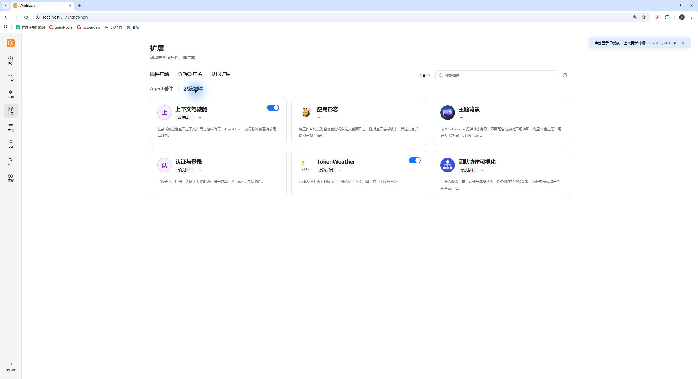
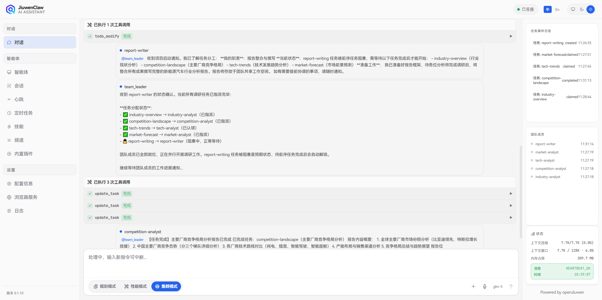
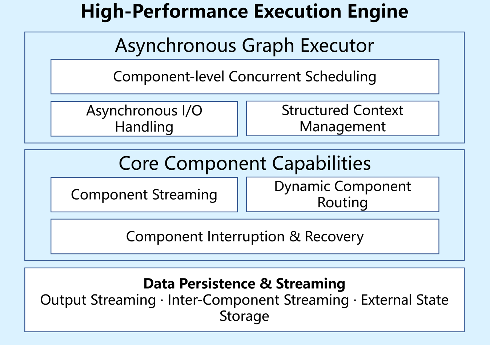

# JiuwenSwarm and agent-core, explained simply

**One-page summary:** [`openjiuwen-onepages.svg`](openjiuwen-onepages.svg).

*As of 28 November 2026. Sources: the local checkouts `agent-core@e60add22a` and `jiuwenswarm@1586ff3e7`, the pinned `agent-gateway@e4eb71be`, their READMEs, the architecture notes and the November release notes. JiuwenSwarm is the company's open platform; our team contributes to it but does not own its roadmap.*

## The short version

- **JiuwenSwarm is the server**, and **agent-core is the runtime underneath it**. JiuwenSwarm gives the runtime channels, sessions, teams, skills, memory, approvals and the enterprise layer.
- It runs **one agent or a team**. A team has a leader, members, a shared task board and, since November, a goal that checks whether the work is actually done.
- It connects the places people already work: **web, desktop, IDE, TUI, Slack, Feishu, WeChat, Telegram, WhatsApp, GitHub, Linear** and more.
- **agent-gateway** is the transport between channels and the runtime. **agent-dx** is an optional distributed substrate; it is not required for the normal setup.
- It is **open source** and active. About 2,200 commits landed across `jiuwenswarm` and `agent-core` in November; the month is recorded in [`whats-new/`](whats-new/).

## What JiuwenSwarm is

JiuwenSwarm is the server around the agent runtime. The Python package is published as **`workswarm`**, which is why some products call the same platform **WorkSwarm**.

It owns the parts a product needs around the loop:

- **Channels:** web, desktop, IDE, TUI and chat apps.
- **Sessions and tasks:** one conversation, its history, its runs and its files.
- **Teams:** a leader, members, a task board, goals, workflows and per-member execution environments.
- **Skills and memory:** packaged instructions, a skill market, document memory and the new Memory page.
- **Approvals and policy:** tool approval, send approval, grants and the enterprise guardrail chain.
- **Enterprise:** personal and enterprise editions behind one gateway, MySQL or PostgreSQL storage, quotas and per-agent credentials.
- **Surfaces:** an Office add-in, an app hub, a presentation layer and the experimental reverse-engineering (REA) setup.

## What agent-core is

agent-core is the runtime and SDK under JiuwenSwarm. It is the code that actually runs the agent:

- **The loop:** call the model, run the tool it names, feed the result back, stop for a reason.
- **Tools and models:** MCP clients, model clients, parameter fallbacks and provider compatibility.
- **Prompts and rails:** the prompt pipeline, tool security, task completion, memory rails and evolution rails.
- **Teams:** leader and member runtimes, goal checks, task claims, recovery and execution environments.
- **Context:** personal context, capacity limits, merge, retirement and per-run token accounting.
- **Harness providers:** the native DeepAgent-style harness plus Claude Code, Codex and DSH adapters.
- **Safety and operations:** sandbox providers (ADX, AIO, JiuwenBox), shell ownership, events and observability.

It is a library and runtime, not a UI. JiuwenSwarm is the product surface most people see.

## How they fit

```text
web · desktop · IDE · TUI · Slack · Feishu · WeChat
                      │
                agent-gateway
                      │
              JiuwenSwarm server
       sessions · teams · skills · memory · policy
                      │
                 agent-core
        loop · tools · rails · memory · sandbox
                      │
              models + MCP tools
```

The important boundary is that **JiuwenSwarm owns the product state** — sessions, teams, skills, memory, approvals and enterprise policy — while **agent-core owns the execution machinery**. Swapping the runtime should not move the product state out of the server.

Other repositories in the openJiuwen family — Studio, protocol, memory, tools — are outside this note unless they affect these two layers.

## What changed in November

The full account is in [`whats-new/whats-new-2026-11.md`](whats-new/whats-new-2026-11.md). The month's main changes:

- **Teams can hold a goal**, not only a task list, and the leader can run on Claude Code or Codex.
- **Each member can start its own workflow** and carries its own shell and execution environment.
- **A Memory page** and team document memory turn memory into a managed surface.
- **A reverse-engineering workbench (REA)** adds a guided setup for Ghidra, IDA, Frida and 229 tools.
- **System plugins** can ship as bundle packages with their own market page.
- **Floating app surfaces** and team companion windows arrive.
- **The enterprise chain** gains execution-guard slots, per-agent Keycloak credentials, workspace quotas and Swarmflow policy.

## What it looks like



*The WorkSwarm web UI at `localhost:5173`: the system-plugin market added in November. Each card is a system-level capability, not a chat prompt.*



*The JiuwenClaw desktop client: a team leader and five members in one conversation, with the task board and each member's status. The team is the unit of work, not a single chat.*



*Under the hood in agent-core: asynchronous graph execution, component streaming, interruption and recovery, and state persistence.*

## How it relates to our products

- **ScienceDiscovery** uses JiuwenSwarm as its default agent backend, with its own control plane for projects and artifacts.
- **LAIX, Cortex, Max and Channels** build on the platform; our issues and designs live in [`projects/openjiuwen/`](../../projects/openjiuwen/README.md).
- **DigitalMate** is the exception: it runs on its own server, with a plan to move onto JiuwenSwarm.
- Other company products can connect through the gateway or the Python API without copying the runtime.

## Limits

- **It is a platform, not a hosted service.** A working setup needs models, channels and permissions.
- **The enterprise deployment environments and cloud images were not read** for this note.
- **Some surfaces are experimental or off by default:** REA, the Memory page, SkillPack routing and TTSE.
- **agent-gateway is a separate repository.** It is pinned by commit; it is not part of the `jiuwenswarm` tree.
- **The local run used our checkouts.** `agent-core` and `jiuwenswarm` were installed editable; a later `uv sync` restores the pinned versions.

## Sources

- `jiuwenswarm` README, `AGENTS.md`, `docs/en/Memory-Portal.md`, `docs/en/application-presentation.md`, `docs/en/session-restart-recovery.md`
- `agent-core` README, `docs/en/images/high_performance_execution_engine.png`, `.agents/agent-docs/features/`
- `whats-new/whats-new-2026-11.md`
- `notes/prompts/context-assembly.md`, `notes/prompts/layer-order.md`
