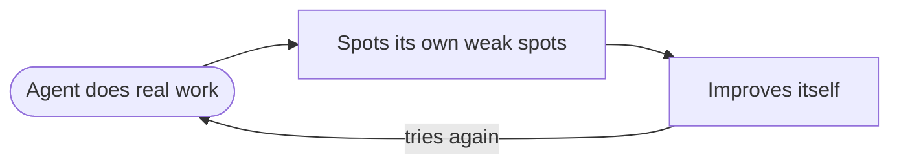

# What's New in JiuwenSwarm — August 2026

August was the month the system started changing itself: a self-improvement module
arrived, the permission model was rebuilt, teams learned to fork their work, and
Symphony grew from an idea into a module. About 680 commits landed across
`agent-core` and `jiuwenswarm`.

*Last updated: 2026-11-01.*

Everything here is tagged:

- **[NEW]** — a capability that did not exist before.
- **[UPGRADE]** — an existing capability re-worked until it feels new.

---

# The big things

## 1. RSI — the system starts improving itself — [NEW]

RSI (recursive self-improvement) landed on 4 August as its own module. It watches how
the agent behaved on real tasks, finds weak spots, and proposes changes to the agent's
own harness and prompts, keeping the changes that pan out. At the end of the month it
gained an evidence-driven path, so proposals are grounded in recorded runs instead of
guesses; the evaluator agent that scores them arrived in September.

This is one level above the existing "self-evolving" work: self-evolving tunes prompts,
tools and skills, RSI improves the harness that runs them.

## 2. Permission modes — a real security model — [NEW]

On 17 August the permission system gained three clear modes — **Full Access**, **Auto**
and **Strict** — and by the 27th the engine was decoupled from the product model:
permissions live in layers (global, user, session), persist per session, and cover
network access as well as tools. Until then, approvals were a prompt-by-prompt affair.

## 3. Fork and checkpoints — five ways to branch work — [NEW]

Teams and single agents can now fork a run instead of compacting it. Five fork modes
arrived (18 August) with named, persisted checkpoints and a `list_checkpoints` tool, and
a fork carries its own identity — a capability statement plus `converted_from` — so the
branch knows what it inherited.

## 4. Symphony — skills as a graph — [NEW]

Symphony became a module of its own (4 August) and then moved into the retrieval path.
It orchestrates skills as a graph, learns from real executions, distils them into
reusable **skill packs**, and groups equivalent skills. By early September it also spoke
the standard JGF graph format, so graphs can be composed and reused by other tools.

---

# The rest, by theme

## Agents working with agents

- **Team templates and plugins [NEW]**: teams can be created, loaded and executed from
  templates and plugin packages, then snapshotted for members.
- **External CLI agents [NEW]**: Claude Code and Codex joined as configurable team
  members, with a settings panel and dependency install on demand.
- **Sub-agent tools [NEW]**: `subagent_spawn`, `wait`, `list`, `send_input`, `close` and
  `resume`, so an agent can manage helpers explicitly.
- **AgentGroup packages [NEW]**: hybrid teams can select installed agent groups.
- **Reviewer feedback drives evolution [UPGRADE]**: review outcomes feed skill evolution.

## Getting smarter

- **Online RL closed loop [NEW]**: task collection through AIGW, policy training and
  cross-process validation, plus SFT flow.
- **Context evolution and proactive context [UPGRADE]**: the context engine gathers
  context by itself rather than waiting to be asked, keeps it in collections you can
  browse and query, and adds a ContextEvolution framework with Metis task memory.
- **Thinking modes [UPGRADE]**: the LLM layer gained explicit thinking and
  reasoning-intensity controls.

## Operations

- **Heartbeat [UPGRADE]**: rebuilt as a Rail-based heartbeat managed by the
  AgentServer, with a web panel for the tasks.
- **Distributed deployment [NEW]**: multi-machine deployment, with function registration
  removed.
- **Renamed to WorkSwarm [NEW]**: on 17 August the Python package and many UI strings
  were renamed from `jiuwenswarm` to `workswarm` (v0.2.5.beta1). Both names still appear
  in the product.
- **Web marketplace [NEW]**: plugins and MCP servers can be installed from the web, with
  SkillHub recommendations.

---

# See also

- [September 2026](whats-new-2026-09.md) · [October 2026](whats-new-2026-10.md)
