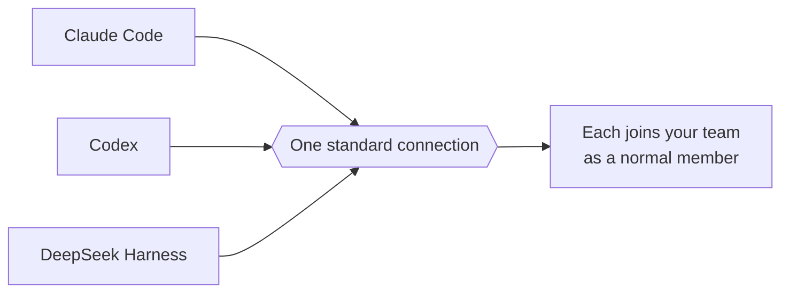

# What's New in JiuwenSwarm — September 2026

September rebuilt how a run is recorded and how the agent is driven: trajectory v2,
the headless runtime with SDKs, the protocol that lets other agents join, and a smarter
approval layer. About 1,050 commits landed across `agent-core` and `jiuwenswarm`.

*Last updated: 2026-11-01.*

Everything here is tagged:

- **[NEW]** — a capability that did not exist before.
- **[UPGRADE]** — an existing capability re-worked until it feels new.

---

# The big things

## 1. Trajectory v2 — one shape for every step — [UPGRADE]

On 17 September the trajectory was rebuilt around a single span-level schema: model
calls, tool calls and context compactions are now recorded in exactly the same shape,
stored by content, and read one subject chain at a time. The viewer became a real
product: turn paging, retention with checkpoints, JSONL zip export, compaction
explanations, time-to-first-token, and the model-facing tool result shown beside the raw
return.

This is technically an upgrade, but the data model and the viewer together are a new
generation of the feature.

## 2. Process CLI and SDKs — the agent runs headless — [NEW]

The agent no longer needs the web app. A new Process CLI runs a single agent one-shot
over standard input and output (10–16 September), and Python and TypeScript SDKs let any
program drive it. It handles sessions, models, planning, permissions and steering, so a
script or a CI job can use the same runtime as the chat.

## 3. A protocol for other agents — [NEW]

The "external harness" protocol was defined on 1 September, with the DeepSeek Harness SDK
integrated the same day. Claude Code and Codex migrated onto it, and members gained model
and reasoning-effort switching, third-party telemetry, a fallback model when their auth
fails, and a way to report runtime failures. This is what later lets someone else's agent
be a normal teammate.

## 4. Smart approval and intent authorization — [NEW]

Approvals stopped being a blanket prompt. **Smart approval** (from 3 September) lets a
model judge whether an action is safe and approve it, with policy snapshots and an audit
trail; the permission layers were split into global, user and session on 7 September.
**A4P** then arrived on 17 September: a user pre-approves an intent for a session or a
scheduled job, and the agent stops asking for every action inside it. It was re-landed
in October with session and scheduled-job support.

---

# The rest, by theme

## Channels

- **Browser extension [NEW]**: the browser became a channel of its own.
- **IDE plugins [NEW]**: editors became a channel too, with an IDE plugin package.
- **Full-duplex audio and video [NEW]**: a plugin-based multimodal channel with its own
  configuration entry, plus voice-to-agent task management.

## Marketplace and skills

- **Unified hub [UPGRADE]**: one search across skills, experts, plugins and MCP servers,
  with caching, and skill packs installable from Symphony.

## Runtime

- **Session steering [NEW]**: send more input to an agent that is already running, and
  across sessions, without starting a new turn.
- **Session housekeeping [UPGRADE]**: fork, side conversations, archive per project,
  resume and delete.
- **Group conversations [NEW]**: members can talk in a group and deliver reliable inputs.

## Models and context

- **Model groups [NEW]**: several models configured as a group with routing policies.
- **OpenAI Responses API [NEW]**: supported for API-key configurations.
- **TTSE rail [NEW]**: a translation rail for how tool results reach the model.
- **Native image input [UPGRADE]**: per-model `supports_vision` declaration.

## RSI

- **RSI web UI [NEW]**: artifact browsing and preview, plus the evaluator agent and the
  optimization lifecycle.

## Platform

- **AgentOS / Gateway split begins [UPGRADE]**: on 22 September the Gateway started being
  separated from the product, first as its own code boundary.

---

# See also

- [August 2026](whats-new-2026-08.md) · [October 2026](whats-new-2026-10.md)
