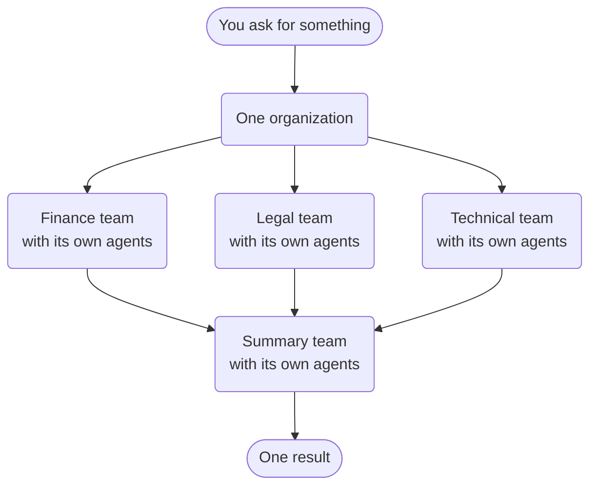
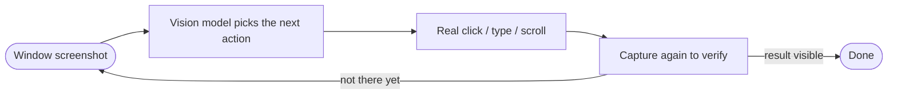

# What's New in JiuwenSwarm — October 2026

October is the month the swarm became an organization and the agent got a hand on the
desktop: Team Organization, Computer Use, third-party agents as teammates, and diagnosis
that explains why a run went wrong. About 1,090 commits landed across `agent-core` and
`jiuwenswarm`.

*Last updated: 2026-11-01.*

Everything here is tagged:

- **[NEW]** — a capability that did not exist before.
- **[UPGRADE]** — an existing capability re-worked until it feels new.

---

# The big things

## 1. Team Organization — teams of teams — [NEW]

On 7 October an organization of teams arrived, behind an experimental UI flag. You no
longer assemble the work: you state a goal, the organization plans it onto a shared task
board, and the expert teams best suited to each task **claim** it. A lazily created
summary team consolidates the results into one answer. No graph to wire and no steps to
sequence — the organization routes the work itself, and it has its own web UI.

Two things make it much bigger than "run a few teams and merge the output":

- **Persistence — an organization, not a run.** The shared task pool, task lineage,
  review state, inbox and workspace persist, so you can re-brief it tomorrow. This is
  what the rest of this section builds on.
- **Composability — teams are products.** An expert team is a reusable, installable
  package, so composing an organization means choosing capabilities. Add a new expert
  team and it starts taking work immediately.

It also ships with governance built in: an independent review before a result is
accepted, and a distinct summary role.

The organization can also staff itself: the leader can browse installed experts and
**spawn one as a member**, and a scheduled task can declare inline members the same way,
including members that run on an external CLI.

The levels relate like this:

| Level | Think of it as… | What it gives you | Where it stops → and who picks it up |
|---|---|---|---|
| **Agent** | One person | Gets a task done. | Work that needs parallel hands, a second opinion, or lasting shared context. **→ Team** |
| **Team** | A department | A lead plus a crew split one goal, work in parallel, and stay in sync. | Goals that span several specialties, each deserving its own crew. **→ Organization** |
| **Organization** | A company | Many crews share one board: the right crew takes the right work, and one result comes back. | — |

## 2. Computer Use — a hand on the desktop — [NEW]

On 15 October a desktop-automation sub-agent (`cua_agent`) landed with a native engine:
a Swift driver for macOS, a C# driver for Windows, and an MCP runtime, all behind one
protocol. It is a new subsystem, not a heavier tool: the desktop becomes a clean, callable
capability. It finds a window, captures it, acts with real mouse and keyboard input at
pixel coordinates, then captures again to confirm the effect.

It is opt-in, needs a vision model, asks before irreversible actions, can pause while
you use the machine, and supports an emergency stop. The same sub-agent serves
single-agent, code and team modes.

## 3. Third-party agents become normal teammates — [NEW]

The harness protocol from September turned into a product feature on 12–13 October:
external providers are discovered from entry points, installed from the runtime manifest,
uploaded in settings, and dispatched as team members. Members can be **task-scoped**,
living only as long as the task needs them, and their model and reasoning effort can be
chosen and switched. A third-party agent that brings its own web UI also gets proxied on
a registry-assigned port, so its interface comes with it.

## 4. Diagnosis and attribution — why a run failed — [NEW]

RSI's "find the weak spot" step became visible. On 17–21 October the trajectory gained a
diagnosis panel that attributes an outcome to root causes, and **reward scoring**: the
deliverable is checked against the user's own words, claims are judged against evidence
from actually running the deliverable, and the score is computed in code. Diagnosis is
opt-in and experimental. A follow-up pass on 28 October refined findings, suggestions and
grouping.

---

# The rest, by theme

## Teams and scheduling

- **Scheduled dispatch + verification [UPGRADE]**: work runs on a timer to read-only
  reviewers, with a verification step before a result is accepted.
- **Task-scoped members and subtasks [NEW]**: members end with their task, and scheduled
  members can split work and track revisions.
- **Member-to-member messaging [NEW]**: scheduled members talk directly behind an opt-in
  sub-switch, instead of routing everything through the leader.
- **External CLI inside scheduled work [UPGRADE]**: an inline task member can run on an
  external CLI, and the separate external-CLI spawn path was folded into the normal
  teammate path.
- **Worktree isolation [NEW]**: inline scheduled members can run in their own worktree.
- **Team model groups [UPGRADE]**: member models are routed through model groups.
- **Scheduler handoffs in chat [NEW]**: group chat shows handoffs and task flow.

## Models

- **MoA — multi-model collaboration [NEW]**: pick a model group and it runs as a
  Mixture-of-Agents — the first model aggregates while the others act as references — with
  a hosted JEV or ordinary LLM verifier scoring progress on an interval. Single-agent
  only, off by default.
- **Streaming function-call arguments [NEW]**: arguments arrive as they are generated.
- **TTFT and TTFB [UPGRADE]**: time-to-first-token and time-to-first-byte are measured
  and shown in request timing.

## Trust

- **A4P in the product [NEW]**: intent authorization reaches sessions and scheduled jobs,
  with a preflight that filters requests needing no new approval; the approval wait
  dropped from five minutes to three.
- **Smart approval in code mode [UPGRADE]**: the approval flow covers code execution.

## Chat and content

- **Topic and prompt recommendations [NEW]**: the chat suggests what to explore next and
  prompts you can send in one click, drawn from your history and the current
  conversation. Off by default, with a consent boundary and an audit trail.
- **Image and video generation [NEW]**: task chat can create and edit images and clips.
- **Bilingual skills [NEW]**: each skill can carry a Chinese and English display page, and
  built-in skills can be limited through a whitelist.

## Memory and integrations

- **JiuwenMemoryRail [NEW]**: the built-in memory variant, or an external AgentMemory
  service, mounts as a rail.
- **MCP Apps [NEW]**: the MCP UI extension is supported in web and desktop, so an app can
  talk back to the agent.

## Platform

- **Client-side tools [NEW]**: a tool call can pause and be answered by the client, so
  work that only the user's own machine can do runs inside the same turn instead of
  being faked or skipped.
- **Resident worker [UPGRADE]**: the Agent Runtime runs in a resident Worker process, so
  the server starts listening before the heavier runtime load and recovers the worker
  after a restart.
- **Central sandbox settings [NEW]**: agent and tool sandbox settings are managed through
  the etcd data plane, alongside the AgentOS multi-user adaptation.
- **Gateway split [UPGRADE]**: the Gateway moved out into its own package, with config,
  auth and session metadata served over a remote provider.
- **Enterprise feature handshake [NEW]**: the product can negotiate enterprise features.
- **Indefinite retention [NEW]**: sessions and trajectories can be kept forever.
- **ADX ingress [NEW]**: an ADX adapter and AgentServer integration for appliance
  deployments.

---

# See also

- [August 2026](whats-new-2026-08.md) · [September 2026](whats-new-2026-09.md)
