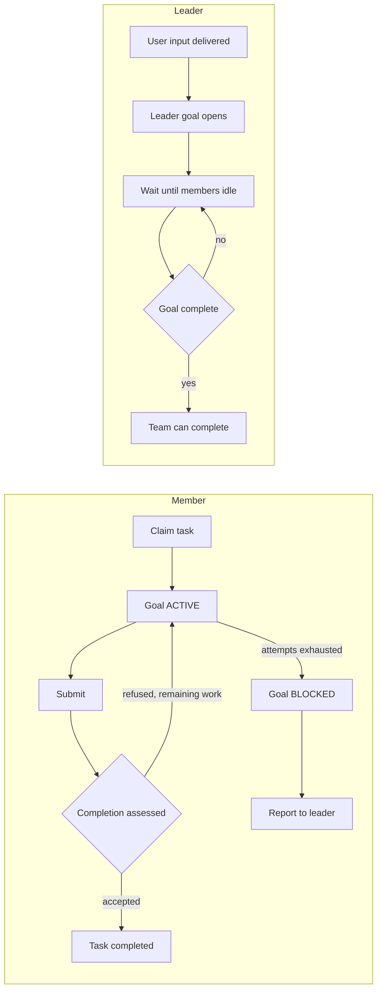
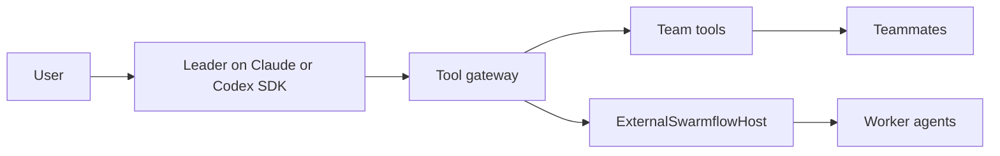
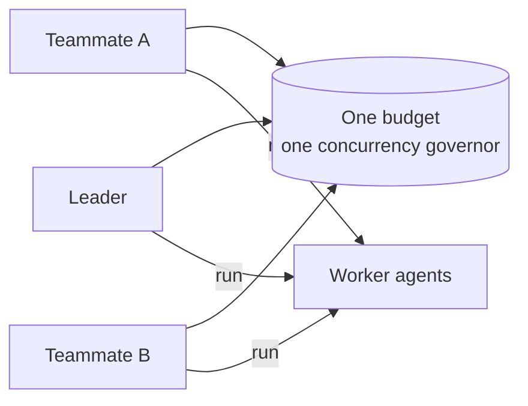
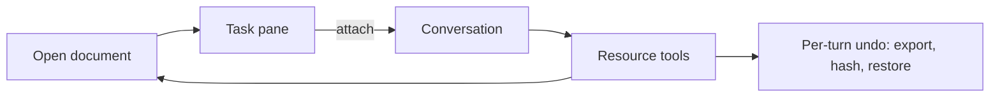
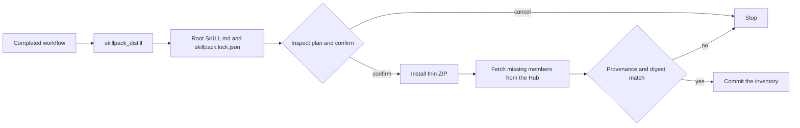

# What's New in JiuwenSwarm — November 2026

November is two weeks old. The first four days moved orchestration out of the leader's hands;
the second week moved the leader itself onto someone else's harness, gave every member its own
shell, and put goals into the team. This page covers 2–14 November; the month is still running.

*Last updated: 2026-11-14.*

**Coverage** — read from the newest `origin/develop` in both repositories:

| Repository | Commit | Merged | What it is |
|---|---|---|---|
| `agent-core` | `279086272` | 2026-11-13 17:23 +08:00 | `fix(otel)`: guard LLM attribute writes and span finish |
| `jiuwenswarm` | `efa6e5b3c` | 2026-11-14 16:50 +08:00 | `fix(history)`: stop duplicating LLM prompts in session events |

The previous edition stopped at `8ede5297c` (agent-core) and `5111fbffb` (jiuwenswarm).

Everything here is tagged:

- **[NEW]** — a capability that did not exist before.
- **[UPGRADE]** — an existing capability re-worked until it feels new.

---

# The big things

## 1. A team can hold a goal — [NEW]

A task board says what is done; a goal says what the team is trying to achieve. Members now
open a goal when they claim a task, and before a member submits, the completion claim is
assessed. A refusal comes back with the remaining work attached, and the member keeps
working; a goal that reaches its attempt limit turns BLOCKED and reports to the leader, who
can take over. The leader has a goal of its own, opened after the user's input is delivered,
held until the other members are idle, and used to gate team completion. `NativeHarness` is
a second goal host with its own stop policy, and `spawn_teammate(goal=...)` opts a member in.

Nine scenarios run end to end in `tests/system_tests/agent_swarm/goal/`, including a lazy
member whose first submission is refused, a reviewer round that re-opens the goal, a mid-run
reassignment, and a member whose goal blocks at its limit. Third-party harness members,
human members and bridge members are outside this scope.

## 2. The leader can run on someone else's harness — [NEW]

`LeaderSpec.cli_agent` names an entry in `external_cli_agents`, and the team leader runs on
the Claude or Codex SDK harness instead of the native one. It keeps the leader tool set —
`build_team`, `create_task`, `view_task`, `spawn_teammate`, `shutdown_member` — and the
leader prompts, and it continues across runs inside the same session. In a `swarmflow`
team it holds `swarmflow` and `async_task*` through `ExternalSwarmflowHost`, so an external
leader can start and collect workflows like the native one. `enable_fork` is refused with
an external leader.

The path was exercised with real Claude Code 2.1.305 and codex-cli, including a Claude
leader with a Claude teammate and a Codex leader with a Codex teammate. Pause on a
provider that can abort but not pause now degrades to a graceful abort instead of raising.
One operational catch: the Codex SDK can prefer its bundled CLI over the one on `PATH`, so
point `cli_path` at a current binary.

## 3. Swarmflow for every teammate — [NEW]

`swarmflow` is the tool that starts a workflow: an asynchronous run whose steps are
executed by worker agents, with the result injected back into the conversation when it
finishes. Until now only the leader could call it. A teammate that needed a workflow had
to hand the request up, which put every run's narration, result and pause/resume inside
the leader's context — the leader became the bottleneck.

On 2–3 November the tool opened to in-process teammates. A teammate starts its own run,
pauses and resumes it, and consumes its own result. The shared machinery — worker model
resolution, the concurrency governor, the budget ledger — is built once by the leader and
shared by reference, so every run draws on one pool with one set of limits.

Two details carry the design:

- **Attribution is a single field.** Every progress event names the `executor`; narration
  and result injection follow it. The leader has a name too, so nothing special-cases it.
- **Resume follows the work.** A paused run goes back to the member that last executed
  it, if that member is online, instead of being taken over by the leader.

Shutting down a member stops and seals the runs it owns, and leaves neighbouring runs
alone. External members get the same tool through `ExternalSwarmflowHost`, so a Claude Code
or Codex teammate can orchestrate too.

## 4. Every member gets its own execution environment — [NEW]

Two members in one process used to share the process environment, so a `git` author, a proxy
or a token leaked between them. `ExecutionEnvironment` now holds immutable `values` and
`overrides` (a null value deletes), and it is resolved at each tool call and bound in a
context manager that restores the previous scope on error or cancel. The precedence is the
host's base environment, then `values`, then explicit call arguments, then `overrides`. Local
shell execution merges into a copy; the sandbox receives only deltas, so a host environment
is never copied in.

Settings live per session in `team_session_settings`, a JSON blob with a version, written
with compare-and-swap. They survive member rebuilds, cold recovery and cross-process calls,
and the platform resolver reads the shared database on every tool call — if the database is
unreachable it fails rather than silently falling back to an old value. Environment values
are redacted in execution logs.

## 5. Office becomes a workspace — [UPGRADE]

The add-in now serves PowerPoint, Word and Excel from one build, with a manifest per host.
The pane attaches the open document to a conversation and runs that conversation's tools
inside the document; the two halves read the same `tools.json` and `profile.json`. Word and
Excel attach, chat, answer the backend's approvals and questions, and show each turn's tool
calls; their tools arrive with their own contracts. PowerPoint runs the read-only tools and
builds and edits slides as native objects — `presentation_apply_patch` — with an undo icon
under each turn that wrote: new slides are deleted, changed and deleted slides are
re-inserted from exports, and the deck's order is restored. Code the model writes against a
slide's XML runs in a sandbox worker, and a patch that fails part way rolls itself back.

The hosts need PowerPointApi 1.8, WordApi 1.6 and ExcelApi 1.13. WPS is planned.

## 6. An AI colleague for every employee — [NEW]

The beta2 AI-colleague feature (`jiuwenmate`) merged into `develop`. Each employee gets a
colleague with a persona template, a chosen capability set and published configuration
versions; editing and publishing are separate, so a request keeps the version it was
accepted with until a new one is published. Colleagues live in web private chat, WeLink and
DingTalk, answer approvals, run scheduled tasks and use the CLI. The default colleague,
小九 (Xiao Jiu), is created once and is not recreated after a user deletes it.

## 7. The enterprise runtime moves into the database — [UPGRADE]

Enterprise checkpoints now land in MySQL or PostgreSQL; the personal edition keeps SQLite.
The enterprise team runtime library reads the deployment database, HTTP session materials
are registered through it, and the admin and user planes have separate login entry points.
Shared team, expert and expert-team libraries install into tenant directories, with expert
creation and publishing hidden for now. The E2A package layout was adapted after its move
into `openjiuwen-protocol`.

## 8. Enterprise features join the open platform — [NEW]

The enterprise edition merged into the same gateway as the personal edition in late
October. In the first week of November the couplings that merge introduced were cut:

- The **Gateway** no longer depends on jiuwenswarm; memory and task-memory config updates
  no longer depend on the agent implementation; skill source and telemetry audit split
  apart; the gateway does its own log-level hot update.
- A **team control store** adds a stable `team_id`, owner identity, lifecycle status and
  human memberships on top of the existing team binding and metadata files, behind a
  pluggable protocol with SQLite as the default.
- **Team quota and route binding** arrive with their own stores.
- **E2A (Everything-to-Agent)** moved into `openjiuwen-protocol`, and web session list,
  rename and pin now go through E2A to the server in both editions — the gateway no longer
  manages sessions locally when the server is down.
- The enterprise web opens the **connector marketplace** navigation.

## 9. SkillPack — a workflow that becomes an installable skill — [NEW]

On 4 November `skillpack_distill` started taking a completed multi-skill workflow and
distilling it into a SkillPack: a root `SKILL.md` that describes an ordered workflow over
ordinary skills. SwarmSkills and nested packs are refused as members, so a pack stays a
plain composition of single-agent skills.

Installation is confirmed and transactional:

- You inspect the plan — members and instructions — and confirm.
- The ZIP is thin: plugin wrapper, root instructions and `skillpack.lock.json`, with no
  member sources inside. The lock records Hub asset IDs, exact versions and SHA-256
  digests; missing members are fetched from the same Hub.
- Reuse requires matching provenance, version, digest and unchanged local content. Name
  conflicts and local edits block the install.
- Everything is validated before the inventory is committed; a failure restores
  directories and registration, and startup recovers an interrupted commit.
- Uninstalling a pack keeps its members; uninstalling a skill that a pack uses is blocked
  and lists the packs that refer to it.

A complete query match can offer the pack directly, bypassing Symphony's composition;
partial matches keep the old path. Routing has three modes — `off`, `shadow` (evaluate and
log only) and `confirm` — and the product entry points are off by default.

## 10. TTSE 2.0 — self-evolution ships as a plugin — [UPGRADE]

TTSE (Two-Track Self-Evolution) induces environment facts (FACT) and capability-selection
hints (TIP) from trajectories and injects the guidance into the system prompt. It is the
sibling of skill-body evolution: it never rewrites `SKILL.md` and never asks for approval.

On 3 November it became a native plugin for the main coding agent, built on the generic
plugin runtime (contract v1). Code mode now gets TTSE only that way; agent and work modes
keep the built-in rail behind `react.ttse.enabled`, still off by default. Banks are per
mode, under `.ttse/work/` and `.ttse/code/`, never inside your project. Auto-dream keeps a
bank tidy — TTL prune, near-duplicate merge, low-quality purge — on fixed intervals.
Installing the plugin does not switch tracing on: the plugin leases the services it
declares when it mounts.

---

# The rest, by theme

## Teams and orchestration

- **SwarmChat rounds [NEW]**: collaboration-space sessions now run as explicit rounds, each
  with its own session checkpointer and stream-task lifecycle, so a round resumes after a
  restart and the background model tasks belong to the round that started them.
- **Compression events [NEW]**: `[CompressionApplied]` structured events record time,
  session, processor, strategy, reason, and chars and tokens before and after, at six points
  across the rule and summary compressors.
- **Verify vote contract [UPGRADE]**: `VerifyVote` gains a display-only `label`, and the tool
  description now spells out the fields and an input→output example, so generated scripts
  stop guessing at `v.label`.
- **Task attribution [UPGRADE]**: `view_task` names the assignee and its member status.
- **Swarmflow traces [UPGRADE]**: workflow runs are grouped in the viewer with operator
  details. Scheduled-dispatch traces get their own analysis and live feedback.
- **Routed model is visible [UPGRADE]**: model-group calls name the model that actually
  answered.
- **Expert catalog [UPGRADE]**: category tabs come from loaded data, so empty categories
  stop appearing.
- **Organization UI [UPGRADE]**: the org front end was fixed for owner-team display and
  layout.
- **Group chat routing [UPGRADE]**: plain conversation and substantive work are separated;
  task cards fold inside the group, workers clean up after an abnormal exit, and a process
  identity fingerprint survives a clock change.

## Clients and channels

- **Client attachments [NEW]**: a client attaches to one conversation, binds a stable
  resource key that survives save-as and renames, runs that conversation's resource tools,
  and renews a lease. One resource belongs to one conversation; a conflict starts a new
  conversation. Attached clients can find each other and read each other's latest messages.
- **Interrupts [UPGRADE]**: clients echo the `interrupt_id` they answer, interrupts are
  told apart by kind, and answers are counted per interrupt.
- **HarmonyOS [NEW]**: Huawei login sessions and loopback IPC transport.
- **WeLink [UPGRADE]**: several assistants share a reader with a confirmed handoff, and the
  channel gains mail and calendar capabilities.
- **DingTalk [NEW]**: employee authorization, group collaboration and employee CLI
  capabilities.
- **Appearance [NEW]**: a settings module for interface font, interface size and code font.
- **Voice [UPGRADE]**: full-duplex ships its ASR bundle, and the lost voice-transcription
  configuration and empty recording results are fixed.

## Platform

- **Gateway request tracing [NEW]**: end-to-end tracing across routing and message
  handling.
- **One tracing config [UPGRADE]**: team and agent tracing read the same configuration.
- **Compatibility as a contract [UPGRADE]**: a runtime-data compatibility spec, session
  and stream boundary compatibility, explicit MQ wire settings, and escaping in VCS state
  paths — with regression evidence recorded next to the contract.
- **A2A streaming [UPGRADE]**: terminal streaming artifacts are marked as a last chunk so
  consumers can close cleanly.
- **jiuwenbox for team members [UPGRADE]**: member command execution in team mode goes
  through the jiuwenbox sandbox, and nested bwrap binds are emitted after their read-write
  ancestors.
- **Session recovery [UPGRADE]**: large histories restore without the memory amplification,
  and in-flight streams resume after a resident IPC reconnect.
- **MCP [UPGRADE]**: entry-level `ssl_verify` for dynamic token requests, and an end-to-end
  check of the enterprise two-token flow.
- **Packaging [UPGRADE]**: the build pins `agent-core` by commit, dependencies flow through
  the gateway, and the updater recognises `uv` editable installs and normalises mirror URLs.

## Self-evolution

- **PromptSearchOptimizer [NEW]**: a multi-candidate prompt search loop that generates N
  candidates per round, scores them on correctness, completeness, latency, tokens and cost,
  penalises drift from the objective, and detects overfitting on held-out cases. It runs
  standalone or bound to a trainer.
- **RSI two-stage promotion [UPGRADE]**: new Harness tasks score continuously from 0 to 1.
  Each target case must first beat its frozen baseline by more than 0.05; one independent
  full evaluation then requires every target to stay improved, no non-target to regress by
  more than 0.05, and the mean to rise. Tool and skill usage plus machine verification
  still have to pass, and resumed tasks keep their saved policy.
- **Harness package preview [NEW]**: a package can be inspected before promotion, and a
  worker-shutdown bug is fixed.

## Content and plugins

- **Google provider [UPGRADE]**: on top of the Sheets and Slides formats already added, the
  cloud-document module gains the Google provider, Docs, comments and discovery.
- **BGM generation [NEW]**: Design generates background music through vLLM-Omni or
  OpenRouter Lyria.
- **Designer continuity [UPGRADE]**: crowd presence is decided by the agent and exits are
  declared by the storyboard, so a crowd no longer disappears between shots.
- **SkillPack hardening [UPGRADE]**: parallel validation no longer times out, an explicit
  selection does not double-confirm, packs are reusable across sessions, Windows long paths
  work, a Hub install compares versions before declaring itself done, and a duplicate plugin
  install prompts instead of silently replacing.
- **Medical knowledge base [NEW]**: a DeepSearch plugin for clinical guidelines — hybrid
  retrieval, citations, and a 2024-versus-2020 guideline comparison.
- **Topic recommendations before the session [UPGRADE]**: suggestions appear before you
  start, not only mid-conversation.
- **Office files [UPGRADE]**: personal context collects `.docx`, and file reading handles
  GBK text plus `.docx` and `.xlsx`.
