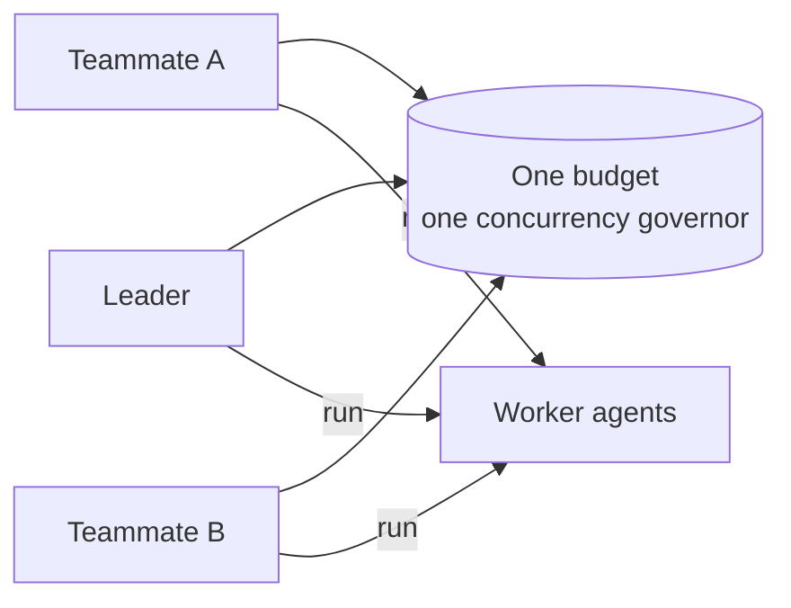

# What's New in JiuwenSwarm — November 2026

November is four days old and has already moved orchestration out of the leader's hands
and turned a good workflow into something you can install. This page covers 2–4 November;
the month is still running.

*Last updated: 2026-11-04.*

**Coverage** — read from the newest `origin/develop` in both repositories:

| Repository | Commit | Merged | What it is |
|---|---|---|---|
| `agent-core` | `8ede5297c` | 2026-11-04 16:27 +08:00 | `fix(retrieval)`: count Milvus Lite delete results returned as a list |
| `jiuwenswarm` | `e90b78f7d` | 2026-11-04 09:44 UTC | merge of #10018 (`sync/pr-9160`); last content change `5111fbffb` — Google Sheets and Slides formats |

The next update should start after these two commits.

Everything here is tagged:

- **[NEW]** — a capability that did not exist before.
- **[UPGRADE]** — an existing capability re-worked until it feels new.

---

# The big things

## 1. Swarmflow for every teammate — [NEW]

`swarmflow` is the tool that starts a workflow: an asynchronous run whose steps are
executed by worker agents, with the result injected back into the conversation when it
finishes. Until now only the leader could call it. A teammate that needed a workflow had
to hand the request up, which put every run's narration, result and pause/resume inside
the leader's context — the leader became the bottleneck.

On 2–3 November the tool opened to in-process teammates. A teammate starts its own run,
pauses and resumes it, and consumes its own result. The shared machinery — worker model
resolution, the concurrency governor, the budget ledger — is built once by the leader and
shared by reference, so every run draws on one pool with one set of limits.

Two details carry the design:

- **Attribution is a single field.** Every progress event names the `executor`; narration
  and result injection follow it. The leader has a name too, so nothing special-cases it.
- **Resume follows the work.** A paused run goes back to the member that last executed
  it, if that member is online, instead of being taken over by the leader.

Shutting down a member stops and seals the runs it owns, and leaves neighbouring runs
alone. External members get the same tool through `ExternalSwarmflowHost`, so a Claude Code
or Codex teammate can orchestrate too.

## 2. SkillPack — a workflow that becomes an installable skill — [NEW]

On 4 November `skillpack_distill` started taking a completed multi-skill workflow and
distilling it into a SkillPack: a root `SKILL.md` that describes an ordered workflow over
ordinary skills. SwarmSkills and nested packs are refused as members, so a pack stays a
plain composition of single-agent skills.

Installation is confirmed and transactional:

- You inspect the plan — members and instructions — and confirm.
- The ZIP is thin: plugin wrapper, root instructions and `skillpack.lock.json`, with no
  member sources inside. The lock records Hub asset IDs, exact versions and SHA-256
  digests; missing members are fetched from the same Hub.
- Reuse requires matching provenance, version, digest and unchanged local content. Name
  conflicts and local edits block the install.
- Everything is validated before the inventory is committed; a failure restores
  directories and registration, and startup recovers an interrupted commit.
- Uninstalling a pack keeps its members; uninstalling a skill that a pack uses is blocked
  and lists the packs that refer to it.

A complete query match can offer the pack directly, bypassing Symphony's composition;
partial matches keep the old path. Routing has three modes — `off`, `shadow` (evaluate and
log only) and `confirm` — and the product entry points are off by default.

## 3. TTSE 2.0 — self-evolution ships as a plugin — [UPGRADE]

TTSE (Two-Track Self-Evolution) induces environment facts (FACT) and capability-selection
hints (TIP) from trajectories and injects the guidance into the system prompt. It is the
sibling of skill-body evolution: it never rewrites `SKILL.md` and never asks for approval.

On 3 November it became a native plugin for the main coding agent, built on the generic
plugin runtime (contract v1). Code mode now gets TTSE only that way; agent and work modes
keep the built-in rail behind `react.ttse.enabled`, still off by default. Banks are per
mode, under `.ttse/work/` and `.ttse/code/`, never inside your project. Auto-dream keeps a
bank tidy — TTL prune, near-duplicate merge, low-quality purge — on fixed intervals.
Installing the plugin does not switch tracing on: the plugin leases the services it
declares when it mounts.

## 4. Enterprise features join the open platform — [NEW]

The enterprise edition merged into the same gateway as the personal edition in late
October. This week the couplings that merge introduced were cut:

- The **Gateway** no longer depends on jiuwenswarm; memory and task-memory config updates
  no longer depend on the agent implementation; skill source and telemetry audit split
  apart; the gateway does its own log-level hot update.
- A **team control store** adds a stable `team_id`, owner identity, lifecycle status and
  human memberships on top of the existing team binding and metadata files, behind a
  pluggable protocol with SQLite as the default.
- **Team quota and route binding** arrive with their own stores.
- **E2A (Everything-to-Agent)** moved into `openjiuwen-protocol`, and web session list,
  rename and pin now go through E2A to the server in both editions — the gateway no longer
  manages sessions locally when the server is down.
- The enterprise web opens the **connector marketplace** navigation.

---

# The rest, by theme

## Teams and orchestration

- **Swarmflow traces [UPGRADE]**: workflow runs are grouped in the viewer with operator
  details. Scheduled-dispatch traces get their own analysis and live feedback.
- **Routed model is visible [UPGRADE]**: model-group calls name the model that actually
  answered.
- **Expert catalog [UPGRADE]**: category tabs come from loaded data, so empty categories
  stop appearing.
- **Organization UI [UPGRADE]**: the org front end was fixed for owner-team display and
  layout.

## Self-evolution

- **RSI two-stage promotion [UPGRADE]**: new Harness tasks score continuously from 0 to 1.
  Each target case must first beat its frozen baseline by more than 0.05; one independent
  full evaluation then requires every target to stay improved, no non-target to regress by
  more than 0.05, and the mean to rise. Tool and skill usage plus machine verification
  still have to pass, and resumed tasks keep their saved policy.
- **Harness package preview [NEW]**: a package can be inspected before promotion, and a
  worker-shutdown bug is fixed.

## Clients and channels

- **Client attachments [NEW]**: a client — a PowerPoint task pane, for example — attaches
  to one conversation, binds a stable resource key that survives save-as and renames, runs
  that conversation's resource tools, and renews a lease. One resource belongs to one
  conversation; a conflict starts a new conversation. Attached clients can find each other
  and read each other's latest messages.
- **Interrupts [UPGRADE]**: clients echo the `interrupt_id` they answer, interrupts are
  told apart by kind, and answers are counted per interrupt.
- **HarmonyOS [NEW]**: Huawei login sessions and loopback IPC transport.

## Platform

- **Gateway request tracing [NEW]**: end-to-end tracing across routing and message
  handling.
- **Compatibility as a contract [UPGRADE]**: a runtime-data compatibility spec, session
  and stream boundary compatibility, explicit MQ wire settings, and escaping in VCS state
  paths — with regression evidence recorded next to the contract.
- **A2A streaming [UPGRADE]**: terminal streaming artifacts are marked as a last chunk so
  consumers can close cleanly.

## Content and plugins

- **Google Sheets and Slides [NEW]**: the cloud-document module gains both formats.
- **Medical knowledge base [NEW]**: a DeepSearch plugin for clinical guidelines — hybrid
  retrieval, citations, and a 2024-versus-2020 guideline comparison.
- **Topic recommendations before the session [UPGRADE]**: suggestions appear before you
  start, not only mid-conversation.
- **Office files [UPGRADE]**: personal context collects `.docx`, and file reading handles
  GBK text plus `.docx` and `.xlsx`.

---

# See also

- [October 2026](whats-new-2026-10.md) · [September 2026](whats-new-2026-09.md) · [August 2026](whats-new-2026-08.md)
