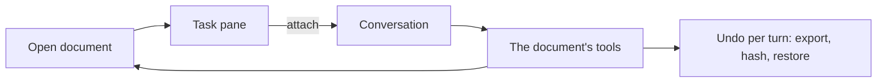
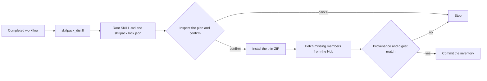

# What's New in JiuwenSwarm — November 2026

November changed who does what in a team. A team can hold a goal, the leader can run on Claude Code or
Codex, every member can start its own workflow and gets its own shell, and Word, Excel and PowerPoint
became one workspace. In the second half the platform added one search for skills, experts and MCP,
coding memory, an app hub, WPS panes, and AI colleagues in group chats. The month also moved
enterprise data to MySQL and PostgreSQL and put the personal and enterprise editions behind one
server, the gateway. About 1,400 commits landed across the two repositories in three weeks.

*Last updated: 2026-11-21.*

## What JiuwenSwarm is

JiuwenSwarm is a platform for running AI agents. It runs the agent loop — ask the model what to do,
call the tool it names, feed the result back — and adds sessions (the record of one conversation),
memory, tools (the actions an agent can call), skills (packaged instructions), teams and connections
to chat apps. Several products in the company run their agent work on it; DigitalMate is one.

The Python package is published as **`workswarm`**, which is why some products call the same platform
**WorkSwarm**.

## What runs underneath

Two repositories make the platform:

1. **`agent-core`** — the base runtime and the code that runs one agent: the loop, tools, prompts,
   memory, teams and the harness that hosts another agent product.
2. **`jiuwenswarm`** — the server around it: channels (web, desktop, IDE, TUI), the gateway that
   connects chat apps to agents, skills, the enterprise layer and the Office add-in.

Products sit on top of both and call them through the gateway or the Python API.

A **harness** is the code that runs one agent: its prompt, its model calls and its tool loop. The
built-in harness is the one JiuwenSwarm ships; Claude Code and Codex are external harnesses.

**Coverage** — read from the newest `origin/develop` in both repositories:

| Repository | Commit | Merged | What it is |
|---|---|---|---|
| `agent-core` | `fbe93360f` | 2026-11-20 18:07 +08:00 | merge of `develop_skillrail` (SkillUseRail cache) |
| `jiuwenswarm` | `e81838343` | 2026-11-21 15:04 +08:00 | merge of `feat/app-hub` |

The first version of this edition stopped at `279086272` (agent-core) and `efa6e5b3c` (jiuwenswarm)
on 13–14 November; this update adds the 476 commits merged after them. The previous edition stopped
at `8ede5297c` (agent-core) and `5111fbffb` (jiuwenswarm). Not read this edition: the enterprise
deployment environments and the cloud images.

Everything here is tagged:

- **[NEW]** — a capability that did not exist before.
- **[UPGRADE]** — an existing capability re-worked until it feels new.

---

# The big things

## 1. A team can hold a goal, not just a task list — [NEW]

A team is one leader agent plus member agents working from a shared task board. The board says what
is done; a goal says what the task must achieve. Now a member opens a goal when it claims a task, and
before it can mark the task done, its completion claim is checked. A refusal comes back with the
remaining work attached, and the member keeps working. If the goal reaches its attempt limit it turns
**BLOCKED** and reports to the leader, who can take over.

The leader has a goal of its own: it opens after the user's message is delivered, stays open until
the other members are idle, and gates whether the team can finish. A second place that can hold a
goal, `NativeHarness`, has its own rule for when to stop, and `spawn_teammate(goal=...)` opts a
member in. On 20 November the leader goal became a setting: scheduling mode has a leader sub-switch,
the leader and member policies are validated together, and the leader's completion assessment runs in
its own trace so it does not mix with the conversation.

Why it matters: a team can no longer call a task finished just because a member says so. Nine
end-to-end cases in `tests/system_tests/agent_swarm/goal/` cover a lazy member whose first
submission is refused, a reviewer round that re-opens the goal, a mid-run reassignment, and a member
whose goal blocks at its limit. Members that run on someone else's harness, human members, and
members connected through a bridge (an adapter to another chat system) are outside this scope.

## 2. The team leader can run on Claude Code or Codex — [NEW]

`LeaderSpec.cli_agent` names an entry in `external_cli_agents`. The team leader then runs on the
Claude or Codex SDK harness instead of the built-in one. It keeps the leader tools — `build_team`,
`create_task`, `view_task`, `spawn_teammate`, `shutdown_member` — and the leader prompts, and it
continues across runs inside the same session. When the team enables swarmflow, the external leader
holds `swarmflow` and the asynchronous task tools, so it can start and collect workflows like the
built-in leader.

Forking the team is refused with an external leader. The path was exercised with real Claude Code
2.1.305 and `codex-cli`, including a Claude leader with a Claude teammate and a Codex leader with a
Codex teammate. Pause on a provider that can abort but cannot pause now degrades to a graceful abort
instead of raising. One operational catch: the Codex SDK can prefer its bundled CLI over the one on
`PATH`, so point `cli_path` at the current binary.

Not included: an external leader's fork, team memory, and a failure-reliability channel.

## 3. Every teammate can start its own workflow — [NEW]

`swarmflow` is the tool that starts a workflow: an asynchronous run whose steps are executed by
worker agents, with the result injected back into the conversation when it finishes. Until now only
the leader could call it; a member that needed a workflow had to ask the leader, which put every
run's narration, result and pause inside the leader's context.

On 2–3 November the tool opened to in-process teammates. A teammate starts its own run, pauses and
resumes it, and consumes its own result. The shared machinery — worker model resolution, the
concurrency governor and the budget ledger — is built once by the leader and shared by reference, so
every run draws on one pool with one set of limits.

Two details define it:

- Every progress event names its **executor**. Narration and result injection follow that field, and
  the leader is named too, so nothing special-cases it.
- Resume follows the work: a paused run goes back to the member that last executed it, if it is
  online.

Shutting down a member stops and seals the runs it owns and leaves its neighbours alone. A Claude
Code or Codex member can be given the same tool through its host; this edition's end-to-end tests
covered in-process members.

## 4. Every teammate gets its own shell and settings — [NEW]

Two members in one process used to share the process environment, so a `git` author, a proxy or a
token could leak from one to the other. `ExecutionEnvironment` now holds immutable `values` and
`overrides` (a null value deletes), resolved at each tool call and bound in a context manager that
restores the previous scope on error or cancel. The order is: the host's base environment, then
`values`, then explicit call arguments, then `overrides`. Local shell execution merges into a copy;
the sandbox receives only the differences, so a host environment is never copied in.

Settings live per session in `team_session_settings`, a JSON blob with a version, written with an
atomic check-and-set (compare-and-swap). They are still there after member rebuilds, cold recovery
and cross-process calls. The platform resolver reads the shared database on every tool call; if the
database is unreachable it fails rather than silently falling back to an old value. Environment
values are redacted in execution logs.

## 5. Word, Excel and PowerPoint become one workspace — [UPGRADE]

The add-in now serves PowerPoint, Word and Excel from one build, with a manifest per application. The
pane attaches the open document to a conversation and runs that conversation's tools inside the
document; the add-in and the server read the same `tools.json` and `profile.json`.

Word and Excel attach, chat, answer the backend's approvals and questions, and show each turn's tool
calls; their tools arrive with their own contracts. PowerPoint runs the read-only tools and builds
and edits slides as native objects with `presentation_apply_patch`. Each turn that wrote has an undo
icon: new slides are deleted, changed and deleted slides are re-inserted from exports, and the deck's
order is restored. Code the model writes against a slide's XML runs in a sandbox worker, and a patch
that fails part way rolls itself back.

The three Office applications need PowerPointApi 1.8, WordApi 1.6 and ExcelApi 1.13. WPS Writer and
Spreadsheets arrived on 19 November; WPS Presentation is not covered.

## 6. An AI colleague for every employee — [NEW]

The beta2 AI-colleague feature (`jiuwenmate`) merged into `develop`. Each employee gets a colleague
with a persona template, a chosen set of capabilities and published configuration versions. Editing
and publishing are separate: a request keeps the version it was accepted with until a new one is
published.

Colleagues are available in web private chat, WeLink and DingTalk, and since 20 November in SwarmChat
group chats, where they can be added to a group and reply when mentioned. They answer approvals, run
scheduled tasks and use the CLI. The default colleague, 小九 (Xiao Jiu), is created once and is not
recreated after a user deletes it.

## 7. Enterprise data moves to MySQL and PostgreSQL — [UPGRADE]

Enterprise checkpoints (the saved state a run resumes from) now land in MySQL or PostgreSQL; the
personal edition keeps SQLite. The enterprise team runtime reads the deployment database, HTTP
session materials are registered through it, and the admin and user planes have separate login entry
points.

Shared team, expert and expert-team libraries install into tenant directories, with expert creation
and publishing hidden for now. The E2A package layout was adapted after its move into
`openjiuwen-protocol`.

## 8. One gateway for the personal and enterprise editions — [NEW]

The gateway is the same server for both editions. The enterprise edition merged into it in late
October. In the first week of November the places where the two were tied together were separated:

- The gateway no longer depends on jiuwenswarm; memory and task-memory configuration updates no
  longer depend on the agent implementation; skill source and telemetry audit are separate; the
  gateway does its own log-level hot update.
- A **team control store** adds a stable `team_id`, owner identity, lifecycle status and human
  memberships on top of the existing team binding and metadata files, behind a pluggable protocol
  with SQLite as the default.
- **Team quota and route binding** arrive with their own stores.
- **E2A (Everything-to-Agent)** moved into `openjiuwen-protocol`. Web session list, rename and pin
  now go through E2A to the server in both editions, so the gateway no longer manages sessions
  locally when the server is down.
- The enterprise web opens the **connector marketplace** navigation.

## 9. A workflow you can install as a skill — [NEW]

On 4 November `skillpack_distill` started taking a completed multi-skill workflow and distilling it
into a SkillPack: a root `SKILL.md` that describes an ordered workflow over ordinary skills. Nested
packs and swarm-style skills are refused as members, so a pack stays a plain composition of
single-agent skills.

Installation is confirmed and transactional:

- You inspect the plan — members and instructions — and confirm.
- The ZIP is thin: a plugin wrapper, the root instructions and `skillpack.lock.json`, with no member
  sources inside. The lock records Hub asset IDs, exact versions and SHA-256 digests; missing members
  are fetched from the same Hub.
- Reuse requires matching provenance, version, digest and unchanged local content. Name conflicts and
  local edits block the install.
- Everything is validated before the inventory is committed; a failure restores directories and
  registration, and startup recovers an interrupted commit.
- Uninstalling a pack keeps its members; uninstalling a skill that a pack uses is blocked and lists
  the packs that refer to it.

A complete query match can offer the pack directly, bypassing the workflow composer (Symphony);
partial matches keep the old path. Routing has three modes — `off`, `shadow` (evaluate and log only)
and `confirm` — and the product entry points are off by default.

## 10. The agent learns from its own runs, now as a plugin — [UPGRADE]

TTSE (Two-Track Self-Evolution) reads past runs and writes two kinds of notes: facts about the
environment (FACT) and hints about which capability to use (TIP). Later prompts include the notes.
It never rewrites `SKILL.md` and never asks for approval. It is the sibling of skill-body evolution.

On 3 November it became a native plugin for the main coding agent, built on the generic plugin
runtime (contract v1). Code mode gets TTSE only that way; agent and work modes keep the built-in rail
behind `react.ttse.enabled`, still off by default. Banks are kept per mode, under `.ttse/work/` and
`.ttse/code/`, never inside your project. Auto-dream keeps a bank tidy — it removes expired notes,
merges near-duplicates and deletes low-quality ones — on fixed intervals. Installing the plugin does
not switch tracing on: the plugin reserves the services it declares when it mounts.

---

# The second half of November

The first version of this edition stopped on 14 November. Between 15 and 21 November, 476 commits
landed. These are the ones that change what the platform can do:

- **One search for skills, experts and MCP [NEW]**: Symphony now retrieves skills, experts and MCP
  servers through one capability index, and Swarm uses that index for discovery. A directly
  configured `ReActAgent` can also load skills on demand with `SkillUseRail`, without a `DeepAgent`,
  and the rail caches its directory scans.
- **Coding memory [NEW]**: Code mode can use native file memory or Jiuwen document memory. The
  provider is selected in `config.yaml`, defaults to local hashing vectors so no embedding service is
  needed, and reloads its configuration without a restart.
- **Office reaches WPS [UPGRADE]**: WPS Writer and Spreadsheets task panes arrived, and both Office
  and WPS add-ins can be installed from the plugin plaza. The pane gained turn control, host hints and
  document attachments.
- **App Hub [NEW]**: apps published to the Hub can be installed locally, with a run-consent prompt, a
  bound project and an update that keeps `data/` and `.git`. The market panel handles install, update,
  uninstall and local publish. Tests use a mocked Hub; the real Hub network and process start were not
  covered.
- **AI colleagues join group chats [NEW]**: a colleague can be added to a SwarmChat group and reply
  when mentioned, with its own core identity and persistent @ requests. Message approval was relaxed
  for group messages; file, document and tool approvals remain. No real model or Feishu, DingTalk or
  WeLink end-to-end run yet.
- **Connector Source SPI [NEW]**: connectors get a standard source interface, with the Hub as the
  first source. This is plumbing for adding connector sources, not a new user surface.
- **Host-managed group members and Git identities [NEW]**: a host can register an existing AI
  colleague as a group member without starting another runtime, and each session can use its own Git
  identity so parallel sessions do not share one author.
- **Enterprise user plane split [UPGRADE]**: the enterprise user-facing backend is being separated
  from the shared backend, with the deployment pieces that go with it.
- **Tracing gets cost and time [UPGRADE]**: LLM spans now carry cost attributes, TPOT, the requested
  model and the served model; retrieval events became spans, and scheduled traces are sized and
  focused per task.

---

# The rest, by theme

## Teams and orchestration

- **SwarmChat rounds [NEW]**: collaboration-space sessions run as explicit rounds, each with its own
  saved state and its own lifetime for background model tasks, so a round resumes after a restart and
  background model tasks belong to the round that started them.
- **Compression events [NEW]**: `[CompressionApplied]` events record time, session, processor,
  strategy, reason, and characters and tokens before and after, at six points across the rule and
  summary compressors.
- **Verify vote contract [UPGRADE]**: `VerifyVote` gains a display-only `label`, and the tool
  description now spells out the fields and an input→output example, so generated scripts stop
  guessing at `v.label`.
- **Task attribution [UPGRADE]**: `view_task` names the assignee and its member status.
- **Swarmflow traces [UPGRADE]**: workflow runs are grouped in the viewer with operator details;
  scheduled-dispatch traces get their own analysis and live feedback.
- **Routed model is visible [UPGRADE]**: model-group calls name the model that actually answered.
- **Expert catalog [UPGRADE]**: category tabs come from loaded data, so empty categories stop
  appearing.
- **Organization UI [UPGRADE]**: the org front end was fixed for owner-team display and layout.
- **Group chat routing [UPGRADE]**: plain conversation and substantive work are separated; task
  cards fold inside the group; workers clean up after an abnormal exit; a process identity
  fingerprint still matches after a clock change.

## Clients and channels

- **Client attachments [NEW]**: a client attaches to one conversation, binds a stable resource key
  that still matches after save-as and renaming, runs that conversation's tools, and renews a lease.
  One resource belongs to one conversation; a conflict starts a new conversation. Attached clients
  can find each other and read each other's latest messages.
- **Interrupts [UPGRADE]**: clients echo the `interrupt_id` they answer; interrupts are told apart by
  kind; answers are counted per interrupt.
- **HarmonyOS [NEW]**: Huawei login sessions and a local connection between processes on the phone.
- **WeLink [UPGRADE]**: several assistants share a reader with a confirmed handoff, and the channel
  gains mail and calendar capabilities.
- **DingTalk [NEW]**: employee authorization, group collaboration and employee CLI capabilities.
- **Appearance [NEW]**: a settings module for interface font, interface size and code font.
- **Voice [UPGRADE]**: full-duplex ships its speech-recognition bundle, and the lost
  voice-transcription configuration and empty recording results are fixed.

## Platform

- **Gateway request tracing [NEW]**: end-to-end tracing across routing and message handling.
- **One tracing config [UPGRADE]**: team and agent tracing read the same configuration.
- **Compatibility as a contract [UPGRADE]**: a runtime-data compatibility spec, session and stream
  boundary compatibility, explicit message-queue wire settings, and escaping in version-control state
  paths — with regression evidence recorded next to the contract.
- **A2A streaming [UPGRADE]**: terminal streaming artifacts are marked as a last chunk so consumers
  can close cleanly.
- **jiuwenbox for team members [UPGRADE]**: member command execution in team mode goes through the
  jiuwenbox sandbox, and nested bwrap binds are emitted after their read-write ancestors.
- **Session recovery [UPGRADE]**: large histories restore without the memory amplification, and
  in-flight streams resume after reconnecting to the local process.
- **MCP (Model Context Protocol) [UPGRADE]**: entry-level `ssl_verify` for dynamic token requests,
  and an end-to-end check of the enterprise two-token flow. MCP is the standard way to plug external
  tools into an agent.
- **Packaging [UPGRADE]**: the build pins `agent-core` by commit, dependencies flow through the
  gateway, and the updater recognises `uv` editable installs and normalises mirror URLs.

## Self-evolution

- **PromptSearchOptimizer [NEW]**: a multi-candidate prompt search loop that generates N candidates
  per round, scores them on correctness, completeness, latency, tokens and cost, penalises drift from
  the objective, and detects overfitting on held-out cases. It runs standalone or bound to a trainer.
- **Recursive self-improvement (RSI) promotion [UPGRADE]**: new Harness tasks score continuously
  from 0 to 1. Each target case must first beat its frozen baseline by more than 0.05; one independent
  full evaluation then requires every target to stay improved, no non-target to regress by more than
  0.05, and the mean to rise. Tool and skill usage plus machine verification still have to pass, and
  resumed tasks keep their saved policy.
- **Harness package preview [NEW]**: a package can be inspected before promotion, and a
  worker-shutdown bug is fixed.

## Content and plugins

- **Google provider [UPGRADE]**: on top of the Sheets and Slides formats already added, the
  cloud-document module gains the Google provider, Docs, comments and discovery.
- **Background music (BGM) generation [NEW]**: Design generates background music through vLLM-Omni
  or OpenRouter Lyria.
- **Designer continuity [UPGRADE]**: crowd presence is decided by the agent and exits are declared by
  the storyboard, so a crowd no longer disappears between shots.
- **SkillPack hardening [UPGRADE]**: parallel validation no longer times out, an explicit selection
  does not double-confirm, packs are reusable across sessions, Windows long paths work, a Hub install
  compares versions before declaring itself done, and a duplicate plugin install prompts instead of
  silently replacing.
- **Medical knowledge base [NEW]**: a DeepSearch plugin for clinical guidelines — hybrid retrieval,
  citations, and a 2024-versus-2020 guideline comparison.
- **Topic recommendations before the session [UPGRADE]**: suggestions appear before you start, not
  only mid-conversation.
- **Office files [UPGRADE]**: personal context collects `.docx`, and file reading handles
  GBK-encoded text plus `.docx` and `.xlsx`.

---

# What didn't ship

- **An external leader cannot fork a team**, and it does not get team memory or the failure-reliability
  channel yet.
- **Goal checks do not cover every kind of member.** Members that run on someone else's harness,
  human members and bridge members are outside the scope.
- **External-CLI members are not covered by the swarmflow end-to-end tests.** The contract they use
  cannot support a background run and later follow-ups.
- **WPS Presentation is not covered.** Writer and Spreadsheets panes exist; Presentation is not
  mentioned.
- **App Hub has not met the real Hub.** Its tests use a mocked Hub; the real network, download and
  process start were not covered.
- **AI colleagues in group chats have not run end to end.** No real model, Feishu, DingTalk or WeLink
  test yet.
- **SkillPack routing is off by default.** So is the shortcut that offers a complete query match
  directly to the user.
- **TTSE is still off by default**; installing the plugin does not turn tracing on.

---

# See also

- [October 2026](whats-new-2026-10.md)
- [JiuwenSwarm, explained simply](../overview.md)
