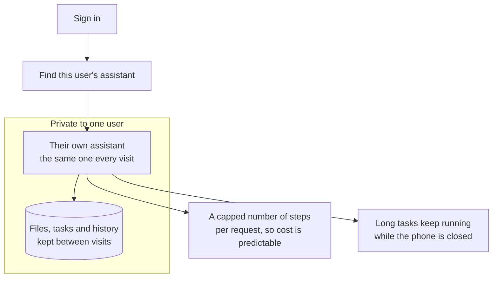
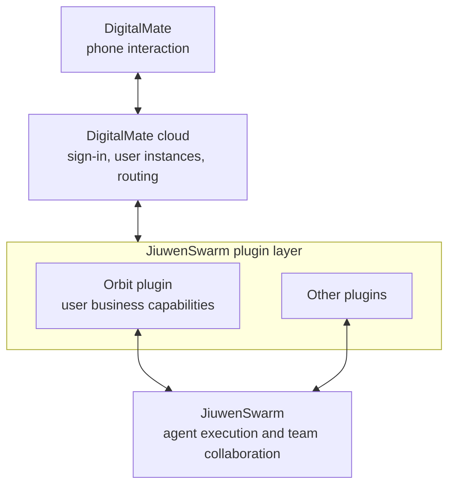

# Orbit, explained simply

*As of 28 October 2026. Sources: gateway code, a merged pull request, the public status board, bug
reports and the jiuwenswarm repository.*

*Orbit is built by another team in the company. This note is context, not our roadmap. The app it serves,
DigitalMate, has [its own note](../digitalmate/overview.md).*

## The short version

- **Orbit** is the cloud engine behind DigitalMate today. It runs the loop, calls the tools and keeps the
  memory.
- Each user gets a **container and a private workspace**. A desktop version also exists; some features
  work only there.
- **agent-dx** is the gateway and substrate: login, per-user routing, container lifecycle and isolation.
- In the **10.23 build**, DigitalMate moved its engine from **WorkSwarm** (jiuwenswarm) to Orbit.
- A **27 October RFC** proposes the next step: Orbit as a plugin inside JiuwenSwarm.
- The app, its screens and its roadmap are in the [DigitalMate note](../digitalmate/overview.md).

## What Orbit is

The details come from
[the merged gateway PR](https://github.com/openJiuwen-ai/agent-dx/pull/94) and
[the Orbit template](https://github.com/openJiuwen-ai/agent-dx/blob/master/agent/activator/examples/orbit-sfs-template.json).



One user, one assistant, one private space. The phone stays light; the work happens in the cloud. Today
Orbit does that work: it runs the loop, calls the tools and keeps the memory.

- **Isolation:** one container per user, inside **gVisor** (`runsc`), a sandbox that checks system calls
  before they reach the host. Each gets 2 CPU and 4 GB.
- **Storage:** the workspace at `/data/state` sits on **SFS** (Huawei Cloud's Scalable File Service,
  mountable network storage), owned by user `10001` with mode `0700`.
- **Model:** GLM-5.2 through an OpenAI-compatible API, a 1M-token context and 8 model-and-tool round trips
  per turn.
- **Protocol:** `orbit.request` with an `action` field over `/orbit/ws`; the phone sends its language and
  device with each message (#270).
- **Binding:** the same user always gets the same container, different users are isolated, and the
  template (`orbit`, version `v1-workspace`) and binding are fixed by the server, so a client cannot pick
  another user's container.

**Where it lives**

- **Runs on:** Huawei Cloud. A desktop version also exists; some features work only there.
- **Code:** private. [`ThinkFlowLab/orbit`](https://github.com/ThinkFlowLab/orbit) returns 404.
- **Artifacts:**
  - A container image in Huawei Cloud **SWR** (its image registry),
    `cn-north-1/openjiuwen-online-test/orbit`, private and returning 401 without credentials
    ([manifest](https://swr.cn-north-1.myhuaweicloud.com/v2/openjiuwen-online-test/orbit/manifests/sha256:e6fe614ff389ab021e855c1516fe9c44b4916ff66fffba5ad825282c0195f917)).
  - A public
    [template](https://github.com/openJiuwen-ai/agent-dx/blob/master/agent/activator/examples/orbit-sfs-template.json)
    inside `agent-dx`.
- **Public trace:** issue numbers cited on the status board, including #2282.

## What agent-dx is

[`agent-dx`](https://github.com/openJiuwen-ai/agent-dx) (Agent Distributed eXecutor) is the **substrate**:
the layer that runs the containers and routes traffic between them. It handles identity, containers,
routing and storage; prompts, tools and model calls stay inside the engine. It is written in Rust.

[The example config](https://github.com/openJiuwen-ai/agent-dx/blob/master/gateway/examples/digitalmategateway.json)
contains both engines:

```json
"jiuwen": { "template": "jiuwen", "version": "1" },
"orbit":  { "template": "orbit", "version": "v1-workspace",
            "backend_path": "/ws", "service_port": 18092 }
```

The Orbit entry was built as a transparent WebSocket route: it authenticates the session, picks the user's
instance from the fixed template, and forwards frames without converting them to Jiuwen's protocol
([#99](https://github.com/openJiuwen-ai/agent-dx/issues/99)). That is what "peer targets" means in practice.

The traffic is no longer only one way. On 26–27 October, JiuwenSwarm's gateway gained an `adx_router`
backend: it creates an ADX Environment from a template, mounts the workspace, and routes Jiuwen's own agent
runtime through the same ingress and Environment APIs (`gateway/extensions/adx/`). So agent-dx now runs
Jiuwen's runtime as well as Orbit's, and the two engines are symmetric tenants of the substrate.

**Where it lives**

- **Runs on:** Huawei Cloud **CCE** (Cloud Container Engine, its managed Kubernetes), with SFS for
  workspaces.
- **Code:** public on GitHub at [`openJiuwen-ai/agent-dx`](https://github.com/openJiuwen-ai/agent-dx).
- **Artifacts:**
  - Release images built from that source.
  - The merge that added Orbit is [PR #94](https://github.com/openJiuwen-ai/agent-dx/pull/94).
- **Public trace:** the repository, its pull requests, and its releases.

## The roles, not the brands

The same three words get mixed up, so by role:

| Role | What it owns | Today | In the plan |
|---|---|---|---|
| **Substrate** | containers, routing, identity, storage | agent-dx | agent-dx |
| **Harness** | one agent's loop: prompt, model calls, tools, memory | Orbit | JiuwenSwarm |
| **Plugin** | product capabilities loaded into a harness | — | Orbit |
| **Product surface** | what the user sees and touches | DigitalMate app; Orbit desktop client | DigitalMate app |

Orbit is a harness today, not the substrate. It also ships a desktop client with its own interface; on the
phone it has no interface of its own — it proposes screens, and DigitalMate draws them.

In the plan Orbit is no longer a harness or a substrate. It is a plugin: a set of capabilities that runs
inside JiuwenSwarm's harness.

"Peer" therefore means interchangeable to the gateway, not equal in scope. JiuwenSwarm is a general
platform; Orbit is the engine for one product. The plan then makes them unequal by design.

## Why the gateway exists

Six jobs happen outside the phone:

1. **Identity** — verify the Huawei account token (AGC, Huawei's app services platform); the container
   receives only authenticated requests.
2. **Assignment** — map the user to a fixed binding and sandbox.
3. **Lifecycle** — start the container if asleep, wait for readiness, close on revoke or expiry.
4. **Storage** — mount the workspace with the right owner and permissions.
5. **Transport** — upgrade to WebSocket and forward frames both ways.
6. **Protection** — keep containers off the public internet and return HTTP 401, 502 or 504 instead of
   leaking internals.

One request:

```
phone → /orbit/ws with a business token
      → gateway verifies the token and gets the user id
      → gateway computes the user's binding
      → finds or starts the Orbit container
      → waits for readiness, mounts the workspace
      → upgrades to WebSocket, proxies frames
```

Those jobs need cloud credentials, placement knowledge, container control and cross-user isolation — all
of which belong in the cloud, not on a phone.

**Orbit is the worker; the gateway is the building manager.** One worker still needs a building manager.

## What Orbit can do, from its tool list (#256)

The assistant once printed its own tool list:

- Todos: `orbit_todos`, `orbit_todo_add`, `orbit_todo_update`.
- Schedules: `orbit_schedule`, `orbit_list_schedules`, `orbit_update_schedule`,
  `orbit_schedule_observe`.
- Other: `orbit_weather`, `orbit_search_memory`, `orbit_propose_view`, `orbit_propose_screen`.
- Generic: `read_file`, `browser_open`, `web_search`, `skill_tool`.

Read together, Orbit owns tasks, schedules, memory and search; the phone only draws the screens it
proposes. That is the A2UI split in practice: data from the cloud, rendering on the phone.

## What comes next: Orbit as a plugin

The board carries **RFC #271** (a request for comments — a design proposal), opened by **changzherui** on
27 October: *"DM 与 Orbit 插件的端云协作、接口兼容及分阶段接入计划"*. The title's "DM" means DigitalMate. It proposes this chain:



The phone keeps talking to the DigitalMate cloud. The cloud loads plugins. **Orbit becomes a plugin inside
JiuwenSwarm**, and JiuwenSwarm handles agent execution. The phone stays on the business interface and does
not touch JiuwenSwarm internals.

Read it as a sequence, not a contradiction:

- **Today, build 10.23:** Orbit is the engine. It plans, calls tools and holds memory. JiuwenSwarm is not
  in the path for new clients; it stays for old clients and rollback.
- **Planned:** JiuwenSwarm is the engine. Orbit becomes a plugin that supplies the user-facing business
  capabilities, while JiuwenSwarm runs the loop and the team collaboration.

In short: today DigitalMate runs on Orbit. In the plan it runs on JiuwenSwarm, and JiuwenSwarm runs on
openJiuwen.

So "Orbit inside JiuwenSwarm" does not mean the gateway put one engine inside another. It means Orbit's job
gets narrower: from running the assistant to providing the parts the assistant uses.

Most of those parts already exist on the Jiuwen side. The `jiuwenswarm` repository lists cross-session
memory (general, task and coding memory), scheduled tasks, skills and skill self-evolution, channels from
Xiaoyi and Feishu to Telegram and Slack, browser control, multi-agent clusters and tool approval. Orbit's
memory and schedules therefore overlap with what Jiuwen already ships. What Orbit adds is the multi-tenant
phone packaging: one isolated workspace per user, the `/orbit/ws` contract, proposed screens and the
phone's task flow. Which side keeps memory and schedules is not settled in public.

Another product already sits on the Jiuwen side.
[ScienceDiscovery](https://github.com/openJiuwen-ai/sciencediscovery), a research workspace for
literature, code and experiments, is built on JiuwenSwarm and uses it as the default backend in every
deployment; jiuwenswarm's
[artifact-provider stub](https://github.com/openJiuwen-ai/jiuwenswarm/blob/develop/jiuwenswarm/agents/harness/common/rsi/mock_artifact_provider.py)
names it as an implementation owned elsewhere. Its
[issue #582](https://github.com/openJiuwen-ai/sciencediscovery/issues/582) compares its own
time-to-first-token with DigitalMate's and notes that DigitalMate has no matching issue. No Orbit
integration appears in its code. So JiuwenSwarm is not only a fallback kept for rollback: it is the active
backend for a sibling product, while Orbit is specific to DigitalMate.

Think of the plugin as a toolbox, not an engine swap. JiuwenSwarm keeps the workshop — planning, teams,
tool calls, memory, scheduling. The Orbit plugin brings the DigitalMate-specific tools and the phone
contract, and plugs into that workshop. Where Jiuwen already has a tool, the plugin can call Jiuwen's version
or ship its own and override the built-in; the RFC does not say which.

The plugin slot itself already exists. JiuwenSwarm loads extension packages that can register channels,
Gateway methods and agent plugin mounts; a package that replaces a built-in element must declare it, and
the operator must list it for override (#7832, #7833). Another proposal adds agent templates and plugin
packages with install, uninstall and per-session MCP mounting (#7931). Permission and confirmation rails
stay protected either way. That is the machinery an Orbit plugin would use.

What that machinery cannot do today is host another agent runtime. An application plugin is an in-process
Python class that adds a workspace page, Gateway RPC methods and WebSocket routes, and may call Jiuwen's
own agent client (`docs/zh/application-plugins.md` in the repository). It shares Jiuwen's process; there is
no interface for "run this other harness here". The agent-plugin mounts in #7832 add hooks to Jiuwen's own
agent — turn fields, filters, input transforms, skill inventory — not a second loop. So an Orbit plugin is
either a bridge that forwards to an Orbit service, or a port of Orbit's behaviour onto Jiuwen's harness.
The RFC does not say which.

The RFC keeps `/orbit/ws` and `orbit.request` and stages the work:

- **P0** tasks and artifacts — progress, files, reconnect.
- **P1** apps and confirmations — mail/calendar queries, confirmation, no double execution.
- **P2** personal memory — read, correct, forget.
- **P3** follow-ups — schedule, deduplicate, resume after restart.

The RFC is a proposal; its dates remain open. It links Orbit's own issue **#2282** for deployment
evidence.

Build 10.23 runs Orbit standalone. The public plan after that is Orbit inside JiuwenSwarm.

The arc so far:

- **Before 10.23:** JiuwenSwarm underneath; DigitalMate was a thin client of it.
- **10.23:** Orbit underneath; JiuwenSwarm kept for old clients and rollback.
- **Planned:** JiuwenSwarm underneath again, with Orbit as a plugin inside it.

The third stage is not a plain revert. The phone keeps the same contract and Orbit's tools; only the loop
changes hands.

## How we know

- **Orbit's packaging, isolation and protocol:** the public template, gateway config and `orbit_ws.rs`.
- **The engine swap:** the internal note for build 10.23, plus the board's issue and PR titles.
- **The old architecture:** DigitalMate bug reports #8522 and #8265 on GitHub.
- **The next architecture:** RFC #271 on the board, quoting `/orbit/ws` and `orbit.request`.
- **The double path today:** agent-dx #99, the transparent WebSocket entry for Orbit with no Jiuwen protocol
  conversion.
- **Jiuwen on the same substrate:** jiuwenswarm commits `8dbce3539` (26 October) and `5f0232ddb`
  (27 October), `gateway/extensions/adx/`.
- **The plugin mechanism:** jiuwenswarm issues #7832 and #7931, plus PR #7833.
- **The plugin boundary:** `docs/zh/application-plugins.md` and the extension registry, read in a local
  checkout at commit `cbde92c` (25 October).
- **What Jiuwen already does:** the `jiuwenswarm` README on its default branch, read 27 October.
- **The sibling product:** the ScienceDiscovery README and its issue #582, read 28 October.
- **The product and its releases:** the [DigitalMate note](../digitalmate/overview.md).

## Open questions

- Orbit's internals: language, loop, parallel-task and memory implementation.
- The code inside Orbit.
- Performance and cost per user. The board shows time-to-first-token (TTFT) complaints around 5 seconds.
- Approval and dates for the plugin plan.
- Which path wins: the plugin layer in RFC #271, or Jiuwen's runtime as another ADX environment. Both are
  now technically possible.

**Unrelated projects with similar names:**
[`mananbharti/Orbit`](https://github.com/mananbharti/Orbit) (a local-first app).
