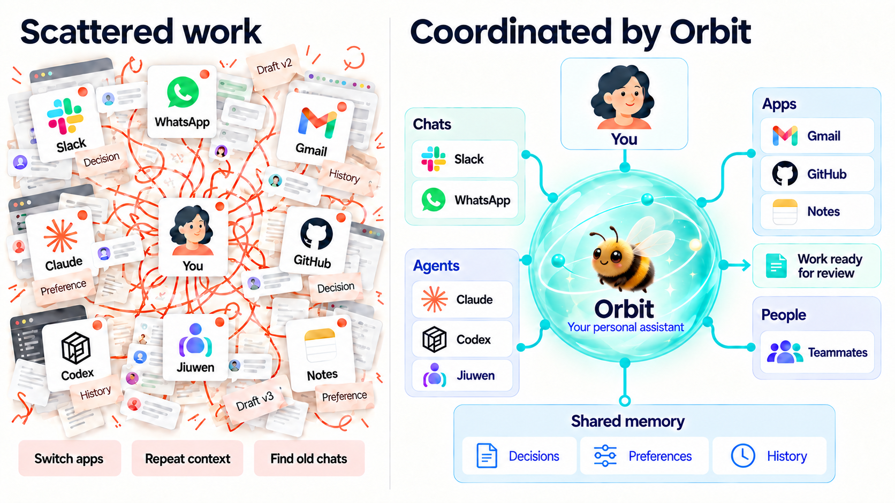
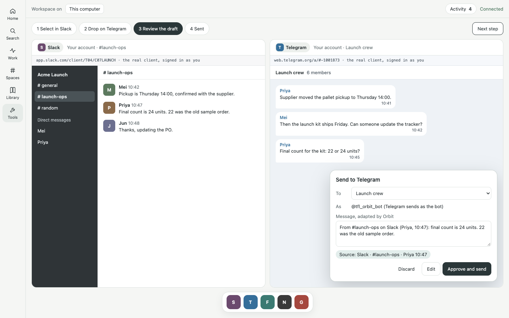
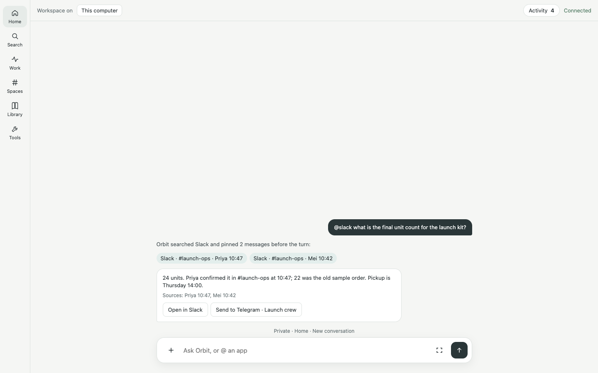
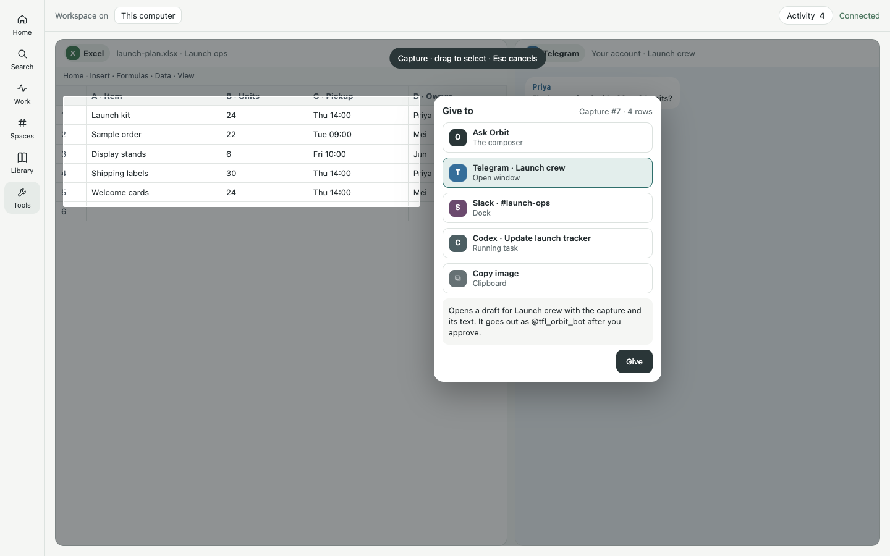
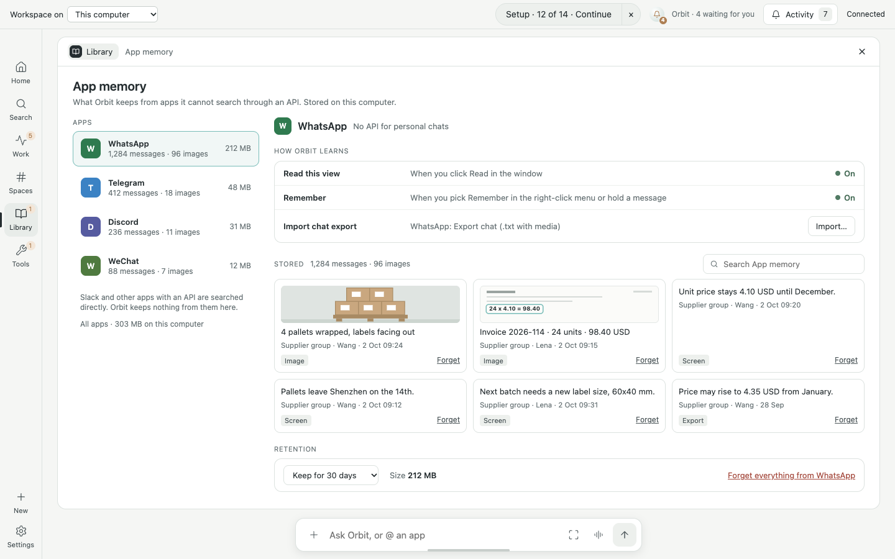

# Orbit, explained simply

**One-page summary:** [`orbit-onepages.svg`](orbit-onepages.svg).

*As of 28 November 2026. Sources: the public checkout `ThinkFlowLab/orbit@d53837a` (initial commit 27 November 2026), its README, `core_functionalities.md`, `docs/orbit/shell.md`, `docs/glossary.md`, `docs/orbit/architecture.md` and `docs/readiness-audit.md`. Orbit is built by another team in the company. This note is context, not our roadmap.*

> **Name note.** The desk’s 29 October note described an internal cloud service also called Orbit, which ran DigitalMate’s assistant for about ten days. That service and this public product are not the same thing. This note replaces the old one and covers the desktop workspace in the public repository.

## The short version

- **Orbit is a desktop workspace where a team and its AI agents work in one shared project room.** You ask in plain words; the room does the work; the result stays in one place.
- **It uses the agents you already have.** Claude Code, Codex, Orbit’s own helper, Jiuwen Swarm teams, or a person reached through a connected chat.
- **It connects the chats you already use.** Slack, Feishu, WeChat, Telegram, WhatsApp, GitHub, Linear and more, so people can take part without opening Orbit.
- **It remembers the project.** Decisions, preferences and earlier agent work are saved and reused.
- **It can follow up on its own.** A schedule, a watched page or a new message can start a check and bring back an update.
- **Messages wait for you.** Anything sent to a real person needs approval, unless you set a standing rule.
- **It runs from source on macOS and Linux.** There is no public installer yet. Windows is limited, and always-on cloud work is a pilot.

## What it looks like



*The repository’s own one-image summary: work scattered across chats, agents and files on the left; one room with the same chats, agents and shared memory on the right.*

## What it is

Orbit 0.2.0 is a desktop app with two parts: an Electron window and a local Python process called the bridge. The bridge holds the project records, talks to the agents and apps, and runs the work. The window only shows what the bridge knows.

It is **local-first**. The workspace, its database and its files live on your computer. Only the material a task needs is sent to the model provider you configured. There is no Orbit account and no shared cloud workspace in the normal setup.

The product is built around a **room**:

- **Home** is your private conversation with Orbit. Nothing is shared from it unless you choose to.
- **A Space** is your view of one project room: its purpose in your words, your private notes, the room’s story and its people.
- **A room** holds the people, the agents, the linked outside chats and the work. Messages from a linked chat appear in the room with the person’s name.
- **A task** is one ask given to one agent. It carries the objective, the evidence it cited, the files it made and where it came from.
- **A conversation** is a thread of asks. A second ask in the same room usually resumes the same agent session, so the agent keeps its context.

Agents are named workers, not one model with a prompt. Orbit’s own helper is one; Claude Code, Codex, Computer, Jiuwen Swarm and imported specialists are others. A person in a linked chat can also be the worker: Orbit sends the question and waits for the reply.

## What it does

### 1. Brings people and agents into the same room

You make a room, invite teammates and agents, and link the project’s chats. A question asked in Slack can reach an agent in Orbit; the answer can go back to Slack. A Feishu thread, a WeChat group and a GitHub issue can all feed the same task.

The point is not another chat app. The point is that the discussion, the files, the agent work and the decision end up in one place instead of five tabs.

### 2. Gives the work to the right agent

When you ask, Orbit decides who should take it. An explicit `@mention` always wins. Otherwise it looks at what the task needs: coding goes to a coding agent, a plain question to Orbit’s own helper, a named team to a Jiuwen Swarm team. It records why it chose.

Agents can ask each other bounded questions, up to two levels deep, and the asking task waits for the answer. Two coding agents can work on the same folder in turn: while one waits for an answer, the other borrows its working copy.

Each coding run leaves evidence: the files changed, the lines added and removed, and the test result. That evidence can be attached to the answer or cited in a screen.

### 3. Keeps project memory

Orbit saves what the project decided and what you prefer. A fact becomes shared memory only after you accept it; until then it is a candidate. Memory keeps the source it came from, so a later reader can see whether they are allowed to use it.

You can import selected histories from Claude Code or Codex, inspect what Orbit remembers, correct a fact, or forget it. A correction is treated as a new version of the source: tasks that relied on the old version turn stale, and drafts that repeat the old value are held.

### 4. Works across apps and files

Orbit can open a web page, a PDF or an Office document beside the conversation. You can capture a region of the screen, mark a paragraph and ask an agent to revise it, or speak the ask. It can build a task-specific view, such as a checklist, a comparison or a board, and keep it for the room.

Office editing needs a separate ONLYOFFICE server. Web apps open in a window with an owner: **You**, **Observe** or **Agent**. Messaging apps never let an agent type; only you operate those.

### 5. Follows up without being asked

A schedule, a watched page or an event from a connected app can start or continue a task. Home collects running work and decisions that need you, so you can review an update and carry on. Local schedules need Orbit running on an awake computer; work that continues after you close the laptop belongs to the cloud pilot.

### 6. Asks before anything leaves

A message to a real person is a delivery. It waits in a queue for your approval, unless a grant you gave covers that task, destination and identity. Every send gets a receipt with the app’s message id. If a fact in the draft changed, the draft is held and shows the old and new value.

There is also a check for secrets in outgoing text, a limit on how often a bot may start work in one conversation, and a rule that an agent cannot change what an approval card looks like.

## One task, from ask to answer

```text
ask in a room
  → Orbit picks an agent and records why
  → the agent reads the room, the cited sources and the memories it may see
  → it works, asks another agent or a person if needed
  → it returns a result with its evidence and files
  → Orbit lays the result out as a screen or a status line
  → any message to a person waits for approval
  → the decision and the sources stay in the room
```

## Screens from the product

These are UI captures from the repository, using its sample launch project. They show the product’s shape; they are not a live customer run.

### One workspace, two chats, one approval



A Slack thread and a Telegram group sit in the same workspace. Orbit has adapted Priya’s Slack message for the Telegram launch crew. The draft names its source and waits for **Approve and send**.

### An ask that shows its sources



A private ask in Home. Orbit searched the linked Slack channel, pinned the two messages it used, and answered with the sources and two next actions.

### Capture a corner of an app, then send it somewhere



A captured region of a spreadsheet can go to Orbit, a Telegram group, a Slack channel, a running Codex task or the clipboard.

### What Orbit keeps from apps without an API



Some apps can be searched directly; others cannot. For those, Orbit can keep what it saw, on this computer, with a retention period and a Forget control.

## What works today

**Working in this repository**

- Desktop rooms, Home, Spaces, linked chats and the shared story.
- Claude Code, Codex, Orbit’s own helper and Jiuwen Swarm teams as runtimes.
- Connectors for Slack, Feishu, Telegram, WhatsApp, WeChat, GitHub, Linear, Google, Microsoft, IMAP and several Apple apps; WeCom, DingTalk and Discord through Jiuwen Swarm channels.
- Task routing, questions between agents, approvals, grants and send receipts.
- Memory candidates, accepted memory, imports and corrections.
- Captures, comments, generated views and published screens.
- Schedules, watches and connected-app triggers.
- Computer sessions on this Mac through a driver; remote machines cannot start one.

**Not there yet**

- No public installer. The route is a source install on macOS or Linux.
- Windows has no one-command source install; native packages are unsigned.
- Always-on cloud work is a pilot. Local schedules need the app awake.
- App access varies by provider and by the permissions you granted. Several integrations are recorded as not yet tested against live accounts.
- Remote computers cannot start a session.
- The repository itself says many example workflows are illustrations, not proof of a live connector or model run.

## Limits to keep in mind

- **It is a desktop app, not a service.** Close the laptop and local work stops; only the cloud pilot continues.
- **It uses your accounts and your model keys.** Setup is part of the product, not a footnote.
- **Connected apps keep their own rules.** WhatsApp Web drafts must be sent by you; Telegram needs participant consent; some providers keep no history to read.
- **Approval is the safety line.** A grant can remove the per-message pause, so grants deserve the same care as the task itself.
- **The product is early.** Version 0.2.0, an initial public commit, and a long list of acceptance work still open.

## How it relates to our products

- **DigitalMate:** a different product and a different layer. DigitalMate is a phone assistant with a cloud task server and a feed; Orbit is a desktop team workspace that coordinates agents and apps. The old internal cloud engine also called Orbit is not this product.
- **Jiuwen / JiuwenSwarm:** Orbit can use Jiuwen Swarm agents and teams as one runtime, and can reach WeCom, DingTalk and Discord through Swarm channels. Orbit is not built on JiuwenSwarm.
- **Claude Code and Codex:** first-class runtimes. Orbit keeps their sessions, settings and histories, and gates their tool calls.
- **MobileGym / HOPA:** no direct relation. Those are phone GUI agents; Orbit is a desktop workspace for project work.

## Why it matters

- **It treats agents as coworkers, not a chat feature.** They have names, sessions, inboxes, questions, permissions and evidence.
- **It meets people where they are.** A teammate can stay in Slack or Feishu and still take part in the room.
- **It takes evidence seriously.** Sources have versions, results cite them, and a changed fact stops the work instead of quietly producing an old answer.
- **It makes the human the gate.** Sends, high-risk tool calls and computer control pass a visible approval card.
- **It is honest about being early.** The README separates what is implemented, what is unverified and what is still a pilot.

## Open questions

- **Will the room model click with teams?** It asks people to change where they discuss work, even if their chats stay connected.
- **Can setup become ordinary?** Model keys, agent sign-ins, app permissions and Office server are a lot for a first run.
- **How far can approvals scale?** Too many cards and people approve without reading; too few grants and the work stalls.
- **Will the desktop-only bet hold?** Always-on work is a pilot; the product is strongest when the laptop is open.
- **What happens when an agent is wrong?** The evidence trail helps, but a person still has to notice.

## Sources

- README and `core_functionalities.md`
- `docs/orbit/shell.md` (user guide)
- `docs/glossary.md` (terms)
- `docs/orbit/architecture.md` (how it is built)
- `docs/readiness-audit.md` (what is verified)
- Repository: `https://github.com/ThinkFlowLab/orbit`
