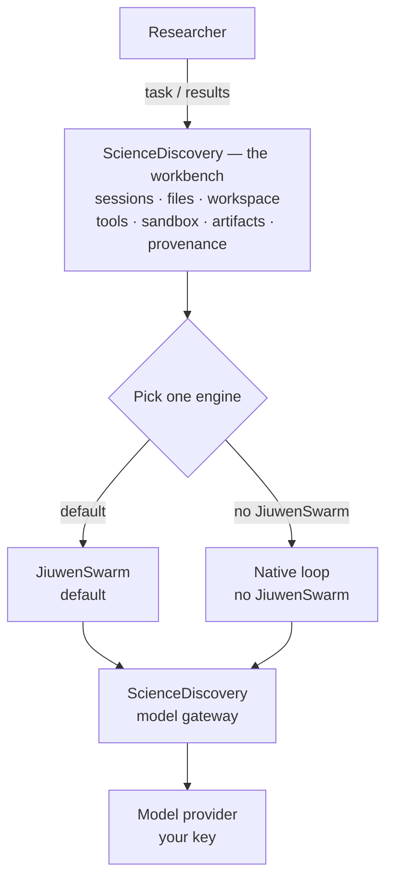
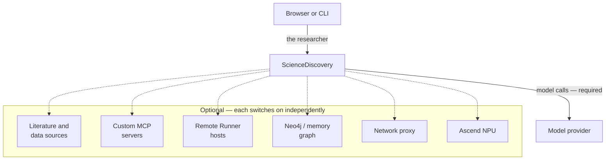
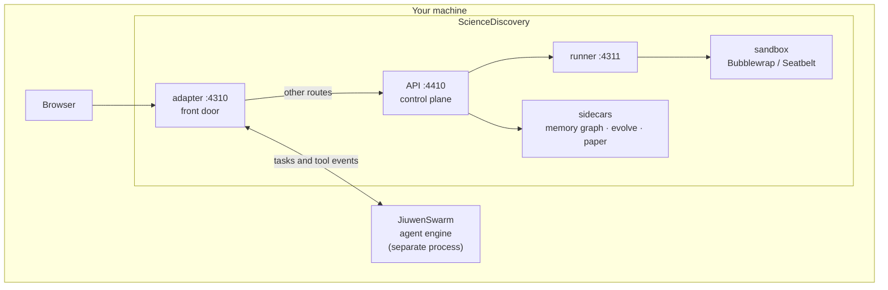
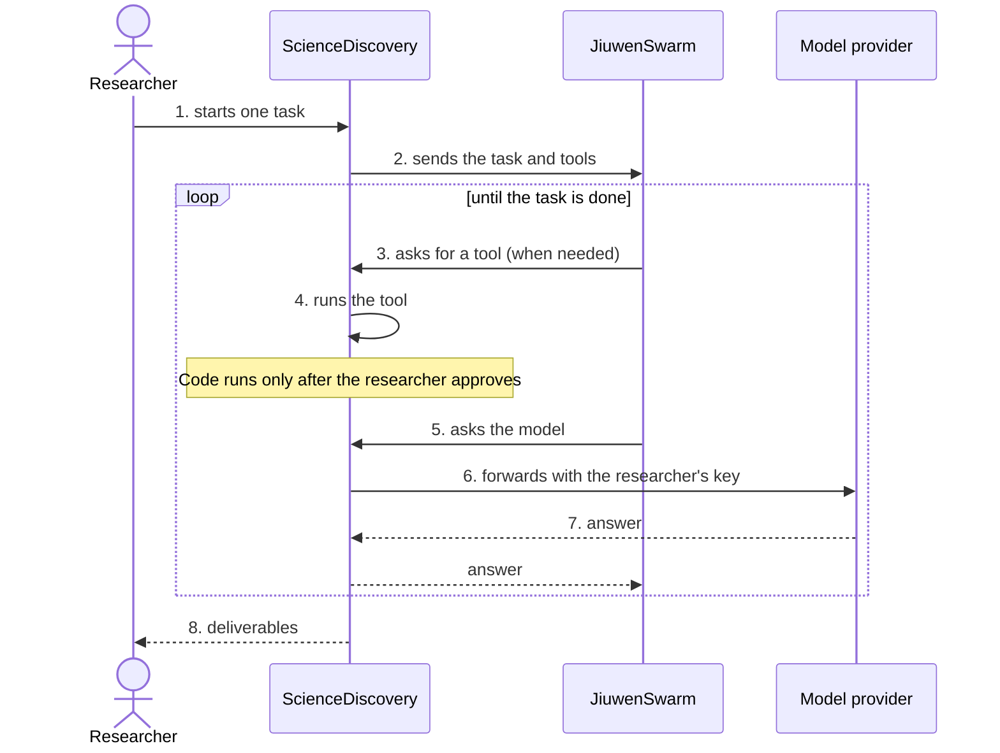

# ScienceDiscovery, explained simply

*As of 29 October 2026. Sources: a checkout of `main` at `2abe8af2`, the README, the 0.3.0
release notes, [issue #582](https://github.com/openJiuwen-ai/sciencediscovery/issues/582), and the
jiuwenswarm repository.*

*ScienceDiscovery is built by another team in the company. This note is context, not our roadmap. It
covers what the product is, how it runs, and the JiuwenSwarm engine it depends on.*

## The short version

- **ScienceDiscovery** is openJiuwen's local research workbench: literature, hypothesis, code,
  experiments and tuning in one place, with a record of where each result came from.
- It is **one user, one machine**. The browser UI is on `127.0.0.1:4310`, state lives under
  `.sciencediscovery-data/`, and the service authenticates with one bearer token. It is not a
  multi-user service and has no TLS.
- Its **default agent backend is JiuwenSwarm**, but the product keeps its own Node control plane
  for projects, sessions, permissions, artifacts and provenance, and can switch to a built-in
  `native` executor. It ships a **pinned and patched JiuwenSwarm**, not a stock release.
- The last **stable release is 0.2.0** (10 September 2026). **0.3.0 is still in prerelease**:
  `0.3.0-beta` on 30 September and `v0.3.0-rc1` on 16 October. `main` is already 13 days past rc1
  and moves daily.
- It is **Apache-2.0**, mostly TypeScript with Python sidecars, and was created on 14 August 2026.
  On 29 October it had about **179 stars, 36 forks and 141 open issues and pull requests**, with
  roughly **1,785 commits** in eleven weeks.

## The picture

For a product reader, ScienceDiscovery is the workbench and JiuwenSwarm is the engine it uses. The
researcher's sessions, files and workspace stay in the workbench.

**The diamond is the only either/or:** pick one engine. Both engines use the same ScienceDiscovery
model gateway to reach the provider. There is no second model path and no third option.

| Mode | Agent engine | Model provider |
|---|---|---|
| JiuwenSwarm (default) | JiuwenSwarm | Used, through ScienceDiscovery's gateway |
| Native | The API's built-in loop | Used, through the same gateway |

**ScienceDiscovery is the product.** It owns the sessions, files, workspace, tools, sandbox,
artifacts and provenance. Those stay when the engine changes.

**JiuwenSwarm is an engine outside it.** It plans the work and keeps the model's working context.
ScienceDiscovery starts it as a separate process; the built-in `native` loop can replace it.

**The model provider is outside both.** ScienceDiscovery owns the provider key and the model
gateway; JiuwenSwarm reaches the model only through ScienceDiscovery. The internal seam is the
**run controller** (the adapter and the control plane).

Other external edges are deliberately left out of the picture. The full external view — solid is
required, dashed is optional:

The optional pieces do not change the engine mode. They add data, tools, execution, storage, network
or hardware to either mode.

| External component | Required? | Used for |
|---|---|---|
| Model provider | Yes, for an agent run | The model API and key the researcher configures; nothing is bundled |
| Browser or CLI | One of them | The researcher's client |
| Built-in literature and data sources | Optional | PubMed, arXiv, Europe PMC, bioRxiv and medRxiv; UniProt, PDB, Ensembl, Reactome, ClinVar, ChEMBL and GEO |
| Custom MCP servers | Optional | Extra tools over STDIO, Streamable HTTP or SSE, with optional OAuth |
| Remote Runner hosts | Optional | SSH or direct-endpoint machines for execution and workspace transfer |
| Neo4j or an external memory-graph service | Optional | ScienceMemory storage; the default is a local file store |
| Network proxy | Optional | Outbound access through a configured proxy |
| Ascend NPU | Optional | NPU execution through the runner's NPU broker |

## What it is

A task is a research question, not a chat. The agent plans, calls tools, writes and runs code,
delegates to sub-agents, and delivers **Artifacts**: reports, code, tables and images. Each
Artifact can be traced back to the code, environment, logs and cited evidence that produced it.

The 0.3.0-beta notes name four supported scenarios:

| Scenario | What is delivered |
|---|---|
| Literature review | Search and fetch papers, extract evidence, collaborate across specialists, deliver a report with traceable citations |
| Data analysis | Read data, prepare an environment, run the analysis, deliver reproducible code, charts and conclusions |
| Antibody design | Combine domain skills, specialist models and scientific environments; results are candidates, not experimental validation |
| Algorithm optimisation | Use Evolve / RSI to generate candidates, score them in the sandbox and iterate, keeping the process |

Three ideas carry most of the differentiation:

- **Idea Tree** explores several research directions and lets evidence steer the next branch.
- **Evolve (RSI)** improves an evaluable artifact by generating, scoring and selecting candidates.
- **ScienceMemory and Reviewer** record relationships between tasks, files and artifacts, make the
  chain navigable, and critique a delivered artifact.

On top of that sit 17 bundled **Skills** (literature searcher, evidence extractor, code engineer,
report writer, reviewers, `science-research-team`, …), MCP connectors for external tools and data,
and **Specialists** that package a role, its methods and its tools. The `science-research-team`
skill is the orchestrator: it splits a question across the knowledge and data domains and
synthesises the result.

There is also a CLI. `ScienceDiscovery run "…"` sends a task to an already running `serve` and
streams the answer; piped output becomes JSONL, and `--auto-approve` skips the permission prompts
(except direct host execution after a sandbox failure, which always asks).

## A run, end to end

1. The browser posts a message to the session.
2. The API resolves the effective model, Skills, Specialists, connectors, workspace and permission
   state.
3. `createAgentRun()` picks an executor: **native** (the TypeScript loop in `services/api`) or
   **JiuwenSwarm** (the default, bridged by the adapter).
4. The executor produces model events and tool calls. Tool calls come back to
   ScienceDiscovery-owned handlers, so permission, sandbox, artifact and audit behaviour is the
   same under either executor.
5. The first code execution raises a permission card. After approval, the runner executes inside a
   fail-closed sandbox.
6. The API persists run events, messages, the prompt manifest, artifacts and provenance. The
   browser follows the run over SSE and can reconnect from the last event id.

The invariant the architecture is built around: **changing the executor does not move authoritative
product state out of the API.**

## Running it

| Path | What you need | Notes |
|---|---|---|
| Prepackaged binary | Linux x86_64 or aarch64, Bubblewrap | ~588 MB for 0.3.0-rc1; the shortest first run |
| Local source | Linux (including WSL 2) or macOS, Node 22.19+, pnpm 11.1.2, Python 3, uv, Git, curl, Bubblewrap on Linux | The development path; macOS uses Seatbelt instead of Bubblewrap |
| Docker | Linux containers, unprivileged user namespaces | Bind-mounts `./data`; no named volume |

The public entry points are the [install page](https://sciencediscovery.github.io/install/index.html),
the [bilingual documentation](https://sciencediscovery.github.io/docs/), and a
[status board](https://sciencediscovery.github.io/github-status-board/) that mirrors issues, pull
requests, CI, E2E and coverage for the repository.

Windows has **no native path**: it runs through WSL 2 or Docker. The 0.3.0-beta notes are explicit
that Windows install paths had not been fully validated for agent execution. Managed scientific
environments come from a pinned micromamba, so no system Python, R or conda is required.

On first start the service generates a token at `.sciencediscovery-data/secrets/auth-token`. That
token grants access to the whole local workspace and is separate from model API keys. The server
listens on loopback and uses no TLS; exposing it is an explicit deployment choice, not a supported
multi-user mode.

There is no bundled model. You register a provider and key in **System configuration → Model
registry**; the first model also becomes the default task model.

## Relationship to JiuwenSwarm

- The README says ScienceDiscovery is **built on JiuwenSwarm**, and every deployment path
  (source, Docker, packaged launcher) uses it by default. The native executor is opt-in.
- JiuwenSwarm is an **executor, not a dependency of the product's data model**. The built-in
  `native` loop runs the same product without it; select it with `--no-jiuwenswarm` or
  `SCIENCE_AGENT_EXECUTOR=native`. There is **no automatic failover**: if the configured executor
  is down, runs fail until it is started or the stack is restarted in native mode. The two modes
  differ in context handling, planning, tools and skills, so native is a working fallback, not a
  like-for-like copy.
- **The provider key stays with ScienceDiscovery, and there is one model path.** The researcher
  starts the *task*; the executor then makes the model calls on their behalf. Both executors reach
  the provider through the API's model gateway; only the executor differs. In Swarm mode JiuwenSwarm
  initiates each model call and the adapter proxies it to the gateway; JiuwenSwarm gets a private
  route, never the key. In native mode the API's own loop initiates it, with JiuwenSwarm absent.
  Product-side calls such as title refinement, review and skill drafts use the same registry and
  gateway.
- JiuwenSwarm runs the reasoning loop and keeps the model's conversation context. ScienceDiscovery
  still owns task scheduling, permissions, provenance and artifact handoff. Delegation stays on the
  platform's own `task` contract rather than Swarm's native sub-agent spawning.
- The adapter is the seam: it maps a ScienceDiscovery run to a Swarm session, exposes that run's
  tools, and maps Swarm frames back to run events.
- It does **not** consume JiuwenSwarm as published. It pins **`workswarm0.2.6`** and applies **nine
  patches** at install or build time: MCP timeout lifecycle, run-model resolution, stream
  correlation, platform MCP transport, output lifecycle, run-model binding, output recovery,
  DeepSeek web, and batch tool permissions. The helper records hashes in a receipt; container
  startup only verifies the receipt. The Git tag and the PyPI wheel are not byte-identical, so
  patching the published wheel is unsupported.
- The artifact contract is shared. jiuwenswarm's
  [artifact-provider stub](https://github.com/openJiuwen-ai/jiuwenswarm/blob/develop/jiuwenswarm/agents/harness/common/rsi/mock_artifact_provider.py)
  describes the real ScienceDiscovery implementation as owned by another repository.

### Who owns what on a run

Here, **session** means the product Session in the sidebar unless it says **engine context**.

| Thing | Owner | Detail |
|---|---|---|
| Project, product Session, messages, run events | ScienceDiscovery | Authoritative product state; survives an executor change |
| Workspace files, uploads and artifacts | ScienceDiscovery | The engine reaches them only through the platform's tools |
| Permissions and provenance | ScienceDiscovery | The engine never persists them |
| Engine conversation context | JiuwenSwarm | The model's working context in its own checkpoint database, not the product Session; the adapter sends and rebuilds no history |

Only the conversation is stored on both sides, and not as a copy: ScienceDiscovery stores the product
Session and its messages; JiuwenSwarm stores the model's working context. The product Session is
authoritative; the engine context is an execution detail. A conversation that began under the
`native` executor is not known to JiuwenSwarm, so switching executors mid-conversation starts the
engine without that history. The workspace is not duplicated at all.

Read that as **adopt and own**, not "call upstream". The team took the harness, fixed what it
needed, and ships its own build, so release control stays with the product rather than with an
upstream release schedule.

## How it is built

For a technical reader, the same product is a control plane, two interchangeable agent executors,
a sandbox daemon and a few optional sidecars.

Everything inside the `ScienceDiscovery` box is the product's own code: the adapter, the control
plane, the runner and the optional sidecars. `JiuwenSwarm` is a separate process on the same machine:
the adapter starts it, drives it and bridges its tool calls back into ScienceDiscovery's permission,
artifact and provenance handlers. The adapter and the API together are what the product picture calls
the run controller.

In the default mode the adapter owns port 4310. It speaks to JiuwenSwarm, exposes the per-run tool
endpoints, and reverse-proxies every route it has not taken over to the API on 4410. With
`--no-jiuwenswarm` the adapter and JiuwenSwarm disappear, and the API serves 4310 directly.

### The call path

The same flow as a sequence, including who initiates model calls:

JiuwenSwarm never calls the provider directly: step 5 passes through ScienceDiscovery's model
gateway.

### The parts

- **Eight services**: `api` (the Node control plane, by far the largest), `adapter` (Python),
  `runner` (sandbox daemon), `launcher` (single-file release), `evolve`, `memory-graph`, `paper`
  (on-demand PDF worker), and `gateway` (bundled Python MCP code, not an HTTP daemon).
- **Twenty-seven packages** own capabilities: `runtime-core`, `schema`, `model`, `tools`, `context`,
  `orchestration`, `workspace`, `executor`, `governance`, `provenance`, `cas`, `data-source`,
  `idea-tree`, `evolve`, `skill`, `specialist`, `mcp`, and the rest. `scripts/check-architecture.mjs`
  enforces the dependency rules in CI.
- **Two frontends.** `apps/web` (React, ~75k lines) still owns the root path.
  `apps/desktop` (~48k lines) is the newer workbench intended to replace it and, according to the
  docs, the one an Electron shell loads — though no Electron package is in this repository. Both
  share the API and the token.
- **Layered CI (L1–L5)**: policy, unit, system, mocked E2E, real-model E2E, binary and Docker,
  with a merge gate. More than 450 TypeScript test files sit beside the code, plus Python suites.
- **Scale**: roughly 350,000 lines of TypeScript, Python and CSS. The repository went from first
  commit to release candidate in nine weeks.

## Limits and risks

- **Not a service.** Single bearer token, no users, no TLS, loopback by default. The README warns
  against exposing it.
- **Linux first.** No native Windows or macOS binary; Windows paths were still experimental in the
  beta notes.
- **The sandbox is not the whole system.** Python, R and shell run inside Bubblewrap or Seatbelt.
  The control API, adapter, JiuwenSwarm, PDF worker, STDIO MCP servers and outbound model calls run
  outside it as trusted control-plane operations. Falling back to host execution after a sandbox
  failure needs its own explicit approval.
- **Upgrade tax.** Nine patches against a pinned Swarm tag mean every Swarm upgrade is a re-patch,
  rebuild and smoke test, not a version bump.
- **Version drift in public material.** The README badge still says 0.2.0 while the latest tag is
  0.3.0-rc1. The docs site tracks `main`, so pages can be ahead of the released binary.
- **Context and latency under Swarm.** [Issue #582](https://github.com/openJiuwen-ai/sciencediscovery/issues/582)
  reports a trivial prompt at **~38k input tokens** and **~20 seconds to first visible text** on
  `glm-5.3-flash`, caused by the Swarm force-all skill setting: the engine loads every skill even
  when the Project selects a few. There is no CI gate on TTFT or skill-token size.

## What is interesting about it

ScienceDiscovery treats the agent runtime as a replaceable component, not as the product. Its own
control plane owns projects, sessions, permissions, artifacts and provenance; the engine only
produces model events and tool calls. Swapping the executor does not move product state. That is the
central design choice.

Two other patterns are worth noting: the **sandbox boundary** keeps code execution isolated while the
control plane stays trusted, and the **pinned runtime** with its hash receipt makes the bundled engine
reproducible across source, Docker and binary builds.

For a reader of the code, the seams matter more than the science features: `createAgentRun()`
switching executors behind one control plane, the adapter's per-run MCP and model bridge, and the
patch receipt that records exactly what was changed in the runtime.

## How we know

- **The product and its claims:** the [repository README](https://github.com/openJiuwen-ai/sciencediscovery)
  and the bilingual docs, read from a local checkout at `main@2abe8af2` (29 October).
- **Releases and dates:** the [releases page](https://github.com/openJiuwen-ai/sciencediscovery/releases)
  and GitHub API on 29 October: 0.2.0 on 10 September, 0.3.0-beta on 30 September, v0.3.0-rc1 on
  16 October. The release notes carry the scenario table, the Windows caveat and the CI changes.
- **Architecture:** `docs/en/developer-docs/architecture.md`, `repository-layout.md` and
  `services/adapter/README.md`; `scripts/start-stack.sh` is the authority for process topology.
- **The Swarm patches:** `jiuwen_swarm/README.md`, `jiuwen_swarm/patches/workswarm0.2.6/` and
  `scripts/swarm-patches.py`.
- **The artifact contract:** the jiuwenswarm `mock_artifact_provider.py` stub on `develop`.
- **The measured cost:** issue #582, opened 27 October, updated 29 October.
- **The numbers:** GitHub API for stars, forks, issues and languages; `git log` for commits and
  dates.

## Open questions

- Does 0.3.0 ship as stable, and does the README badge catch up?
- Does the Swarm force-all skill setting change, and does that fix the ~38k-token, ~20-second case?
- Which frontend wins: `apps/web` or `apps/desktop`, and when does the root switch?
- Do the nine patches go upstream, or does ScienceDiscovery keep carrying them?
- Does it stay local-only, or add a hosted or multi-user mode?
- What does a real run cost in tokens and wall time, under native and under Swarm?
