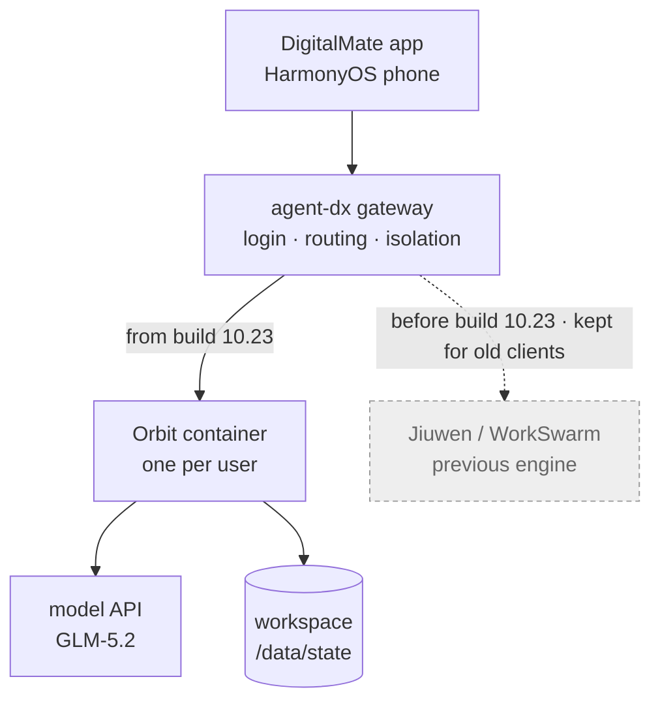
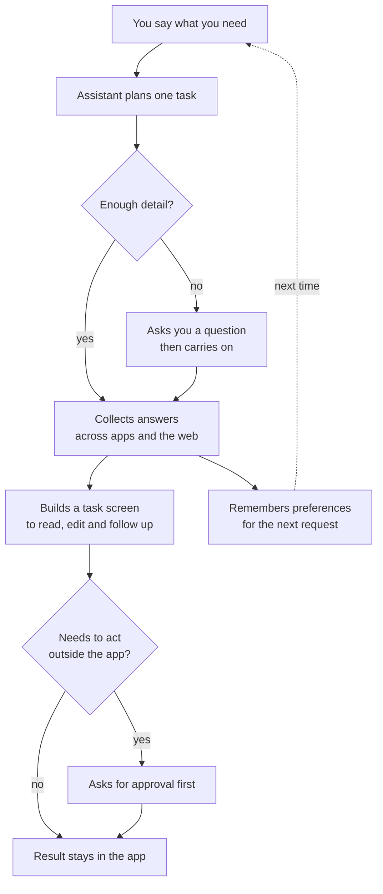
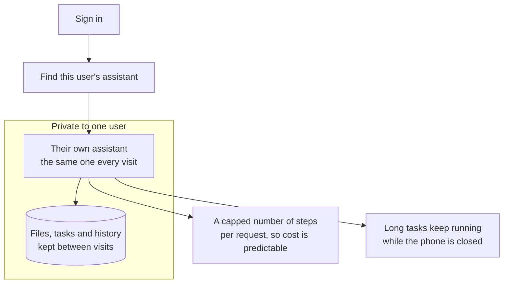
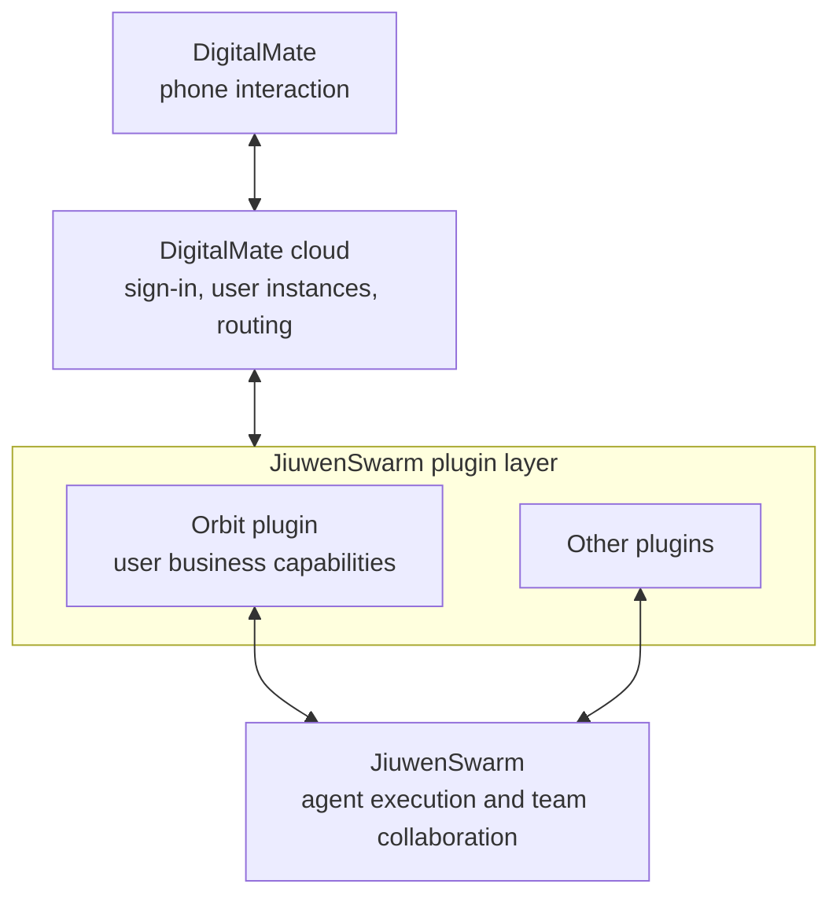

# DigitalMate and Orbit, explained simply

*As of 28 October 2026. Sources: gateway code, a merged pull request, the public status board, bug
reports, one product article and a sibling product's repository.*

## The short version

- **DigitalMate** is a HarmonyOS phone app. You say what you want in one sentence, and it builds a task
  screen for you.
- It has two surfaces: **A2UI task screens** (screens the agent composes) and a Bot-style **Orbit chat**
  called OrbitHome.
- **Orbit** is the cloud engine behind it today. Each user gets a container and a private workspace. A
  desktop version also exists.
- **agent-dx** is the gateway: login, per-user routing, container lifecycle and isolation.
- In the **10.23 build**, DigitalMate moved its cloud engine from **WorkSwarm** (jiuwenswarm) to a
  standalone **Orbit** instance.
- A **27 October RFC** (a design proposal) proposes the next step: Orbit as a plugin inside JiuwenSwarm.

## The picture



The app talks to the gateway. The gateway talks to a container. The container owns the workspace where
the user's state lives.

Build **10.23** runs Orbit. Earlier builds ran WorkSwarm, the name JiuwenSwarm ships under on PyPI. The
gateway keeps the Jiuwen path for old clients and rollback; the merged pull request calls the two engines
"peer targets" and leaves the Jiuwen template unchanged. The board's public releases are **v0.1.2** (21
October) and **v0.1.3** (25 October); 10.23 is an internal build number.

## What DigitalMate is

A mobile project from the openJiuwen community. It was
[described publicly on 6 October](https://news.qq.com/rain/a/20261006A05U6G00).



The flow: ask, get asked back if something is missing, gather, show a screen, confirm before acting, and
remember for next time.

- **Two surfaces:** `A2uiHome` for task screens and `OrbitHome` for the bot chat.
- **The bot is called Beebou**, shown as an avatar at the top of the chat; tapping it opens activity,
  reminders and the artifact centre (#225, #239, #242).
- **Screen format:** [A2UI](https://a2ui.org/introduction/what-is-a2ui/) — the agent describes the screen,
  and the phone draws it with its own components.
- **What it keeps:** each result's source and failed providers, so a missing train or price reads as
  missing.
- **Open demos:** office files, ticketing, group-chat interjection and proactive reminders (#176–#180).

In one line: **a task centre for the phone, with a Bot chat beside it.**

**Where it lives**

- **Runs on:** a HarmonyOS phone.
- **Code:** private. [`openJiuwen-ai/DigitalMate`](https://github.com/openJiuwen-ai/DigitalMate) returns 404
  without access.
- **Artifacts:** the app installed on phones. Builds are not public.
- **Public trace:**
  - The [status board repository](https://github.com/haowenz001/digitalmate-board) is public and readable.
  - The [published board](https://haowenz001.github.io/digitalmate-board/) carries the snapshot from
    27 October 2026, 07:50 UTC.

## What Orbit is

The details come from
[the merged gateway PR](https://github.com/openJiuwen-ai/agent-dx/pull/94) and
[the Orbit template](https://github.com/openJiuwen-ai/agent-dx/blob/master/agent/activator/examples/orbit-sfs-template.json).



One user, one assistant, one private space. The phone stays light; the work happens in the cloud. Today
Orbit does that work: it runs the loop, calls the tools and keeps the memory.

- **Isolation:** one container per user, inside **gVisor** (`runsc`), a sandbox that checks system calls
  before they reach the host. Each gets 2 CPU and 4 GB.
- **Storage:** the workspace at `/data/state` sits on **SFS** (Huawei Cloud's Scalable File Service,
  mountable network storage), owned by user `10001` with mode `0700`.
- **Model:** GLM-5.2 through an OpenAI-compatible API, a 1M-token context and 8 model-and-tool round trips
  per turn.
- **Protocol:** `orbit.request` with an `action` field over `/orbit/ws`; the phone sends its language and
  device with each message (#270).
- **Binding:** the same user always gets the same container, different users are isolated, and the
  template (`orbit`, version `v1-workspace`) and binding are fixed by the server, so a client cannot pick
  another user's container.

**Where it lives**

- **Runs on:** Huawei Cloud. A desktop version also exists; some features work only there.
- **Code:** private. [`ThinkFlowLab/orbit`](https://github.com/ThinkFlowLab/orbit) returns 404.
- **Artifacts:**
  - A container image in Huawei Cloud **SWR** (its image registry),
    `cn-north-1/openjiuwen-online-test/orbit`, private and returning 401 without credentials
    ([manifest](https://swr.cn-north-1.myhuaweicloud.com/v2/openjiuwen-online-test/orbit/manifests/sha256:e6fe614ff389ab021e855c1516fe9c44b4916ff66fffba5ad825282c0195f917)).
  - A public
    [template](https://github.com/openJiuwen-ai/agent-dx/blob/master/agent/activator/examples/orbit-sfs-template.json)
    inside `agent-dx`.
- **Public trace:** issue numbers cited on the status board, including #2282.

## What agent-dx is

[`agent-dx`](https://github.com/openJiuwen-ai/agent-dx) (Agent Distributed eXecutor) is the **substrate**:
the layer that runs the containers and routes traffic between them. It handles identity, containers,
routing and storage; prompts, tools and model calls stay inside the engine. It is written in Rust.

[The example config](https://github.com/openJiuwen-ai/agent-dx/blob/master/gateway/examples/digitalmategateway.json)
contains both engines:

```json
"jiuwen": { "template": "jiuwen", "version": "1" },
"orbit":  { "template": "orbit", "version": "v1-workspace",
            "backend_path": "/ws", "service_port": 18092 }
```

The Orbit entry was built as a transparent WebSocket route: it authenticates the session, picks the user's
instance from the fixed template, and forwards frames without converting them to Jiuwen's protocol
([#99](https://github.com/openJiuwen-ai/agent-dx/issues/99)). That is what "peer targets" means in practice.

The traffic is no longer only one way. On 26–27 October, JiuwenSwarm's gateway gained an `adx_router`
backend: it creates an ADX Environment from a template, mounts the workspace, and routes Jiuwen's own agent
runtime through the same ingress and Environment APIs (`gateway/extensions/adx/`). So agent-dx now runs
Jiuwen's runtime as well as Orbit's, and the two engines are symmetric tenants of the substrate.

**Where it lives**

- **Runs on:** Huawei Cloud **CCE** (Cloud Container Engine, its managed Kubernetes), with SFS for
  workspaces.
- **Code:** public on GitHub at [`openJiuwen-ai/agent-dx`](https://github.com/openJiuwen-ai/agent-dx).
- **Artifacts:**
  - Release images built from that source.
  - The merge that added Orbit is [PR #94](https://github.com/openJiuwen-ai/agent-dx/pull/94).
- **Public trace:** the repository, its pull requests, and its releases.

## The roles, not the brands

The same three words get mixed up, so by role:

| Role | What it owns | Today | In the plan |
|---|---|---|---|
| **Substrate** | containers, routing, identity, storage | agent-dx | agent-dx |
| **Harness** | one agent's loop: prompt, model calls, tools, memory | Orbit | JiuwenSwarm |
| **Plugin** | product capabilities loaded into a harness | — | Orbit |
| **Product surface** | what the user sees and touches | DigitalMate app; Orbit desktop client | DigitalMate app |

Orbit is a harness today, not the substrate. It also ships a desktop client with its own interface; on the
phone it has no interface of its own — it proposes screens, and DigitalMate draws them.

In the plan Orbit is no longer a harness or a substrate. It is a plugin: a set of capabilities that runs
inside JiuwenSwarm's harness.

"Peer" therefore means interchangeable to the gateway, not equal in scope. JiuwenSwarm is a general
platform; Orbit is the engine for one product. The plan then makes them unequal by design.

## Why the gateway exists

Six jobs happen outside the phone:

1. **Identity** — verify the Huawei account token (AGC, Huawei's app services platform); the container
   receives only authenticated requests.
2. **Assignment** — map the user to a fixed binding and sandbox.
3. **Lifecycle** — start the container if asleep, wait for readiness, close on revoke or expiry.
4. **Storage** — mount the workspace with the right owner and permissions.
5. **Transport** — upgrade to WebSocket and forward frames both ways.
6. **Protection** — keep containers off the public internet and return HTTP 401, 502 or 504 instead of
   leaking internals.

One request:

```
phone → /orbit/ws with a business token
      → gateway verifies the token and gets the user id
      → gateway computes the user's binding
      → finds or starts the Orbit container
      → waits for readiness, mounts the workspace
      → upgrades to WebSocket, proxies frames
```

Those jobs need cloud credentials, placement knowledge, container control and cross-user isolation — all
of which belong in the cloud, not on a phone.

**Orbit is the worker; the gateway is the building manager.** One worker still needs a building manager.

## What the board adds

The 27 October snapshot mirrors whole issue bodies: a weekly roadmap, design proposals and test plans. Those
say more about the product than the bug list does.

### The roadmap (#147)

Every week has a capability, a demo script and a tick box.

- **Week of 19–25 October, done:**
  - One bot chat for tasks. Topics are created and continued automatically: the demo moves from Shanghai
    basketball courts to a Nanjing trip, then asks about courts in Pudong and food in Nanjing without
    mixing them.
  - A clarifying card before work starts. The answer stays in the chat, and the result reflects it and
    says what was not verified.
  - Tasks keep running when the user changes topic or leaves the app, with progress in the chat, an
    activity panel, a home-screen card and a notification.
  - Structured results — text, tables, checklists, a budget — and a text fallback when an interactive
    artifact fails.
  - Cross-session memory that overwrites old facts: a user who switches from meat to vegetarian, or
    changes a weekly meeting, is remembered that way.
- **Week of 26 October, planned:**
  - Mail, calendar and chat pulled into one brief, pushed without being asked.
  - To-dos taken from email with their deadlines, then followed up.
  - Inbox triage: archive marketing, flag priority mail, draft replies.
  - A loop across apps: email → task → Feishu or Slack notice → draft reply.
- **After that:** a standalone plugin for adding another person's agent as a contact and messaging it — send
  a handle, wait for consent, then a private chat, with no public directory.

### How the discovery feed ranks (#200)

The "Discover" feed is a multi-source pool with two ranking formulas:

- **Interest mix:** 0.50 profile + 0.25 session + 0.15 freshness and heat + 0.10 balance.
- **Search:** 0.55 reciprocal rank fusion (merging several ranked lists) + 0.30 BM25 (term matching) +
  0.10 freshness + 0.05 preference, then near-duplicate removal by TF-IDF (word frequency) and MMR
  (maximum marginal relevance, which trades repetition for variety).
- **Sources:** YouTube, Bilibili, X, Hacker News, Reddit, Zhihu, GitHub, RSS, and Chinese and global news
  feeds. Xiaohongshu and Douyin are not connected.
- **Not from conversation memory:** the projection exists but rebuilds only after 8 remembered facts and
  about 7 days, so a new account sees a generic feed (#65).

### The daily brief in planning (#200)

A second proposal adds an editorial layer above that pool:

- Pipeline: fetch → profile → model gives 0–10 and one line → threshold, topic de-duplication, quota →
  summary, background, community discussion.
- The phone shows one card per day: score and one line, tap for detail.
- Only two controls: "more like this" and "less like this".
- A card can become a task — follow up on an issue, make a reading list, draft something — through the
  confirmation gate.
- It stays one card, not a source manager, an infinite feed, or a mix with short video.

### What Orbit can do, from its tool list (#256)

The assistant once printed its own tool list:

- Todos: `orbit_todos`, `orbit_todo_add`, `orbit_todo_update`.
- Schedules: `orbit_schedule`, `orbit_list_schedules`, `orbit_update_schedule`,
  `orbit_schedule_observe`.
- Other: `orbit_weather`, `orbit_search_memory`, `orbit_propose_view`, `orbit_propose_screen`.
- Generic: `read_file`, `browser_open`, `web_search`, `skill_tool`.

Read together, Orbit owns tasks, schedules, memory and search; the phone only draws the screens it
proposes. That is the A2UI split in practice: data from the cloud, rendering on the phone.

### How they plan to test it (#209)

- Start from 20–50 real failures, not a large benchmark.
- Two suites: **regression**, which should reach 100% pass^k (every trial passes, k at least 3), and
  **capability**, which starts low and climbs — morning brief, confirmation gate, research readiness.
- Three graders: code checks (new topic? same session? tool called?), a model rubric for intent, and a
  weekly human spot check.
- The test setup must behave like the production phone app.

### Identities and connections (#190, #221)

- **Identity cabinet:** three card types — company, open source, social. It stores names and roles,
  never passwords or tokens.
- The confirmation card shows which identity will act.
- **Connections** are made inside the app by OAuth: Feishu first, then email, GitHub, Gitee.
- Connecting is not sending: outbound actions still pass the gate.

### Interface choices (#153, #219)

- Artifacts appear in the reply as thumbnails or file cards. HTML preview loads a local file into a
  WebView with JavaScript off and every other URL blocked.
- Long tasks get a timeline of three lanes — input, model, tools — but the phone shows only a result card
  and the duration, turns and calls. The full view is a second page.

The [published board](https://haowenz001.github.io/digitalmate-board/) is the public source. Individual
issue pages point at the private repo and return 404; the bodies are public on the board.

## What changed in build 10.23

The internal note for build 10.23 says four things:

1. The **cloud execution engine moved from WorkSwarm to Orbit**.
2. The UI moved from **Session style to Bot style**; follow-ups and new topics happen in the main chat.
3. Orbit brought **cross-session memory**, linked by intent.
4. **Parallel tasks** with live progress, and notification cards on the home screen that can wake the app.

Before the switch, DigitalMate was a thin client of remote JiuwenSwarm. Two public bug reports describe
that period: [tool permission that could not be revoked](https://github.com/openJiuwen-ai/jiuwenswarm/issues/8265)
and [streamed output buffered until the turn ended](https://github.com/openJiuwen-ai/jiuwenswarm/issues/8522).
The first one spells out the old split: tools ran in the cloud, and the phone only received
`chat.ask_user_question` cards and sent back an approval.

## What comes next: Orbit as a plugin

The board carries **RFC #271** (a request for comments — a design proposal), opened by **changzherui** on
27 October: *"DM 与 Orbit 插件的端云协作、接口兼容及分阶段接入计划"*. The title's "DM" means DigitalMate. It proposes this chain:



The phone keeps talking to the DigitalMate cloud. The cloud loads plugins. **Orbit becomes a plugin inside
JiuwenSwarm**, and JiuwenSwarm handles agent execution. The phone stays on the business interface and does
not touch JiuwenSwarm internals.

Read it as a sequence, not a contradiction:

- **Today, build 10.23:** Orbit is the engine. It plans, calls tools and holds memory. JiuwenSwarm is not
  in the path for new clients; it stays for old clients and rollback.
- **Planned:** JiuwenSwarm is the engine. Orbit becomes a plugin that supplies the user-facing business
  capabilities, while JiuwenSwarm runs the loop and the team collaboration.

In short: today DigitalMate runs on Orbit. In the plan it runs on JiuwenSwarm, and JiuwenSwarm runs on
openJiuwen.

So "Orbit inside JiuwenSwarm" does not mean the gateway put one engine inside another. It means Orbit's job
gets narrower: from running the assistant to providing the parts the assistant uses.

Most of those parts already exist on the Jiuwen side. The `jiuwenswarm` repository lists cross-session
memory (general, task and coding memory), scheduled tasks, skills and skill self-evolution, channels from
Xiaoyi and Feishu to Telegram and Slack, browser control, multi-agent clusters and tool approval. Orbit's
memory and schedules therefore overlap with what Jiuwen already ships. What Orbit adds is the multi-tenant
phone packaging: one isolated workspace per user, the `/orbit/ws` contract, proposed screens and the
phone's task flow. Which side keeps memory and schedules is not settled in public.

Another product already sits on the Jiuwen side.
[ScienceDiscovery](https://github.com/openJiuwen-ai/sciencediscovery), a research workspace for
literature, code and experiments, is built on JiuwenSwarm and uses it as the default backend in every
deployment; jiuwenswarm's
[artifact-provider stub](https://github.com/openJiuwen-ai/jiuwenswarm/blob/develop/jiuwenswarm/agents/harness/common/rsi/mock_artifact_provider.py)
names it as an implementation owned elsewhere. Its
[issue #582](https://github.com/openJiuwen-ai/sciencediscovery/issues/582) compares its own
time-to-first-token with DigitalMate's and notes that DigitalMate has no matching issue. No Orbit
integration appears in its code. So JiuwenSwarm is not only a fallback kept for rollback: it is the active
backend for a sibling product, while Orbit is specific to DigitalMate.

Think of the plugin as a toolbox, not an engine swap. JiuwenSwarm keeps the workshop — planning, teams,
tool calls, memory, scheduling. The Orbit plugin brings the DigitalMate-specific tools and the phone
contract, and plugs into that workshop. Where Jiuwen already has a tool, the plugin can call Jiuwen's version
or ship its own and override the built-in; the RFC does not say which.

The plugin slot itself already exists. JiuwenSwarm loads extension packages that can register channels,
Gateway methods and agent plugin mounts; a package that replaces a built-in element must declare it, and
the operator must list it for override (#7832, #7833). Another proposal adds agent templates and plugin
packages with install, uninstall and per-session MCP mounting (#7931). Permission and confirmation rails
stay protected either way. That is the machinery an Orbit plugin would use.

What that machinery cannot do today is host another agent runtime. An application plugin is an in-process
Python class that adds a workspace page, Gateway RPC methods and WebSocket routes, and may call Jiuwen's
own agent client (`docs/zh/application-plugins.md` in the repository). It shares Jiuwen's process; there is
no interface for "run this other harness here". The agent-plugin mounts in #7832 add hooks to Jiuwen's own
agent — turn fields, filters, input transforms, skill inventory — not a second loop. So an Orbit plugin is
either a bridge that forwards to an Orbit service, or a port of Orbit's behaviour onto Jiuwen's harness.
The RFC does not say which.

The RFC keeps `/orbit/ws` and `orbit.request` and stages the work:

- **P0** tasks and artifacts — progress, files, reconnect.
- **P1** apps and confirmations — mail/calendar queries, confirmation, no double execution.
- **P2** personal memory — read, correct, forget.
- **P3** follow-ups — schedule, deduplicate, resume after restart.

The RFC is a proposal; its dates remain open. It links Orbit's own issue **#2282** for deployment
evidence.

Build 10.23 runs Orbit standalone. The public plan after that is Orbit inside JiuwenSwarm.

The arc so far:

- **Before 10.23:** JiuwenSwarm underneath; DigitalMate was a thin client of it.
- **10.23:** Orbit underneath; JiuwenSwarm kept for old clients and rollback.
- **Planned:** JiuwenSwarm underneath again, with Orbit as a plugin inside it.

The third stage is not a plain revert. The phone keeps the same contract and Orbit's tools; only the loop
changes hands.

## Likely reasons for the switch

These are the likely drivers, inferred from the public record:

- **The product became a bot.** JiuwenSwarm already ships a personal assistant with memory, schedules and
  channels, but users install it on their own machine or cluster. DigitalMate needs one bot per phone
  user, isolated, inside a shared service.
- **Isolation.** One container per user with its own disk is easier to defend than many users inside one
  shared AgentServer.
- **Release control.** The two bug reports show the team waiting on upstream JiuwenSwarm fixes. Owning the
  Orbit template and version means shipping on their own schedule.
- **Parallel work and memory.** Both were listed as new capabilities, and both fit a per-user workspace.
- **The plugin plan.** The RFC folds Orbit back into JiuwenSwarm, so the standalone instance is one step
  on that path.

## How we know

- **Orbit's packaging, isolation and protocol:** the public template, gateway config and `orbit_ws.rs`.
- **The engine swap:** the internal note for build 10.23, plus the board's issue and PR titles.
- **The old architecture:** DigitalMate bug reports #8522 and #8265 on GitHub.
- **The next architecture:** RFC #271 on the board, quoting `/orbit/ws` and `orbit.request`.
- **The double path today:** agent-dx #99, the transparent WebSocket entry for Orbit with no Jiuwen protocol
  conversion.
- **Jiuwen on the same substrate:** jiuwenswarm commits `8dbce3539` (26 October) and `5f0232ddb`
  (27 October), `gateway/extensions/adx/`.
- **The plugin mechanism:** jiuwenswarm issues #7832 and #7931, plus PR #7833.
- **The plugin boundary:** `docs/zh/application-plugins.md` and the extension registry, read in a local
  checkout at commit `cbde92c` (25 October).
- **The product description:** the 6 October article.
- **The roadmap, ranking and plans:** board issue bodies #147, #200, #209, #219, #221 and #190.
- **What Jiuwen already does:** the `jiuwenswarm` README on its default branch, read 27 October.
- **The sibling product:** the ScienceDiscovery README and its issue #582, read 28 October.
- **Releases:** the board snapshot of 27 October.

## Open questions

- The code inside DigitalMate and Orbit.
- Orbit's internals: language, loop, parallel-task and memory implementation.
- Performance and cost per user. The board shows time-to-first-token (TTFT) complaints around 5 seconds.
- Approval and dates for the plugin plan.
- Which path wins: the plugin layer in RFC #271, or Jiuwen's runtime as another ADX environment. Both are
  now technically possible.

**Unrelated projects with similar names:**
[`mananbharti/Orbit`](https://github.com/mananbharti/Orbit) (a local-first app),
[`mlai21/DigitalMate`](https://github.com/mlai21/DigitalMate) and
[`XDesktopSoft/DigitalMate2D`](https://github.com/XDesktopSoft/DigitalMate2D).
