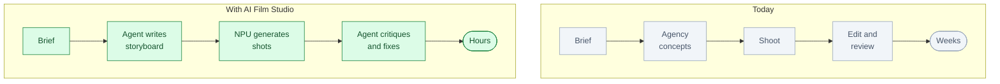

# AI Film Studio: an AI director for brand films

*Status: idea. Not built.*

**One line.** It turns a short brief into a storyboard, generated shots, a critique and a final cut
for a creative team to review.

## Who buys it

CMOs, creative directors, agency producers and brand teams.

They pay for faster campaigns, more variants, lower production cost and fewer review rounds.

## The problem

A 15-second ad can take weeks and a crew.

The brief, storyboard, shoot, edit, review and cutdowns are a long chain. Most of the cost is in
production and rework.

Brands want more versions, for more markets, faster.

## Today vs with AI Film Studio

## How it works

1. **The team writes the brief.** Brand, audience, feeling, length, markets.
2. **The agent proposes concepts and a storyboard.**
3. **The NPU generates shots and variants.**
4. **The agent critiques them against the brief.** It flags off-brand shots.
5. **It regenerates the weak shots.**
6. **The creative director picks the cut.**
7. **The system exports the hero and the cutdowns.**

The short version:

## Where the NPU fits

The NPU renders images and video on-site or in a private cloud.

Why:

- Many shots and variants
- Fast iteration
- Brand assets stay private
- Lower cost per variant

Start with images and short clips. Full video generation can come later.

## What the customer gets

- Concepts and a storyboard
- Shot variants
- A critique against the brief
- A final cut and cutdowns
- A record of prompts, seeds and approvals

## The hard part

The AI is not the hard part. The hard part is:

- Brand taste and consistency
- Rights and clearances
- Video quality
- Compute cost
- Creative trust

## Business model

- Per studio or per brand
- Project fee
- Usage-based compute
- Agency partnership

Start with performance marketing and social ads, where many variants matter.

## What to prove in a pilot

- Time to first cut
- Number of variants
- Production cost
- Review rounds
- Brand approval rate
- Cost per usable shot

## Where to start

Pick one brand and one 15-second social ad.

Good first work:

- Performance marketing
- Social cutdowns
- Product launches
- Regional variants

## Who else is doing this

- Generative video tools
- Production houses
- Creative agencies
- In-house studios

The difference is the agentic loop: brief → critique → regenerate → cut, with brand rules kept in the
loop.

## Why this is not just a skill for a research workbench

| Research workbench | AI Film Studio |
|---|---|
| For scientists | For creative teams |
| Papers and code | Briefs, shots and brand assets |
| One user, one laptop | A studio, many reviewers |
| Research report | Film and cutdowns |
| Rare NPU use | Constant rendering |

The value is the creative workflow, the brand kit, the review loop and the rendering pipeline.

## Risks

- Video quality may not meet brand standards.
- Rights and likeness are legal risks.
- Compute can be expensive.
- The market is crowded.
- Creative teams may reject automated taste.

Keep the human director in charge. The agent proposes; the director decides.

## Smallest first version

For one brand and one 15-second ad:

1. Enter the brief.
2. Generate three concepts.
3. Generate 12 shots for the chosen concept.
4. Flag one off-brand shot.
5. Regenerate it.
6. Export a 15-second cut.

## The 60-second demo

A summer water brief. The agent writes a storyboard, the NPU renders 12 shots, the agent flags a dark
shot, regenerates it, and the cut plays. “38 minutes, 20 variants.”

## Open questions

- Which brand and category first?
- Images only, or video?
- Where does rendering run?
- How are rights handled?
- Who approves the final cut?
- What quality is good enough for a brand?
