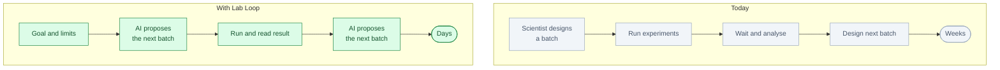
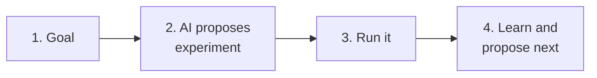

# Lab Loop: an AI experimenter for the lab

*Status: idea. Not built.*

**One line.** It designs an experiment, runs it on a lab instrument or simulator, reads the result and
decides the next experiment — with a scientist approving the plan.

## Who buys it

Pharma, biotech, chemical and materials companies, university labs and contract research
organisations.

They pay for faster experiment cycles, fewer wasted experiments, better use of expensive instruments
and less scientist time on repetitive optimisation.

## The problem

Experiment cycles are slow.

A scientist designs a batch, runs it, waits, analyses the result and designs the next batch. Each
round takes days or weeks. The search space is large, and many experiments are wasted.

The knowledge sits with a few experts. When they leave, the loop slows down.

## Today vs with Lab Loop

## How it works

1. **The scientist sets the goal.** What to optimise, what is allowed, what is too risky.
2. **The AI proposes experiments.** It uses prior data, literature and simulation.
3. **The experiment runs.** On an instrument, a robot or a simulator.
4. **The result comes back.** The AI checks quality and updates its model.
5. **The AI proposes the next batch.** It explains why.
6. **The scientist approves.** The loop continues.

The short version:

## Where the NPU fits

The NPU runs simulation and model inference inside the loop.

Why:

- Many candidate experiments
- Fast scoring before running anything
- Models that improve with each result
- On-site compute for sensitive data

You can start with a simulator. You do not need a robot for the first version.

## What the customer gets

- An experiment plan
- A run log
- Results and quality flags
- The next recommended batch
- The reason for each choice
- A record of what was run, with which settings and model version

## The hard part

The AI is not the hard part. The hard part is:

- Connecting to instruments and robots
- Lab safety and permissions
- Data standards and messy results
- Reproducibility
- Scientist trust
- Long validation cycles

## Business model

- Per lab
- Per instrument
- Per research programme
- Setup and integration fee
- Optional on-site NPU server

Start with one lab, one instrument or one simulator, and one optimisation goal.

## What to prove in a pilot

- Cycle time
- Number of experiments per result
- Hit rate
- Cost per result
- Scientist hours saved
- Reproducibility

## Where to start

Start with a **simulation-only loop** or one instrument in one lab.

Good first targets:

- Formulation optimisation
- Reaction condition search
- Material recipe tuning
- Assay condition optimisation

Avoid a fully robotic lab at the start. It is expensive and slow to integrate.

## Who else is doing this

- Lab automation vendors
- Self-driving lab startups
- Instrument makers
- Internal pharma and chemical teams
- University labs

The market is early. The difference is the closed loop, the instrument integration and the
scientist's trust.

## Why this is not just a skill for a research workbench

| Research workbench | Lab Loop |
|---|---|
| For scientists | For lab operations and R&D teams |
| Papers and code | Instruments, robots and results |
| One user, one laptop | Many scientists, one lab |
| Research report | Experiment plan and run log |
| Rare NPU use | Simulation and scoring in the loop |

The value is instrument integration, safety, lab operations and the closed loop.

## Risks

- Instruments are hard to connect.
- Safety and permissions are critical.
- Results are noisy.
- Scientists may not trust an AI-designed experiment.
- Hardware and lab time are expensive.
- Validation takes months.

Keep a scientist in the loop. Start with advice and simulation, not autonomous lab control.

## Smallest first version

For one lab and one optimisation goal:

1. Load past experiment data.
2. Propose the next five experiments.
3. Score them with a simulator or model.
4. Let a scientist pick one batch.
5. Run it and record the result.
6. Update the model and propose again.

## The 60-second demo

A scientist sets a goal: “maximise yield under these limits.” The AI proposes five formulations, a
simulator scores them, the scientist runs the best one, and the result comes back. The AI updates its
model and proposes the next batch. No robot needed.

## Open questions

- Which lab and which instrument first?
- Can we start simulation-only?
- What data do they already have?
- Who approves experiments?
- On-site NPU or edge device?
- What does success look like in the first month?
