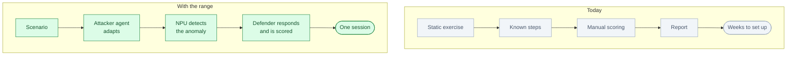
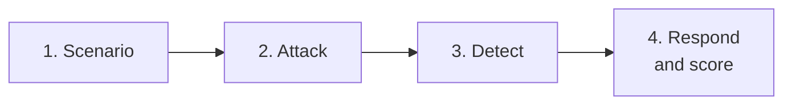

# Cyber Range: an AI attacker and defender for security training

*Status: idea. Not built.*

**One line.** Two AI agents run a live attack-and-defence exercise on a safe network, and the system
measures how fast the team detects and responds.

## Who buys it

CISOs, heads of security operations, training directors and managed security providers.

They pay for faster detection, better-trained analysts, compliance evidence and measurable readiness.

## The problem

Security teams train with slides, static exercises and occasional red-team visits.

It is hard to measure readiness. Analysts rarely face an attacker who changes tactics in real time.
Hiring and retaining skilled analysts is difficult.

## Today vs with the range

## How it works

1. **The team picks a scenario.** A small bank network with one weak service.
2. **The attacker agent plans and executes.**
3. **The NPU flags anomalous behaviour.**
4. **The defender agent responds.**
5. **The attacker changes tactic.**
6. **The system scores detection, response and gaps.**
7. **The team gets a readiness report.**

The short version:

## Where the NPU fits

The NPU runs detection and classification models on-site.

Why:

- Fast inference during a live exercise
- Security data stays inside the network
- Many parallel sessions
- Lower cost than cloud inference

The NPU is not the product. The exercise, the adaptation and the scoring are.

## What the customer gets

- A live exercise timeline
- Detection and response times
- The gaps found
- Analyst actions and notes
- A readiness report for management or audit

## The hard part

The AI is not the hard part. The hard part is:

- A safe, isolated lab
- Realistic networks and logs
- False positives
- Legal and ethical limits
- Trust from security teams
- Measuring readiness, not just activity

## Business model

- Per exercise
- Per analyst seat
- Annual subscription
- Managed-service partnership

Start with one network, one attack path and one blue team.

## What to prove in a pilot

- Detection time
- Response time
- Gaps found
- Analyst confidence
- Repeatability
- Cost per exercise

## Where to start

Pick one scenario and one team:

- Phishing to lateral movement
- Weak service to data access
- Ransomware containment
- Cloud misconfiguration

Start with a small mock network.

## Who else is doing this

- Cyber-range vendors
- Red-team consultancies
- Tabletop training providers
- Internal security teams

The difference is an adaptive attacker, a measured defender and a repeatable score.

## Why this is not just a skill for a research workbench

| Research workbench | Cyber Range |
|---|---|
| For scientists | For security teams |
| Papers and code | Networks, logs and alerts |
| One user, one laptop | A SOC and a lab |
| Research report | Readiness score and gaps |
| Rare NPU use | Live detection |

The value is the safe lab, the realistic scenario, the adaptation and the measurement.

## Risks

- A lab can leak into a real network if badly isolated.
- Scenarios can be unrealistic.
- False positives can erode trust.
- Legal and ethical limits on attack simulation.
- Security buyers are cautious.

Keep the exercise isolated and authorised. Do not touch production systems.

## Smallest first version

For one network and one team:

1. Build a small mock network.
2. Run one attack path.
3. Detect with the NPU.
4. Let the defender respond.
5. Score detection and response.
6. Produce a short report.

## The 60-second demo

On a mock bank network, the attacker moves from a weak service to a database. The NPU flags the
anomaly in 4m 12s. The defender isolates the host in 6 minutes. The report shows three gaps.

## Open questions

- Which scenario and team first?
- How is the lab isolated?
- What does “readiness” mean for the buyer?
- Which logs and tools are available?
- On-site NPU or cloud?
- Who authorises the exercise?
