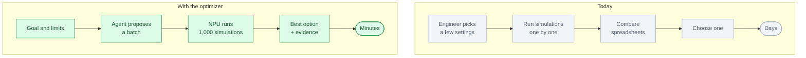
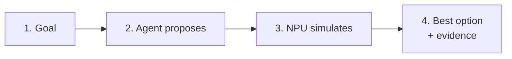

# Digital Twin Optimizer: an AI process engineer

*Status: idea. Not built.*

**One line.** It tries thousands of process settings on a digital twin, finds the best trade-off and
shows the evidence to the plant engineer.

## Who buys it

Plant directors, VP Operations and process engineers at manufacturing, chemical, energy and utility
sites.

They pay for lower energy use, higher yield, less scrap and faster process changes.

## The problem

A plant has a simulation model, but engineers can only try a few settings by hand.

Each simulation is slow. The search space is large. The best setting is often a trade-off between
energy, yield, quality and throughput.

So plants run on settings that are good enough, not optimal.

## Today vs with the optimizer

## How it works

1. **The engineer sets the goal.** “Cut energy 15% without losing yield.”
2. **The agent reads the model** and the constraints.
3. **It proposes a batch of settings.**
4. **The NPU runs the simulations.** Many more than a human could.
5. **The agent scores the results** and proposes the next batch.
6. **It recommends an option** with the trade-offs and evidence.
7. **The engineer approves.**

The short version:

## Where the NPU fits

The NPU runs the simulation or surrogate model on-site.

Why:

- Many runs per search
- Fast enough to iterate
- Plant data stays inside the plant
- Lower cost than a cloud cluster

The NPU is not the product. It is what makes the search loop fast enough to be useful.

## What the customer gets

- A recommended setting
- The expected energy, yield and quality
- The trade-offs and alternatives
- The evidence: simulations, constraints, confidence
- A record of what was tried

## The hard part

The AI is not the hard part. The hard part is:

- A trustworthy simulation model
- Clean process data
- Plant integration
- Proving the recommendation is safe
- Getting engineers to trust it

## Business model

- Per site or per line
- Setup and model integration
- Annual subscription
- Optional on-site NPU server

Start with one line and one goal.

## What to prove in a pilot

- Energy saved
- Yield change
- Time to a new setting
- Payback period
- Engineer acceptance
- Number of simulations per decision

## Where to start

Pick an energy-intensive line with a good simulation model:

- Injection molding
- Chemical or battery production
- Steel or glass
- Utilities

Start with one process and three to five settings.

## Who else is doing this

- Simulation software vendors
- Process consultants
- Internal data-science teams
- Cloud optimization platforms

The difference is an agent that runs the search loop, explains the trade-offs and keeps the evidence.

## Why this is not just a skill for a research workbench

| Research workbench | Digital Twin Optimizer |
|---|---|
| For scientists | For plant engineers |
| Papers and code | Live process data and a simulation model |
| One user, one laptop | Many engineers, one plant |
| Research report | Recommended setting and savings |
| Rare NPU use | Many simulations per decision |

The value is the plant model, the data, the safety case and the integration.

## Risks

- A wrong model gives a wrong recommendation.
- Plant data is messy.
- Engineers may not trust an AI setting.
- A change can affect safety or quality.
- Sales cycles are long.

Keep the engineer in the loop. Do not auto-apply changes.

## Smallest first version

For one line and one goal:

1. Load a simple model.
2. Set three constraints.
3. Let the agent propose 100 settings.
4. Run them on the NPU.
5. Show the best option and the trade-offs.
6. Let the engineer approve.

## The 60-second demo

A line model is on screen. The agent runs 1,000 simulations, finds a setting with 12.8% less energy
and stable yield, and shows the trade-off. The engineer picks option B.

## Open questions

- Which process and plant first?
- Is the simulation model trustworthy?
- What data is available?
- On-site NPU or edge server?
- Who approves a process change?
- What savings make the pilot a success?
