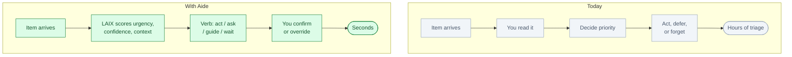
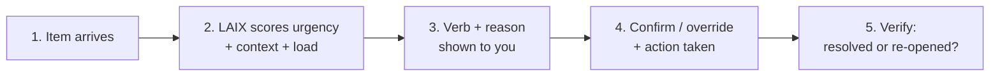

# Aide: an AI chief of staff for your inbox and calendar

*Status: idea, not built. Built to demo LAIX.*

**One line.** Aide decides what needs you now, what it can handle, and what can wait — with a
reason every time.

## Who buys it

Executives, engineering managers, consultants, and knowledge workers who are drowning in messages,
meetings, and decisions.

Their budget comes from less time triaging, fewer things falling through the cracks, and a clear
record of what was decided and why.

## The problem

A knowledge worker's inbox, calendar, and task list fill up faster than they can process them.
Important things get buried. Low-priority threads consume attention. Meetings arrive without context.
Deadlines slip because nobody noticed the signal.

The difference is simple:

## How it works

1. **An item arrives.** Email, Slack message, calendar invite, task assignment.
2. **LAIX reads the situation.** Sender, urgency signals, deadline, prior thread context, your
   current load and schedule.
3. **LAIX returns a verb.** `act` (draft and send the reply), `ask` (send one clarifying question),
   `guide` (show it to you with context for your decision), `wait` (low priority, not due soon),
   `escalate` (blocking a deadline, needs you now).
4. **You see the reason.** Plain-English rationale, confidence bar, the evidence behind it.
5. **You confirm or override.** One tap. The decision is recorded.
6. **Aide verifies.** After acting, a follow-up check confirms the thread closed or flags a
   re-open.

## Where LAIX fits

LAIX is the attention allocation layer. Each incoming item becomes a `DecisionRequest` with a
`Signal` carrying severity, confidence, and due date. Aide uses the full attention policy: quiet
hours suppress low-severity items, cost-of-waiting scores surface deadline risk, and the
`guide` verb ensures you always see items where confidence is below the auto-act threshold.

The quiet-hours override is the best demo lever: during simulated quiet hours, a low-severity
thread stays suppressed. A critical email — confidence 0.95, deadline today — overrides quiet
hours and escalates. The audience watches the system respect context without blindly following
rules.

## What the audience sees

A clean inbox-like view. Each item has a LAIX badge. Most items are `wait` (grey). A few are `act`
(green) — Aide has drafted a reply. One is `guide` (blue) — it needs you. One overrides quiet
hours and surfaces as `escalate` (red). Click any badge to see the full decision breakdown.

The presenter drags the quiet-hours slider to show it activate. A low-severity email disappears
from the active queue. The high-severity one stays. *"The system knows what can wait."*

## The hard part

Access to your email and calendar. OAuth flows, permission scopes, privacy. Users will not give
an AI read/write access to their inbox without very high trust. The first version should be
read-only suggestion mode: Aide shows what it would do, you click to apply.

The second hard part is calibrating what counts as high severity for each person. Two users at the
same company have different attention budgets. The preference elicitation policy and the outcome
learning loop are essential here.

## Business model

- Per-seat monthly subscription
- Team plan: shared attention budget and quiet hours across a team
- Enterprise: SSO, audit export, no data leaving the organisation

Start with one persona (engineering manager), one integration (Gmail or Outlook), one item type
(email).

## What to prove in a demo

- Quiet-hours override: low-severity suppressed, high-severity surfaces
- Confidence gate: two similar emails, one auto-acted, one guided to you — visible diff
- Trust beat: Aide drafts wrong reply; you reject it; record updated, Aide learns
- All seven verbs appear naturally in a 90-second scenario

## Where to start

One user, Gmail or Outlook read-only, email only. Five signal types: deadline mention, direct
question, CC vs. to-line, sender tier, reply chain length. Run for 14 days in suggestion-only mode
before enabling any auto-actions.

## Who else is doing this

- **Email clients** (Superhuman, Spark) surface priority but do not explain the decision.
- **AI assistants** (Copilot, Gemini for Workspace) draft replies but do not apply attention
  policies or produce audit records.
- **Task managers** track items but do not decide what needs you now.

Aide is different: explicit attention scoring, confidence gates, quiet-hours policy, outcome
learning, and you always in control.

## Risks

- Users are uncomfortable with AI reading their private communications.
- Wrong auto-replies damage relationships.
- Calibration requires learning period; first week feels wrong.
- Email/calendar API scopes are broad; users may reject the permission request.

Launch in suggestion-only mode. No auto-send in the first version. Show the reason before every
action. Make the audit trail visible and easy to review.

## Smallest first version

For one user, Gmail read-only, email only:

1. Read emails and extract signals (sender, subject, deadline, question).
2. Score each email with LAIX using the attention policy.
3. Display the verb and reason on each email.
4. Let the user confirm the suggested action (reply, defer, ignore).
5. Record every decision and outcome.
6. After 14 days, surface the five most impactful threshold adjustments.

No auto-send. No calendar. No Slack. Just score, explain, suggest, record.

## The 90-second stage piece

A clean inbox on screen. Twenty emails, most grey (`wait`). A quiet-hours indicator shows active.
The presenter shows: emails arriving during quiet hours stay suppressed. Then one email arrives
marked urgent, deadline today, from a known high-tier sender. LAIX overrides quiet hours: the
email surfaces as `escalate`, confidence 0.96. The reason card reads: *"Due today. Sender is
critical path. Cost of waiting: high."*

The trust beat: Aide suggests `act — send the standard reply`. The presenter rejects it — *"this
person needs a personal response, not a template."* Aide re-ranks: `guide — draft with context
for your review`. The inbox updates. *"It was confident. It was wrong. This is why you stay in
charge."*

The closing line: *"Your inbox, with a reason for everything."*

## Open questions

- Which email client is the first integration target?
- What is the minimum permission scope needed for suggestion-only mode?
- How do we surface the confidence threshold calibration without overwhelming the user?
- Should the stage piece use real email or synthetic?
- Which quiet-hours scenario has the highest audience moment?
