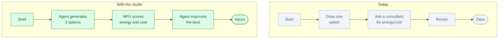
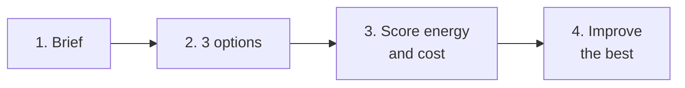

# Generative Architecture Studio: an AI design partner

*Status: idea. Not built.*

**One line.** It turns a building brief into costed, energy-scored design options and improves the
best one before the client call.

## Who buys it

Principal architects, design directors and developers at architecture and design-build firms.

They pay for faster feasibility, better energy performance and fewer client iterations.

## The problem

A feasibility study takes days.

Designers draw options, send them to consultants for energy and cost checks, wait, and revise. Clients
ask for changes. Energy rules are tighter. The loop is slow.

## Today vs with the studio

## How it works

1. **The architect enters the brief.** Size, budget, site, energy target.
2. **The agent generates three layouts.**
3. **The NPU scores energy and cost.**
4. **The agent improves the best layout.**
5. **It checks daylight and circulation.**
6. **The architect selects an option for the client.**

The short version:

## Where the NPU fits

The NPU runs simulation and rendering models on-site.

Why:

- Many design variants
- Fast energy and cost scoring
- Large BIM and image data
- Firm data stays private

The NPU is not the product. The design loop and the evidence are.

## What the customer gets

- Three costed options
- Energy and cost trade-offs
- Daylight and circulation checks
- The design rationale
- A record of what was tested

## The hard part

The AI is not the hard part. The hard part is:

- Building codes
- Simulation accuracy
- Professional liability
- BIM and CAD integration
- Architect trust

## Business model

- Per architect seat
- Per project
- Firm subscription
- Optional on-site NPU server

Start with one firm and one residential or mixed-use brief.

## What to prove in a pilot

- Time to three options
- Energy improvement
- Cost accuracy
- Client iterations
- Architect acceptance
- Code compliance

## Where to start

Pick one building type and one firm:

- Residential
- Mixed-use
- Small commercial
- Retrofit

Start with a simple energy and cost model.

## Who else is doing this

- CAD and BIM vendors
- Energy simulation consultants
- Generative design tools
- Internal computational design teams

The difference is an agent that generates, scores, explains and improves in one loop.

## Why this is not just a skill for a research workbench

| Research workbench | Generative Architecture |
|---|---|
| For scientists | For architects and developers |
| Papers and code | BIM, site and cost data |
| One user, one laptop | A firm and its clients |
| Research report | Costed design options |
| Rare NPU use | Many design variants |

The value is the BIM integration, the simulation, the code checks and the professional workflow.

## Risks

- A wrong simulation can mislead a client.
- Building codes vary by city.
- Liability sits with the architect.
- Firms may not trust a generated design.
- The market is conservative.

Keep the architect in charge. The agent proposes; the architect signs.

## Smallest first version

For one brief and one firm:

1. Enter size, budget and site.
2. Generate three layouts.
3. Score energy and cost.
4. Improve the best one.
5. Show the trade-offs.
6. Let the architect choose.

## The 60-second demo

A 120 m² house brief. The agent produces three layouts. The NPU scores energy and cost. The agent
improves the best one to 18% lower energy, still inside the €280k budget. The architect picks option 2.

## Open questions

- Which building type first?
- Which energy model is credible?
- How is code compliance checked?
- Which BIM format?
- On-site NPU or cloud?
- Who carries liability?
