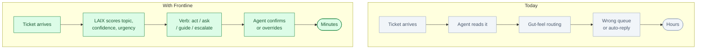
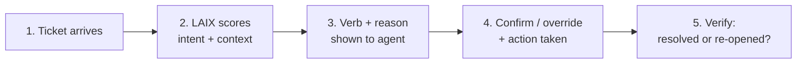

# Frontline: an AI triage layer for customer support

*Status: idea, not built. Built to demo LAIX.*

**One line.** When a ticket arrives, Frontline decides whether to act, ask, guide, or escalate —
with a written reason for every call.

## Who buys it

Customer support managers, VP Customer Success, and CCOs at companies where support volume is high
and escalation quality matters.

Their budget comes from faster resolution times, fewer wrong escalations, consistent routing, and
measurable confidence scores that replace gut-feel triage.

## The problem

A support queue fills with tickets that look similar but need very different responses. Some can be
auto-resolved. Some need more information before anyone touches them. Some need a senior agent.
Some need the on-call engineer.

Today, routing depends on who reads the ticket first and how experienced they are. Escalations are
inconsistent. Customers with complex problems get auto-replies. Agents waste time on tickets that
need one more question answered first.

The difference is simple:

## How it works

1. **A ticket arrives.** Text, metadata, customer tier, history.
2. **LAIX reads the situation.** Severity, confidence in intent, customer context, time since last
   contact, open related tickets.
3. **LAIX returns a verb.** `act` (send the known fix), `ask` (request one missing detail),
   `guide` (route to the agent with this product area), `escalate` (hand to senior agent or
   engineering), `observe` (wait; likely duplicate of open ticket).
4. **The agent sees the reason.** Plain-English rationale, confidence bar, the option that was
   blocked by low confidence.
5. **The agent confirms or overrides.** Either way, the decision is recorded.
6. **LAIX verifies.** After an auto-reply or action, a follow-up check flags whether the customer
   responded or the ticket re-opened.

## Where LAIX fits

LAIX is the decision layer between the ticket queue and the agent. Each ticket becomes a
`DecisionRequest`. The possible responses (send canned reply, ask clarifying question, route to
team, page engineer, wait) are `Actions` with cost, disruption, and risk scores.

The key gate: `act` is only available when intent confidence is above 0.75. Below that, the option
is eliminated and LAIX recommends `ask` instead. This is the most visible LAIX behaviour in the
demo: two near-identical tickets, one gets `act`, one gets `ask`, the diff is one confidence point.

## What the audience sees

A live ticket queue. Each ticket gets a LAIX badge: `act` (green), `ask` (amber), `guide` (blue),
`escalate` (red). Click any badge to see the full scoring breakdown. Two side-by-side tickets show
the confidence threshold in action: nearly identical text, but one has a known customer tier and
history, the other does not. Different verbs, visible reason.

## The hard part

Integrating with Zendesk, Intercom, Salesforce Service Cloud, or Freshdesk. Each has a different
ticket model. Mapping customer tier, history, and topic to LAIX's `Situation` and `Belief` contracts
is the product. The LAIX reasoning is generic; the connector and context model are the moat.

The second hard part is calibrating confidence thresholds per product area. An auto-reply for
billing needs higher confidence than one for password resets.

## Business model

- Per-seat monthly subscription for support teams
- Per-integration setup fee
- Enterprise: custom confidence thresholds, SSO, audit export, SLA dashboards

Start with one team, one ticketing tool, one product area.

## What to prove in a demo

- Two nearly identical tickets routed differently because of confidence — audience sees why
- Safety gate blocks auto-reply for an ambiguous ticket
- Trust beat: AI routes to wrong queue; agent overrides; record updated
- Verify cycle: ticket re-opens after auto-reply; LAIX escalates on second pass

## Where to start

One support team, Zendesk or Intercom, one product area (password reset / billing / API errors).
Instrument five intent categories. Run for 30 days with agents confirming every decision before it
fires.

## Who else is doing this

- **Help-desk AI** (Intercom Fin, Zendesk AI) auto-replies but does not explain the routing
  decision.
- **Intent classifiers** score topics but do not produce a verb + reason + audit record.
- **Escalation rules** encode thresholds but are static and opaque.

Frontline is different: explicit scoring, confidence gates, a reason every time, and the agent
always in control.

## Risks

- Agents will over-trust the system and stop reading tickets.
- Wrong auto-replies damage customer relationships.
- Confidence calibration requires labelled ticket history.
- Ticketing tool integrations are version-sensitive.

Never fire `act` without a confirmation step in the first 30 days. Build agent trust before
enabling any automation.

## Smallest first version

For one team, one ticketing tool, five intent categories:

1. Read tickets from the ticketing API.
2. Score each ticket with LAIX.
3. Display the verb and reason on the ticket.
4. Let the agent confirm or override.
5. Record every decision with timestamp and outcome.
6. Run a verify check 24 hours after each auto-reply.

No automatic replies. No multi-team routing. Just score, explain, confirm, record.

## The 90-second stage piece

A live ticket queue on screen. Two tickets appear side by side. Both say roughly the same thing:
*"I can't log in."* One has a known customer, recent history, clear account tier. LAIX scores it
`act — send password reset link, confidence 0.88`. The other has no history, ambiguous account
type. LAIX scores it `ask — request account email, confidence 0.52, intent gate not met`.

The trust beat: LAIX routes a billing complaint to the standard queue. The agent on stage rejects
it — *"this customer is churning, it needs a senior rep."* LAIX re-ranks: `escalate → senior
account manager`. *"It was confident. It was wrong. This is why the agent stays in charge."*

The closing line: *"Every ticket, a decision. Every decision, a reason."*

## Open questions

- Which ticketing tool is the first integration target?
- What is the right confidence threshold for auto-act in the first pilot?
- How do we source labelled ticket history for threshold calibration?
- Should the stage piece show real tickets or synthetic ones?
- Which ticket scenario has the highest trust-beat drama?
