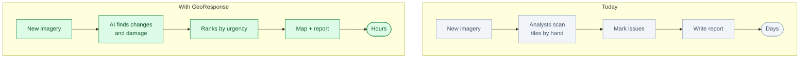
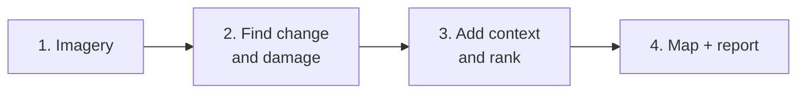

# GeoResponse: an AI analyst for imagery

*Status: idea. Not built.*

**One line.** When an area changes — flood, fire, damage or new construction — GeoResponse finds it,
ranks what matters and writes the assessment with a map.

## Who buys it

Start with **insurers and utilities**. Expand to governments, agriculture and mining.

They pay for faster assessments, fewer manual image reviews, better claims decisions and earlier
maintenance.

## The problem

A satellite or drone can capture a large area in minutes. Making sense of it takes days.

Analysts scan thousands of image tiles by hand, mark what changed, check maps and write a report.
During a disaster, that delay costs money and lives.

## Today vs with GeoResponse

## How it works

1. **Imagery arrives.** Satellite, drone, or the customer's archive.
2. **The AI finds change.** Damaged buildings, flooded roads, new construction, defective assets.
3. **It adds context.** Roads, buildings, power lines, population, asset records.
4. **It ranks what matters.** Urgency, value at risk, access, confidence.
5. **An analyst checks.** The human approves or corrects.
6. **A map and report are ready.**

The short version:

## Where the NPU fits

The NPU runs the image models on-site or at the edge.

Why:

- Large images and many tiles
- Fast results
- Sensitive imagery stays inside the customer's network
- Lower cost than sending everything to the cloud

You do not need your own satellite or drone. Start with free imagery for the demo and customer
imagery for production.

## What the customer gets

- A map of changes or damage
- A prioritized list of locations
- The evidence: images, confidence, asset context
- A written assessment
- A record of what was reviewed and by whom

## The hard part

The AI is not the hard part. The hard part is:

- Getting high-resolution imagery
- Labelled examples
- Geospatial engineering: tiles, projections, alignment, clouds, seasons
- Accuracy good enough for money or safety decisions
- Government and insurance procurement

## Business model

- Per area, per asset or per claim
- Annual monitoring subscription
- Setup and integration fee
- Optional on-site NPU server

Start with one region, one asset type and one change type.

## What to prove in a pilot

- Time to assessment: days to hours
- Detection accuracy
- Analyst hours saved
- Claims cycle time
- False alarms
- Cost per assessed area

## Where to start

Do not start with disaster response as a business. It is a great demo but a hard sale.

Better first markets:

- **Utility corridor inspection** — power lines, pipelines, solar farms
- **Insurance property damage** — roofs, flood, fire
- **Agriculture** — crop health and field boundaries

Use free Sentinel-2 imagery for the demo. Use customer drone or high-resolution imagery for
production.

## Who else is doing this

- **Satellite companies** sell imagery, not decisions.
- **Geospatial analytics firms** sell maps and dashboards, not an agentic assessment.
- **Cloud platforms** are strong but raise data-sovereignty concerns.
- **Internal GIS teams** are slow and project-based.

## Why this is not just a skill for a research workbench

| Research workbench | GeoResponse |
|---|---|
| For scientists | For insurers, utilities and agencies |
| Papers and code | Imagery and maps |
| One user, one laptop | Many analysts, one region |
| Research report | Operational assessment |
| Rare NPU use | Constant image analysis |

The value is the imagery pipeline, geospatial context, deployment and customer workflow.

## Risks

- Free imagery is often too coarse.
- Clouds and seasons hide change.
- Labels are expensive.
- A wrong map can cost money or lives.
- Government and insurance sales are slow.
- Privacy and ethical concerns around aerial monitoring.

Keep a human in the loop. Do not automate decisions about people or property.

## Smallest first version

For one region and one asset type:

1. Load free imagery.
2. Detect one kind of change.
3. Put results on a map.
4. Rank by confidence and value.
5. Write a short report.
6. Let an analyst review.

## The 60-second demo

Show a before/after flood image. GeoResponse highlights damaged buildings, ranks the worst areas, and
produces a map and a one-page assessment. The analyst corrects one false positive and approves.

## Open questions

- Which first market: utility, insurance or agriculture?
- Where does the imagery come from?
- Do we have labelled examples?
- What accuracy is good enough?
- On-site server or edge device?
- Who is the first customer or data partner?
