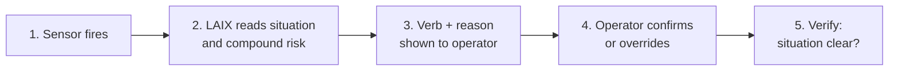

# Guardian: an AI emergency orchestrator for buildings and sites

*Status: idea, not built. Built to demo LAIX.*

**One line.** When a sensor fires, Guardian decides what to do, shows its evidence, and keeps a
person in charge.

## Who buys it

Facilities managers, building operations teams, and site safety officers at offices, campuses,
hospitals, data centres, and industrial sites.

Their budget comes from faster response to real emergencies, fewer false evacuations, and clear
audit trails for safety compliance.

## The problem

A building has dozens of sensors — smoke, water, power, temperature, access control. When one fires,
the response depends on who happens to be watching and what they remember from their training.

Two sensors firing together (water + electricity, smoke + HVAC) create compound situations that a
single operator may not have seen before. The wrong response — acting too fast or too slow — can be
dangerous.

The difference is simple:

```mermaid
flowchart TD
  subgraph TODAY["Today"]
    direction LR
    A1["Sensor fires"] --> A2["Operator reads panel"] --> A3["Recalls procedure"] --> A4["Acts or calls someone"] --> A5(["Minutes, uncertain"])
  end

  subgraph NEW["With Guardian"]
    direction LR
    B1["Sensor fires"] --> B2["LAIX reads sensor,<br/>context, compound risk"] --> B3["Decision: observe / act<br/>/ escalate — with reason"] --> B4["Operator confirms"] --> B5(["Seconds, audited"])
  end

  classDef old fill:#f1f5f9,stroke:#94a3b8,color:#475569;
  classDef new fill:#dcfce7,stroke:#15803d,color:#14532d;
  class A1,A2,A3,A4,A5 old;
  class B1,B2,B3,B4,B5 new;
```

## How it works

1. **A sensor fires.** Smoke in zone B3. Water pressure drop in basement. Power anomaly on floor 4.
2. **LAIX reads the situation.** Sensor type, severity, confidence (single sensor or confirmed by
   two), time of day, occupancy, open maintenance jobs.
3. **LAIX checks compound risk.** Water + active electrical circuit → safety gate blocks auto-act.
4. **LAIX returns a verb and reason.** `observe` (single unconfirmed smoke sensor, HVAC active),
   `act` (confirmed water leak, no electrical in zone), `escalate` (water + electrical, do not act
   without authorised engineer).
5. **The operator confirms.** One button. The decision and confirmation are recorded.
6. **LAIX verifies.** After the response, a follow-up check confirms the situation resolved.

## Where LAIX fits

LAIX is the decision layer between the sensor panel and the operator. Each sensor event becomes a
`DecisionRequest`. The possible responses (call facilities, evacuate zone, cut power, observe for 5
minutes, page building engineer) are `Actions` with risk, disruption, and reversibility scores.

Safety gates are the core value: water + electricity never reaches `act` without an authorised
engineer. The compound risk scenario is directly representable in LAIX's constraint model.

The confidence dial is the best demo lever: drag the smoke-detector confidence from single-sensor
(0.4) to cross-confirmed (0.9) and watch the decision flip from `observe` to `act` in real time.

## What the audience sees

A floor plan of a building. Sensors animate as they fire. Each event gets a LAIX decision card:
verb, reason, confidence bar, evidence chips. The presenter drags a confidence slider to show the
decision change live.

The compound scenario — water in the basement, active electrical circuit — shows the safety gate
blocking auto-act. LAIX returns `escalate → call building engineer`. The audience sees the system
refusing to act when the situation is dangerous.

## The hard part

Sensor integration: BACnet, Modbus, proprietary BMS protocols. Building systems are old and
fragmented. The LAIX logic is generic; the sensor connectors and site context model are the product.

Liability is real. Guardian advises; the operator always decides. This must be clear in the UI and
the contracts.

## Business model

- Annual licence per building or site
- Integration and commissioning fee per site
- Optional on-site server hardware

Start with one building type: data centres (high sensor density, no public evacuation liability) or
hospitals (high stakes, existing safety culture).

## What to prove in a demo

- Audience reads the reason for every decision without explanation
- Safety gate visibly blocks a dangerous compound action
- Confidence slider flips the decision live
- Trust beat: AI recommends action; operator rejects; system recovers
- All seven verbs appear across a 90-second scenario

## Where to start

One building, one sensor type (water), one compound scenario (water + electrical). Map 10 zones.
Run alongside the existing process for 30 days.

## Who else is doing this

- **BMS vendors** (Honeywell, Siemens, Johnson Controls) surface sensor data but have no
  reasoning layer.
- **SCADA dashboards** show state but do not decide.
- **Emergency response playbooks** encode knowledge but are not applied in real time.

Guardian is different: compound risk reasoning, confidence-driven decisions, operator always in
charge, full audit trail.

## Risks

- Operators will over-trust the system and stop thinking.
- False positives erode trust; false negatives create liability.
- Sensor integrations are fragile and site-specific.
- Legal liability for wrong advice in an emergency.

Never remove the operator confirmation step. Every decision must show its reason. Liability language
in every contract.

## Smallest first version

For one building, one scenario (water in basement + electrical circuit):

1. Read sensor events from a BMS or simulate them.
2. Score each event with LAIX, including compound context.
3. Display the verb, reason, and evidence on a floor plan.
4. Let the operator confirm or override.
5. Record every decision with timestamp, sensor state, and outcome.

No automatic action. No multi-building routing. Just read, decide, explain, record.

## The 90-second stage piece

A floor plan on screen. A water sensor fires in the basement. LAIX shows: `observe — single sensor,
no cross-confirmation, confidence 0.4`. The presenter drags confidence to 0.9 (cross-confirmed).
Decision flips to `act — isolate water supply, zone B`. Then a second event fires: electrical panel
in the same zone. LAIX immediately re-evaluates. `act` is now blocked by the safety gate.
New decision: `escalate — water + active circuit, do not enter, call building engineer`.

The trust beat: LAIX first recommends `act — cut power`. The operator on stage rejects it — *"there
are people in the server room."* LAIX re-ranks: `guide — show floor warden, wait for clearance`.
*"It was confident. It was wrong. This is why the operator stays in charge."*

The closing line: *"The building knows what's happening. It asks before it acts."*

## Open questions

- Which building type is the safest first target: data centre, hospital, or office?
- What sensor protocol is most common among first customers?
- How do we source or simulate realistic sensor data for the demo?
- What is the minimum compound scenario count for a convincing stage piece?
- Which safety gate scenario has the highest audience drama?
