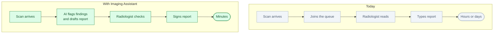
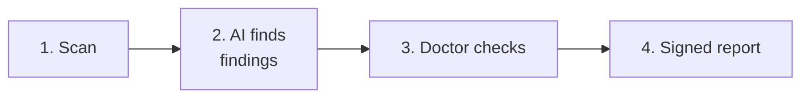

# Imaging Assistant: an AI first reader for radiology

*Status: idea. Not built.*

**One line.** It reads a scan first, flags what matters, gathers the patient's history and drafts a
report for the radiologist to review and sign.

## Who buys it

Hospitals, imaging centres, radiology groups and medical device vendors.

They pay for faster reporting, shorter backlogs, earlier triage and less repetitive work for
radiologists.

## The problem

Imaging demand keeps growing. Radiologists are scarce. Reports take time, and urgent findings can sit
in a queue behind routine cases.

The first read is repetitive. The report is manual. The evidence is spread across the image, the
patient history and past studies.

## Today vs with Imaging Assistant

## How it works

1. **A scan arrives** from the imaging system.
2. **The AI reads it** and marks possible findings.
3. **It gathers context.** Patient history, prior studies, the reason for the scan.
4. **It drafts a report** with evidence and uncertainty.
5. **The radiologist checks and signs.**
6. **The final report is saved** with an audit trail.

The short version:

## Where the NPU fits

The NPU runs the imaging models inside the hospital.

Why:

- Patient data cannot leave the hospital
- Fast results
- Many scans per day
- Lower cost than sending every study to the cloud

## What the customer gets

- Annotated images
- A draft report
- A list of findings with confidence
- Relevant prior studies
- A record of what the AI suggested and what the doctor signed

## The hard part

The AI is not the hard part. The hard part is:

- Regulatory approval
- Clinical validation
- Integration with imaging systems
- Liability and insurance
- Labelled data and bias testing
- Doctor trust

This is a regulated medical product, not a normal app.

## Business model

- Per study
- Per scanner or per site
- Per radiologist seat
- Partnership with a PACS or device vendor

Start with one hospital, one scanner and one clear finding.

## What to prove in a pilot

- Reading time
- Time to urgent finding
- Detection accuracy
- Report turnaround
- Doctor acceptance
- Number of corrections

## Where to start

Pick one modality and one narrow task:

- Chest X-ray: urgent finding triage
- Mammography: screening support
- CT: stroke or bleed triage

Start as **decision support**, not diagnosis. The doctor always signs.

## Who else is doing this

- Radiology AI vendors
- Scanner manufacturers
- Hospital IT and PACS vendors
- Internal hospital AI teams

The market is crowded. The difference must be workflow, integration, trust and local deployment.

## Why this is not just a skill for a research workbench

| Research workbench | Imaging Assistant |
|---|---|
| For scientists | For hospitals and radiologists |
| Papers and code | Scans and patient history |
| One user, one laptop | Many clinicians, one hospital |
| Research report | Signed medical report |
| Rare NPU use | Constant imaging inference |

The value is clinical validation, hospital integration, regulation and trust.

## Risks

- Regulation is slow and expensive.
- A wrong finding can harm a patient.
- Liability must be clear.
- Hospitals buy slowly.
- Doctors may reject a tool they do not trust.
- Data must stay private.

Do not start with autonomous diagnosis. Start with triage and draft reports.

## Smallest first version

For one hospital and one finding:

1. Read one type of scan.
2. Flag the finding.
3. Show it on the image.
4. Draft a short report.
5. The doctor reviews and signs.
6. Save the audit trail.

## The 60-second demo

A chest X-ray appears. The AI marks a possible urgent finding, shows the evidence, and drafts a
two-line report. The doctor accepts, edits one sentence and signs. The case is saved with the audit
trail.

## Open questions

- Which modality and finding first?
- Which hospital or imaging partner?
- What regulatory path?
- Which imaging system must we integrate with?
- What accuracy and evidence do doctors need?
- Who carries liability?
