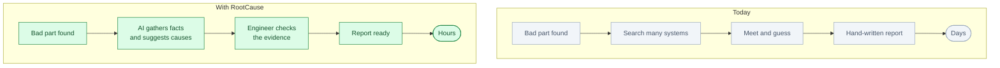
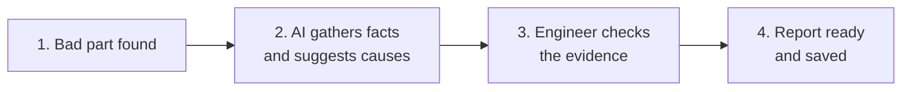

# RootCause: an AI quality engineer for factories

*Status: playable proof built. Product not built.*

**Play it:** [play/rootcause.html](../../play/rootcause.html) · **Stage plan:** [roadmap](../roadmaps/rootcause.md)

**One line.** When a factory finds a bad part, RootCause finds the likely cause and writes the
quality report with evidence.

## Who buys it

Quality managers, plant managers and manufacturing engineers.

Their budget comes from less scrap, less rework, fewer recalls, less downtime and fewer engineer
hours.

## The problem

A camera can see a defect in a second. Finding the cause can take days.

Engineers dig through machine settings, material batches, maintenance logs, old defects and notes
from operators. Then they meet, guess, test and write a report.

This is slow and expensive. It also depends on a few experienced people. When they leave, the
knowledge leaves with them.

The difference is simple:

## How it works

1. **A camera sees a defect.** The NPU checks the image on-site.
2. **The AI gathers the facts.** Machine settings, material batch, maintenance record, similar past
   defects.
3. **The AI looks for patterns.** It suggests likely causes and ranks them.
4. **It shows the evidence.** Photos, charts and similar past cases.
5. **An engineer approves.** The AI writes the quality report.
6. **The case is saved.** Next time, the system knows more.

The short version:

## Where the NPU fits

The NPU runs the image models inside the factory.

Why:

- Many cameras and many images
- Fast answers
- Factory data stays inside the factory
- Lower cost than sending everything to the cloud

Start with the cameras the factory already has. Add an on-site NPU server or edge box. The NPU is not
the product; it is the compute.

## What the customer gets

A case file for each defect:

- Photos
- Charts
- Likely causes
- Evidence
- A draft quality report
- A record of who approved what

## The hard part

The AI is not the hard part. The hard part is connecting to factory systems:

- Machine data
- Material and batch records
- Maintenance records
- Quality systems
- Old defect images

Whoever connects these well wins. This is the real product.

## Business model

- Monthly fee per production line or per factory
- Setup and integration fee
- Optional on-site NPU server

Start with one line, one defect type, one factory. Then expand.

## What to prove in a pilot

- Time to find the cause: days to hours
- Less scrap and rework
- Faster quality reports
- Less engineer time
- Fewer false alarms

## Where to start

Pick a factory process where bad parts are expensive, machine data exists and defects happen often.

Good first targets:

- Plastic injection molding
- Battery part production
- Electronics assembly
- Semiconductor manufacturing

Semiconductor has the highest value but is the hardest to enter.

## Who else is doing this

- **Camera companies** detect defects, but do not explain the cause.
- **Factory analytics tools** show charts, but do not investigate.
- **Cloud AI** raises data-security concerns in factories.
- **Internal data teams** are slow and project-based.

RootCause is different: on-site, evidence-first root-cause, with a human in control.

## Why this is not just a skill for a research workbench

| Research workbench | RootCause |
|---|---|
| For scientists | For factory quality teams |
| Papers and code | Machines, images, material records |
| One user, one laptop | Many users, one factory |
| Research report | Quality report |
| Rare NPU use | Constant image analysis on-site |

A research workbench could provide the AI engine. But the product is the factory connections, the
quality workflow and the on-site deployment.

## Risks

- Factory data is messy.
- Factory networks are sensitive.
- Engineers will not trust it at first.
- Sales cycles are long.
- Bad advice can be expensive.

Start with advice and reports, not automatic control of the line. Keep the engineer in charge.

## Smallest first version

For one line and one defect type:

1. Read images and machine data.
2. Detect the defect.
3. Suggest likely causes.
4. Show the evidence.
5. Draft the quality report.
6. Let the engineer approve.

No line control. No automatic changes. Just find the cause and write the report.

## The 90-second stage piece

A real failed bracket is on the bench. The presenter drags a lens across it, pushes into x-ray depth
and finds three pieces of evidence. The AI's first answer — operator error / tool mark — is wrong.
The engineer rejects it; the system re-ranks to gas porosity; the causal chain assembles and the
verdict is stamped: *it wasn't fatigue, it started in the casting.*

The room chooses whether to open the surface evidence or the x-ray evidence. The full beat sheet,
trust beat, props and acceptance tests are in the [roadmap](../roadmaps/rootcause.md).

## Open questions

- Which process should be the first target?
- Do customers have labelled defect data?
- Do they already have inspection cameras?
- Which factory systems must be connected first?
- On-site server or edge box?
- Who is the first pilot customer?
- What level of accuracy makes engineers trust it?
