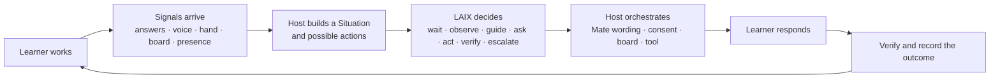
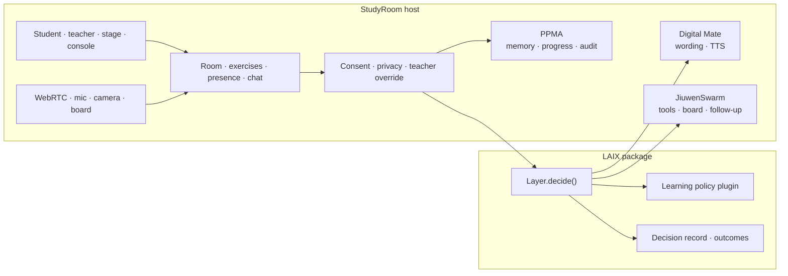

# StudyRoom: a live collaborative learning room with LAIX

*Status: concept + full scope. No code yet. Stage and build plan: [roadmap](../roadmaps/studyroom.md).*

**Working name.** `studyroom`. The product name can change without changing the integration id.

**One line.** StudyRoom notices when a learner needs help, decides whether to wait, hint, ask a peer or call the teacher, and shows why.

**Buyer.** Tutoring companies, small-group learning centres, universities and corporate training teams.

**User.** The student in the room, the peer helper, and the teacher or tutor running the session.

**The sentence the audience repeats.** *"It knew when not to interrupt."*

## The problem

A teacher can watch one student at a time. In a room of three to six learners, the quiet student who is stuck is easy to miss, and the loud student gets the attention.

The tools do not solve this. A video call shows faces, a whiteboard shows work, an LMS stores exercises, and an AI tutor answers questions. None of them decides **whether this is the moment to intervene**, **who should help**, **what they are allowed to see**, or **when to stop**.

The result is familiar:

- help arrives late, or too early;
- the teacher is interrupted for problems a peer could solve;
- peer help exposes private work without consent;
- AI helpers interrupt focused learners;
- the session ends with no record of what happened or whether the help worked.

StudyRoom makes the room itself notice, decide and remember.

## Why now

Three things changed at the same time:

- **Multimodal signals are cheap enough to run in a browser.** Voice activity, speech-to-text, motion
  and board events no longer need a data centre.
- **Classrooms already have devices.** Laptops, tablets and phones are normal, but most learning
  software still assumes one teacher at the front of the room.
- **AI is moving from answers to decisions.** A chat box can answer a question; a decision layer can
  decide whether to interrupt, who should help and what the learner is allowed to share.

The missing piece is not another tutor. It is the **decision layer between the room and the helper**.

## What StudyRoom is

A **live small-group learning room** with four surfaces:

1. **Student room** — the learner's problem, camera, microphone, digital helper, private board and consent prompts.
2. **Teacher wall** — every learner's state, evidence, decisions, consent and the next action.
3. **Stage / presenter wall** — the 90-second story mode for a demo or a class introduction.
4. **Engineering console** — the event feed, LAIX decisions, policy constraints, latency and replay.

The room supports:

- three to six learners in a session;
- a shared problem and individual work;
- camera, microphone, speech-to-text and text-to-speech;
- a private board that becomes shared only after consent;
- typed or spoken help requests;
- peer help, teacher escalation and private hints;
- a visible decision record for every intervention;
- replay and outcome review after the session.

## What the customer gets

- a live room that notices struggle without interrupting focus;
- a teacher wall with the next action, not another dashboard;
- peer help that is consent-first and scope-limited;
- a visible decision record for every intervention;
- a session report with evidence, approvals and outcomes;
- privacy controls that a school can explain to a parent;
- integrations with the LMS, SIS and calendar the school already uses.

## What StudyRoom is not

- **Not an LMS.** It does not own courses, enrolment, grades or long-term curriculum.
- **Not a video-conferencing product.** It uses WebRTC, but the room is built around learning decisions, not meetings.
- **Not an autonomous teacher.** The teacher stays in charge; the system proposes and records.
- **Not a grading system.** It can verify an answer; it does not certify learning.
- **Not a surveillance tool.** No face recognition, emotion detection, attention scoring or always-on recording.
- **Not a replacement for PPMA, Digital Mate or JiuwenSwarm.** Those are host services with their own contracts.
- **Not a copy of the LAIX LiveTogether zip.** This is a new host app that borrows the product idea, not the code.

## The learning loop

The loop is event-driven. A decision is not a scripted step in a demo; it is produced from the current situation and the options the host allows.

## The decision that matters

Alice has two wrong attempts. She has been on the problem for three minutes. She says, *"I don't get it."* Her hand-raise signal is uncertain. Ben has finished and offers to explain.

The host gives LAIX these options:

| Option | Verb | Learning benefit | Risk | Delay | Interruption | Consent |
|---|---|---:|---:|---:|---:|---|
| Wait | `wait` | 0.35 | 0.00 | 0 min | 0.05 | not needed |
| Look for more evidence | `observe` | 0.45 | 0.00 | 1 min | 0.05 | not needed |
| Private hint | `guide` | 0.70 | 0.05 | 0 min | 0.15 | not needed |
| Ask Ben to help | `ask` | 0.82 | 0.35 | 1 min | 0.25 | both learners |
| Share Ben's explanation | `act` | 0.65 | 0.50 | 2 min | 0.30 | both learners |
| Call the teacher | `escalate` | 0.55 | 0.10 | 2 min | 0.20 | teacher |

Hard constraints:

- no peer involvement without consent from both learners;
- no interruption while the learner is speaking;
- only one assistance flow at a time;
- safeguarding concerns go to the teacher, not to a peer;
- a cooldown after a delivered intervention.

At evidence **0.42**, below the intervention line, LAIX returns **wait**. At evidence **0.71**, it returns **ask Ben**, with **approval required**. If Ben declines, it re-plans to **guide Alice privately**.

That is the product in one scene: restraint, evidence, consent, action, re-plan.

## The decision gallery

| Moment | Decision | Why |
|---|---|---|
| Evidence below the line | `wait` | Help would interrupt without enough reason |
| Two wrong attempts, no request | `observe` | Gather one more signal before acting |
| Explicit request, no helper | `guide` | Private hint is fast and low-risk |
| Helper offers, both consent | `ask` then `act` | Peer help with a limited shared scope |
| Helper declines | `guide` | Re-plan without pressure |
| Helper disconnects mid-explanation | `guide` | Continue privately; no dead end |
| Consent revoked | `wait` and close the board | Permission is not a one-time switch |
| Learner solves it | `verify` | Check the answer before moving on |
| Safety or distress signal | `escalate` | A human owns safeguarding |
| Teacher override | Re-decide with the human reason | The teacher stays in charge |

The decision is always one of the seven verbs. The learning-specific action is an app action id.

## The LAIX boundary

| Concern | Owner |
|---|---|
| Camera, microphone, screen, board, chat, presence | StudyRoom host |
| Exercises, answers, correctness, class roster | StudyRoom host |
| Consent, privacy, safeguarding, teacher override | StudyRoom host |
| Long-term memory, progress, audit | PPMA, behind the host |
| Wording, personalization, TTS, delivery | Digital Mate, behind the host |
| Tool execution, idempotency, retries | JiuwenSwarm, behind the host |
| Live situation, option choice, confidence, approval requirement, re-plan | **LAIX** |
| Decision record and outcome loop | **LAIX** |

**LAIX receives** a generic situation, beliefs, constraints and options. It does **not** receive raw media, names, chat history or PPMA records.

**LAIX returns** one decision with a verb, action id, score, confidence, confidence source, alternatives, constraints applied and an approval flag.

**LAIX never imports or calls** PPMA, Digital Mate, JiuwenSwarm, the room, the database or the UI.

## What LAIX sees

The adapter maps host events to generic contracts:

- **Situation** — opaque subject ids, time, urgency, beliefs, constraints and attributes.
- **Beliefs** — for example, "Alice has an incorrect answer" at 0.9, "Alice wants help" at 0.8.
- **Constraints** — consent, privacy, no-interruption, cooldown, teacher-only, lesson window.
- **Options** — wait, observe, guide, ask, act, verify, escalate, each with benefit, risk, delay, cost, reversibility and approval needs.
- **Attributes** — attention state, intervention line, evidence score, flow state, teacher availability.

The app-specific learning policy lives in StudyRoom, not in LAIX. LAIX provides the decision shape, policy plumbing, attention, records and outcomes.

## Signals and provenance

Every signal carries a source and a confidence. Nothing is treated as a fact just because it is on screen.

| Signal | Source | Used for | Confidence |
|---|---|---|---|
| Answer correct / incorrect | App event | Learning state | High |
| Attempt count | Derived | Struggle evidence | High |
| Time on problem | System | Struggle evidence | High |
| Explicit help request | Speech / typed → interpretation | Intent to help | Medium–high |
| Hand raise | Camera motion | Uncertain help signal | Low–medium |
| Voice activity | Browser audio | Speaking / interruption | High for speech, not intent |
| Transcript | Browser STT | Intent and answer capture | Medium |
| Chat | App event | Help request / collaboration | High |
| Board edits | App event | Work and sharing | High |
| Presence / disconnect | System | Re-plan | High |
| Consent | App event | Permission gate | Authoritative |
| Teacher override | App event | Human correction | Authoritative |
| Optional vision note | Opt-in model | Context, never emotion | Low |
| Delivery / ack | System | Whether the intervention landed | High |

No face recognition. No emotion detection. No attention score. No always-on recording.

## Surfaces

| Surface | User | Job |
|---|---|---|
| Student room | Learner | Work, ask, consent, see the helper, use the board |
| Teacher wall | Teacher / tutor | See the room, the evidence, the decisions and the next action |
| Stage wall | Presenter | Tell the 90-second story |
| Engineering console | Builder / operator | Inspect events, decisions, policy, latency and replay |
| Decision record | Teacher / auditor | See what happened, why, who approved and what changed |
| Admin | School / programme admin | Classes, roles, data policy, integrations and billing |
| Booth | Demo operator | Pick a scenario, run three minutes, reset |
| Mobile / PWA | Student / teacher | Join, capture, triage and review on a phone or tablet |

## Roles

| Role | Can do | Cannot do |
|---|---|---|
| Student | Work, ask for help, consent, use own board | See another learner's private work or history |
| Peer helper | Offer help, accept consent, explain, use shared board | Read private history or unshared work |
| Teacher | Watch, approve, override, escalate, review records | See raw media that was not retained or consented |
| Teaching assistant | Triage, support, review | Change safeguarding settings |
| Observer / presenter | Watch the wall, run the story | Act as a student or change data |
| Admin | Manage classes, roles, retention, integrations | Read private learner content without a documented purpose |
| Engineer | Inspect traces, replay, tune policies | Bypass consent in production |

## Task families

| Task | What the room does |
|---|---|
| Join | Presence, role, device check, consent state |
| Work | Problem, attempts, time, notes, board |
| Ask | Voice, typed, hand raise, help button |
| Notice | Fuse explicit and uncertain signals |
| Decide | Wait, observe, guide, ask, act, verify, escalate |
| Consent | Ask learner and helper, revoke, record |
| Collaborate | Shared board, explanation, peer turn |
| Verify | Check the answer and the learner's confidence |
| Remember | Progress, decisions, outcomes, audit |
| Review | Teacher brief, session replay, next step |

## Collaboration and consent

Peer help is the most sensitive action in the room. It is allowed only when:

1. the learner asks for help or the evidence crosses the line;
2. the learner consents to a peer seeing the current problem;
3. the helper consents to help;
4. the teacher has not blocked peer help for this session;
5. the shared scope is the current problem and the latest attempt only.

Consent is revocable. Revocation immediately closes the shared board and triggers a re-decision. A peer never receives learning history, private notes, preferences or progress.

The host enforces consent. LAIX only sees a constraint that says peer sharing is allowed or blocked.

### Consent states

| State | Meaning | Host behaviour |
|---|---|---|
| Not asked | No request yet | Do not share; peer help cannot start |
| Pending | Asked, waiting for answer | Show what will be shared; no board access |
| Granted | Learner and helper agreed | Open the consented scope only |
| Declined | One side said no | Re-plan; no repeated prompt in the same flow |
| Revoked | Consent withdrawn later | Close the shared board immediately; re-decide |
| Expired | Consent passed its time limit | Ask again or fall back to a private action |
| Blocked | Teacher or guardian policy | Do not offer peer help |

Consent is recorded with scope, purpose, actor, time and expiry. It is never inferred from silence.

## The teacher

The teacher wall is not a dashboard of everything. It answers one question: **who needs what now?**

It shows:

- each learner's current state and evidence;
- the latest decision and its alternatives;
- what is waiting for consent;
- what the system chose not to do;
- the next action the teacher can take;
- a session brief and a post-session record.

The teacher can:

- approve or reject a peer-help decision;
- override a decision with a reason;
- pause the room or a single learner;
- block peer help for a learner or a session;
- mark a safeguarding concern;
- review the decision record and outcome.

### Teacher override reasons

| Reason | What it means for the next decision |
|---|---|
| Back on task | Lower the weight of the uncertain signal; prefer wait |
| Already asked | Suppress a duplicate prompt |
| Consent issue | Block peer help until consent is fixed |
| Not appropriate now | Respect the teacher's context; try a private action |
| Too early | Raise the evidence threshold for this learner |
| Too late | Escalate or change the action |
| Other | Require a note; keep the override in the record |

An override is not a failure. It is a labelled correction that makes the room better.

## The student

The student sees their own problem, their own board and the digital helper. They can:

- ask for help by voice, text or hand raise;
- accept or decline a peer;
- see what will be shared before it is shared;
- revoke consent;
- turn the camera or microphone off;
- use the board privately, then share it;
- see the helper's explanation with captions.

The student never sees another learner's private board, history or progress.

## The 2026 look and feel

**The direction.** A quiet rehearsal room, not a school dashboard. The teacher is a conductor; the
room is a score of learners, cues, rests and interventions.

This is the visual and interaction brief for the product. It is separate from the theatre language of
the 90-second stage piece.

### The principles

1. **Calm surfaces, dense on demand.** The default screen is quiet. Evidence and detail appear when
   the teacher asks for them.
2. **The room is spatial.** Learner strips, an evidence line, a consent rail and a decision dock
   replace a grid of equal cards.
3. **Type leads.** Hierarchy comes from scale, weight and space, not another rounded panel.
4. **One accent, semantic colour.** Colour means state: waiting, consent, helped, safeguarding,
   shared. It is never decoration and never the only signal.
5. **Motion explains a state change.** Evidence crosses the line, consent opens a link, a helper
   disconnects, the decision re-plans. Motion is not ambient decoration.
6. **AI is ambient.** Digital Mate is a voice with captions. LAIX is a decision strip with a reason,
   not a chatbot bubble. No avatar is required.
7. **The teacher is the interface.** The human override, signature and reason are visible.
8. **Accessible is the aesthetic.** Large enough type, contrast, captions, keyboard paths and reduced
   motion are part of the look.
9. **Stage and desk are different products.** The stage is theatre; the desk is a daily instrument.

### The surfaces

| Surface | Look | Signature move |
|---|---|---|
| Student room | Warm paper, one problem, one board, one help action | The "ask" card and the consent preview |
| Teacher wall | Dark or light desk, learner strips along a quiet room score | The evidence line and the decision dock |
| Stage wall | Deep theatre palette, five panes, large type | The wait moment and the re-plan |
| Engineering console | Dark control room, monospace event tape | The decision trace |
| Decision record | Editorial document with evidence in the margin | The human signature and the outcome |
| Admin | Calm settings, status-led | Consent and retention at a glance |

### Colour and type

- **Palette:** warm paper and deep ink as the base; one **cobalt** accent for focus and action. Amber
  means waiting or consent pending. Green means helped and verified. Red is reserved for safeguarding.
  Violet means shared or peer context.
- **Type:** Fraunces or Newsreader for editorial headings; Inter for the room; JetBrains Mono for
  evidence, time and decision records.
- **Type floor:** 11 px labels, 14 px body, 16 px student reading text. No 8–9 px microtype.
- **Space:** 4 / 8 / 12 / 16 / 24 / 32 / 48.
- **Radius:** 3 / 6 / 9 / 13. No pill panels.
- **Motion:** 120 / 180 / 240 ms, `cubic-bezier(.2,.7,.2,1)`, reduced-motion respected.

### States the UI must show

- waiting, with evidence below the line;
- observing, with the next signal expected;
- consent pending, with exactly what will be shared;
- helping, with the helper and the shared scope;
- re-plan, with what changed;
- verified, with the evidence that the learner solved it;
- escalated, with the human owner;
- low confidence, with the source and the reason;
- offline, with what still works;
- no decision, as a valid outcome.

### The AI presence

- LAIX is a **decision strip**, not a chat.
- Every decision has a "why" drawer: evidence, alternatives, constraints, confidence source.
- "What would change the answer?" is one click away.
- Digital Mate speaks with captions; the student can read instead of listen.
- No typing animation, no fake thinking, no magic sparkle.

### UI copy examples

- **Waiting** — "Evidence is below the line. The room will wait."
- **Observing** — "One more signal before we interrupt."
- **Asking** — "Asking Ben to help. Both learners must agree."
- **Declined** — "Ben declined. Giving Alice a private hint instead."
- **Override** — "Teacher override: back on task. The room will wait."
- **Verified** — "Alice solved it. The hint helped."
- **Offline** — "The room is offline. Board and text still work."

Plain language first. The technical reason is one click away.

### Anti-patterns

- A dark neon dashboard with a grid of identical learner cards.
- A chatbot as the main interface.
- Gamified confetti for a correct answer.
- Cartoon avatars that make a serious classroom feel childish.
- Permanent sidebars and 9 px labels.
- A video wall that feels like surveillance.
- 3D or glass effects that do not explain a decision.
- A phone version that is the desktop squeezed.

### Performance expectations

- Join to first interaction: under 2 seconds on a school laptop.
- Local decision: under 100 ms.
- Board sync: under 150 ms on the same network.
- LCP under 1.5 s, INP under 200 ms, CLS under 0.05.
- No external font, CDN or analytics call in the default build.

## Data and memory

- **Live state** — in memory, cleared on reset.
- **Session record** — events, decisions, approvals, outcomes and audit.
- **Long-term memory** — PPMA, behind the host; profiles, preferences, progress, consent.
- **Media** — peer-to-peer by default, not recorded unless the session explicitly opts in.
- **Transcripts** — retained only as long as the session policy says; redactable and deletable.
- **Board** — private by default; shared only with consent; versioned for sync and replay.
- **Audit** — append-only, hash-chained, exportable.

LAIX keeps only short-lived decision state and the decision record.

## Data ownership and retention

The school or programme owns its data. The student and guardian have rights over their own records.

Recommended defaults, reviewed per region:

| Data | Default | Control |
|---|---|---|
| Raw camera / microphone | Not recorded; peer-to-peer | Session opt-in only |
| Transcript | Session-only unless the teacher saves it | Redact, delete, export |
| Board | Session-only; shared scope only | Revoke and close |
| Decision record | 1 year | Export or delete |
| Audit record | 7 years or local policy | Append-only, exportable |
| Progress and memory | PPMA policy | Learner/guardian request |
| Research data | Off by default | Explicit consent and ethics review |

- No training on student data without explicit, separate consent.
- Export in JSON, CSV and printable PDF.
- Deletion propagates to memory and derived records, with a tombstone for audit.
- No lock-in: the school can leave with its records.

## Privacy, safety and trust

- Consent is a first-class object, not a checkbox in a settings page.
- Minors need guardian consent where the law requires it.
- STT may use a browser vendor's cloud service; this is disclosed before use.
- Optional vision is off by default and requires explicit opt-in.
- No raw media goes to LAIX.
- No emotion, face or attention inference.
- No automatic discipline, grading or parent contact.
- Safeguarding escalates to a human.
- Every decision shows its evidence, alternatives, constraints and confidence source.
- Every intervention has a record and an outcome.
- The teacher can always override, and the override is recorded.

## Where an NPU fits — optional, not core

StudyRoom runs on a CPU. An NPU can improve the private, local parts:

- on-device speech recognition and voice activity;
- speaker diarization for group discussion;
- small vision models for hand-raise and board understanding;
- local hint ranking or content recommendation.

Why it helps:

- raw audio and video can stay in the room;
- captions and hints appear without a cloud round trip;
- the room works offline or on a weak school network.

A CPU fallback exists. The NPU is a privacy and latency feature, not the reason to buy StudyRoom.

## Failure behavior

The room must fail safely and say what still works.

| Failure | Behaviour |
|---|---|
| STT unavailable | Typed Tell Mate fallback; transcript marked unavailable |
| Camera or mic denied | Board-only or audio-only mode; no hand-raise signal |
| WebRTC or TURN failure | Reconnect; fall back to board and text |
| LAIX unavailable | Safe `wait`; teacher alert; no local replacement engine |
| Consent store unavailable | Fail closed: no peer help, no board sharing |
| PPMA unavailable | Session continues; memory writes queue and retry |
| Digital Mate unavailable | Text directive to the teacher or student |
| JiuwenSwarm unavailable | Local safe fallback; the failure is visible |
| Database unavailable | Live room continues only if consent and records are safe |
| Network lost | Offline pack and local session; sync on return |

Never silently switch to a second decision engine.

## Safeguarding and emergencies

- A distress, threat or safety signal escalates to a **human**, never to a peer.
- The system does not diagnose, score or discipline.
- The school's safeguarding policy owns the response; StudyRoom records it.
- Emergency contact and escalation paths are configured before the pilot.
- The teacher can pause the room and take over at any time.
- Peer help is blocked during a safeguarding event.
- The audit trail records who saw what and when.

## Business model

- Per classroom or per active seat for tutoring centres.
- Annual school or programme licence.
- Pilot fee for one class, one subject, 90 days.
- Setup and integration fee for LMS/SIS, SSO and data policy.
- Optional private deployment or on-site inference.
- No charge per intervention; help should not be metered.

Start with one tutoring centre, one subject and one age group.

## What to prove in a pilot

- Time from struggle to help.
- Interventions avoided because the evidence was below the line.
- Peer-help uptake and success.
- Teacher interruptions avoided.
- Teacher time saved on triage.
- Student and teacher trust in the decisions.
- Consent coverage and revocation correctness.
- Technical reliability: join, media, board, reconnect.
- Learning outcome, measured carefully against a baseline.
- False-positive and false-negative decisions.

Do not claim improved learning outcomes from a demo. Measure them in a pilot with a pre/post design.

## Where to start

Best first settings:

- small-group maths tutoring;
- a study centre with repeated sessions;
- a university study group;
- corporate onboarding or certification study.

Avoid starting with a whole school, a high-stakes exam or a safeguarding-critical environment. The first pilot needs a teacher who can co-design the decision policy.

## Who else is doing this

- **Video platforms** (Zoom, Teams, Meet) carry the room but do not decide when to help.
- **LMS products** (Canvas, Moodle, Google Classroom) own content and grades, not live intervention.
- **AI tutors** answer questions, often without the group context or consent.
- **Classroom response systems** collect answers, not live collaborative decisions.
- **Whiteboards** (Miro, FigJam) hold the work, not the learning decision.

StudyRoom's wedge is the **decision layer between the room and the helper**: who needs help, when, from whom, with what consent, and why.

## The hard parts

- Real-time media is difficult: devices, browsers, networks, echo, permissions.
- Consent law and safeguarding vary by country and age.
- A wrong intervention can embarrass a learner or damage trust.
- Speech-to-text and hand-raise signals are noisy.
- Teachers are busy; the wall must reduce work, not add a dashboard.
- Schools procure slowly and demand security, accessibility and data rights.
- Learning outcomes are slow to measure and easy to overclaim.

## Risks

- The system becomes an interruption machine instead of a restraint machine.
- The teacher wall becomes surveillance.
- A privacy incident ends trust in the product.
- Peer help exposes private work.
- The demo overfits to scripted lines.
- LAIX drift breaks the adapter if the package is not pinned and tested.
- The product becomes a video call with an AI chat, not a decision product.

## Smallest first version

For one simulated room and one problem:

1. Three learners, one teacher, one exercise.
2. Answers, attempts, help request, hand raise, chat and presence events.
3. A LAIX learning policy plugin.
4. Decisions: wait, private hint, ask a peer, escalate.
5. Consent and approval.
6. One re-plan after a helper declines or disconnects.
7. A decision panel with alternatives and constraints.
8. A session record and an outcome.
9. A six-step story and a reset.

No camera, no microphone, no WebRTC in the first version. Add real media after the decision loop is proven.

## The fast example

The ZIP's 12-step story is a good format for a fast presentation. We should build our own version as a
first-class example, not as a throwaway demo.

**What it is:** a 12-step simulated room with three learners, real LAIX decisions, visible
alternatives, consent, a trust beat and one re-plan. It runs offline, with no camera, microphone or
WebRTC. The inputs are simulated; the decisions are live.

**Where it lives:** `examples/studyroom_fast_demo/`, with a web wall at `/?view=demo` and a CLI
transcript for developers.

**How it runs:** one command starts the app and opens the wall. The presenter uses `Next`, `Back` and
`Restart`; `R` resets under five seconds.

| Step | What happens | What the room sees |
|---:|---|---|
| 1 | Alice, Ben and Chris join | Three learner strips, teacher wall |
| 2 | Alice answers incorrectly | Evidence rises, still below the line |
| 3 | Alice answers incorrectly again | LAIX waits; no interruption |
| 4 | Alice pauses; time on problem rises | The room shows restraint |
| 5 | Hand raise is detected, but it is a false positive | LAIX proposes ask-Ben; teacher rejects; re-rank to wait |
| 6 | Alice says "I don't get it"; Ben offers | Evidence crosses; LAIX asks Ben with consent |
| 7 | Both learners consent | Shared board opens with only the current problem |
| 8 | Ben explains the step | The board and captions update |
| 9 | Alice solves the problem | LAIX verifies the answer |
| 10 | Ben disconnects mid-explanation | LAIX re-plans to a private hint |
| 11 | Alice solves with the hint | Teacher reviews the decision |
| 12 | Session record and outcome | The record shows wait, ask, override, re-plan, hint |

The example is also the **fast presentation path**:

- a clean checkout can install and run it in under three minutes;
- the wall is readable at 10 metres;
- the story pane says which modalities each step uses;
- the decision pane shows verb, action, score, alternatives and constraints;
- the teacher can override without leaving the wall;
- a recorded fallback exists;
- the same scenario is a test fixture, so the demo cannot silently drift.

It is not the full product. It is the smallest honest proof that the room, the consent and LAIX work
together.

## The 90-second stage piece

A laptop shows three student panes and a teacher wall. Alice has two wrong attempts. The presenter says Alice's line: *"I don't get it."*

The evidence bar rises but stays below the line. **LAIX waits.** The room sees the restraint.

Ben offers to explain. The bar crosses. LAIX asks both learners for consent. Ben accepts. The shared board opens with only the current problem.

Then Ben's connection drops. LAIX re-plans to a private hint. Alice solves it. The decision record shows what happened and why.

**Trust beat.** LAIX initially proposes asking Ben after a hand-raise signal. The teacher sees that Alice is back on task and rejects it. The system re-ranks to **wait** and records the correction. *"It had enough evidence. It was wrong. The teacher stayed in charge."*

**Audience choice.** Ben declines. The room chooses: ask Chris, who is free but has less context, or give Alice a private hint now. Both are defensible; the trade-off is on screen.

**The line.** *"It knew when not to interrupt."*

## Cadence

- **Student:** every session, whenever stuck.
- **Teacher:** every session, plus a short brief before and after.
- **Admin:** weekly review of classes, consent and integration health.
- **Pilot:** one class, one subject, 90 days.

The daily loop is the teacher wall. The deep loop is the decision record and the next lesson.

## FAQ for teachers and schools

**Is the room recording us?**
No by default. Camera and microphone are peer-to-peer; recording is a separate opt-in.

**Does it use student data to train a model?**
No. Research use needs separate consent and ethics review.

**Does it replace the teacher?**
No. The teacher can override every decision, and the override is recorded.

**What if LAIX is wrong?**
The teacher rejects it with a reason. The room re-decides and records the correction.

**Does it work offline?**
Yes, in a degraded mode: board and text continue; media and cloud STT may not.

**Is it safe for minors?**
Consent, data minimisation, no recording by default, no emotion detection and human safeguarding.
Regional law still needs review.

**Can a peer see my private work?**
No. Only the current problem and the latest attempt, and only after both learners consent.

**What if a helper declines or disconnects?**
The room re-plans to a private hint or another safe action.

**Can we export or delete our data?**
Yes. Export is JSON, CSV and PDF; deletion propagates with an audit tombstone.

**Which systems does it connect to?**
LMS, SIS, calendar and SSO through standard APIs. The first integration is chosen with the pilot.

## Glossary

| Word | Meaning |
|---|---|
| Evidence | The signals that support a decision |
| Intervention line | The threshold where the room may act |
| Wait | A valid decision not to interrupt |
| Observe | Gather one more signal before acting |
| Guide | A private hint or worked example |
| Ask | Request help from a peer or the teacher |
| Act | Share work, open a board or execute a tool |
| Verify | Check that the learner solved or understood |
| Escalate | Hand the decision to a human |
| Consent | Scoped, revocable permission |
| Helper | A peer who has agreed to help |
| Re-plan | A new decision after the situation changed |
| Decision record | What happened, why, who approved and what changed |
| Confidence source | Where the confidence came from |
| Calibrated | Whether the confidence is a real probability |

## Open questions

- Which age group and subject first?
- Which buyer first: tutoring centre, university or corporate training?
- Which devices: school laptops, tablets or phones?
- Is STT allowed to use a browser cloud service in the first pilot?
- Who owns consent: teacher, guardian or student?
- Which LMS/SIS integration comes first?
- Does the first version need real WebRTC, or are simulated signals enough?
- How much of the decision should the teacher see, and how much should stay out of the way?
- What is the one learning metric the pilot will measure?
- Which partner provides the first content and problem set?
