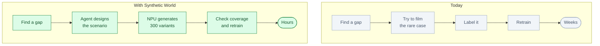
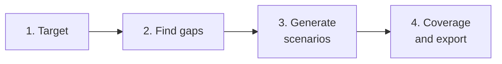

# Synthetic World Studio: an AI scenario designer

*Status: idea. Not built.*

**One line.** It finds the rare cases a model has never seen, generates them on the NPU and proves
the training data improved.

## Who buys it

Heads of AI and perception teams at autonomous-vehicle, robotics, drone, security and industrial
vision companies.

They pay for faster model improvement, fewer real-world tests and coverage of dangerous or rare
cases.

## The problem

A perception model fails on the cases that are hard to collect: night rain, glare, occlusion,
rare objects, unusual layouts.

Collecting and labelling those cases is slow and expensive. Some cannot be filmed safely.

## Today vs with Synthetic World

## How it works

1. **The team defines the target.** “Warehouse robot, night shift, misplaced pallet.”
2. **The agent finds the coverage gaps.**
3. **It designs the missing scenarios.**
4. **The NPU generates images, video or simulation data.**
5. **The agent checks coverage and labels.**
6. **It fills the remaining gaps.**
7. **The ML engineer exports the dataset.**

The short version:

## Where the NPU fits

The NPU generates and simulates data at scale.

Why:

- Hundreds of variants per scenario
- Fast iteration
- Customer data stays on-site
- Lower cost than collecting real data

The NPU is not the product. The coverage loop and the generated data are.

## What the customer gets

- A dataset of rare cases
- A coverage report
- Labels and metadata
- Scenario definitions
- A record of what was generated and why

## The hard part

The AI is not the hard part. The hard part is:

- Realism and sim-to-real gap
- Correct labels
- Customer model integration
- Bias and safety
- Rights and data licensing

## Business model

- Per dataset or per project
- Annual subscription
- Usage-based generation
- Optional on-site NPU server

Start with one perception model and one rare scenario.

## What to prove in a pilot

- Coverage gain
- Model improvement
- Cost per rare case
- Time to dataset
- Label accuracy
- Real-world transfer

## Where to start

Pick one model and one gap:

- Night and rain for a warehouse robot
- Glare for a drone
- Occlusion for an inspection camera
- Rare objects for a security camera

Start simulation-only or image-only.

## Who else is doing this

- Simulation vendors
- Data collection companies
- Internal data teams
- Cloud synthetic-data tools

The difference is the agent that finds the gap, designs the scenario and proves coverage.

## Why this is not just a skill for a research workbench

| Research workbench | Synthetic World |
|---|---|
| For scientists | For ML and perception teams |
| Papers and code | Datasets, labels and coverage |
| One user, one laptop | A model team and a pipeline |
| Research report | Training data and coverage report |
| Rare NPU use | High-volume generation |

The value is the data pipeline, the labels, the coverage loop and the customer model.

## Risks

- Generated data may not transfer to the real world.
- Labels can be wrong.
- Bias and safety must be tested.
- Customers may not share model details.
- Licensing and rights matter.

## Smallest first version

For one model and one gap:

1. Load a small validation set.
2. Find the missing cases.
3. Generate 100 variants.
4. Check coverage.
5. Train or test the model.
6. Report the gain.

## The 60-second demo

A warehouse robot fails at night with a misplaced pallet. The agent lists the gaps, generates 300
variants, coverage goes from 61% to 94%, and the model improves by 8 points.

## Open questions

- Which model and gap first?
- Image, video or simulation?
- Who labels the data?
- How is sim-to-real measured?
- On-site NPU or cloud?
- What improvement makes the pilot a success?
