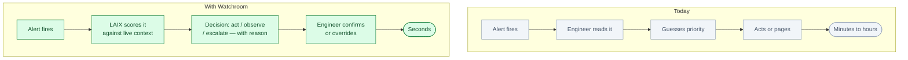
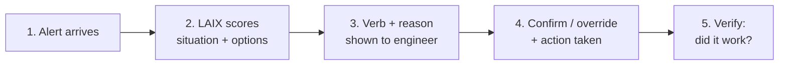

# Watchroom: an AI operations commander for live systems

*Status: idea, not built. Built to demo LAIX.*

**One line.** When production alerts flood in, Watchroom triages each one, explains the decision,
and keeps the engineer in control.

## Who buys it

Site reliability engineers, on-call engineers, platform engineering managers, and CTOs at companies
where downtime is expensive.

Their budget comes from less mean time to resolution, fewer wrong escalations, and fewer engineers
pulled from sleep for alerts that resolve themselves.

## The problem

A production system can fire hundreds of alerts in an hour. Deciding which ones matter, which need
action now, and which can wait is hard and stressful.

Engineers learn the patterns over years. When they leave, the knowledge leaves with them. New
engineers page the wrong people, take the wrong action, or freeze.

The difference is simple:

## How it works

1. **An alert arrives.** CPU spike, memory leak, failed deploy, 5xx rate crossing a threshold.
2. **LAIX scores the situation.** It reads severity, confidence, current load, time of day, and
   recent related alerts.
3. **LAIX returns a verb.** `act` (restart the pod), `observe` (watch for 2 more minutes), `ask`
   (page the database team), `escalate` (wake the on-call manager), `wait` (noise, ignore).
4. **The engineer sees the reason.** Confidence score, evidence chips, the gate that blocked or
   allowed action.
5. **The engineer confirms or overrides.** Either way, the decision is recorded.
6. **LAIX verifies.** After an action, a follow-up decision checks whether it worked.

## Where LAIX fits

LAIX is the entire decision layer. Every alert becomes a `DecisionRequest`. Each possible response
(restart, page, ignore, wait) is an `Action` with cost, risk, and disruption scores. Safety gates
block actions that are too risky given current load or confidence. The `verify` verb triggers a
follow-up request after each action.

The seven verbs map naturally onto ops:

| LAIX verb | Ops meaning |
|---|---|
| `wait` | Not worth tracking yet |
| `observe` | Watch for two more minutes |
| `ask` | Page the team who owns this service |
| `guide` | Show the alert to on-call with context |
| `act` | Run the remediation now |
| `verify` | Check whether the restart worked |
| `escalate` | Wake the on-call manager |

## What the audience sees

The demo shows a live board. Alerts stream in on the left. Each one gets a LAIX verdict badge on
the right. Click any alert to see the full scoring breakdown: options listed, gates applied, winner
chosen, reason written in plain English.

One alert shows a safety gate in action: `auto-restart-db` is the highest-scoring option but risk
exceeds the 0.20 gate. LAIX falls back to `escalate → page on-call`. The audience watches the gate
save the production database.

## The hard part

Connecting to the monitoring stack: Datadog, PagerDuty, Prometheus, OpsGenie, CloudWatch. Each has
a different data model. Normalising severity, confidence, and service context into LAIX contracts is
the real product. The LAIX decision logic is generic; the connectors are the moat.

## Business model

- Per-seat monthly subscription for engineering teams
- Per-integration setup fee
- Enterprise: self-hosted, SSO, audit export, data residency

Start with one team, one monitoring tool, one incident type.

## What to prove in a demo

- Audience can read the reason for every decision without explanation
- Safety gate visibly blocks a dangerous action
- Trust beat: AI recommends wrong action; engineer overrides; system learns
- All seven verbs appear naturally in one scenario

## Where to start

One SRE team, one monitoring tool (Datadog or Prometheus), one service class (stateless web tier).
Instrument five alert types. Run for 30 days alongside the existing process.

## Who else is doing this

- **AIOps tools** (Moogsoft, BigPanda) correlate alerts but do not explain decisions.
- **PagerDuty** routes and escalates but has no reasoning layer.
- **Runbooks** encode human knowledge but do not apply it in real time.
- **LLM chatbots in ops** answer questions but do not drive action or produce audit records.

Watchroom is different: explicit scoring, safety gates, audit trail, and the engineer always in
control.

## Risks

- Engineers will not trust a system that acts without explanation.
- False positives in the trust beat erode confidence.
- Integrations with monitoring tools are brittle and version-sensitive.
- Liability for wrong automated actions.

Never automate actions without a confirmation step in the first version. Keep the engineer one click
away from every action.

## Smallest first version

For one team, one monitoring tool, five alert types:

1. Read alerts from the monitoring API.
2. Score each alert with LAIX.
3. Display the verb and reason on a board.
4. Let the engineer confirm or override.
5. Record every decision with timestamp and outcome.
6. Run a verify check 5 minutes after each action.

No automatic remediation. No multi-team routing. Just score, explain, confirm, record.

## The 90-second stage piece

A live ops board. Production alerts stream in. One alert — a database memory spike — gets scored.
LAIX shows `auto-restart-db` as the top option, then the safety gate fires: risk 0.87 > limit 0.20,
option eliminated. LAIX chooses `escalate → page on-call` instead. The engineer in the audience is
asked: approve or override? They approve. Five seconds later a verify pulse comes back: memory
stable, incident closed.

The trust beat: LAIX flags a 5xx spike as `act → scale up`. The engineer on stage rejects it —
*"this is a client bug, not our load."* LAIX re-ranks: `observe → watch 2 min`. The board updates.
*"It was confident. It was wrong. This is why the engineer stays in charge."*

The closing line: *"Every alert, a decision. Every decision, a reason."*

## Open questions

- Which monitoring tool is the first integration target?
- What is the right confidence threshold for auto-act vs. confirm?
- How do we source a realistic alert stream for the demo?
- Should the stage piece show real ops tooling or a custom board?
- Which incident scenario has the highest trust-beat drama?
