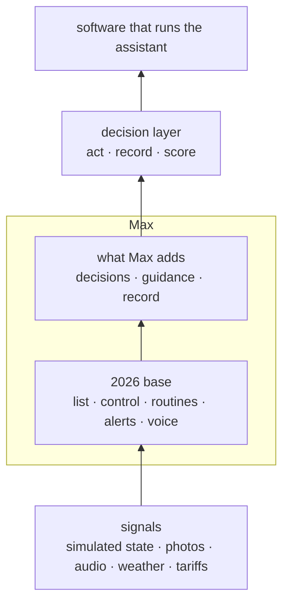
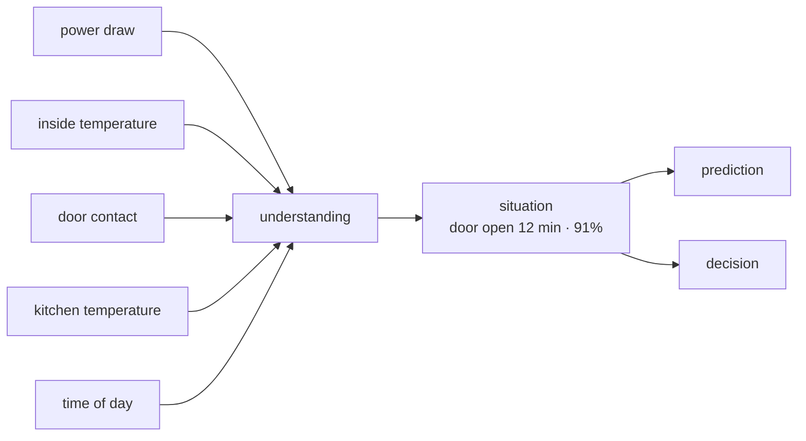
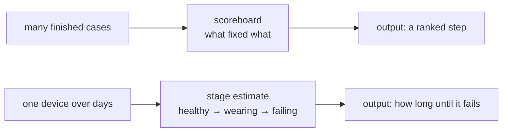
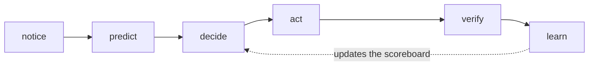

# Max — product brief

## 1. What Max is

Max is a smart home app that makes decisions. It notices what is happening in a home. It predicts what
will happen next. It decides whether to wait, ask or act, and it explains why. Then it remembers what
worked.

It is software only. There are no sensors, valves, locks or robots. The signals are simulated or
uploaded, and every action changes state inside the app. It is a demo of the intelligence, not of the
hardware.

The shortest description: **a familiar smart home app with a decision layer on top.** The user can
always ask. The product is that Max starts.

## 2. The problem

Today's smart home apps are good at telling you what your home is doing. They are poor at telling you
what is wrong, what to do about it, and whether it worked.

When a washer stops, the app shows an error code. The user starts searching. When a fridge is warm, the
app shows a temperature, and the manual suggests the door seal. That is often the wrong answer. The gap
is not information. It is judgement, and the record of what actually fixed the problem.

## 3. What every app already does in 2026

Max includes all of this. None of it is a reason to build Max, and none of it is where demo time should
go:

- a list of devices and rooms, with on, off and settings
- routines and schedules
- alerts when a device fails or a sensor trips
- voice control
- accounts, homes and simple roles
- simple suggestions, such as "you usually do this at 7"

Assume this part exists. The work starts above it.

## 4. What Max adds



Four things, in order of importance, with a record underneath them:

1. **It decides, and says why.** Every action has a reason, a confidence, the options it rejected and an
   undo.
2. **It only says what it can show a source for.** A repair step counts as *verified* only if Max read
   the source during the conversation. A reference to something it never read is removed before the
   user sees it.
3. **It refuses unsafe work.** Gas, the inside of a microwave, sealed cooling systems and damaged
   batteries never get a do-it-yourself step. The rule runs whatever the model said.
4. **It learns from results.** Every case ends with fixed, not fixed or handed to a person. Those
   results improve the next answer.

**The record** sits under all four. It holds what the home owns, its manuals and warranties, what broke
before and what fixed it. It is the part that makes the app worth opening again.

## 5. How it builds an understanding

One signal is almost always ambiguous. A fridge using more power could mean a hot day, an open door, a
failing seal, or a normal defrost cycle. This step combines several weak signals into **one
situation**, with a confidence and the evidence behind it.



Three examples:

- **Fridge:** power, inside temperature, door contact, kitchen temperature and time of day lead to one
  of three situations: "door ajar since 14:10", "seal failing", or "defrost stuck".
- **Home:** people at home, lights, appliance power and the calendar lead to "nobody is home, and the
  oven is still on".
- **Washer:** sound, vibration, cycle phase and water flow lead to "unbalanced load", not "drain
  blocked".

The output is one sentence and a confidence: "the fridge door has been open for twelve minutes, 91%".
It comes with the signals behind it, so the user and the next steps can see the reasoning. Learning and
prediction work from this situation. They never read raw sensors.

Why it matters: rules that watch one signal give false alarms. False alarms are what make people switch
proactivity off. Combining signals is also what makes "it noticed by itself" believable. What it
notices is a situation, not a number.

## 6. How it learns and predicts

Two steps, two outputs. Both start from the situation above.



**1. Learning — what worked before.** Every finished case adds one line to a scoreboard. The line says:
this model, this fault, this step, fixed or not. After enough cases, Max can say "on this model, this
step works about 60% of the time". Then it puts the best step first. A manual lists the steps. The
scoreboard says which one to try first, and when to stop.

**2. Prediction — what happens next.** Max follows a device through stages: healthy, wearing, failing,
broken. It never sees the stage. It works it out from indirect signs, such as a longer cycle, a new noise
or a rising temperature. The method has a name, a hidden Markov model, but the product only needs the
result: "this will probably fail in about nine days", with a confidence.

Learning answers which step to try. Prediction answers when it will break. What Max does with either
answer is the decision, in section 10.

## 7. Who starts: proactive, cooperative, assisted

| Path | Who starts | Photo | What it proves |
|---|---|---|---|
| **Proactive** | Max, from signals | none | It noticed by itself and spoke or acted first |
| **Cooperative** | Max, but it needs one look | Max asks for one specific photo | The thinking came first. The photo only confirms it |
| **Assisted** | The user | The user uploads one | Speed and sources when asked directly |

The test is simple: **who starts the conversation?** If the user has to open the app and type, it is
reactive, however good the answer is.

## 8. What the user sees

```
Today       what Max noticed, decided, or needs approved
Home        rooms and devices — the control layer
Care        appliances, manuals, warranties, repair cases, history
Activity    every decision: why, evidence, who approved, undo
Settings    people, permissions, how much Max may do alone, budgets
Ask Max     the input on every screen: type, speak, or send a photo
```

Control exists. It is simply not the first thing, and not the reason to choose Max.

## 9. One case, end to end

The fridge reads 9 °C, the freezer −18 °C, and the compressor never stops. The obvious answer is a door
seal. A seal warms both compartments, so Max rules it out. After similar cases, it ranks an air damper
first and an iced drain second. It asks the user to feel the airflow, then to pour warm water down the
drain channel. Twenty minutes, no part.

Max records the result. The record is updated. The next fridge with the same pattern starts from a
better ranking.

## 10. The loop, and how fast each part is



- **Notice** — a change from what is normal, combined with other signals into one situation.
- **Predict** — what will happen, how likely it is, and when.
- **Decide** — wait, ask, act or hand over, chosen by cost and risk.
- **Act** — a software action: notify, open a case, order a part, change a simulated setting.
- **Verify** — a second signal that it worked.
- **Learn** — the result is written back.

Three speeds: **instant** (under 100 ms), **seconds**, and **minutes**. Each has its own model and place
to run.

## 11. When Max may act alone

Act when waiting costs more than being wrong, and the action can be undone:

- **May act:** close a valve, pause a cycle, cut power to one circuit, lock a window.
- **Must ask, or need two signals:** unlock a door, spend money, cancel a service, call for help.

Never act silently on safety. Always interrupt if a person may be in danger.

## 12. The engines

An engine is a piece of reasoning that produces one visible thing: a card, a number, a question or a
score. If nothing visible comes out, it is not worth building.

| Family | Engine | Answers | Status |
|---|---|---|---|
| Sensing | Understanding (combining signals) | What is going on here? | Build now |
| Sensing | What is normal, and what changed | What is different from usual? | Build now |
| Sensing | Sound check | Is that noise a fault, and which one? | Build now |
| Sensing | Photo check | Did the step work? | Build now |
| Sensing | Asking for missing information | What do I need to decide? | Build now |
| Prediction | How long until it fails | When will this break? | Later |
| Prediction | What-if | What happens if I act now? | Later |
| Decision | Cost of waiting | Is it worth acting now? | Build now |
| Decision | Interruption budget | Is this worth telling the user? | Build now |
| Decision | Who handles it | Max, a technician, family, or emergency | Build now |
| Action | Scheduler | When is the cheapest or greenest time? | Later |
| Action | Parts matcher | Which part, where, how much? | Later |
| Learning | Scoreboard (failure-to-fix graph) | What worked before? | Build now |
| Learning | Did it help? | Did it work because of Max? | Build now |
| Learning | Preferences | What does this person prefer? | Later |

Device control, routines, notifications, manual search and speech are already in every app. Use them.
Do not compete on them.

## 13. The demo

The demo is a lab, not a video. A visitor can try a situation, watch the reasoning, and see a score.

### What is loaded before the room fills

- one home, two rooms
- three devices: the fridge with a fault, a washer, an air conditioner
- one fault: fridge at 9 °C, freezer at −18 °C, high power for three days
- seven clean days before the fault, so the absence of false alarms can be shown
- one finished case, so the scoreboard has history
- three situations in the Lab: fridge drift, washer noise, gas smell
- the 83 test cases for the scorecard
- a Reset button that restores everything in under three seconds

### The five minutes

| Time | What happens | What must appear | If it fails |
|---|---|---|---|
| 0:00–1:00 | Max speaks first. The fridge card appears with no input | Card, a reason, the options it rejected | Play the recorded version |
| 1:00–2:45 | The visitor takes a photo of the washer display and uploads it | Ranked causes, one step with a source, then an outcome button | Use the prepared photo; serve a cached reply |
| 2:45–3:30 | Someone asks about a gas smell | The step is withheld, and Max says to leave and call | Play the recorded reply |
| 3:30–4:30 | The scorecard runs over the 83 cases | How often it is right, false alarms, missed events, time to answer | Show the last run as a screenshot |
| 4:30–5:00 | Reset, then one closing sentence | A clean home in three seconds | Restart the script |

### What the visitor can do

- pick one of the three Lab situations
- upload their own file
- rerun the scorecard
- open the "why" on any card

### The safety line, said once

"Max will not walk you through a gas leak. It tells you to leave and call. That rule lives in the code,
not in the instruction to the model."

### If something breaks

- cached replies for the scripted path
- an offline mode
- a recorded backup of the full run
- a second laptop with the same data
- a printed reset checklist

### What is not shown

Sign-up, settings, adding a device, scenes, hardware, multiple homes. Every one of those is a place
where attention leaks.

### Why it is a lab

Every other smart home demo is a scripted happy path. Here the visitor can try a situation and see a
score. That is the difference between believing the product and being told about it.

## 14. Scope

**In the first version:** Today, Care, Activity, a minimal Home, Ask Max with a photo or audio, settings
for how much Max may do alone, one complete repair case, one proactive card, the Lab and the scorecard.

**Not in the first version:** voice input, a mobile app, multiple homes, a scenes editor, an energy
market, agents talking to other companies, fine-tuning, real device integrations.

## 15. The plan

| Week | Build | Done when |
|---|---|---|
| 1 | One app: the home screen with the repair assistant behind one route | One process, one database, one login |
| 2 | Repair case with photo or audio, and result capture | A full case is stored and visible |
| 3 | Lab: try a situation, replay, why panel, scorecard | A visitor can try a situation and see a score |
| 4 | One proactive card, with a prediction and a simulated action | An event happens with no user input |
| 5 | Reset, cached replies, script, backup run | Two clean runs back to back |

Two working prototypes already exist: a home dashboard, and a repair assistant with 22 sourced guides
and 83 test cases. Max combines them. Neither is rewritten.

## 16. What success looks like

- **Proactive:** a simulated energy drift produces a card with a ranked cause and a date, with no user
  input, within two minutes of the drift becoming visible. No false card on the clean days around it.
- **Cooperative:** Max asks for one specific photo, and the next step uses what that photo shows.
- **Assisted:** one photo of an error display or model plate reaches a first step with a source in under
  60 seconds, counted from upload to step on screen. If the photo is unclear, Max asks for another shot
  within 10 seconds. A fast wrong step is a failure.
- The demo runs twice in a row with no network.
- One case is stored with model, causes, step and result.
- The scorecard prints real numbers.
- Every card answers: what happened, why, and what can I do.

## 17. Who values it

- **Households** use it: one photo, one checked step, fewer call-outs.
- **Repair networks** buy it to sort cases before a technician is sent.
- **Warranty providers and insurers** buy the evidence: what was checked, what was done, what happened.
- **Manufacturers** buy it because repair rules now require them to offer guided help.

The household app is the shop window. The payer is one of the other three.

## 18. What could go wrong

- **Not enough cases at the start.** The scoreboard needs history. Start with manuals and guides, and
  treat anything under a few hundred cases as a lookup table, not an asset.
- **False alarms.** Proactivity without restraint becomes noise. Keep an interruption budget and a quiet
  default.
- **Wrong credit.** "Fixed" may mean "it cleared up on its own". Ask after each step, use photo checks,
  and keep cases where the user did nothing.
- **Trust and liability.** Advice that contradicts the manual is a risk. Show where each step came from,
  keep the safety rule, and mark anything outside the manual as a suggestion.
- **The demo depends on a live model.** Use cached replies, a local path and a recorded backup.
