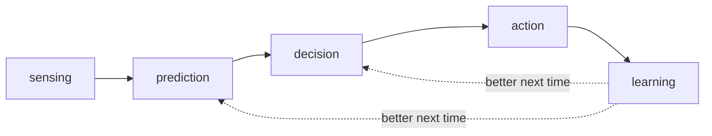

# Engine catalogue

An engine is a piece of reasoning that produces one visible thing: a card, a number, a question or a
score. If nothing visible comes out, it is not worth building.

Five families, in the order they run:

**Status:** *build now* = needed for the v1 demo · *later* = after v1 or after data · *commodity* =
every app has it; use one, do not differentiate on it.

## Sensing — what is happening

| Engine | The question it answers | Visible output | Status |
|---|---|---|---|
| Baseline and deviation | What changed from normal here? | A card naming the change | Build now |
| Sound classifier | Is that noise a fault, and which one? | A ranked cause | Build now |
| Photo verification | Did the step work? | Passed / not yet / unsure | Build now |
| Uncertainty and clarification | What is missing to decide? | One specific question or photo | Build now |
| Presence and activity | Who is home, awake, asleep? | A state the rest can use | Commodity |

## Prediction — what happens next

| Engine | The question it answers | Visible output | Status |
|---|---|---|---|
| Remaining life | When will this fail? | "About 9 days, 78%" | Later |
| What-if simulation | What happens if I act now? | Predicted state and cost | Later |
| Novel event | Have we seen this here before? | "Never seen in this home" | Later |

## Decision — what to do

| Engine | The question it answers | Visible output | Status |
|---|---|---|---|
| Cost of waiting | Is it worth acting now? | Wait / ask / act, with the reason | Build now |
| Attention manager | Is this worth interrupting for? | A daily budget and a chosen card | Build now |
| Escalation router | Who should handle this? | Self, technician, family, emergency | Build now |

## Action — doing it

| Engine | The question it answers | Visible output | Status |
|---|---|---|---|
| Constraint planner | When is the cheapest or greenest time? | A schedule and a saving | Later |
| Parts matcher | Which part, where, how much? | Part, price, delivery date | Later |
| Negotiator | Who gets the shared budget? | An agreed split between agents | Later |

## Learning — getting better

| Engine | The question it answers | Visible output | Status |
|---|---|---|---|
| Failure-to-fix graph | What worked before? | A ranked step list with rates | Build now |
| Causal attribution | Did it work because of me? | Fixed vs resolved alone | Build now |
| Preference learner | What does this person prefer? | Learned defaults | Later |
| Trust calibration | How much freedom has it earned? | An autonomy level per domain | Later |

## Commodity — use, do not build

Device control, routines and schedules, notifications, search over manuals, speech recognition, voice
output. Every mainstream app in 2026 has these. They are the floor from the main brief, not a reason to
choose Max.

## The three to add next

1. **Baseline and deviation** — without it, every proactive behaviour is a threshold.
2. **Attention manager** — without it, proactivity becomes notification spam.
3. **Causal attribution** — without it, the failure-to-fix graph learns fiction.

The first two decide whether the product feels proactive; the third decides whether it can be trusted
with the data it collects.
