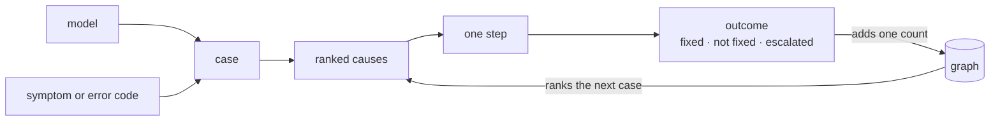
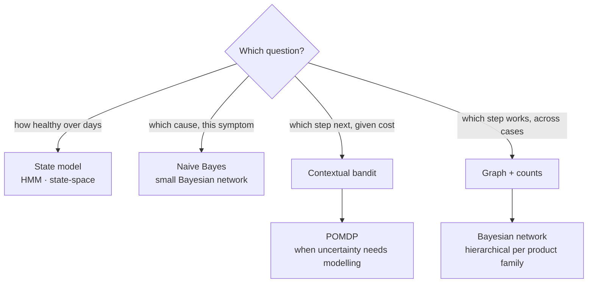
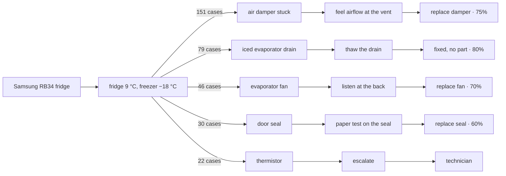
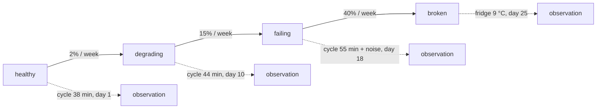

# Failure-to-fix graph

## What it is

A map of what actually fixed which problem, learned from real cases. Each case adds a link:

```
model + symptom + cause + step → fixed / not fixed / escalated
```

A guide says "here are the steps". The graph says "for this model, this step works most of the time,
that one wastes it, and this is the order to try them".

## How it is modelled

The graph is a count table first and a probability model second.

Each repair case is independent: it has a start, an end and an outcome. What links cases is not time
but the shared nodes — the same model, the same symptom, the same step. So the structure is a graph,
and the statistics are conditional counts: how often this step resolved this fault on this model.



Every finished case travels the loop once: what was observed, what was suspected, what was tried, what
happened. The outcome writes back to the graph, and the graph ranks the causes for the next case.

Five pieces make up the model:

1. **Graph** — nodes for model, symptom, error code, cause, step, part and outcome; edges for
   "observed with" and "followed by".
2. **Counts** — per step: tried, resolved, failed, escalated, with Wilson confidence intervals. Useful
   with no model at all.
3. **Probabilities** — a Bayesian network (symptom → cause → step → outcome) or a hierarchical model
   per product family, so a rare model borrows strength from similar ones.
4. **Decisions** — which step to try next: a contextual bandit (context: model, symptom, history; arm:
   step or ask; reward: resolved without escalation), or a POMDP when the uncertainty needs modelling
   explicitly.
5. **Time** — a separate state model for device health over days (healthy → degrading → failing), used
   for prediction rather than for pooling cases.

## Which tool answers which question

| Question | Right tool |
|---|---|
| What is the hidden device state over time — healthy, degrading, failing? | A state model over time: HMM or state-space model |
| Which step fixed this fault, across thousands of independent cases? | Graph + counts, then a Bayesian network |
| What should I try next, given cost and uncertainty? | Contextual bandit, or a POMDP |
| Which cause is most likely for this symptom? | Naive Bayes or a small Bayesian network |



The pattern behind the table: the question decides the **shape of the data**, and the shape decides the
model.

### Graph — many cases, no time

Nodes are things that repeat: model, symptom, cause, step, outcome. Edges say "these belong to the
same case" or "this step led to that outcome". Nothing runs on time.

A single case is deliberately small — one symptom, one cause, one step, one outcome. That is the unit
of evidence; a repair with five steps is five records in a row, not one complex node. The graph
appears when those small records **share nodes**:



One model, one symptom, 328 cases, five causes. The edge weights are the counts, and the outcome on
each step is what the graph learned. Remove the shared nodes and only separate records remain. Remove
the counts and only a guide remains.

The case in full: a fridge at 9 °C, a freezer at −18 °C, and a compressor that never stops. The manual
says check the door seal, clean the condenser, call service. The obvious answer is the seal — and the
second reading rules it out: a failed seal warms both compartments, and the freezer is perfect.

That combination is what the graph knows and a manual does not. After 328 cases it ranks an air damper
first, then an iced evaporator drain behind the freezer panel, then the fan. The drain is the
interesting one: the fix is warm water down the drain channel, no part and twenty minutes, and it
resolves 80% of the cases where the drain is the cause. Nothing in the manual points there, because
the manual lists causes per symptom, not per combination of symptoms.

This is when the graph earns its keep: the symptom that looks like one thing, the evidence that makes
it another, and a fix that costs nothing and is not written down.

### State model — one case, over time



Nodes are hidden states of one device. Solid edges are transitions with probabilities; dotted edges
are the observations the model sees. One device, many days, and the state at each moment is never
observed directly.

### The rule

- Sequence over time → a state model.
- Many independent cases → counts, then a graph, then a Bayesian network.
- One decision under uncertainty → a bandit, or a POMDP when the hidden state matters.
- One cause for one symptom → Naive Bayes, or a small Bayesian network.

## When the graph is worth building

- **The symptom is ambiguous** — "noise", "not cleaning", "smells", "warm but running".
- **Several causes are plausible**, and the order changes cost, time or risk.
- **The manual is silent, generic, or wrong for this model or age** — it says "call service", or
  describes a new machine.
- **The outcome depends on the model family, age or usage** — the same code means different things
  across brands.
- **The fix is not in the manual at all** — a reset sequence, a known firmware quirk, a part
  substitution.

If none of these hold, the guide is enough and the graph adds nothing.

## Guardrails

- Mark every step's provenance: manufacturer manual, technician, or community.
- Run the safety gate before any step, whatever the graph's confidence says.
- Never promote a step the manual forbids, and never rank an unsafe step higher because it once worked.
- Treat a graph-recommended fix that is not in the manual as a suggestion, not a verification.

## The hard problem is attribution

If the user says "it works now", did the step fix it, or did the fault clear on its own, or did they
do something you did not see? Three defences:

- order the steps and ask after each one, not at the end;
- require a photo when the outcome is visible;
- keep controls: cases where the user did nothing, or where the step was skipped, so "fixed" can be
  separated from "resolved by itself".

## Build order

1. Counts with confidence intervals — useful immediately.
2. Hierarchical pooling by product family — helps rare models.
3. Contextual bandit for step selection — where it visibly gets smarter.
4. A state model for degradation over time — only with pre-failure prediction.

## What it buys

- fewer wasted steps, and the right part ordered first;
- a warning before the failure, not after;
- evidence a manufacturer or insurer will accept;
- an asset that grows with every case and cannot be copied from manuals.
