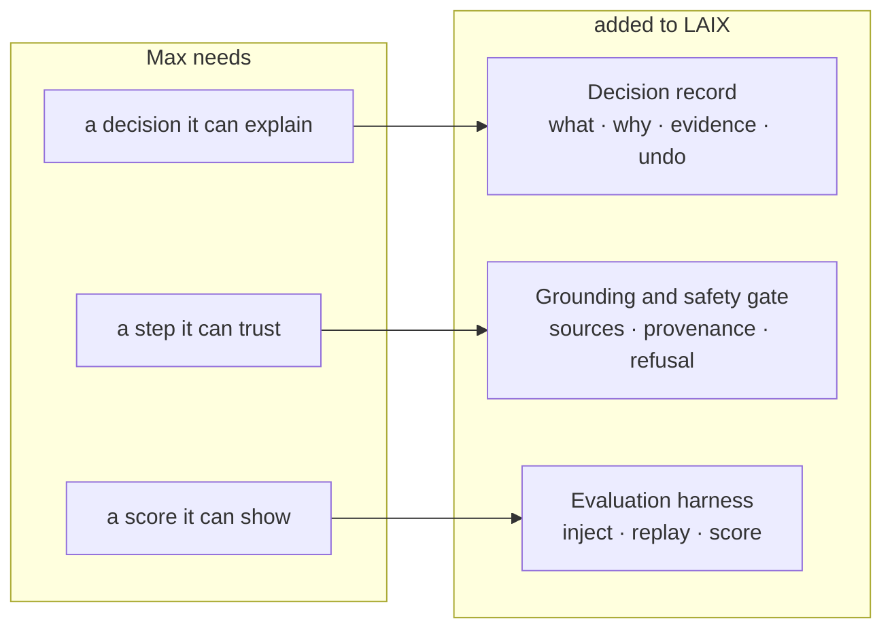
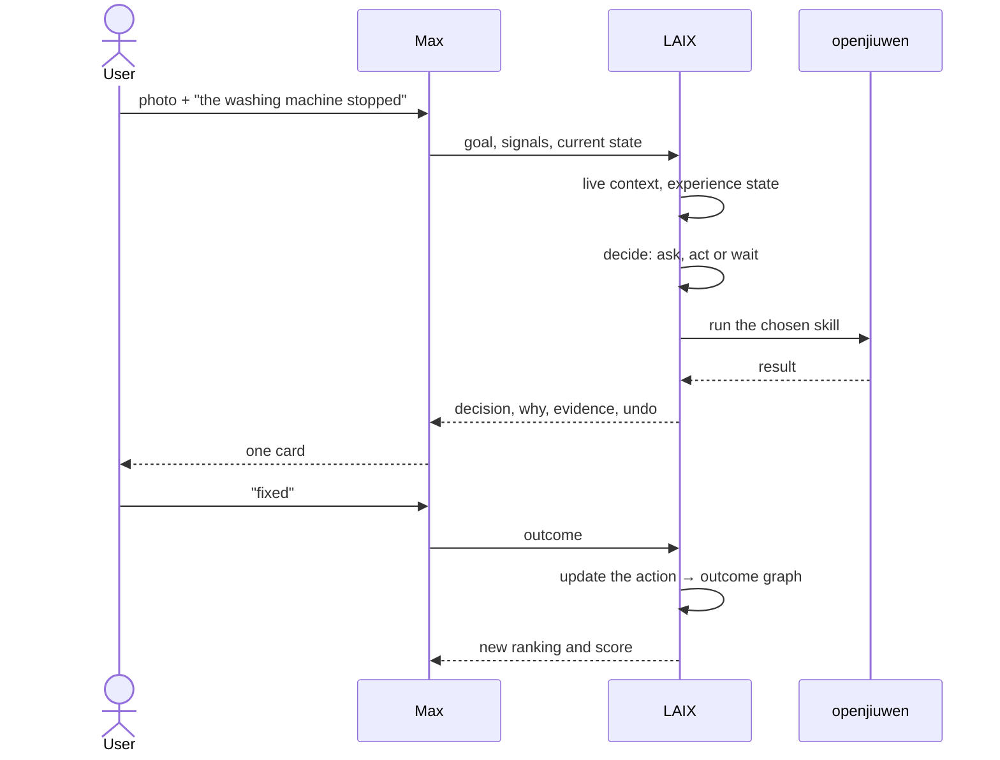

# LAIX: what Max adds, and what Max uses

Max is the app. LAIX is the layer beneath it that decides whether, when and how the app acts. Building
Max exposed three things LAIX does not yet have; Max depends on them, so they are added to LAIX and
Max consumes them.

## Three needs, three additions

| Max needs | Added to LAIX | Where Max uses it |
|---|---|---|
| A decision it can explain | Decision record | Activity screen, the why panel, undo |
| A step it can trust | Grounding and safety gate | Care and repair steps; the gas refusal |
| A score it can show | Evaluation harness | The Lab tab and the scorecard |

## One decision, end to end

## The boundary, in one line each

**Max supplies:** goals, signals (photo, audio, device state), outcome labels, permissions, a budget.

**LAIX guarantees:** a decision, its evidence, its confidence, the cost of waiting, an undo, a record,
and a score.

## The rest of the additions, needed later

| Addition | What Max will use it for |
|---|---|
| Baseline and deviation | Noticing that something changed without a threshold being crossed |
| Interruption policy | Deciding which of Max's cards is worth showing today |
| Autonomy configuration | Per domain: observe, suggest, ask, act within limits |
| Latency tiers | Reflex, tactical and deliberate paths with different models |
| Reference-app contract | Making the next app an integration rather than a project |

## Why this lives in the Max folder

Max is the first reference app, so its needs define the LAIX additions. The middleware documents the
design; this file records the part of that design that Max actually exercises today, and the part it
will need next.
