# The LAIX case — manager and moment

*The decision layer for the right moment, and the symbiosis with PPMA.*

> **All performance numbers in this document are targets, not results.**

## 1. The story

AI is good at answering. It is bad at knowing when to speak.

Models can now see, speak and act. The missing layer is the decision between them.

The enemy is **mistiming**: the AI that interrupts when it should wait, stays silent when it should
act, and never checks whether it helped. The user stops trusting it; the app cannot improve; every
team rebuilds the same timing logic.

LAIX is the decision layer for that moment. It decides when to act, what to do, and whether it worked.

| | PPMA | LAIX |
|---|---|---|
| **How long it lasts** | Weeks or months — a thesis, a course, a job hunt | Milliseconds to months — a cue, a session, a life decision |
| **Enemy** | **Forgetting** | **Mistiming** |
| **Promise** | Memory that manages the project | Action that fits the moment |
| **Strength** | memory, commitments, apps, follow-up | perception, timing, uncertainty, risk, outcome |
| **Decides** | what matters over time | what to do now |
| **Failure** | the project drifts | the AI speaks too early, too late, or not at all |
| **Proof** | Feed, plans, follow-ups | Coach, accessibility, causal study, reuse |

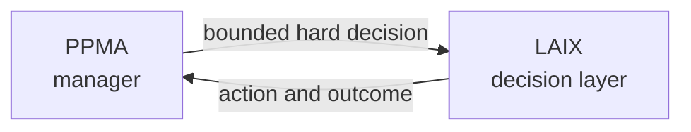

The vertical app supplies the example; LAIX supplies the class, the algorithm and the measured
outcome.

> **AI is good at answering. It is bad at knowing when to speak. LAIX decides when to act — and
> proves it helped.**

## 2. The boundary

PPMA is a **manager**. Its decision space is small and discrete:

- `command` an app,
- `ask` the user,
- `dispatch` a bounded mission,
- stay `silent`.

It works over events, for **one owner**, with a memory that lasts for weeks. That suits project management. A decision-theoretic controller is a different layer.

LAIX is the layer for the decisions that are **too fast, too social, too uncertain, or too consequential** for that model.

| | PPMA | LAIX |
|---|---|---|
| Unit | a project over weeks | an experience, from milliseconds to months |
| Input | app events, user text | sensor streams, context, outcomes |
| Decision | command / ask / dispatch / silence | wait / ask / guide / act / verify / escalate |
| Owner | one | one or many |
| Method | rules + model + memory | decisions under cost, latency, risk and interruption |
| Proof | provenance and calibration | measured user outcome |

## 3. The decision frontier

This section describes ten decision classes. Each card gives the decision in five steps, a five-step
case for LAIX, an example and a diagram.

### 3.1 Real-time intervention under uncertainty

**The decision**

| Step | Detail |
|---|---|
| **1. Question** | When should the product act, and when should it wait? |
| **2. Situation** | Things change fast, and the product cannot see the whole situation clearly. |
| **3. Options** | wait · cue · adjust · stop · ask a person for help |
| **4. Goal** | help now, without interrupting too much or adding risk |
| **5. Limits** | under a second · limited sensors · the user’s consent |

**The case for LAIX**

| Step | Detail |
|---|---|
| **1. PPMA gap** | It reacts to events and writes a card. It has no live video, no model of the body, and no sub-second loop. |
| **2. LAIX solution** | Live Context + a fast decision engine on the device. Measure: intervention precision ≥85% · response ≤1 second · form gain vs baseline. |
| **3. Algorithms** | POMDP · contextual bandit · active perception · uncertainty-triggered escalation |
| **4. Build** | Type: Engineering + research · MVP: Weeks · Full product: Multi-quarter |
| **5. Impact** | It is the clearest test of “right action, right moment”. |

**Example** — a camera watches a squat. Form starts to drift. The value is in the timing.

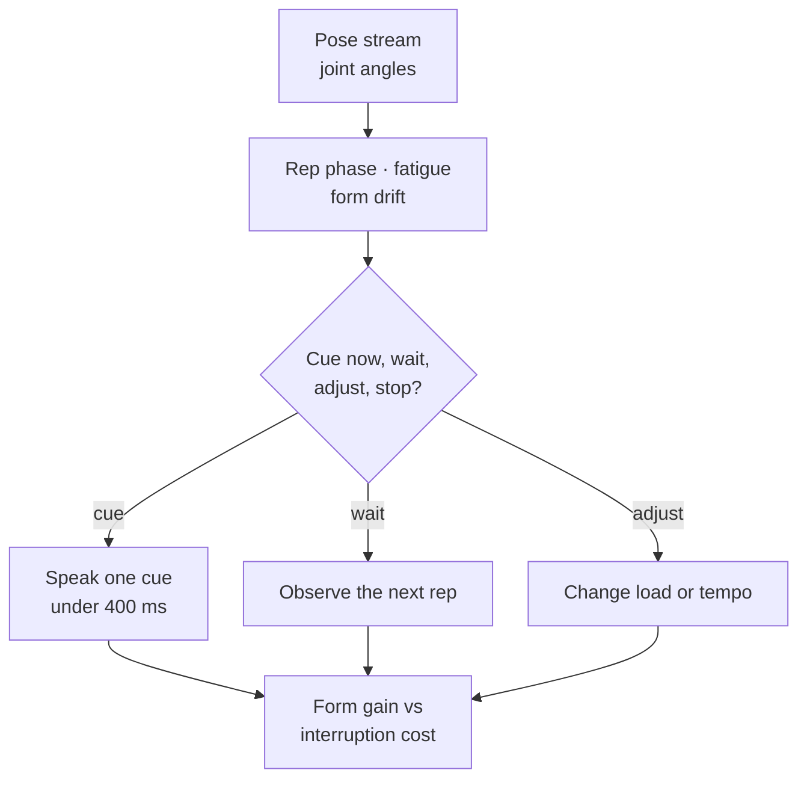

### 3.2 Active perception

**The decision**

| Step | Detail |
|---|---|
| **1. Question** | What should we look at next? |
| **2. Situation** | The product cannot see the target clearly and does not know where it is. |
| **3. Options** | move the camera · ask · check · hand over to a person |
| **4. Goal** | find the target quickly, with as little sensing cost as possible |
| **5. Limits** | latency · bandwidth · safety · a person available to help |

**The case for LAIX**

| Step | Detail |
|---|---|
| **1. PPMA gap** | It reads messages, not live video or audio. It cannot choose where to look next or hand over in real time. |
| **2. LAIX solution** | Live context + decision engine + resource policy. Measure: task success · time to find · model calls per success · safe handover rate. |
| **3. Algorithms** | active perception · POMDP · multimodal fusion · uncertainty-based escalation · cost-aware sensing |
| **4. Build** | Type: Engineering + research · MVP: A quarter · Full product: Multi-quarter |
| **5. Impact** | The decision is what to perceive next. |

**Example** — a blind user looking for a seat in a crowded station.

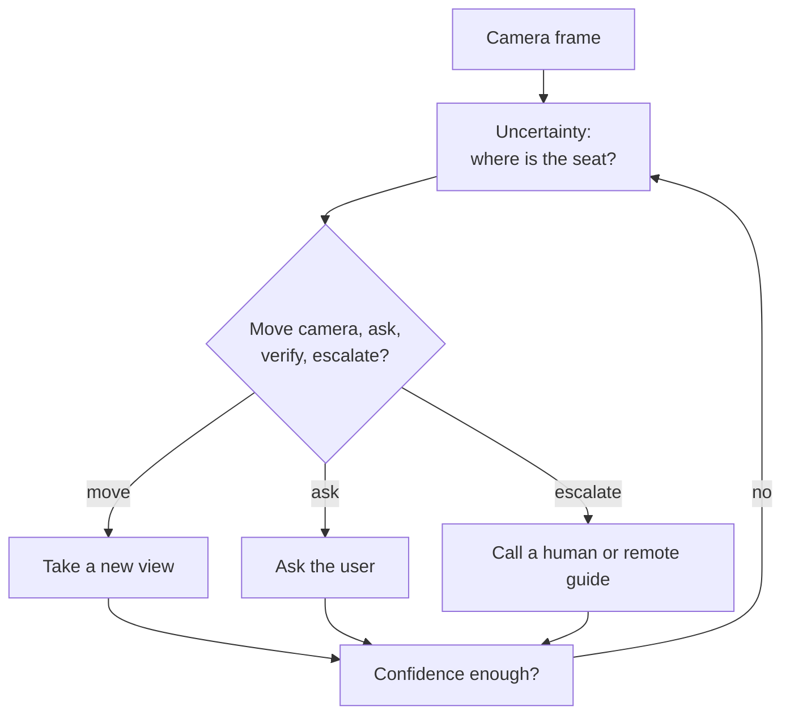

### 3.3 Stochastic replanning

**The decision**

| Step | Detail |
|---|---|
| **1. Question** | What do we do now that the plan broke? |
| **2. Situation** | Plans break, constraints are linked, and future options are uncertain. |
| **3. Options** | rebook · wait · take another route · cancel · ask a person for help |
| **4. Goal** | recover quickly, at acceptable cost, without missing what matters |
| **5. Limits** | deadlines · budget · fatigue · availability |

**The case for LAIX**

| Step | Detail |
|---|---|
| **1. PPMA gap** | It can run a plan, but it cannot replan under uncertainty across time, cost and commitments. |
| **2. LAIX solution** | Decision engine + execution bridge + resource policy. Measure: recovery time · cost · missed commitments · user stress. |
| **3. Algorithms** | stochastic scheduling · MDP/POMDP · robust optimization · search under uncertainty |
| **4. Build** | Type: Engineering + research · MVP: Weeks to a quarter · Full product: Multi-quarter |
| **5. Impact** | Replanning is a stochastic scheduling problem. |

**Example** — a cancelled flight, three connections, and a keynote tomorrow.

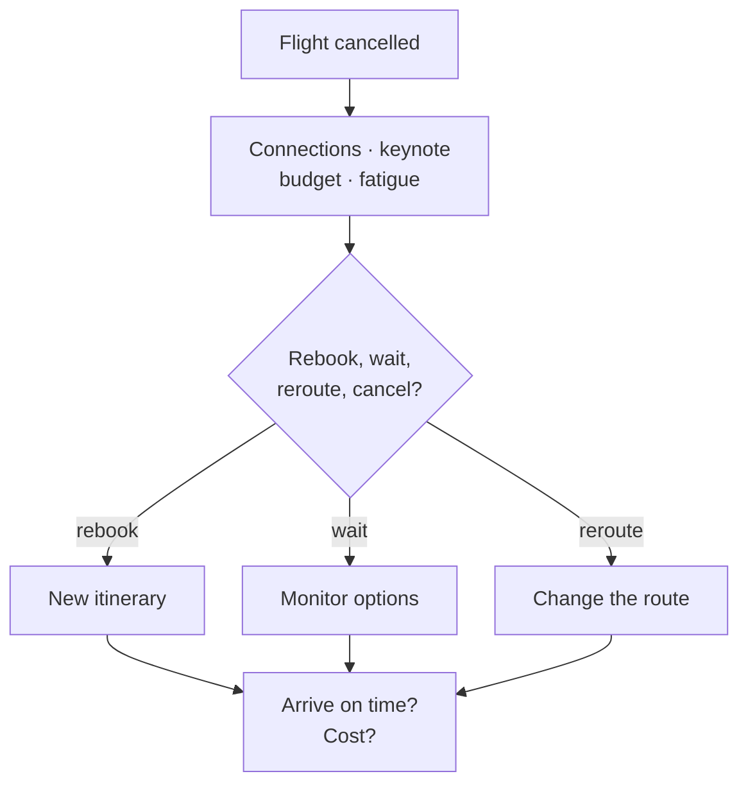

### 3.4 Resource allocation under uncertainty

**The decision**

| Step | Detail |
|---|---|
| **1. Question** | Where should the next hour or dollar go? |
| **2. Situation** | Several projects compete for limited time and money, and their payoffs are uncertain. |
| **3. Options** | fund · postpone · stop · try something new |
| **4. Goal** | the best risk-adjusted result for the resources spent |
| **5. Limits** | budget · time · people · attention · burnout |

**The case for LAIX**

| Step | Detail |
|---|---|
| **1. PPMA gap** | It can schedule steps and reminders, but it has no budget, no cost of missed opportunities, and no way to compare uncertain payoffs. |
| **2. LAIX solution** | Decision engine + resource policy + outcome learning. Measure: outcome per hour · risk-adjusted progress · regret vs a perfect planner. |
| **3. Algorithms** | constrained MDP · robust optimization · real options · multi-armed bandits · multi-objective optimization |
| **4. Build** | Type: Engineering + data · MVP: Weeks to a quarter · Full product: Multi-quarter |
| **5. Impact** | It is the clearest manager and investor story: the decision is about what to stop. |

**Example** — 20 hours a week across six projects.

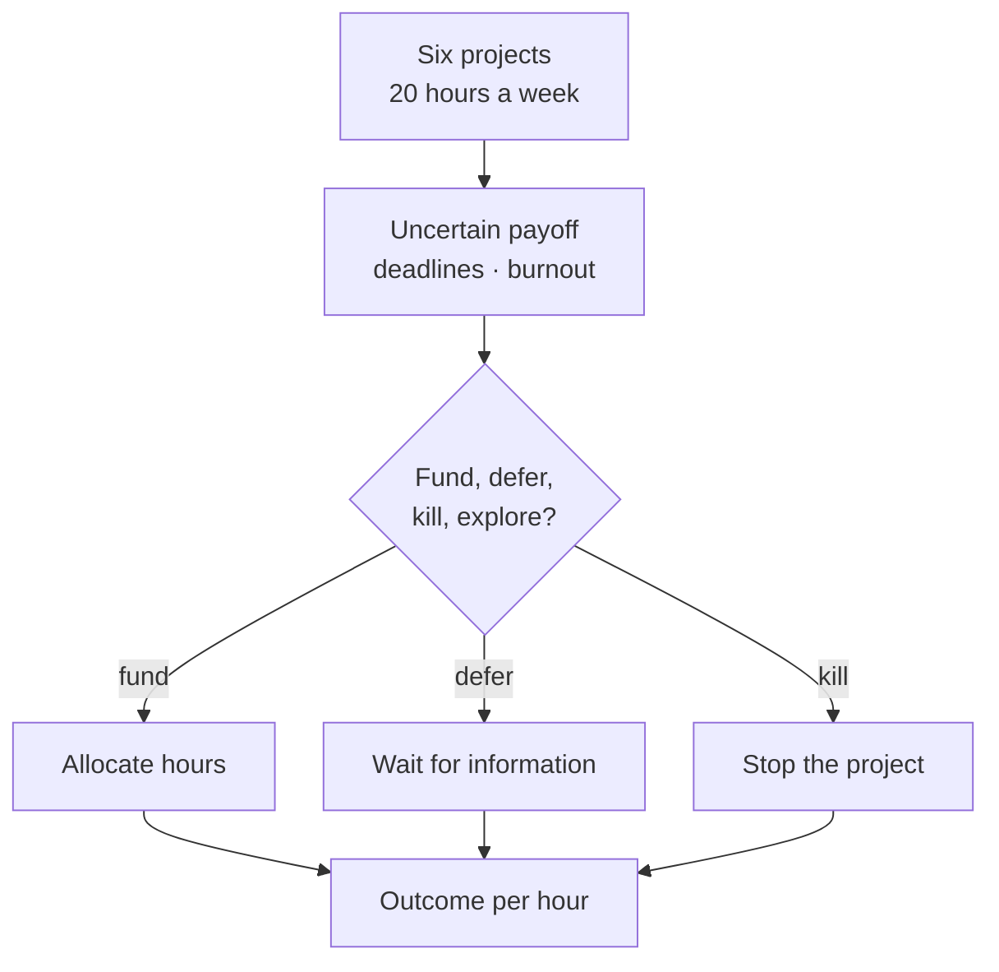

### 3.5 Causal outcome estimation

**The decision**

| Step | Detail |
|---|---|
| **1. Question** | Did our intervention actually work? |
| **2. Situation** | You change something, see a result later, and other things may have caused it too. |
| **3. Options** | continue · change · run a test · stop |
| **4. Goal** | know whether the change caused the result, and act on that |
| **5. Limits** | sample size · time · ethics · measurement quality |

**The case for LAIX**

| Step | Detail |
|---|---|
| **1. PPMA gap** | It records outcomes, but it does not design experiments or separate cause from correlation. |
| **2. LAIX solution** | Outcome learning. Measure: estimated causal effect · +15% measured improvement · confidence intervals. |
| **3. Algorithms** | causal inference · do-calculus · propensity scores · A/B/n design · off-policy evaluation · bandits with delayed feedback |
| **4. Build** | Type: Data + research · MVP: Weeks · Full product: Multi-quarter |
| **5. Impact** | It is how LAIX measures whether an intervention actually worked. |

**Example** — you moved study to 07:00 and your score improved. Was it the time, the material, or the sleep?

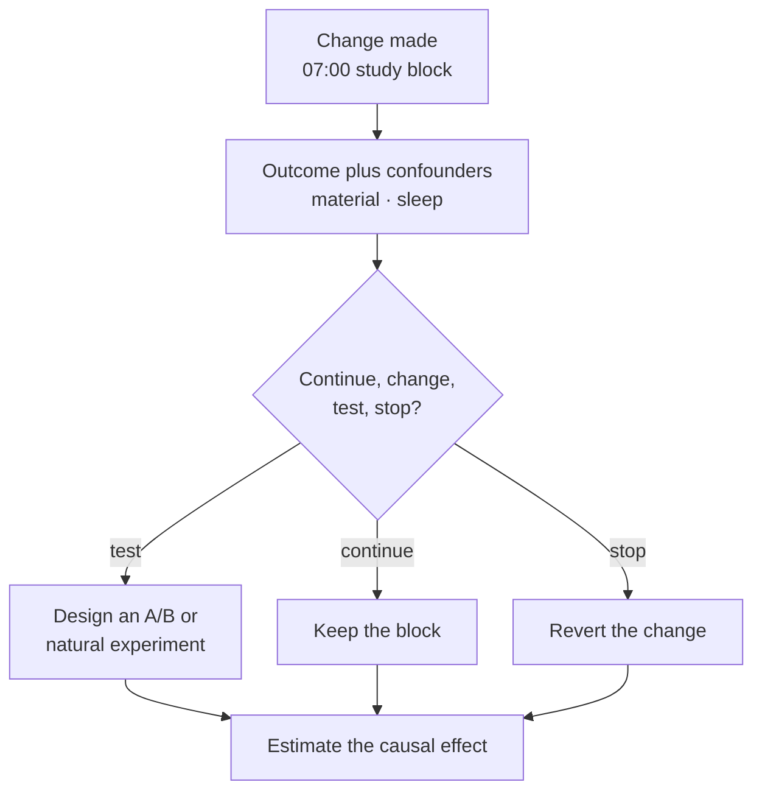

### 3.6 Strategic negotiation

**The decision**

| Step | Detail |
|---|---|
| **1. Question** | What should we offer next? |
| **2. Situation** | You know what you want; the other side has a hidden limit; the conversation has a history. |
| **3. Options** | open · hold · give ground · walk away · ask a person for help |
| **4. Goal** | get the best deal that is likely to be accepted, without taking too much risk |
| **5. Limits** | commitments · reputation · deadlines · legality |

**The case for LAIX**

| Step | Detail |
|---|---|
| **1. PPMA gap** | It can write a message and ask for approval, but it has no model of the other side, no plan for several rounds, and no sense of leverage. |
| **2. LAIX solution** | Execution bridge with approval + experience state. Measure: value captured · agreement rate · time to agreement · walk-away correctness. |
| **3. Algorithms** | game theory · POMDP negotiation · opponent modeling · mechanism design · concession strategies |
| **4. Build** | Type: Research + product · MVP: Weeks · Full product: Multi-quarter |
| **5. Impact** | Negotiation quality depends on the policy as much as the wording. |

**Example** — rent, a refund, or a deadline extension.

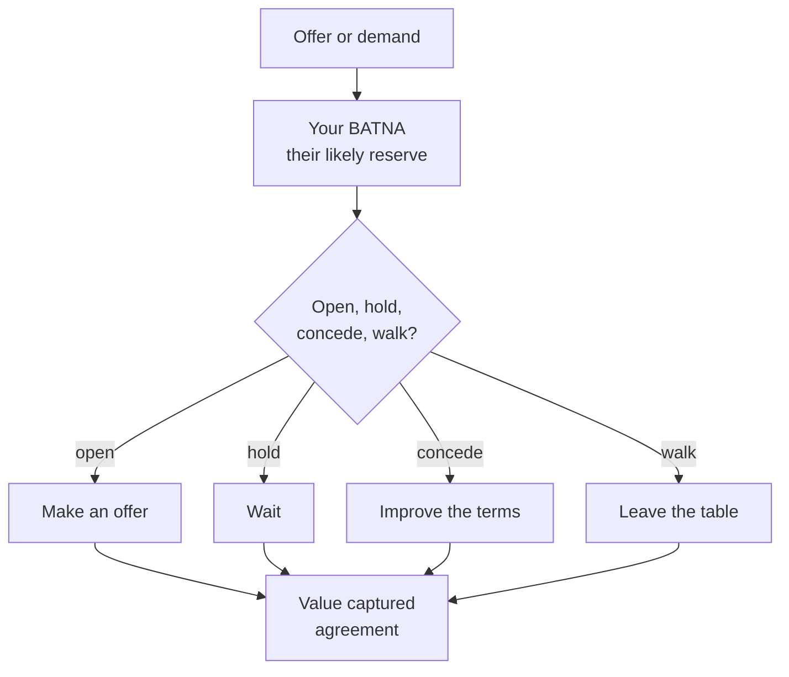

### 3.7 Multi-party coordination with private preferences

**The decision**

| Step | Detail |
|---|---|
| **1. Question** | How do we reach an agreement that people accept? |
| **2. Situation** | Several people share one resource, and each has limits they do not fully share. |
| **3. Options** | propose · ask · give ground · hand over to a person |
| **4. Goal** | an agreement that is accepted and fair, with little conflict and little coordination effort |
| **5. Limits** | privacy · existing commitments · vetoes · availability |

**The case for LAIX**

| Step | Detail |
|---|---|
| **1. PPMA gap** | It manages one person. It cannot represent other people’s preferences, bargain with them, or judge fairness. |
| **2. LAIX solution** | Multi-user experience state + decision engine. Measure: conflict-free weeks · accepted proposals · fairness · time saved. |
| **3. Algorithms** | DCOP · negotiation · fair division · mechanism design · planning with partial information |
| **4. Build** | Type: Product + research · MVP: A quarter · Full product: Multi-quarter |
| **5. Impact** | It turns LAIX from a personal assistant into a social decision layer. |

**Example** — four people, one car, and a week to schedule.

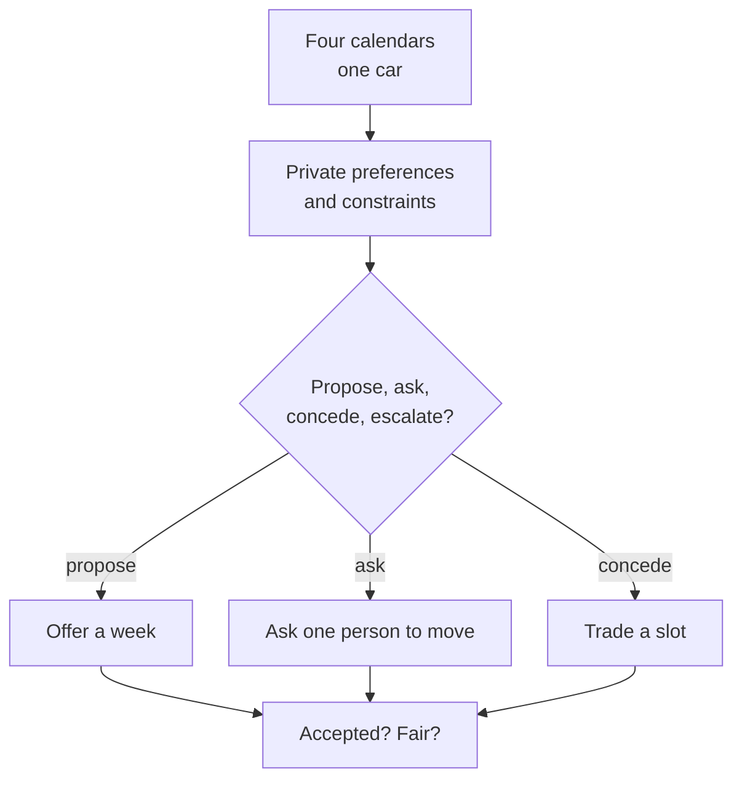

### 3.8 Fair allocation with incentives

**The decision**

| Step | Detail |
|---|---|
| **1. Question** | Who gets the scarce resource, and why? |
| **2. Situation** | Many people want the same scarce resource, with different needs and reliability. |
| **3. Options** | assign · put on a waitlist · rebalance · ask |
| **4. Goal** | cover as much need as possible, fairly, while keeping people willing to return |
| **5. Limits** | budget · eligibility · travel · incentives |

**The case for LAIX**

| Step | Detail |
|---|---|
| **1. PPMA gap** | It optimizes for one person. It has no fairness goal, no incentives, and no model of who will come back. |
| **2. LAIX solution** | Multi-user state + decision engine. Measure: coverage · fairness gap · volunteer retention · cost per fulfilled request. |
| **3. Algorithms** | fair division · matching · min-cost flow · mechanism design · incentive alignment |
| **4. Build** | Type: Engineering + economics · MVP: Weeks to a quarter · Full product: Multi-quarter |
| **5. Impact** | The hard part is keeping people willing to participate next month. |

**Example** — 200 volunteers, 40 requests, and a small budget.

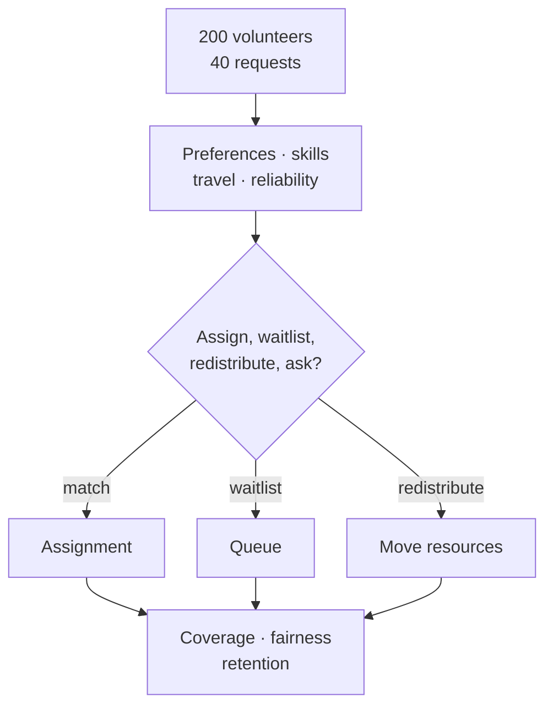

### 3.9 Safety-constrained action

**The decision**

| Step | Detail |
|---|---|
| **1. Question** | When is it safe to act? |
| **2. Situation** | The result is uncertain, the action cannot be undone, and rules apply. |
| **3. Options** | act · ask · check · wait · hand over to a person |
| **4. Goal** | get the benefit while staying inside a safety limit |
| **5. Limits** | zero unsafe actions · auditability · liability · consent |

**The case for LAIX**

| Step | Detail |
|---|---|
| **1. PPMA gap** | It can ask for approval, but it has no risk bound, no verification, and no liability model. |
| **2. LAIX solution** | Safety rules first, approval gates, verified execution. Measure: zero unsafe actions · audit completeness · false-refusal rate. |
| **3. Algorithms** | constrained MDP · CVaR · verification · shielding · human-in-the-loop escalation |
| **4. Build** | Type: Safety + research · MVP: Weeks · Full product: Multi-quarter |
| **5. Impact** | A wrong click is a loss. |

**Example** — sign a contract, pay, start treatment, or refinance.

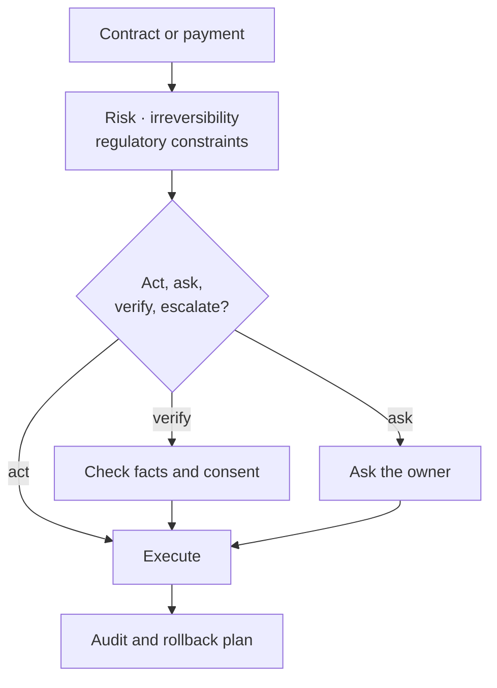

### 3.10 Preference elicitation under conflicting objectives

**The decision**

| Step | Detail |
|---|---|
| **1. Question** | What does the user actually want? |
| **2. Situation** | Several goals conflict, the user does not fully know their own priorities, and they want to avoid regret. |
| **3. Options** | decide · ask · wait · revisit |
| **4. Goal** | choose in a way the user will still endorse later |
| **5. Limits** | time · reversibility · the cost of asking |

**The case for LAIX**

| Step | Detail |
|---|---|
| **1. PPMA gap** | It acts on goals the user states. It cannot infer their tradeoffs or reason about regret. |
| **2. LAIX solution** | Experience state + decision engine. Measure: alignment with later choices · regret · reduced rework. |
| **3. Algorithms** | multi-objective optimization · inverse reinforcement learning · preference elicitation · decision analysis under regret |
| **4. Build** | Type: Product + research · MVP: Weeks · Full product: Multi-quarter |
| **5. Impact** | The hardest personal decisions are multi-objective tradeoffs under regret. |

**Example** — a promotion offer against family time.

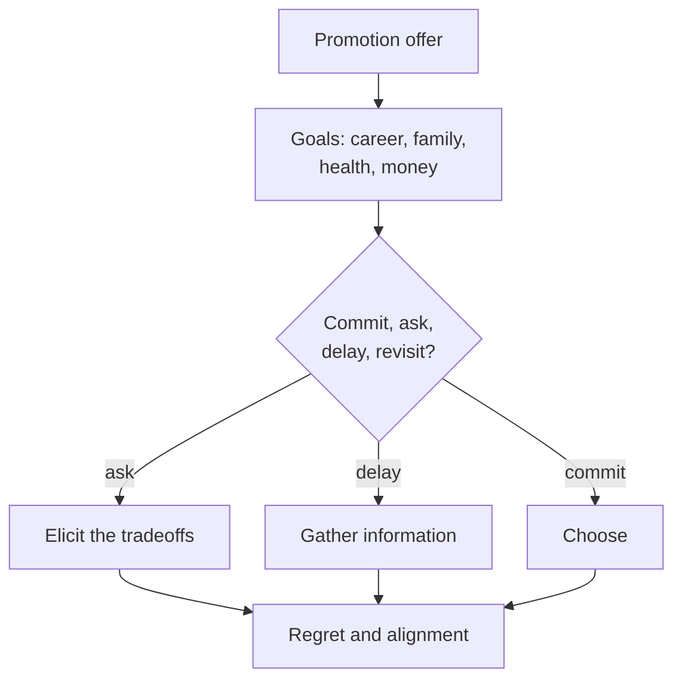

## 4. The decision map

The ten cards above differ along two simple dimensions:

- **How long the decision takes to play out** — from a single moment to a project lasting weeks or months.
- **Who is involved** — one owner, or several people and parties.

The map places all ten:

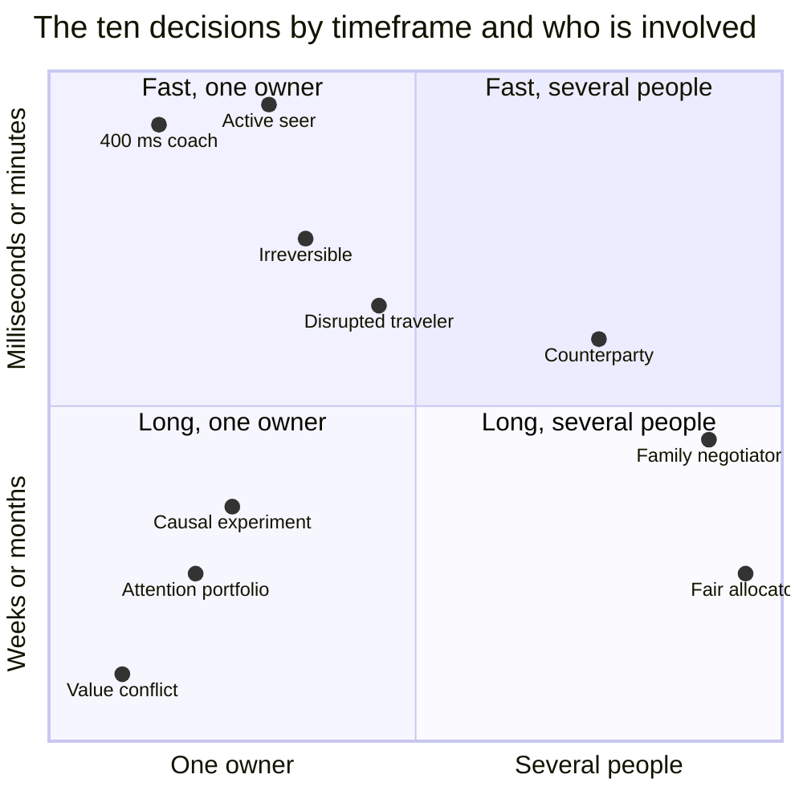

How to read it:

| Area | What it means | Decisions |
|---|---|---|
| **Top-left** | Fast, one owner | Real-time intervention, active perception, safety-constrained action, stochastic replanning |
| **Top-right** | Fast, several people | Strategic negotiation |
| **Bottom-left** | Long, one owner | Resource allocation, causal outcome estimation, preference elicitation |
| **Bottom-right** | Long, several people | Multi-party coordination, fair allocation |

The map is not a ranking. It shows that LAIX is not one use case: the same decision layer has to work
at different speeds and with different numbers of people.

## 5. Three proofs and a six-month plan

Three classes prove the engine:

1. **Real-time intervention** (the 400 ms coach) — timing.
2. **Causal outcome estimation** (the 07:00 study experiment) — learning.
3. **Multi-party coordination** (the family negotiator) — social coordination.

All three have a small or medium version; none needs the large research version to start.

| Phase | Weeks | Work | Gate |
|---|---|---|---|
| 1. Decide | 1–6 | Experience state, decision engine, coach baseline | First closed loop, ≤1 s |
| 2. Prove | 7–12 | A/B/n, causal attribution, off-policy evaluation, LAIX-Bench | +15% outcome, precision ≥80% |
| 3. Reuse | 13–18 | A second app on the same runtime; cost control | ≥60% reuse, −30% model calls |
| 4. Extend | 19–24 | One multi-party pilot, safety guardrails, SDK | Pilot data, paper, SDK v0.5 |

Ten people for six months is about five person-years. That is enough for one engine and three
proofs, not ten products.

## 6. The product

LAIX is a runtime and SDK for product teams building live AI apps. The end user never opens LAIX;
they feel the result in the app.

The first product is the decision layer behind a real reference app — not a new app studio, and not
another agent framework.

| Question | Answer |
|---|---|
| Who buys? | The product team building a live AI app |
| What do they get? | A decision layer: state, timing, action, verification and outcome learning |
| What do they stop building? | Their own timers, thresholds, confidence scoring and outcome loop |
| First reference app | The coach: one real app, one clear outcome |
| Proof targets | Intervention precision, +15% outcome, −30% model calls, ≥60% reuse |
| Price | A paid pilot, then an SDK/runtime licence or usage-based fee |
| Why not build in-house? | Time, evaluation data, reuse across apps, safety |
| What it is not | A model, an agent framework, or an app studio |

## 7. The ask

Fund one engine and three proofs for six months, with the coach as the first reference app. The
first customer is an app team; the first product is the SDK behind the coach.

## 8. Words used here

| Term | What it means in this document |
|---|---|
| **MVP** | The smallest version that is useful to real users. |
| **Full product** | The complete version, after the MVP. |
| **Weeks / quarter / multi-quarter** | One engineer / a small team / a research and platform effort. “Weeks to a quarter” means the MVP is small and the full product is larger. |
| **Type** | The main kind of work: engineering, data, research, product or safety. |
| **Situation (state)** | What the system knows at the moment. |
| **Choices (actions)** | What the product can do next. |
| **Goal (objective)** | What success means. |
| **Limits (constraints)** | What the product must not do. |
| **Live Context** | Watches the situation and decides when a deep model is needed. |
| **Experience State** | The app's picture of what is happening now. |
| **Decision Engine** | Chooses wait, ask, guide, act, verify or escalate. |
| **Execution bridge** | Runs the chosen action safely, with approval and recovery. |
| **Outcome Learning** | Measures whether the action helped. |
| **Resource policy** | Chooses model tier, edge or cloud, and when to skip inference. |
| **LAIX-Bench** | The evaluation suite for decision quality and outcomes. |
| **MDP / POMDP** | Planning when outcomes are uncertain; POMDP also handles hidden state. |
| **Bandit** | Choosing between options while learning which works best. |
| **DCOP** | Several decision-makers coordinating with private limits. |
| **Mechanism design** | Designing rules so people act in the system’s interest. |
| **Fair division / matching** | Dividing scarce goods fairly; pairing supply and demand. |
| **Causal inference** | Separating cause from correlation. |
| **A/B tests, propensity scores, do-calculus** | Tools for separating cause from correlation. |
| **Off-policy evaluation** | Judging a policy using data from an older policy. |
| **CVaR** | Controlling the worst-case tail of the risk. |
| **Shielding** | A safety filter that blocks unsafe actions. |
| **Verification** | Checking that an action met its safety and correctness conditions. |
| **Active perception** | Choosing where to look next. |
| **Stochastic scheduling** | Planning when the future is uncertain. |
| **Inverse RL / preference elicitation** | Learning what someone wants from their choices or answers. |
| **Constrained MDP / robust optimization** | Optimizing under hard limits and uncertainty. |
| **Real options** | Valuing the option to wait or change course. |
| **Min-cost flow** | Moving resources through a network at the lowest cost. |
| **Opponent modeling / concession strategy** | Predicting the other side and deciding when to give. |
| **Multimodal fusion** | Combining video, audio and text. |
| **Human-in-the-loop** | A person approves or takes over. |
