# PPMA, explained simply

*One document. No other reading needed. Written 28 October 2026.*

## 1. In one paragraph

PPMA is a memory-first manager. Apps report events from the **North**. PPMA turns them into memory,
decides what matters, and acts through the same apps. When it needs to think, it asks a model or
agent — **South** for one answer, **East** for a bounded mission. Other assistants may read its
memory from the **West**, but never write it. That is the whole design: facts in, memory kept,
decisions made, actions bounded.

## 2. What PPMA is

PPMA stands for **Persistent Proactive Management Agent**. It is an agent that helps you manage
ongoing projects — a course, a thesis, a job hunt, a lab, a move — over weeks, not one chat.

Three things make it different:

- **It remembers.** Its first job is to keep a living picture of your project: what is true, what is
  planned, what is at risk.
- **It acts on its own.** It watches what happens and decides whether to wait, ask, tell you, or do
  something.
- **It uses your real apps.** Mail, calendar, notes, code, chat. You do not move your life into a new
  app.

It is not a chatbot with memory. A chatbot waits for you. PPMA also starts things.

## 3. The four directions

Think of PPMA as the center of a compass: **North above, South below, West left, East right.** Each
direction is a **role**, not a step. You only need the sides you use.

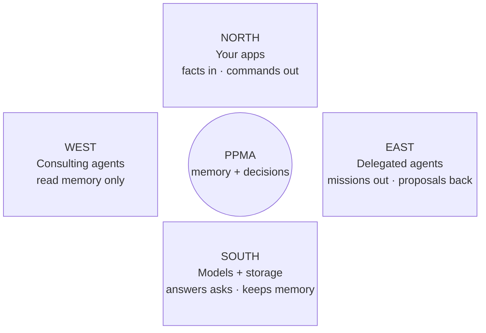

The positions are the point. North is literally above, South below, West on the left, East on the
right. The arrows of everyday traffic are in the loop diagram below.

| Direction | In plain words | Examples | What it can do |
|---|---|---|---|
| **North** | Your apps: ears and hands | Gmail, Calendar, Outlook, Obsidian, Git/GitHub, Feishu, Anki | Report facts; carry out commands |
| **West** | A friend who may read your notes | another chat assistant, your own tools | Read memory only |
| **East** | Hired help | Claude Code, Codex, OpenCode, JiuwenSwarm | Take a bounded mission, use tools, return a proposal |
| **South** | The brain and the notebook | an LLM, JiuwenSwarm as a model, SQLite | Answer questions; store what PPMA knows |

The compass shows **who is allowed to do what**. It is not a menu. One product can sit in more than
one direction. JiuwenSwarm is a good example: its model endpoint would be South, but its A2A agent
gateway is East. If you connect the gateway, PPMA treats it as East.

### Why South and East are not the same

Both use AI. The difference is what PPMA asks them to do.

| Aspect | **South** | **East** |
|---|---|---|
| Job | one question, one answer | one mission, many steps |
| Can it act? | no | yes: tools, files, commands |
| How long? | seconds | minutes to days |
| What PPMA gets | text or JSON | a proposal and artifacts |
| Risk | it may read data it should not | it may change things |
| Examples | OpenAI-compatible model, Claude API | Claude Code, JiuwenSwarm A2A |

A South model cannot delete a file. An East agent can. That is why East gets a sandbox, an
attestation and a stricter trust check, and why its work is only a **proposal** until PPMA commits
it.

## 4. Why not connect a North app straight to JiuwenSwarm?

A fair question: if JiuwenSwarm can plan and speak A2A, why put PPMA in the middle?

Because A2A is a **transport**, and PPMA is the **manager** around it.

**Direct: the app calls the agent**

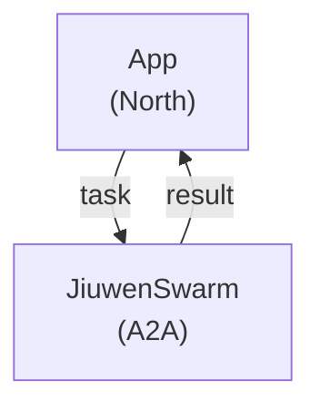

**Through PPMA: the app reports, PPMA decides, the agent is one engine**

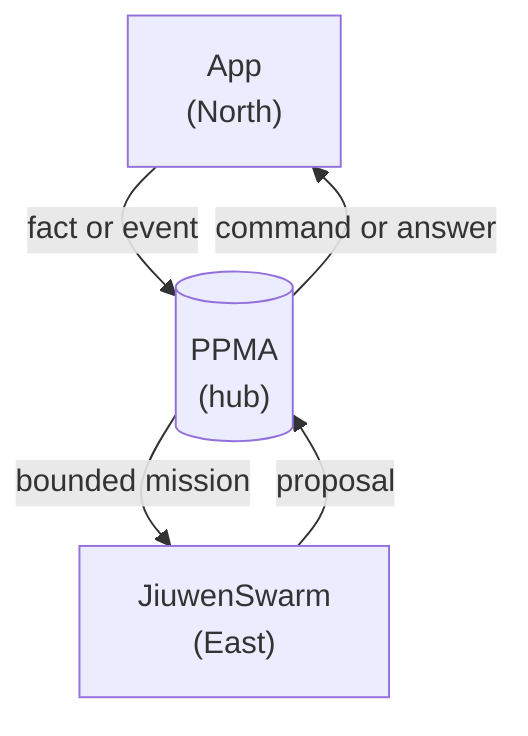

| Question | Direct to JiuwenSwarm | Through PPMA |
|---|---|---|
| Hops | one | two |
| Latency | lower | higher |
| Memory | the agent's session | PPMA's ledger, across apps and weeks |
| Proactivity | the app must schedule | PPMA's timers and plans |
| App contract | every app learns A2A | one north contract |
| Trust and privacy | every app implements it | one policy for every engine |
| Audit and "why" | every app implements it | built in |
| Confirmations and at-most-once | every app implements it | built in |
| Swap the agent | change every app | change one setting |
| Best for | one app, one short task | many apps, long projects |

**When direct is better.** One app, one agent, one short task, no history, no follow-up, no policy. A2A is the simpler architecture.

**When the hub is worth it.** The work spans apps and weeks; you need memory, proactive follow-up, privacy rules, confirmations and an audit trail. The extra hop buys a single source of truth.

**The cost.** PPMA must run, adds latency, and can refuse a request the policy does not allow. That refusal is the feature, not the tax.

One clarification about JiuwenSwarm: it is connected to PPMA over A2A and sits on the **East**. Using it as PPMA's main thinker is a separate choice from using it as a dispatch agent; in both cases it is one engine behind PPMA, not a North app.

## 5. The one loop

Everything in PPMA follows the same path.

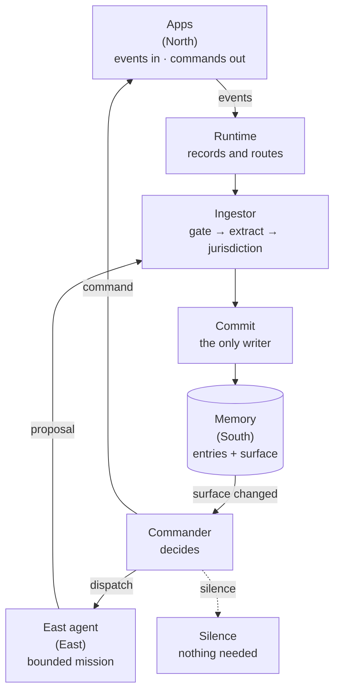

In words:

1. An app reports an **event**.
2. The **Ingestor** decides what it means and whether it is worth remembering.
3. **Commit** writes it. Nothing else may write memory.
4. Memory changes, so the **Commander** wakes.
5. The Commander decides: **command** an app, **ask** you, **dispatch** a mission, or stay **silent**.
6. Outcomes and answers come back as new events.

This loop is why PPMA can be proactive. It does not need you to start every turn.

## 6. What PPMA remembers

Memory is not chat history. It is a set of **entries**: one line of belief plus the evidence behind
it.

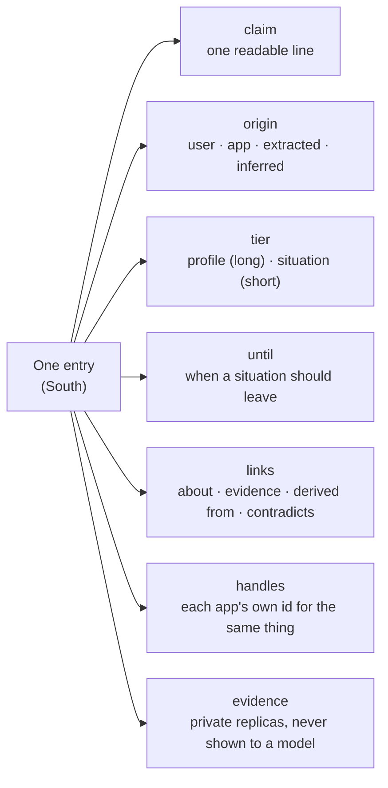

Two ideas matter:

- **Profile** entries last: preferences, goals, people, procedures.
- **Situation** entries expire: this week's deadline, the current risk, a commitment.

A **surface** is the rendered subset a model is allowed to see. Models never see the whole database.
They see a surface built for the task. This keeps prompts small and private data controlled.

## 7. The four things PPMA can do

| Action | Meaning | Example |
|---|---|---|
| **Command** | Ask an app to change something | Move a calendar block |
| **Ask** | Ask you a question | "Is this the deadline you meant?" |
| **Dispatch** | Hand a bounded mission to an agent | "Summarise this diff" |
| **Silence** | Decide nothing is needed | A low-value notification |

Silence is a real outcome. An agent that always answers is noisy.

## 8. Everyday scenarios

### 8.1 A class time changes
*Google Calendar and Obsidian are linked.*

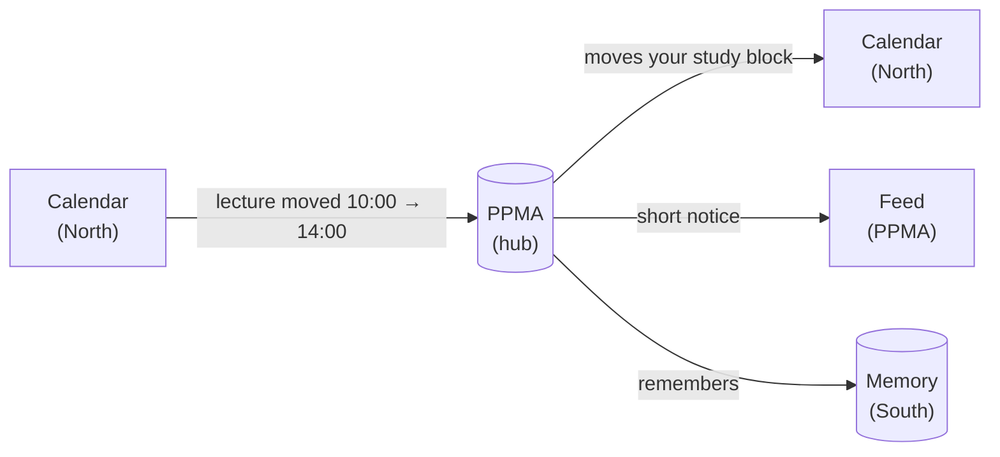

- Calendar reports the change.
- PPMA updates its picture.
- It sees a clash with your study block and moves the block.
- It tells you in the Feed.

No agent is needed. This is memory plus a rule. **North + South.**

### 8.2 "Summarise my notes"
*Obsidian is linked read-only. JiuwenSwarm is the East agent.*

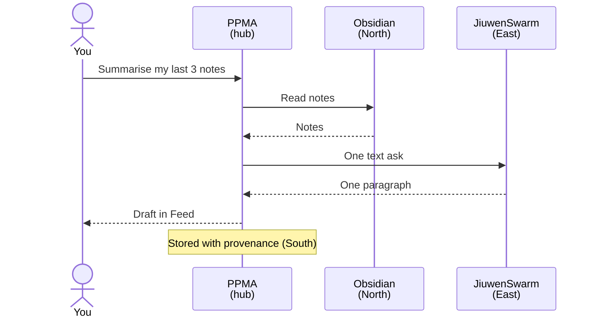

Obsidian is read-only, so PPMA shows the paragraph instead of writing it into your vault. If you
allow writes, it can create a note — after asking.

**North + East + South.**

### 8.3 The email you keep forgetting
*Gmail is linked read-only. Calendar can be changed.*

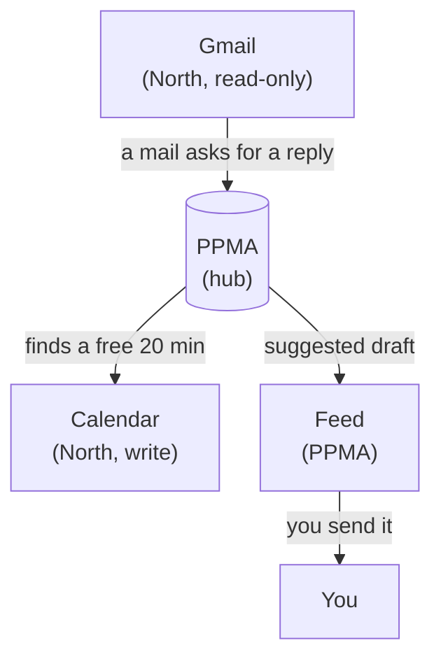

PPMA cannot send the mail. It books the time and shows a draft. The connector's read-only limit is
respected, not worked around.

**North + South.**

### 8.4 The code review
*Git & GitHub is linked. JiuwenSwarm is the East agent.*

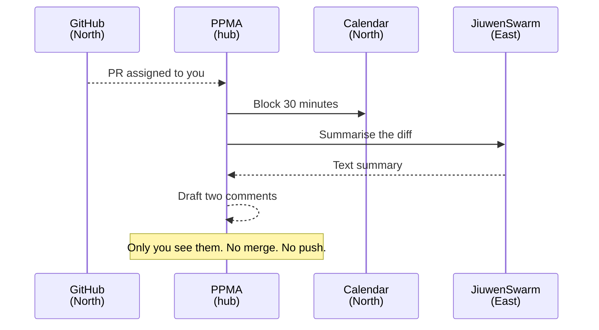

JiuwenSwarm only reads the final text answer. PPMA drafts comments; you decide.

**North + East + South.**

### 8.5 "What did we decide?"
*You use a chat assistant that can read PPMA's memory (West).*

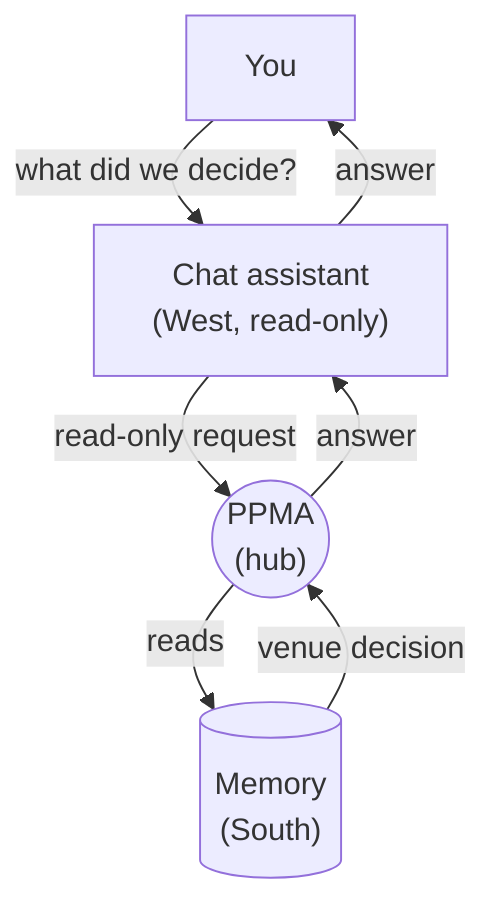

- You ask: "What did we decide about the venue?"
- It answers from memory: "The 12th, at the library, 3pm."
- It cannot change anything.

West is read-only on purpose. A consulting assistant should not be able to rewrite your memory.

**West + South.**

### 8.6 The noisy group chat
*Feishu is linked.*

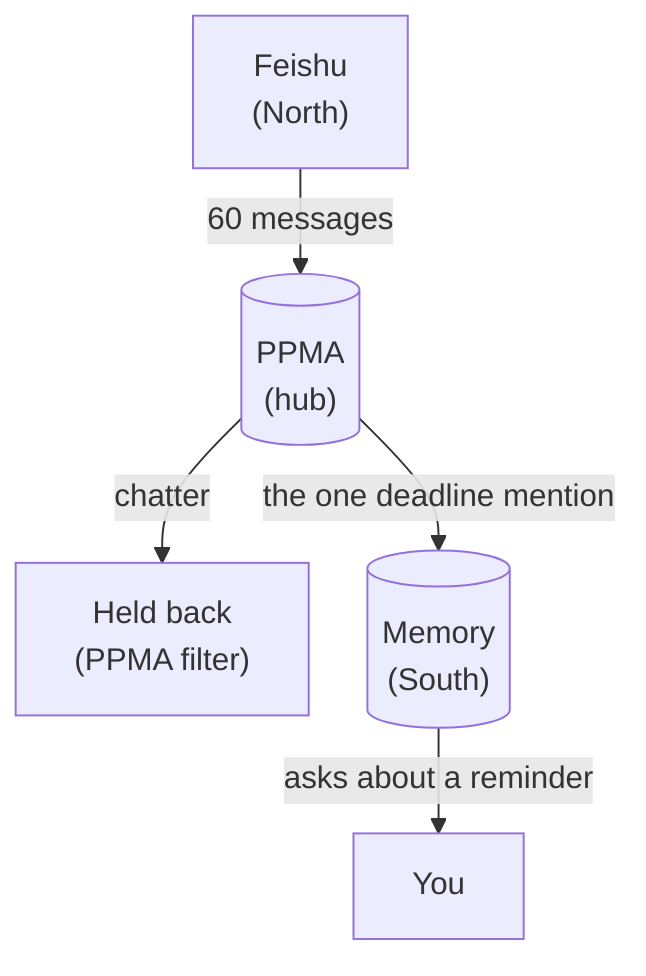

PPMA listens without drowning. You can review and lift held-back rules in **What PPMA holds back**.

**North + South.**

### 8.7 The mission that cannot run here

You ask PPMA to fix a failing test in a repository.

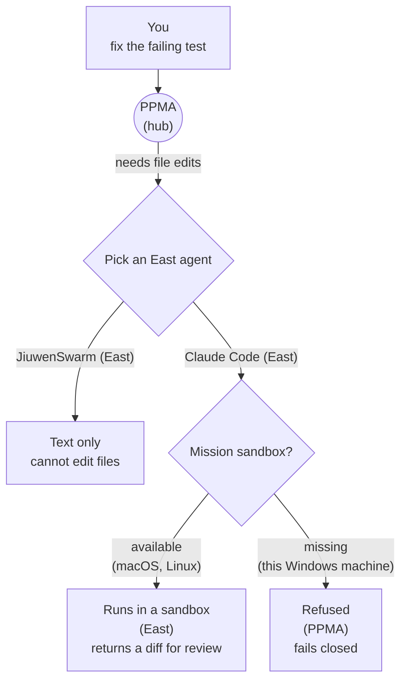

- That needs an agent that can edit files — **East**.
- JiuwenSwarm returns text only. It cannot do this.
- Claude Code could, but this Windows machine has no mission sandbox.
- PPMA refuses rather than run it unsafely.

On macOS or Linux, or with the explicit unsandboxed opt-in, the mission would run with a workspace
and return a diff for review. The rule is simple: **agents that can change things face stricter
checks.**

## 9. The algorithms inside

Most of the “intelligence” sits behind one `ask` boundary. The interesting code is the deterministic machinery around it: what the model sees, what PPMA believes, what it may do, and how it recovers.

### 9.1 Calibrated confidence

A model's “90% sure” is not 90%. PPMA maps it to a probability checked against outcomes.

- Cold start: shrink the raw score toward a configured prior, with the raw score weighted at most 0.5.
- After enough judged outcomes, use a beta-binomial posterior per bucket.
- Buckets: phase, origin, target app, command type, and raw-confidence band.
- Only **asked** outcomes count. Auto-executed commands and silence are excluded: auto execution was chosen by confidence, so counting it would create a feedback loop.

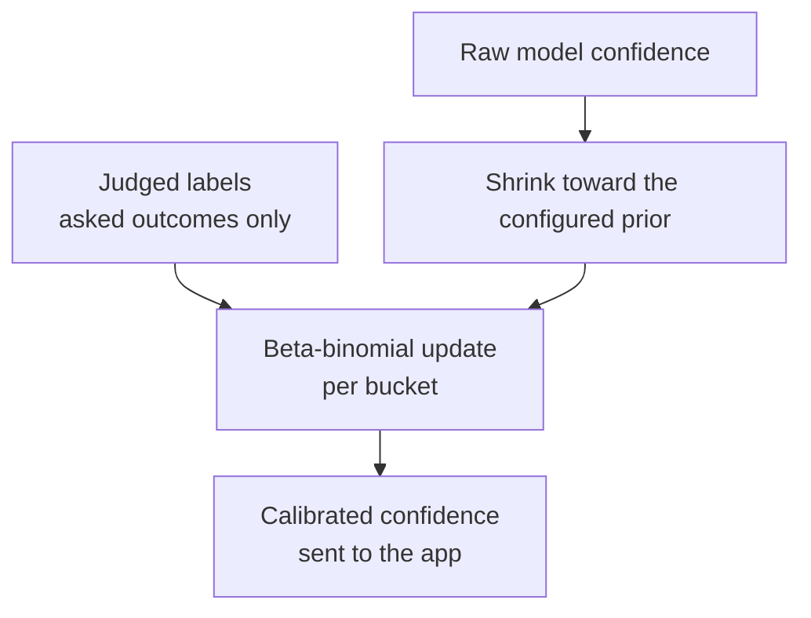

**Why it matters:** the number an app receives is a claim about correctness, not a model's mood.

### 9.2 Choosing what the model sees

Before every ask, PPMA picks the part of memory that matters. It is lexical, deterministic and budgeted.

- Normalize text: NFKC, case-fold, drop filler and words shorter than three letters, reduce contractions to stems.
- Score on shared content words, shared IDs, same app, links, and open or held work.
- Pack `must` entries first: open work, held work, and entries holding an item ID the ask names.
- Pack durable `profile` entries next, capped at half the budget.
- Fill the rest by score until the token budget is reached.

Budgets differ by task: 4k for the gate, 6k for the exit check, 32k for jurisdiction and decide.

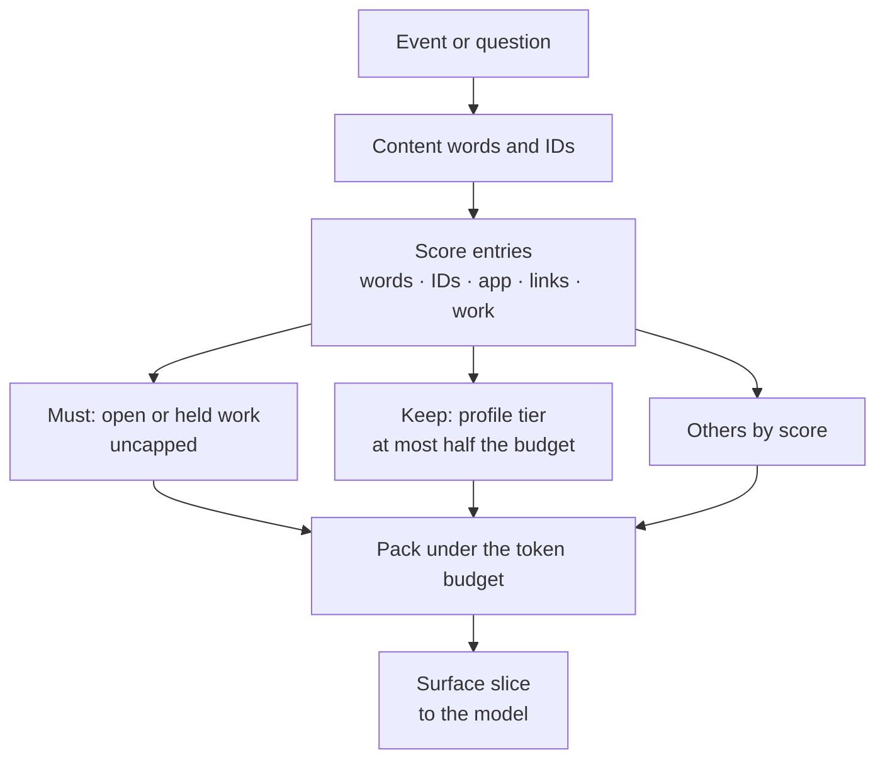

**Why it matters:** no embeddings, no vector database, and the same event always produces the same slice.

### 9.3 The surface as a cache

The prompt is rendered as an append-only **base** plus a **changes log**, so a provider's prefix cache stays warm.

- A changed entry appends a new line; a later line for the same ID supersedes the old one.
- A removed entry gets a removal marker; its old line stays in the cached base.
- The base rebases when there is no base yet, after ten idle minutes, when an answered item leaves, when the log costs as much as a rebase, or when dead lines pass 25% of the base.
- The cost model assumes cached input is about ten times cheaper than uncached.

There is also a size-control loop: the trim trigger is `max(base, after × 1.25)`, resistance rises at 0.5× and 1.0× the base, and a failed trim does not raise the trigger.

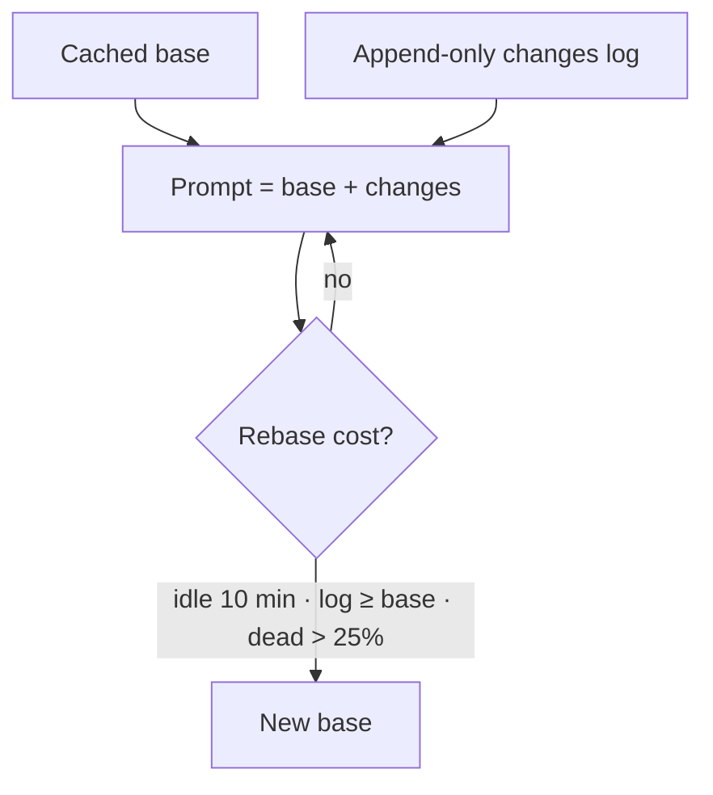

**Why it matters:** the surface is a data structure tuned to how providers bill.

### 9.4 Belief revision

A contradiction does not delete the old record. It marks the record `challenged` and names the entry that prevails.

- The claim **stated last** wins.
- At the same moment, the user's explicit correction beats an app's record.
- Two apps disagreeing leaves the contradiction open.
- A user's correction gives way when the app states its record anew; finding that record walks the `replaced_by` lineage plus a contradiction index.

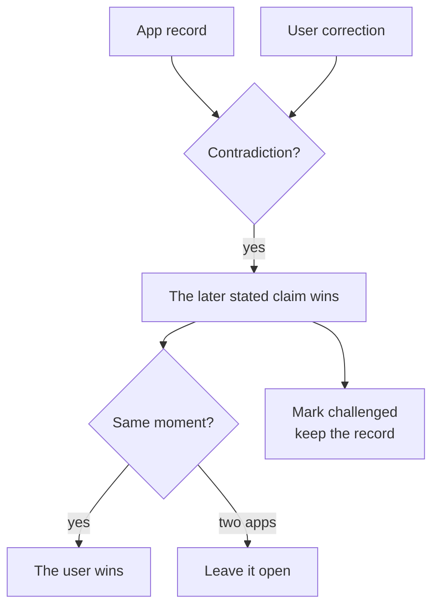

**Why it matters:** memory may disagree with itself, but it must not forget why.

### 9.5 Nine guarded primitives

The model proposes changes; only nine primitives can apply them. The rules hold whatever it answered.

- `origin` and `source_app` come from the event, never from the model.
- User and app claims have confidence 1.
- An app's record changes only by that app or the user.
- Links and evidence are additive; a link is never duplicated.
- Held work cannot be superseded or duplicated.
- A retired entry cannot be changed, only linked to or replaced.

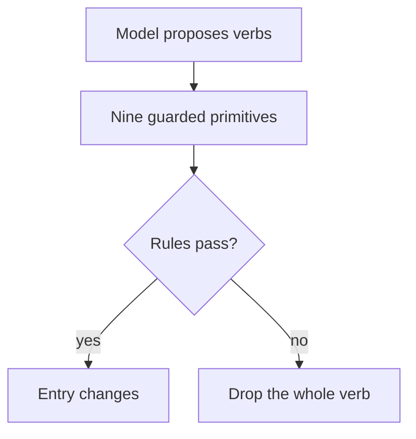

**Why it matters:** a small state machine turns model output into safe transitions.

### 9.6 Missions: lifecycle, locks, dependencies

Long work needs more than a prompt.

- Lifecycle is a pure transition from `(lifecycle, execution condition)`. `unknown` counts as possibly live, so an unconfirmed stop blocks a restart.
- Locks are all-or-nothing over canonical keys. An unknown resource takes a space-wide lock.
- A new owner epoch may take over only after the previous termination is confirmed.
- Dependencies are typed: `ledger:<seq>`, `decision:<id>`, `entry:<id>`. Holds, failed ingestions and cross-space refs never satisfy one.
- The scanner walks routes round-robin in bounded batches and never advances past unregistered work.

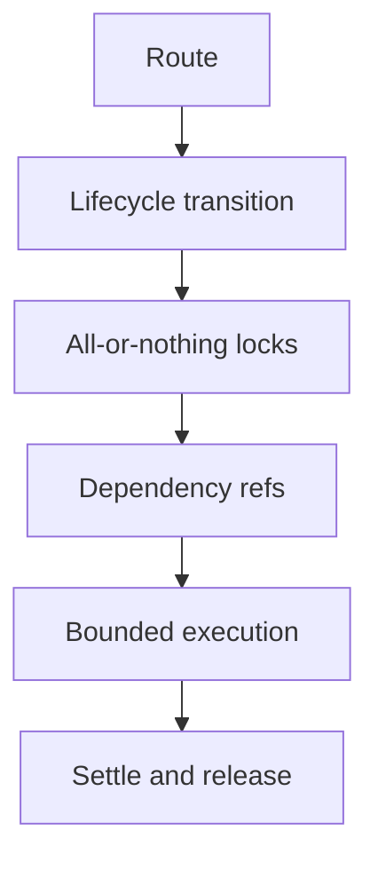

**Why it matters:** leases, fencing and at-most-once thinking inside a personal agent.

### 9.7 What actually happened

A mission proposes an effect; PPMA issues it; the app reports what happened.

- Item IDs are read schema-agnostically: any key named `id` or ending `_id`, including nested values, while ignoring `accepted`, `rejected`, `args` and `closest`.
- Only events inside `[issued_at, issued_at + 7 days)` count; an event at the close does not.
- The later verdict stands; earlier evidence is kept.
- Silence is **unconfirmed**, never “contradicted”.

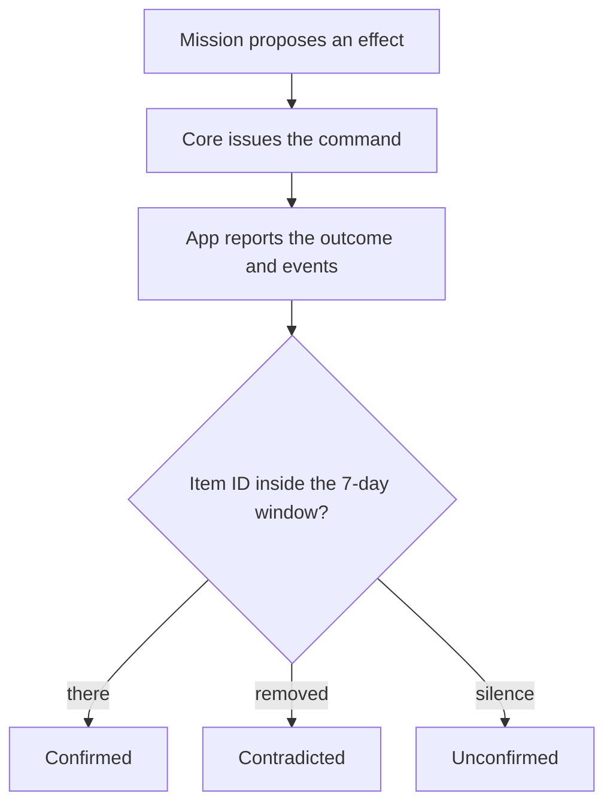

**Why it matters:** absence of evidence is not evidence of absence.

### 9.8 Timers that survive a restart

Timers are committed state, not in-memory cron.

- A timer is a state record written by the Core.
- The scheduler reconciles sleepers against state on every refresh.
- A fired trigger carries the record version, so stale work is rejected.
- A failed handler leaves the timer pending; it re-arms after a short grace.
- One version is re-fired at most three times for transient failures.

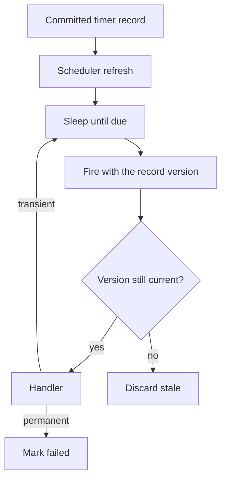

**Why it matters:** the event loop can restart without losing or duplicating a timer.

### 9.9 Learning how much risk a tool may take

Calibration estimates correctness; this controls confirmation.

- Only explicit user judgments count; auto execution is never positive evidence.
- A wrong auto execution permanently marks that command and raises the tool's threshold by 0.1, up to 0.95.
- Adjacent wrong autos can switch the tool to “always ask”.
- Only the last ten asked judgments are kept.

```mermaid
%%{init: {"flowchart": {"nodeSpacing": 30, "rankSpacing": 30}, "themeVariables": {"fontSize": "16px"}}}%%
flowchart TB
    J["Asked judgment"] --> L["Tool policy"]
    W["Wrong auto execution"] --> M["Permanent marker for that command"]
    M --> T["Threshold +0.1<br/>cap 0.95"]
    T --> L
    L --> C["Next command"]
```

**Why it matters:** online threshold control with hysteresis, resistant to reward hacking.

### 9.10 Measuring itself honestly

The attention report treats missing outcomes as missing.

- Commands are grouped into UTC-day cohorts.
- A fixed ledger head is used, so unanswered commands are censored, not counted as failures.
- It reports a Brier score, ten reliability bins, and the autonomous share.
- The scan is `O(entries)`, not `O(days)`, because a late outcome can answer an old command.

```mermaid
%%{init: {"flowchart": {"nodeSpacing": 30, "rankSpacing": 30}, "themeVariables": {"fontSize": "16px"}}}%%
flowchart TB
    L["Ledger"] --> C["UTC-day cohorts"]
    C --> H["Fixed head<br/>censor unanswered"]
    H --> B["Brier score + reliability bins"]
    B --> R["Report"]
```

**Why it matters:** survival-analysis thinking applied to the agent's own actions.

### 9.11 The smaller algorithms

| Algorithm | What it does |
|---|---|
| **Reply-language selection** | Parses explicit instructions and negation, compares Han characters with Latin words, falls back to the last clear turn, and distinguishes Simplified from Traditional. |
| **Batch chunking** | Packs whole UTC days under a 60k-character target, never cuts an event, and summarizes inline `data:` URIs by type and size. |
| **Transcript compaction** | Rebases a Worker transcript at 2× its base (2000-token floor), resets it into label-covered partitions, and keeps the handoff note only for specific reasons. |
| **Flow “limited” reduction** | A limited clearance lets only arguments tagged `time` or `title` through; every other value is removed. |
| **Rule 15 holding** | A decision table over holder, hardness, hand-over and claim support decides hold, ask, claim or release. |
| **Task routing** | `task@media` → exact task → longest dotted prefix → default. |

These are smaller, but they follow the same pattern: deterministic rules around a probabilistic model.

**Where to look.** `core/calibration.py`, `core/ingestor/closeness.py`, `core/surface/layout.py`, `core/surface/challenges.py`, `core/surface/primitives.py`, `core/mission_control/`, `core/effects.py`, `runtime/timers/scheduler.py`, `core/policy_learning.py`, `runtime/observe/attention.py`.

## 10. What PPMA will not do

- It will not let an app command another app. Apps report facts; PPMA decides.
- It will not let a mission write memory directly. Mission output is a proposal.
- It will not write memory from anywhere except the one commit path.
- It will not scan your ports or guess at apps. An app must register itself, or be a known connector.
- It will not send from a read-only app. Limits stay limits.
- It will not pass a model's raw self-confidence to you as fact. Confidence is calibrated.

## 11. What is built today

As of 28 October 2026:

| Part | State |
|---|---|
| **North** | Contract v0 and the app SDK work; eight connectors (Gmail, Google Calendar, Outlook, EventKit, Git & GitHub, Obsidian, Feishu, Anki) |
| **South** | SQLite and in-memory storage; fake, recorded and live model adapters |
| **East** | Claude Code, Codex, OpenCode and JiuwenSwarm A2A; the mission sandbox works on macOS/Linux, not yet on Windows |
| **West** | Read-only memory views, explain and converse endpoints exist; the packaged MCP door is still planned |
| **Core** | Ingestor, Commander, plans, calibration, memory surfaces |
| **UI** | Web GUI at `/app/` and an Electron desktop shell |
| **Missions** | Bounded dispatches; managed missions are opt-in |

## 12. A concrete setup

This is one real setup, on one Windows machine:

- PPMA runs at `http://127.0.0.1:8765/app/`.
- Its main agent is **JiuwenSwarm (A2A)** at `http://127.0.0.1:19100/a2a`.
- JiuwenSwarm's web UI on port 5173 is a different thing. It is not the A2A endpoint.
- No North apps are linked yet. That is why **Configure app** is empty.
- JiuwenSwarm is text-only: good for summaries and drafts, not for editing files.
- Claude Code and OpenCode are blocked by the missing Windows sandbox.

The shortest description of this setup: **PPMA is the hub; JiuwenSwarm is its East agent and its
current thinker; memory is local; the apps are still to come.**

## 13. Glossary

| Word | Meaning |
|---|---|
| **Event** | Something that happened, reported by an app or the user |
| **Entry** | One thing PPMA believes, with its evidence |
| **Surface** | The rendered view of memory that a model is allowed to see |
| **Command** | An instruction to an app |
| **Dispatch / mission** | Bounded work handed to an East agent |
| **Ask** | A question to a model or to you |
| **Connector** | The adapter for one existing app |
| **Engine** | A model or agent PPMA can call |
| **Provenance** | The record of why PPMA believes or did something |
