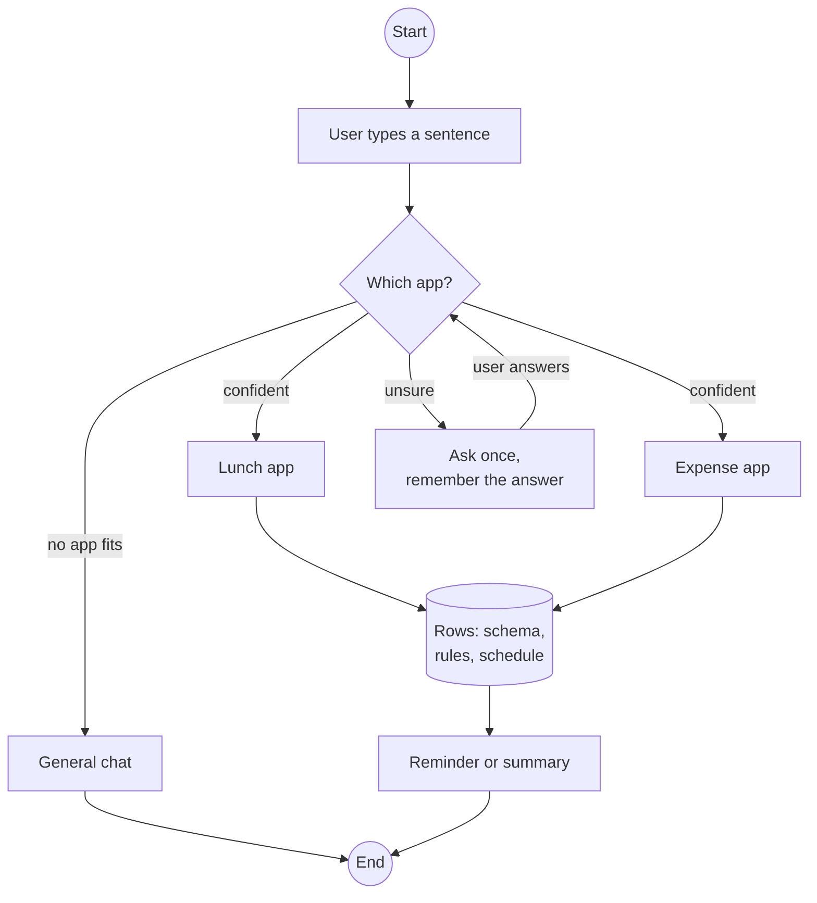
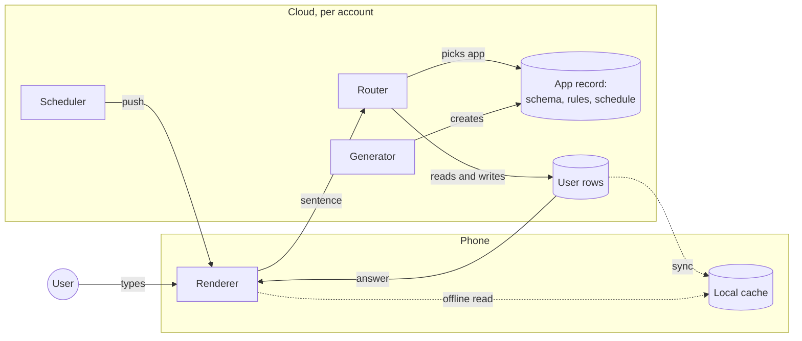

# Personal apps that hear you

*Our proposal for a direction, not a company roadmap. Market claims are sourced; numbers we would
have to earn are marked as targets.*

*Last updated: 2026-11-04. Status: proposal, no work started.*

## The user

A person wants one small thing: a place to log lunch, and a nudge at 12:30 if she has not eaten.

She has three bad options.

- **The app store.** Install a product built for millions — account, ads, permissions, onboarding —
  to use one feature that is buried inside it.
- **The chatbot.** It works for a day, forgets the shape of her log, and cannot remind her at 12:30.
- **The no-code builder.** She describes the app and gets one. Now she owns a URL she must remember
  to open, on a phone she will replace, in a tool she has no reason to return to.

So she does none of it. The need is real, small and personal, and the market only sells it in sizes
that do not fit.

## The problem

**Personal software has no home between an app store and a chat box — and once it is built, the app
cannot hear the person where they already talk.**

That is the industry gap, not a product gap. Today's builders — of which there are now many — all end
at the same place: *here is your app, open it.* The user then has to remember it exists, find it, and
speak inside it. The app gets a database and a schedule and no ears.

The moment she types "I ate a sandwich" into the assistant she already uses, nothing knows that this
belongs to the lunch app she built two weeks ago.

## What we propose

**One conversation, several personal apps, and a router that knows which one is being spoken to.**

An app is a small record in one shared runtime — schema, rules, schedule, UI description and the
user's rows — and the router decides which record hears each sentence. One runtime serves every app;
nothing gets its own container.

| Today | Proposed |
|---|---|
| The app is a destination you open | The app hears you inside the conversation you already use |
| You must remember it exists | It answers when the sentence belongs to it, and stays quiet otherwise |
| Routing is the user's job | A router decides, shows which app is active, asks once when unsure |
| Data sits inside the app | The app is a record: schema + rules + schedule + data, served by one runtime |

**The parts:**

1. **The router.** Classify each sentence: general chat, or one of this user's apps. Above a
   confidence threshold it routes; below it, it asks once and remembers. The active app is visible,
   and one tap returns to general chat.
2. **The runtime.** Apps are data; actions call skills that already exist; a shared scheduler sends
   reminders and summaries. Idle apps sleep and wake on use.
3. **The account.** Apps and history belong to the account, not the phone — so they survive a new
   device and can be exported or deleted.
4. **The catalogue.** Three templates — food log, habit streak, expense tracker — so the first app is
   useful before the user invents anything.

Parts 2–4 are table stakes, already shipped by others. The router is the only part that is ours.

## Where it runs

Hybrid, and the split is forced rather than chosen.

| Piece | Where | Why |
|---|---|---|
| App definition | **Cloud**, per account | Must survive a new phone and be shareable |
| User data | **Cloud**, per account | Same, plus backup and cross-device |
| Rendering | **Phone** | It is the screen; also keeps offline reading |
| Scheduler | **Cloud** | A phone cannot reliably wake an app at 12:30 when it is closed |
| Generation | **Cloud** | Too heavy for the device, and needs the model |

*Read it left to right: the user speaks on the phone; the cloud decides which app, reads and writes its rows, and sends the answer back to the same screen. The scheduler pushes reminders; the cache keeps the app readable offline.*

Phone-only fails on every requirement that matters: no cross-device, no reliable reminders (both
HarmonyOS and Android throttle background work), no sharing, and uninstalling loses the history.
Cloud-only fails on the other side: the UI still has to render locally, and offline reading matters.

**The prerequisite we cannot skip: the host needs accounts.** DigitalMate Web is deliberately
account-free and local-first today; while that is true, this feature can only live on the device and
loses the point. So the first decision is not "cloud or phone" — it is whether DigitalMate gets
identity at all.

**For China**, the cloud side runs in-country (Huawei Cloud) for data residency. That is a launch
constraint, not an optimisation.

## What already exists, and how close it is

Building, hosting and persistence are commodity. This is the evidence, not the lead:

- Baidu's **Miaoda** takes a sentence, builds an app, deploys and hosts it, with a database and a
  domain, and reached [200,000 apps in four months](https://hub.baai.ac.cn/view/48029).
- Alibaba's **Qwen Go** added **My Apps**: describe it, get it built and deployed, shareable, with
  access to the user's own data in Taobao, Amap, Damai and Quark
  ([25 October 2026](https://tech.ifeng.com/c/8xVoOh3h24V)). It runs on Alibaba Cloud's
  **Meoo (秒悟)** app-building platform behind Qwen Go's cloud Pro, is **invite-only**, and is not
  open source — so its routing behaviour cannot be inspected from outside.
- ByteDance's **Coze** builds agents and apps, open source, with long-term memory and background
  execution on cloud devices ([coze.cn](https://www.coze.cn/)).
- Google's **Opal** built no-code mini-apps and is
  [leaving Labs on 17 November 2026](https://opal.google/), with its workflows folded into Gemini
  skills.

The category's problem is not capability — it is that people try it and leave. Meta's AI feed
**Vibes** runs at [about 2M daily against 30M monthly](https://www.socialmediatoday.com/news/data-shows-that-metas-ai-based-vibes-feed-is-struggling-to-hold-attentio/805862/),
and Gartner expects [more than 40% of agent projects to be cancelled by end-2027](https://www.gartner.com/en/newsroom/press-releases/2025-06-25-gartner-predicts-over-40-percent-of-agentic-ai-projects-will-be-canceled-by-end-of-2027)
over cost and unclear value.

**How close the incumbents are.** Qwen Go's My Apps already lives inside the Qwen assistant, so the
remaining question is narrow: does a sentence typed in the main chat reach the app the user built?
We have not found a source showing that it does. If it does, this proposal loses its reason.

**Confidence:** low-to-medium. The capability gap is unverified in both directions, which is why the
first task is a check, not code.

## What we still do not know

Four questions decide whether this is a project or a dead end. None can be answered from outside the
product.

1. **Does the main chat reach the app?** In Qwen Go, does “I ate a sandwich” reach an app built in My
   Apps, or must the user open it first? *How to check: apply to the invite-only beta and test it.*
2. **Does the app persist?** Does it keep data and run schedules after the session ends, or is it a
   page that lives only while open? *How to check: the same beta, over several days.*
3. **How does sharing work?** A live link with data, or a copy of the definition? Can a recipient
   edit it? *How to check: the sharing flow in the beta.*
4. **Could we use Meoo instead of building a runtime?** It is Alibaba's platform under a consumer
   feature; if it is sold commercially, the runtime is not the work. *How to check: ask Alibaba Cloud,
   as a customer.*

Until these are answered, the status is unverified — and the first one can kill the proposal.

## What the build involves

Ten work items, none of which is "generate the app".

**Making an app live**

- **Provisioning** — create, update and delete an instance: retry-safe, resumable after a crash, undone in reverse order (storage, jobs, tokens, routes).
- **Tenancy** — every row, cache and log tied to one person; quotas per account; one test that proves A never sees B, run on every commit.
- **Change** — three versions tracked at once (app, platform, data), with a migration that runs per app and can be rolled back.
- **Time** — reminders and summaries that survive time zones, daylight saving, downtime and duplicate delivery, testable with a clock you can move forward.
- **Routing** — the only part nobody else has: labelled examples, a confusion matrix, a threshold that prefers asking over guessing, and a visible sign of which app is listening.

**Making it useful and debuggable**

- **The app description** — fields, actions, schedules, screens, limits: the contract every other part reads, and the most expensive thing to change later.
- **Actions** — a scope, an approval rule for anything irreversible, a retry key, and a defined failure.
- **Cross-app questions** — one index over every user's rows, so "what did I eat last week" can be answered and attributed to the app it came from.
- **Visibility** — every request replayable: which app, what confidence, what ran, what changed; plus fixture users and golden sessions.
- **The boundary** — who owns accounts, rendering, storage and scheduling, agreed before code.

Generation itself is the easy part: a validator and a repair loop over the schema.

## What we would measure

| Metric | Target | Why |
|---|---|---|
| Routing accuracy | ≥ 95% on the user's own sentences | Below this, the assistant feels broken |
| Wrong-app rate | ≤ 2% | One misfire costs trust in the whole product |
| Second-app creation | ≥ 25% of users within 30 days | The bet only pays if users build more than one |
| Week-4 retention of created apps | above the category baseline, measured at gate 1 | The category's known failure; no public baseline to copy |
| Cost per idle app per month | ≤ $0.05 | Idle apps must not cost |
| Time from request to first use | under a minute | The only advantage over an app store |

## What we would not build

- Arbitrary user code execution, or a container per app.
- An app store or a marketplace.
- A new model.
- A second assistant: the router lives inside the assistant the user already talks to.

## Risks

| Risk | What it would look like | Response |
|---|---|---|
| Routing already exists | An incumbent ships it before we start | Check first; if true, stop |
| People build only one app | No routing problem to solve | The first template must be useful alone; measure second-app creation |
| The router misfires | "I ate…" answered by general chat | Measure it first; confirm when unsure; show the active app |
| The platform absorbs it | The host ships the same thing as a feature | Stay a routing and record layer, not a builder |

## Where it would sit

A proposal for a product surface that already has an assistant and an account, with the router and
runtime built once and reused. It is a feature of the assistant, not a new product: the value is the
routing and the accumulated history, not the builder.

The first question is not technical: **does the host product have an account and a shared place to run
one service?** Without both, this becomes a local-only feature and loses the point.
